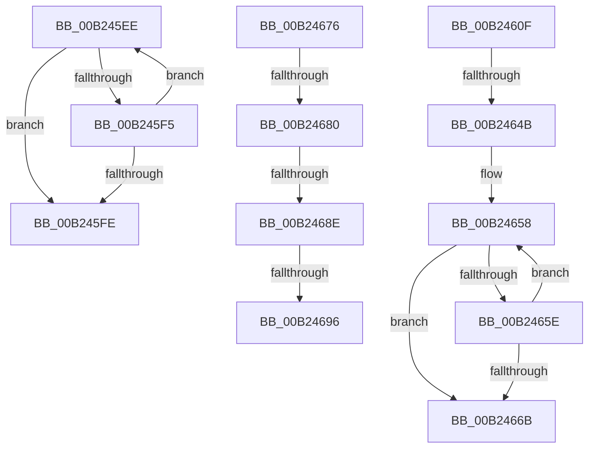

# sub_00B245EE

- RVA: `0x00B245EE`–`0x00B246D9` (길이 `235` bytes)
- VA: `0x0000000140B245EE`
- 실행 섹션: `PAGE`
- PDB 이름 있음: `아니요`; PDB Function 태그: `아니요`
- unwind 정보 RVA: `0x0008F0A4`
- 디코드: `63`개 명령, `235/235` bytes 표시
- 미해석 바이트: `0` (있으면 어셈블리에 `.byte`로 보존)

> 이 문서는 커널 이미지의 기계어와 PDB 기호를 분석해 생성했습니다. 4번과 5번은 함수 원형과 자료형을 바이너리 사용 방식에서 추정한 C 해석이며 원본 소스 복구 결과는 아닙니다.

## 1. Dependencies

- 직접 호출 지점: **2**; 고유 호출 대상: **2**
- 직접 호출자로 확인된 함수: **0**
- RIP 상대 이미지 참조: **0**

### Outgoing calls
- `0x00B246AD` → [memcpy](../../text/6C/memcpy_function_006C6840.md) (function, `0x006C6840`)
- `0x00B246C8` → [memset](../../text/6C/memset_function_006C6C40.md) (function, `0x006C6C40`)

### Direct callers
- 이 함수 시작 RVA로 연결되는 직접 call은 확인되지 않았습니다. 간접 호출은 완전히 역산할 수 없습니다.

### Static image references
- 디코드된 RIP-relative 메모리 참조가 없습니다.

## 2. Other-region calls and transfers

- 다른 실행 섹션으로 향하는 call: **2**
  - `0x00B246AD` → [memcpy](../../text/6C/memcpy_function_006C6840.md) (`PAGE` → `.text`)
  - `0x00B246C8` → [memset](../../text/6C/memset_function_006C6C40.md) (`PAGE` → `.text`)
- call이 아닌 외부 분기/꼬리 이동: **7**
  - `0x00B2460A` → [VrpUpdateKeyInformation + 0xA9](../93/VrpUpdateKeyInformation_function_00933D00.md) (`tail-transfer`)
  - `0x00B24645` → [VrpUpdateKeyInformation + 0xE1](../93/VrpUpdateKeyInformation_function_00933D00.md) (`tail-transfer`)
  - `0x00B24671` → [VrpUpdateKeyInformation + 0xE1](../93/VrpUpdateKeyInformation_function_00933D00.md) (`tail-transfer`)
  - `0x00B2467A` → [VrpUpdateKeyInformation + 0x91](../93/VrpUpdateKeyInformation_function_00933D00.md) (`tail-transfer`)
  - `0x00B24688` → [VrpUpdateKeyInformation + 0x197](../93/VrpUpdateKeyInformation_function_00933D00.md) (`tail-transfer`)
  - `0x00B24690` → [VrpUpdateKeyInformation + 0x197](../93/VrpUpdateKeyInformation_function_00933D00.md) (`tail-transfer`)
  - `0x00B246D4` → [VrpUpdateKeyInformation + 0x91](../93/VrpUpdateKeyInformation_function_00933D00.md) (`tail-transfer`)

## 3. Assembly (complete function range)

```asm
00B245EE  66 41 83 38 5C                  cmp word ptr [r8], 0x5c
00B245F3  74 09                           je 0x140b245fe
00B245F5  4C 2B C2                        sub r8, rdx
00B245F8  48 83 E9 01                     sub rcx, 1
00B245FC  75 F0                           jne 0x140b245ee
00B245FE  8D 04 09                        lea eax, [rcx + rcx]
00B24601  41 8B C9                        mov ecx, r9d
00B24604  2B C8                           sub ecx, eax
00B24606  41 89 4E 20                     mov dword ptr [r14 + 0x20], ecx
00B2460A  E9 9A F7 E0 FF                  jmp 0x140933da9
00B2460F  4D 8D 24 06                     lea r12, [r14 + rax]
00B24613  44 0F B7 D6                     movzx r10d, si
00B24617  48 8B 84 24 90 00 00 00         mov rax, qword ptr [rsp + 0x90]
00B2461F  4D 8D 2C 16                     lea r13, [r14 + rdx]
00B24623  0F 10 00                        movups xmm0, xmmword ptr [rax]
00B24626  66 0F 7E C0                     movd eax, xmm0
00B2462A  0F 11 44 24 30                  movups xmmword ptr [rsp + 0x30], xmm0
00B2462F  66 89 74 24 30                  mov word ptr [rsp + 0x30], si
00B24634  44 0F B7 C0                     movzx r8d, ax
00B24638  49 D1 E8                        shr r8, 1
00B2463B  66 0F 73 D8 08                  psrldq xmm0, 8
00B24640  66 49 0F 7E C7                  movq r15, xmm0
00B24645  0F 84 96 F7 E0 FF               je 0x140933de1
00B2464B  49 8D 47 FE                     lea rax, [r15 - 2]
00B2464F  BA 02 00 00 00                  mov edx, 2
00B24654  4A 8D 04 40                     lea rax, [rax + r8*2]
00B24658  66 83 38 5C                     cmp word ptr [rax], 0x5c
00B2465C  74 0D                           je 0x140b2466b
00B2465E  66 44 03 D2                     add r10w, dx
00B24662  48 2B C2                        sub rax, rdx
00B24665  49 83 E8 01                     sub r8, 1
00B24669  75 ED                           jne 0x140b24658
00B2466B  66 44 89 54 24 30               mov word ptr [rsp + 0x30], r10w
00B24671  E9 6B F7 E0 FF                  jmp 0x140933de1
00B24676  8B 07                           mov eax, dword ptr [rdi]
00B24678  85 C0                           test eax, eax
00B2467A  0F 84 11 F7 E0 FF               je 0x140933d91
00B24680  41 8B 0B                        mov ecx, dword ptr [r11]
00B24683  8D 14 08                        lea edx, [rax + rcx]
00B24686  3B D1                           cmp edx, ecx
00B24688  0F 82 09 F8 E0 FF               jb 0x140933e97
00B2468E  3B D5                           cmp edx, ebp
00B24690  0F 87 01 F8 E0 FF               ja 0x140933e97
00B24696  41 0F B7 3F                     movzx edi, word ptr [r15]
00B2469A  49 8D 14 0E                     lea rdx, [r14 + rcx]
00B2469E  83 C7 1B                        add edi, 0x1b
00B246A1  44 8B C0                        mov r8d, eax
00B246A4  83 E7 FC                        and edi, 0xfffffffc
00B246A7  8B DF                           mov ebx, edi
00B246A9  4A 8D 0C 37                     lea rcx, [rdi + r14]
00B246AD  E8 8E 21 BA FF                  call 0x1406c6840
00B246B2  48 8B 44 24 20                  mov rax, qword ptr [rsp + 0x20]
00B246B7  33 D2                           xor edx, edx
00B246B9  8B 08                           mov ecx, dword ptr [rax]
00B246BB  2B E9                           sub ebp, ecx
00B246BD  48 03 CB                        add rcx, rbx
00B246C0  2B EF                           sub ebp, edi
00B246C2  49 03 CE                        add rcx, r14
00B246C5  44 8B C5                        mov r8d, ebp
00B246C8  E8 73 25 BA FF                  call 0x1406c6c40
00B246CD  48 8B 44 24 28                  mov rax, qword ptr [rsp + 0x28]
00B246D2  89 38                           mov dword ptr [rax], edi
00B246D4  E9 B8 F6 E0 FF                  jmp 0x140933d91
```

## 4. C-style interpretation (structured pseudocode)

```c
__int64 __fastcall sub_00B245EE(__int64 a1, __int64 a2, __int64 a3, int a4)
{
    unsigned __int64 v_stack_p20;
    unsigned __int64 v_stack_p28;
    unsigned __int64 v_stack_p30;
    unsigned __int64 v_stack_p90;

    if ((*(unsigned __int16 *)(a3)) == 92) goto loc_00B245FE;
    a3 = (a3) - (a2);
    a1 = (a1) - (1);
    if (condition_is_not_equal) goto loc_00B245EE;
loc_00B245FE:
    a1 = (unsigned int)(((unsigned int)(a4)) - ((unsigned int)(a1 + a1 * 1)));
    *(unsigned int *)(v_r14 + 32) = (unsigned int)(a1);
}
```

## 5. (Beta) C Style

```c
int64_t sub_00B245EE(void *Arg1, int64_t Arg2, void *Arg3, int32_t Arg4)
{
    uint8_t *arg1 = (uint8_t *)Arg1;
    uint8_t *arg3 = (uint8_t *)Arg3;

    uint64_t v_stack_p20;
    uint64_t v_stack_p28;
    uint64_t v_stack_p30;
    uint64_t v_stack_p90;

    if ((*(uint16_t *)(arg3)) == 92) goto loc_00B245FE;
    Arg3 = (Arg3) - (Arg2);
    Arg1 = (Arg1) - (1);
    if (condition_is_not_equal) goto loc_00B245EE;
loc_00B245FE:
    Arg1 = (uint32_t)(((uint32_t)(Arg4)) - ((uint32_t)(Arg1 + Arg1 * 1)));
    *(uint32_t *)(local_r14 + 0x20) = (uint32_t)(Arg1);
}
```

### 관측된 메모리 오프셋

구조체 형식이 확인되지 않은 접근은 인자 기준의 오프셋으로만 기록했습니다.

| 기준 인자 | 오프셋 표현 | 폭 (bit) | 접근 |
|---|---:|---:|---|
| `Arg1` | `+ 0x0 + rcx*1` | `32` | `R` |
| `Arg3` | `+ 0x0` | `16` | `R` |

## 6. Execution-region graph

[열기: 2D/3D 그래프와 함수 탐색 컨트롤 패널](../../../control-panel.html?section=page&rva=0x00B245EE&view=graph)

- 2D 그래프는 위에서 아래로 흐르고, 3D 그래프는 빈 공간을 드래그해 회전합니다. Shift+드래그는 이동, 휠은 확대·축소, 함수 노드 선택은 대상 보고서 이동입니다.

### Static fallback


