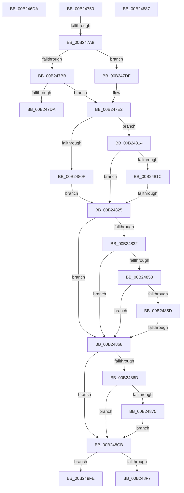

# sub_00B246DA

- RVA: `0x00B246DA`–`0x00B24913` (길이 `569` bytes)
- VA: `0x0000000140B246DA`
- 실행 섹션: `PAGE`
- PDB 이름 있음: `아니요`; PDB Function 태그: `아니요`
- unwind 정보 RVA: `0x0008F0F0`
- 디코드: `120`개 명령, `569/569` bytes 표시
- 미해석 바이트: `0` (있으면 어셈블리에 `.byte`로 보존)

> 이 문서는 커널 이미지의 기계어와 PDB 기호를 분석해 생성했습니다. 4번과 5번은 함수 원형과 자료형을 바이너리 사용 방식에서 추정한 C 해석이며 원본 소스 복구 결과는 아닙니다.

## 1. Dependencies

- 직접 호출 지점: **8**; 고유 호출 대상: **8**
- 직접 호출자로 확인된 함수: **0**
- RIP 상대 이미지 참조: **3**

### Outgoing calls
- `0x00B24741` → [tlgWriteTransfer_EtwWriteTransfer](../../text/42/tlgWriteTransfer_EtwWriteTransfer_function_004260E0.md) (function, `0x004260E0`)
- `0x00B2479B` → [ZwOpenKey](../../text/6A/ZwOpenKey_function_006AD310.md) (function, `0x006AD310`)
- `0x00B247AB` → [VrpUnlockJobContextShared](../93/VrpUnlockJobContextShared_function_009345D8.md) (function, `0x009345D8`)
- `0x00B247C5` → [ExAllocatePool2](../../poolcode/B8/ExAllocatePool2_function_00B820F0.md) (function, `0x00B820F0`)
- `0x00B24801` → [ZwQueryKey](../../text/6A/ZwQueryKey_function_006AD390.md) (function, `0x006AD390`)
- `0x00B2484D` → [VrpUpdateKeyInformation](../93/VrpUpdateKeyInformation_function_00933D00.md) (function, `0x00933D00`)
- `0x00B24880` → [memcpy](../../text/6C/memcpy_function_006C6840.md) (function, `0x006C6840`)
- `0x00B248E2` → [VrpOutputBufferParameter](../93/VrpOutputBufferParameter_function_0093461C.md) (function, `0x0093461C`)

### Direct callers
- 이 함수 시작 RVA로 연결되는 직접 call은 확인되지 않았습니다. 간접 호출은 완전히 역산할 수 없습니다.

### Static image references
- `0x00B24733` → RVA `0x0005A974` (`.rdata`; read)
- `0x00B2473A` → RVA `0x00E0A630` (`.data`; read)
- `0x00B2488B` → RVA `0x00002F28` (`.rdata`; read)

## 2. Other-region calls and transfers

- 다른 실행 섹션으로 향하는 call: **5**
  - `0x00B24741` → [tlgWriteTransfer_EtwWriteTransfer](../../text/42/tlgWriteTransfer_EtwWriteTransfer_function_004260E0.md) (`PAGE` → `.text`)
  - `0x00B2479B` → [ZwOpenKey](../../text/6A/ZwOpenKey_function_006AD310.md) (`PAGE` → `.text`)
  - `0x00B247C5` → [ExAllocatePool2](../../poolcode/B8/ExAllocatePool2_function_00B820F0.md) (`PAGE` → `POOLCODE`)
  - `0x00B24801` → [ZwQueryKey](../../text/6A/ZwQueryKey_function_006AD390.md) (`PAGE` → `.text`)
  - `0x00B24880` → [memcpy](../../text/6C/memcpy_function_006C6840.md) (`PAGE` → `.text`)
- call이 아닌 외부 분기/꼬리 이동: **8**
  - `0x00B2474B` → [VrpPostEnumerateKey + 0xFF](../93/VrpPostEnumerateKey_function_00933EA8.md) (`tail-transfer`)
  - `0x00B247A2` → [VrpPostEnumerateKey + 0x2AD](../93/VrpPostEnumerateKey_function_00933EA8.md) (`tail-transfer`)
  - `0x00B247DA` → [VrpPostEnumerateKey + 0x6FF](../93/VrpPostEnumerateKey_function_00933EA8.md) (`tail-transfer`)
  - `0x00B2481F` → [VrpPostEnumerateKey + 0x2AD](../93/VrpPostEnumerateKey_function_00933EA8.md) (`tail-transfer`)
  - `0x00B24862` → [VrpPostEnumerateKey + 0x2AF](../93/VrpPostEnumerateKey_function_00933EA8.md) (`tail-transfer`)
  - `0x00B248C6` → [VrpPostEnumerateKey + 0x2C5](../93/VrpPostEnumerateKey_function_00933EA8.md) (`tail-transfer`)
  - `0x00B248F9` → [VrpPostEnumerateKey + 0x2C0](../93/VrpPostEnumerateKey_function_00933EA8.md) (`tail-transfer`)
  - `0x00B2490E` → [VrpPostEnumerateKey + 0x2C0](../93/VrpPostEnumerateKey_function_00933EA8.md) (`tail-transfer`)

## 3. Assembly (complete function range)

```asm
00B246DA  0F B7 08                        movzx ecx, word ptr [rax]
00B246DD  48 8B 40 08                     mov rax, qword ptr [rax + 8]
00B246E1  48 8D 94 24 E8 01 00 00         lea rdx, [rsp + 0x1e8]
00B246E9  48 89 94 24 D0 01 00 00         mov qword ptr [rsp + 0x1d0], rdx
00B246F1  48 C7 84 24 D8 01 00 00 02 00 00 00  mov qword ptr [rsp + 0x1d8], 2
00B246FD  48 89 84 24 E0 01 00 00         mov qword ptr [rsp + 0x1e0], rax
00B24705  89 8C 24 E8 01 00 00            mov dword ptr [rsp + 0x1e8], ecx
00B2470C  89 9C 24 EC 01 00 00            mov dword ptr [rsp + 0x1ec], ebx
00B24713  48 8D 84 24 A0 01 00 00         lea rax, [rsp + 0x1a0]
00B2471B  48 89 44 24 28                  mov qword ptr [rsp + 0x28], rax
00B24720  C7 44 24 20 05 00 00 00         mov dword ptr [rsp + 0x20], 5
00B24728  45 33 C9                        xor r9d, r9d
00B2472B  4C 8D 84 24 08 01 00 00         lea r8, [rsp + 0x108]
00B24733  48 8D 15 3A 62 53 FF            lea rdx, [rip - 0xac9dc6]
00B2473A  48 8D 0D EF 5E 2E 00            lea rcx, [rip + 0x2e5eef]
00B24741  E8 9A 19 90 FF                  call 0x1404260e0
00B24746  44 8A 44 24 40                  mov r8b, byte ptr [rsp + 0x40]
00B2474B  E9 57 F8 E0 FF                  jmp 0x140933fa7
00B24750  C7 84 24 D8 00 00 00 30 00 00 00  mov dword ptr [rsp + 0xd8], 0x30
00B2475B  48 89 9C 24 E0 00 00 00         mov qword ptr [rsp + 0xe0], rbx
00B24763  C7 84 24 F0 00 00 00 40 02 00 00  mov dword ptr [rsp + 0xf0], 0x240
00B2476E  48 83 C0 18                     add rax, 0x18
00B24772  48 89 84 24 E8 00 00 00         mov qword ptr [rsp + 0xe8], rax
00B2477A  0F 57 C0                        xorps xmm0, xmm0
00B2477D  F3 0F 7F 84 24 F8 00 00 00      movdqu xmmword ptr [rsp + 0xf8], xmm0
00B24786  4C 8D 84 24 D8 00 00 00         lea r8, [rsp + 0xd8]
00B2478E  BA 3F 00 0F 00                  mov edx, 0xf003f
00B24793  48 8D 8C 24 98 00 00 00         lea rcx, [rsp + 0x98]
00B2479B  E8 70 8B B8 FF                  call 0x1406ad310
00B247A0  85 C0                           test eax, eax
00B247A2  0F 88 AD F9 E0 FF               js 0x140934155
00B247A8  48 8B CF                        mov rcx, rdi
00B247AB  E8 28 FE E0 FF                  call 0x1409345d8
00B247B0  89 5C 24 58                     mov dword ptr [rsp + 0x58], ebx
00B247B4  8B 46 18                        mov eax, dword ptr [rsi + 0x18]
00B247B7  85 C0                           test eax, eax
00B247B9  74 24                           je 0x140b247df
00B247BB  8B D0                           mov edx, eax
00B247BD  45 8B C7                        mov r8d, r15d
00B247C0  B9 00 01 00 00                  mov ecx, 0x100
00B247C5  E8 26 D9 05 00                  call 0x140b820f0
00B247CA  48 8B C8                        mov rcx, rax
00B247CD  48 89 84 24 A0 00 00 00         mov qword ptr [rsp + 0xa0], rax
00B247D5  48 85 C0                        test rax, rax
00B247D8  75 08                           jne 0x140b247e2
00B247DA  E9 C8 FD E0 FF                  jmp 0x1409345a7
00B247DF  48 8B CB                        mov rcx, rbx
00B247E2  4C 8B F1                        mov r14, rcx
00B247E5  48 8B 44 24 68                  mov rax, qword ptr [rsp + 0x68]
00B247EA  48 89 44 24 20                  mov qword ptr [rsp + 0x20], rax
00B247EF  44 8B 4E 18                     mov r9d, dword ptr [rsi + 0x18]
00B247F3  4C 8B C1                        mov r8, rcx
00B247F6  8B 56 0C                        mov edx, dword ptr [rsi + 0xc]
00B247F9  48 8B 8C 24 98 00 00 00         mov rcx, qword ptr [rsp + 0x98]
00B24801  E8 8A 8B B8 FF                  call 0x1406ad390
00B24806  8B F8                           mov edi, eax
00B24808  3D 23 00 00 C0                  cmp eax, 0xc0000023
00B2480D  75 05                           jne 0x140b24814
00B2480F  4C 8B F3                        mov r14, rbx
00B24812  EB 11                           jmp 0x140b24825
00B24814  41 03 C5                        add eax, r13d
00B24817  41 85 C5                        test r13d, eax
00B2481A  75 09                           jne 0x140b24825
00B2481C  41 3B FC                        cmp edi, r12d
00B2481F  0F 85 30 F9 E0 FF               jne 0x140934155
00B24825  8B 4E 0C                        mov ecx, dword ptr [rsi + 0xc]
00B24828  4C 8B 6C 24 68                  mov r13, qword ptr [rsp + 0x68]
00B2482D  83 F9 02                        cmp ecx, 2
00B24830  74 36                           je 0x140b24868
00B24832  89 5C 24 28                     mov dword ptr [rsp + 0x28], ebx
00B24836  48 8D 84 24 B0 00 00 00         lea rax, [rsp + 0xb0]
00B2483E  48 89 44 24 20                  mov qword ptr [rsp + 0x20], rax
00B24843  4D 8B CD                        mov r9, r13
00B24846  44 8B 46 18                     mov r8d, dword ptr [rsi + 0x18]
00B2484A  49 8B D6                        mov rdx, r14
00B2484D  E8 AE F4 E0 FF                  call 0x140933d00
00B24852  8B F8                           mov edi, eax
00B24854  85 C0                           test eax, eax
00B24856  79 10                           jns 0x140b24868
00B24858  41 3B C4                        cmp eax, r12d
00B2485B  74 0B                           je 0x140b24868
00B2485D  3D 23 00 00 C0                  cmp eax, 0xc0000023
00B24862  0F 85 EF F8 E0 FF               jne 0x140934157
00B24868  41 3B FC                        cmp edi, r12d
00B2486B  74 5E                           je 0x140b248cb
00B2486D  81 FF 23 00 00 C0               cmp edi, 0xc0000023
00B24873  74 56                           je 0x140b248cb
00B24875  45 8B 45 00                     mov r8d, dword ptr [r13]
00B24879  49 8B D6                        mov rdx, r14
00B2487C  48 8B 4E 10                     mov rcx, qword ptr [rsi + 0x10]
00B24880  E8 BB 1F BA FF                  call 0x1406c6840
00B24885  EB 44                           jmp 0x140b248cb
00B24887  8B F8                           mov edi, eax
00B24889  33 DB                           xor ebx, ebx
00B2488B  4C 8D 25 96 E6 4D FF            lea r12, [rip - 0xb2196a]
00B24892  41 BF 56 52 65 67               mov r15d, 0x67655256
00B24898  89 5C 24 58                     mov dword ptr [rsp + 0x58], ebx
00B2489C  48 8B 8C 24 C0 00 00 00         mov rcx, qword ptr [rsp + 0xc0]
00B248A4  48 89 8C 24 90 00 00 00         mov qword ptr [rsp + 0x90], rcx
00B248AC  48 8B B4 24 C8 00 00 00         mov rsi, qword ptr [rsp + 0xc8]
00B248B4  48 8B 84 24 D0 00 00 00         mov rax, qword ptr [rsp + 0xd0]
00B248BC  4C 8B 74 24 48                  mov r14, qword ptr [rsp + 0x48]
00B248C1  44 8A 6C 24 40                  mov r13b, byte ptr [rsp + 0x40]
00B248C6  E9 A2 F8 E0 FF                  jmp 0x14093416d
00B248CB  4C 8D 4C 24 68                  lea r9, [rsp + 0x68]
00B248D0  41 B8 04 00 00 00               mov r8d, 4
00B248D6  48 8B 56 20                     mov rdx, qword ptr [rsi + 0x20]
00B248DA  44 8A 6C 24 40                  mov r13b, byte ptr [rsp + 0x40]
00B248DF  41 8A CD                        mov cl, r13b
00B248E2  E8 35 FD E0 FF                  call 0x14093461c
00B248E7  4C 8B 74 24 48                  mov r14, qword ptr [rsp + 0x48]
00B248EC  4C 8D 25 35 E6 4D FF            lea r12, [rip - 0xb219cb]
00B248F3  85 C0                           test eax, eax
00B248F5  79 07                           jns 0x140b248fe
00B248F7  8B F8                           mov edi, eax
00B248F9  E9 6A F8 E0 FF                  jmp 0x140934168
00B248FE  48 8B 84 24 88 00 00 00         mov rax, qword ptr [rsp + 0x88]
00B24906  89 78 18                        mov dword ptr [rax + 0x18], edi
00B24909  BF 03 05 00 C0                  mov edi, 0xc0000503
00B2490E  E9 55 F8 E0 FF                  jmp 0x140934168
```

## 4. C-style interpretation (structured pseudocode)

```c
__int64 __fastcall sub_00B246DA(__int64 a1, __int64 a2, __int64 a3, int a4, __int64 a5, __int64 a6, __int64 a7, unsigned __int8 a8, __int64 a9, __int64 a10, __int64 a11, __int64 a12, __int64 a13, __int64 a14, __int64 a15, __int64 a16, __int64 a17, __int64 a18, __int64 a19, __int64 a20, __int64 a21, __int64 a22, __int64 a23, __int64 a24, __int64 a25, __int64 a26, __int64 a27, __int64 a28, __int64 a29, __int64 a30, __int64 a31, __int64 a32, __int64 a33, __int64 a34, __int64 a35, __int64 a36, __int64 a37, __int64 a38, __int64 a39, __int64 a40, __int64 a41, __int64 a42, __int64 a43, __int64 a44, __int64 a45, __int64 a46, __int64 a47, __int64 a48, __int64 a49, __int64 a50, __int64 a51, __int64 a52, __int64 a53, __int64 a54, __int64 a55, __int64 a56, __int64 a57, __int64 a58, __int64 a59, __int64 a60, __int64 a61)
{
    __int64 result;
    unsigned __int64 v_stack_p1D0;
    unsigned __int64 v_stack_p1D8;
    unsigned __int64 v_stack_p1E0;
    unsigned int v_stack_p1E8;
    unsigned int v_stack_p1EC;
    unsigned int v_stack_p20;
    unsigned __int64 v_stack_p28;
    unsigned __int8 v_stack_p40;
    unsigned __int64 v_stack_p48;
    unsigned int v_stack_p58;
    unsigned __int64 v_stack_p68;
    unsigned __int64 v_stack_p88;
    unsigned __int64 v_stack_p90;
    unsigned __int64 v_stack_p98;
    unsigned __int64 v_stack_pA0;
    unsigned __int64 v_stack_pB0;
    unsigned __int64 v_stack_pC0;
    unsigned __int64 v_stack_pC8;
    unsigned __int64 v_stack_pD0;
    unsigned int v_stack_pD8;
    unsigned __int64 v_stack_pE0;
    unsigned __int64 v_stack_pE8;
    unsigned int v_stack_pF0;
    unsigned __int64 v_stack_pF8;

    v_stack_p1D0 = a61;
    v_stack_p1D8 = 2;
    v_stack_p1E0 = *(unsigned __int64 *)(result + 8);
    v_stack_p1E8 = (unsigned int)(*(unsigned __int16 *)(result));
    v_stack_p1EC = (unsigned int)(v_rbx);
    v_stack_p28 = a52;
    v_stack_p20 = 5;
    a4 = 0;
    result = tlgWriteTransfer_EtwWriteTransfer(v_rip + 3038959, v_rip - 11312582, a33, a4);
}
```

## 5. (Beta) C Style

```c
int64_t sub_00B246DA(int64_t Arg1, int64_t Arg2, int64_t Arg3, int32_t Arg4, uint64_t Arg5, uint64_t Arg6, uint64_t Arg7, uint8_t Arg8, uint64_t Arg9, uint64_t Arg10, uint64_t Arg11, uint64_t Arg12, uint64_t Arg13, uint64_t Arg14, uint64_t Arg15, uint64_t Arg16, uint64_t Arg17, uint64_t Arg18, uint64_t Arg19, uint64_t Arg20, uint64_t Arg21, uint64_t Arg22, uint64_t Arg23, uint64_t Arg24, uint64_t Arg25, uint64_t Arg26, uint64_t Arg27, uint64_t Arg28, uint64_t Arg29, uint64_t Arg30, uint64_t Arg31, uint64_t Arg32, int64_t Arg33, uint64_t Arg34, uint64_t Arg35, uint64_t Arg36, uint64_t Arg37, uint64_t Arg38, uint64_t Arg39, uint64_t Arg40, uint64_t Arg41, uint64_t Arg42, uint64_t Arg43, uint64_t Arg44, uint64_t Arg45, uint64_t Arg46, uint64_t Arg47, uint64_t Arg48, uint64_t Arg49, uint64_t Arg50, uint64_t Arg51, int64_t Arg52, uint64_t Arg53, uint64_t Arg54, uint64_t Arg55, uint64_t Arg56, uint64_t Arg57, uint64_t Arg58, uint64_t Arg59, uint64_t Arg60, int64_t Arg61)
{
    int64_t result;
    uint64_t v_stack_p1D0;
    uint64_t v_stack_p1D8;
    uint64_t v_stack_p1E0;
    uint32_t v_stack_p1E8;
    uint32_t v_stack_p1EC;
    uint32_t v_stack_p20;
    uint64_t v_stack_p28;
    uint8_t v_stack_p40;
    uint64_t v_stack_p48;
    uint32_t v_stack_p58;
    uint64_t v_stack_p68;
    uint64_t v_stack_p88;
    uint64_t v_stack_p90;
    uint64_t v_stack_p98;
    uint64_t v_stack_pA0;
    uint64_t v_stack_pB0;
    uint64_t v_stack_pC0;
    uint64_t v_stack_pC8;
    uint64_t v_stack_pD0;
    uint32_t v_stack_pD8;
    uint64_t v_stack_pE0;
    uint64_t v_stack_pE8;
    uint32_t v_stack_pF0;
    uint64_t v_stack_pF8;

    v_stack_p1D0 = Arg61;
    v_stack_p1D8 = 2;
    v_stack_p1E0 = *(uint64_t *)(result + 0x8);
    v_stack_p1E8 = (uint32_t)(*(uint16_t *)(result));
    v_stack_p1EC = (uint32_t)(local_rbx);
    v_stack_p28 = Arg52;
    v_stack_p20 = 5;
    Arg4 = 0;
    result = tlgWriteTransfer_EtwWriteTransfer(v_rip + 3038959, v_rip - 11312582, Arg33, Arg4);
}
```

## 6. Execution-region graph

[열기: 2D/3D 그래프와 함수 탐색 컨트롤 패널](../../../control-panel.html?section=page&rva=0x00B246DA&view=graph)

- 2D 그래프는 위에서 아래로 흐르고, 3D 그래프는 빈 공간을 드래그해 회전합니다. Shift+드래그는 이동, 휠은 확대·축소, 함수 노드 선택은 대상 보고서 이동입니다.

### Static fallback


