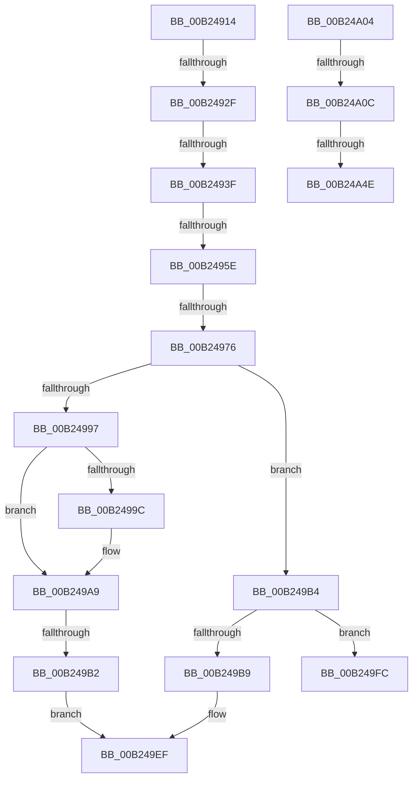

# sub_00B24914

- RVA: `0x00B24914`–`0x00B24A66` (길이 `338` bytes)
- VA: `0x0000000140B24914`
- 실행 섹션: `PAGE`
- PDB 이름 있음: `아니요`; PDB Function 태그: `아니요`
- unwind 정보 RVA: `0x0008F1E8`
- 디코드: `86`개 명령, `338/338` bytes 표시
- 미해석 바이트: `0` (있으면 어셈블리에 `.byte`로 보존)

> 이 문서는 커널 이미지의 기계어와 PDB 기호를 분석해 생성했습니다. 4번과 5번은 함수 원형과 자료형을 바이너리 사용 방식에서 추정한 C 해석이며 원본 소스 복구 결과는 아닙니다.

## 1. Dependencies

- 직접 호출 지점: **10**; 고유 호출 대상: **8**
- 직접 호출자로 확인된 함수: **0**
- RIP 상대 이미지 참조: **0**

### Outgoing calls
- `0x00B24951` → [ULongLongMult](../../text/44/ULongLongMult_function_00448380.md) (function, `0x00448380`)
- `0x00B24969` → [ULongLongMult](../../text/44/ULongLongMult_function_00448380.md) (function, `0x00448380`)
- `0x00B2498A` → [ExAllocatePoolWithTag](../../poolcode/B8/ExAllocatePoolWithTag_function_00B82010.md) (function, `0x00B82010`)
- `0x00B249A4` → [memset](../../text/6C/memset_function_006C6C40.md) (function, `0x006C6C40`)
- `0x00B249C1` → [memset](../../text/6C/memset_function_006C6C40.md) (function, `0x006C6C40`)
- `0x00B249DA` → [memcpy](../../text/6C/memcpy_function_006C6840.md) (function, `0x006C6840`)
- `0x00B249E7` → [ExFreePoolWithTag](../../poolcode/B8/ExFreePoolWithTag_function_00B82870.md) (function, `0x00B82870`)
- `0x00B24A41` → [ZwOpenKey](../../text/6A/ZwOpenKey_function_006AD310.md) (function, `0x006AD310`)
- `0x00B24A52` → [ZwDeleteKey](../../text/6A/ZwDeleteKey_function_006AEC50.md) (function, `0x006AEC50`)
- `0x00B24A5B` → [ZwClose](../../text/6A/ZwClose_function_006AD2B0.md) (function, `0x006AD2B0`)

### Direct callers
- 이 함수 시작 RVA로 연결되는 직접 call은 확인되지 않았습니다. 간접 호출은 완전히 역산할 수 없습니다.

### Static image references
- 디코드된 RIP-relative 메모리 참조가 없습니다.

## 2. Other-region calls and transfers

- 다른 실행 섹션으로 향하는 call: **10**
  - `0x00B24951` → [ULongLongMult](../../text/44/ULongLongMult_function_00448380.md) (`PAGE` → `.text`)
  - `0x00B24969` → [ULongLongMult](../../text/44/ULongLongMult_function_00448380.md) (`PAGE` → `.text`)
  - `0x00B2498A` → [ExAllocatePoolWithTag](../../poolcode/B8/ExAllocatePoolWithTag_function_00B82010.md) (`PAGE` → `POOLCODE`)
  - `0x00B249A4` → [memset](../../text/6C/memset_function_006C6C40.md) (`PAGE` → `.text`)
  - `0x00B249C1` → [memset](../../text/6C/memset_function_006C6C40.md) (`PAGE` → `.text`)
  - `0x00B249DA` → [memcpy](../../text/6C/memcpy_function_006C6840.md) (`PAGE` → `.text`)
  - `0x00B249E7` → [ExFreePoolWithTag](../../poolcode/B8/ExFreePoolWithTag_function_00B82870.md) (`PAGE` → `POOLCODE`)
  - `0x00B24A41` → [ZwOpenKey](../../text/6A/ZwOpenKey_function_006AD310.md) (`PAGE` → `.text`)
  - `0x00B24A52` → [ZwDeleteKey](../../text/6A/ZwDeleteKey_function_006AEC50.md) (`PAGE` → `.text`)
  - `0x00B24A5B` → [ZwClose](../../text/6A/ZwClose_function_006AD2B0.md) (`PAGE` → `.text`)
- call이 아닌 외부 분기/꼬리 이동: **10**
  - `0x00B24929` → [VrpDestroyNamespaceNode + 0x66](../93/VrpDestroyNamespaceNode_function_00934A50.md) (`tail-transfer`)
  - `0x00B24939` → [VrpDestroyNamespaceNode + 0x66](../93/VrpDestroyNamespaceNode_function_00934A50.md) (`tail-transfer`)
  - `0x00B24958` → [VrpDestroyNamespaceNode + 0x66](../93/VrpDestroyNamespaceNode_function_00934A50.md) (`tail-transfer`)
  - `0x00B24970` → [VrpDestroyNamespaceNode + 0x66](../93/VrpDestroyNamespaceNode_function_00934A50.md) (`tail-transfer`)
  - `0x00B249AC` → [VrpDestroyNamespaceNode + 0x66](../93/VrpDestroyNamespaceNode_function_00934A50.md) (`tail-transfer`)
  - `0x00B249F7` → [VrpDestroyNamespaceNode + 0x66](../93/VrpDestroyNamespaceNode_function_00934A50.md) (`tail-transfer`)
  - `0x00B249FF` → [VrpDestroyNamespaceNode + 0x66](../93/VrpDestroyNamespaceNode_function_00934A50.md) (`tail-transfer`)
  - `0x00B24A06` → [VrpDestroyNamespaceNode + 0x73](../93/VrpDestroyNamespaceNode_function_00934A50.md) (`tail-transfer`)
  - `0x00B24A48` → [VrpDestroyNamespaceNode + 0x73](../93/VrpDestroyNamespaceNode_function_00934A50.md) (`tail-transfer`)
  - `0x00B24A61` → [VrpDestroyNamespaceNode + 0x73](../93/VrpDestroyNamespaceNode_function_00934A50.md) (`tail-transfer`)

## 3. Assembly (complete function range)

```asm
00B24914  48 8B 53 28                     mov rdx, qword ptr [rbx + 0x28]
00B24918  48 8B 4B 38                     mov rcx, qword ptr [rbx + 0x38]
00B2491C  48 8B C2                        mov rax, rdx
00B2491F  48 0F AF C1                     imul rax, rcx
00B24923  48 3D 00 04 00 00               cmp rax, 0x400
00B24929  0F 82 87 01 E1 FF               jb 0x140934ab6
00B2492F  48 8B C1                        mov rax, rcx
00B24932  48 C1 E8 02                     shr rax, 2
00B24936  4C 3B C0                        cmp r8, rax
00B24939  0F 83 77 01 E1 FF               jae 0x140934ab6
00B2493F  4C 8B F9                        mov r15, rcx
00B24942  4C 89 6D 50                     mov qword ptr [rbp + 0x50], r13
00B24946  4C 8D 45 50                     lea r8, [rbp + 0x50]
00B2494A  49 D1 EF                        shr r15, 1
00B2494D  4C 89 6D 48                     mov qword ptr [rbp + 0x48], r13
00B24951  E8 2A 3A 92 FF                  call 0x140448380
00B24956  85 C0                           test eax, eax
00B24958  0F 88 58 01 E1 FF               js 0x140934ab6
00B2495E  48 8B 53 28                     mov rdx, qword ptr [rbx + 0x28]
00B24962  4C 8D 45 48                     lea r8, [rbp + 0x48]
00B24966  49 8B CF                        mov rcx, r15
00B24969  E8 12 3A 92 FF                  call 0x140448380
00B2496E  85 C0                           test eax, eax
00B24970  0F 88 40 01 E1 FF               js 0x140934ab6
00B24976  4C 8B 75 48                     mov r14, qword ptr [rbp + 0x48]
00B2497A  41 B8 52 54 61 72               mov r8d, 0x72615452
00B24980  4C 8B 6B 48                     mov r13, qword ptr [rbx + 0x48]
00B24984  49 8B D6                        mov rdx, r14
00B24987  41 8B CC                        mov ecx, r12d
00B2498A  E8 81 D6 05 00                  call 0x140b82010
00B2498F  48 8B F0                        mov rsi, rax
00B24992  4D 85 ED                        test r13, r13
00B24995  75 1D                           jne 0x140b249b4
00B24997  48 85 C0                        test rax, rax
00B2499A  74 0D                           je 0x140b249a9
00B2499C  4D 8B C6                        mov r8, r14
00B2499F  33 D2                           xor edx, edx
00B249A1  48 8B C8                        mov rcx, rax
00B249A4  E8 97 22 BA FF                  call 0x1406c6c40
00B249A9  48 85 F6                        test rsi, rsi
00B249AC  0F 84 04 01 E1 FF               je 0x140934ab6
00B249B2  EB 3B                           jmp 0x140b249ef
00B249B4  48 85 C0                        test rax, rax
00B249B7  74 43                           je 0x140b249fc
00B249B9  4D 8B C6                        mov r8, r14
00B249BC  33 D2                           xor edx, edx
00B249BE  48 8B CE                        mov rcx, rsi
00B249C1  E8 7A 22 BA FF                  call 0x1406c6c40
00B249C6  48 8B 45 50                     mov rax, qword ptr [rbp + 0x50]
00B249CA  49 8B D5                        mov rdx, r13
00B249CD  49 3B C6                        cmp rax, r14
00B249D0  48 8B CE                        mov rcx, rsi
00B249D3  49 0F 43 C6                     cmovae rax, r14
00B249D7  4C 8B C0                        mov r8, rax
00B249DA  E8 61 1E BA FF                  call 0x1406c6840
00B249DF  BA 52 54 61 72                  mov edx, 0x72615452
00B249E4  49 8B CD                        mov rcx, r13
00B249E7  E8 84 DE 05 00                  call 0x140b82870
00B249EC  45 33 ED                        xor r13d, r13d
00B249EF  48 89 73 48                     mov qword ptr [rbx + 0x48], rsi
00B249F3  4C 89 7B 38                     mov qword ptr [rbx + 0x38], r15
00B249F7  E9 BA 00 E1 FF                  jmp 0x140934ab6
00B249FC  45 33 ED                        xor r13d, r13d
00B249FF  E9 B2 00 E1 FF                  jmp 0x140934ab6
00B24A04  85 C0                           test eax, eax
00B24A06  0F 89 B7 00 E1 FF               jns 0x140934ac3
00B24A0C  48 8D 47 28                     lea rax, [rdi + 0x28]
00B24A10  4C 89 6D 48                     mov qword ptr [rbp + 0x48], r13
00B24A14  0F 57 C0                        xorps xmm0, xmm0
00B24A17  48 89 45 E0                     mov qword ptr [rbp - 0x20], rax
00B24A1B  4C 8D 45 D0                     lea r8, [rbp - 0x30]
00B24A1F  48 C7 45 D0 30 00 00 00         mov qword ptr [rbp - 0x30], 0x30
00B24A27  BA 3F 00 0F 00                  mov edx, 0xf003f
00B24A2C  48 C7 45 E8 40 02 00 00         mov qword ptr [rbp - 0x18], 0x240
00B24A34  48 8D 4D 48                     lea rcx, [rbp + 0x48]
00B24A38  4C 89 6D D8                     mov qword ptr [rbp - 0x28], r13
00B24A3C  F3 0F 7F 45 F0                  movdqu xmmword ptr [rbp - 0x10], xmm0
00B24A41  E8 CA 88 B8 FF                  call 0x1406ad310
00B24A46  85 C0                           test eax, eax
00B24A48  0F 88 75 00 E1 FF               js 0x140934ac3
00B24A4E  48 8B 4D 48                     mov rcx, qword ptr [rbp + 0x48]
00B24A52  E8 F9 A1 B8 FF                  call 0x1406aec50
00B24A57  48 8B 4D 48                     mov rcx, qword ptr [rbp + 0x48]
00B24A5B  E8 50 88 B8 FF                  call 0x1406ad2b0
00B24A60  90                              nop
00B24A61  E9 5D 00 E1 FF                  jmp 0x140934ac3
```

## 4. C-style interpretation (structured pseudocode)

```c
__int64 __fastcall sub_00B24914(__int64 a1, __int64 a2, __int64 a3)
{
    __int64 result;
    __int64 v_r13;
    __int64 v_r15;

    result = (*(unsigned __int64 *)(v_rbx + 40)) * (*(unsigned __int64 *)(v_rbx + 56));
    result = (*(unsigned __int64 *)(v_rbx + 56)) >> (2);
    *(unsigned __int64 *)(v_rbp + 80) = v_r13;
    v_r15 = (*(unsigned __int64 *)(v_rbx + 56)) >> (1);
    *(unsigned __int64 *)(v_rbp + 72) = v_r13;
    result = ULongLongMult(*(unsigned __int64 *)(v_rbx + 56), *(unsigned __int64 *)(v_rbx + 40), v_rbp + 80, a4);
    result = ULongLongMult(v_r15, *(unsigned __int64 *)(v_rbx + 40), v_rbp + 72, a4);
    result = ExAllocatePoolWithTag((unsigned int)((unsigned int)(v_r12)), *(unsigned __int64 *)(v_rbp + 72), (unsigned int)(0x72615452ULL), a4);
    if (*(unsigned __int64 *)(v_rbx + 72) != 0) goto loc_00B249B4;
    if (result != 0) {
        a3 = *(unsigned __int64 *)(v_rbp + 72);
        a2 = 0;
        a1 = result;
        result = memset(a1, a2, a3, a4);
    }
    goto loc_00B249EF;
loc_00B249B4:
    if (result == 0) goto loc_00B249FC;
    a2 = 0;
    result = memset(result, a2, *(unsigned __int64 *)(v_rbp + 72), a4);
    result = *(unsigned __int64 *)(v_rbp + 80);
    if ((*(unsigned __int64 *)(v_rbp + 80)) >= (*(unsigned __int64 *)(v_rbp + 72))) { result = *(unsigned __int64 *)(v_rbp + 72); }
    result = memcpy(result, *(unsigned __int64 *)(v_rbx + 72), result, a4);
    result = ExFreePoolWithTag(*(unsigned __int64 *)(v_rbx + 72), (unsigned int)(0x72615452ULL), result, a4);
    v_r13 = 0;
loc_00B249EF:
    *(unsigned __int64 *)(v_rbx + 72) = result;
    *(unsigned __int64 *)(v_rbx + 56) = v_r15;
loc_00B249FC:
    v_r13 = 0;
}
```

## 5. (Beta) C Style

```c
int64_t sub_00B24914(int64_t Arg1, int64_t Arg2, int64_t Arg3)
{
    int64_t result;
    int64_t local_r13;
    int64_t local_r15;

    result = (*(uint64_t *)(local_rbx + 0x28)) * (*(uint64_t *)(local_rbx + 0x38));
    result = (*(uint64_t *)(local_rbx + 0x38)) >> (2);
    *(uint64_t *)(local_rbp + 0x50) = local_r13;
    local_r15 = (*(uint64_t *)(local_rbx + 0x38)) >> (1);
    *(uint64_t *)(local_rbp + 0x48) = local_r13;
    result = ULongLongMult(*(uint64_t *)(local_rbx + 0x38), *(uint64_t *)(local_rbx + 0x28), local_rbp + 80, a4);
    result = ULongLongMult(local_r15, *(uint64_t *)(local_rbx + 0x28), local_rbp + 72, a4);
    result = ExAllocatePoolWithTag((uint32_t)((uint32_t)(local_r12)), *(uint64_t *)(local_rbp + 0x48), (uint32_t)(0x72615452ULL), a4);
    if (*(uint64_t *)(local_rbx + 0x48) != 0) goto loc_00B249B4;
    if (result != 0) {
        Arg3 = *(uint64_t *)(local_rbp + 0x48);
        Arg2 = 0;
        Arg1 = result;
        result = memset(Arg1, Arg2, Arg3, a4);
    }
    goto loc_00B249EF;
loc_00B249B4:
    if (result == 0) goto loc_00B249FC;
    Arg2 = 0;
    result = memset(result, Arg2, *(uint64_t *)(local_rbp + 0x48), a4);
    result = *(uint64_t *)(local_rbp + 0x50);
    if ((*(uint64_t *)(local_rbp + 0x50)) >= (*(uint64_t *)(local_rbp + 0x48))) { result = *(uint64_t *)(local_rbp + 0x48); }
    result = memcpy(result, *(uint64_t *)(local_rbx + 0x48), result, a4);
    result = ExFreePoolWithTag(*(uint64_t *)(local_rbx + 0x48), (uint32_t)(0x72615452ULL), result, a4);
    local_r13 = 0;
loc_00B249EF:
    *(uint64_t *)(local_rbx + 0x48) = result;
    *(uint64_t *)(local_rbx + 0x38) = local_r15;
loc_00B249FC:
    local_r13 = 0;
}
```

## 6. Execution-region graph

[열기: 2D/3D 그래프와 함수 탐색 컨트롤 패널](../../../control-panel.html?section=page&rva=0x00B24914&view=graph)

- 2D 그래프는 위에서 아래로 흐르고, 3D 그래프는 빈 공간을 드래그해 회전합니다. Shift+드래그는 이동, 휠은 확대·축소, 함수 노드 선택은 대상 보고서 이동입니다.

### Static fallback


