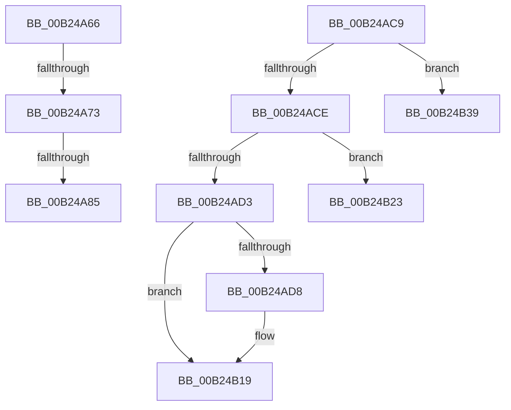

# sub_00B24A66

- RVA: `0x00B24A66`–`0x00B24B4F` (길이 `233` bytes)
- VA: `0x0000000140B24A66`
- 실행 섹션: `PAGE`
- PDB 이름 있음: `아니요`; PDB Function 태그: `아니요`
- unwind 정보 RVA: `0x0008F220`
- 디코드: `54`개 명령, `233/233` bytes 표시
- 미해석 바이트: `0` (있으면 어셈블리에 `.byte`로 보존)

> 이 문서는 커널 이미지의 기계어와 PDB 기호를 분석해 생성했습니다. 4번과 5번은 함수 원형과 자료형을 바이너리 사용 방식에서 추정한 C 해석이며 원본 소스 복구 결과는 아닙니다.

## 1. Dependencies

- 직접 호출 지점: **4**; 고유 호출 대상: **3**
- 직접 호출자로 확인된 함수: **0**
- RIP 상대 이미지 참조: **4**

### Outgoing calls
- `0x00B24ABE` → [tlgWriteTransfer_EtwWriteTransfer](../../text/42/tlgWriteTransfer_EtwWriteTransfer_function_004260E0.md) (function, `0x004260E0`)
- `0x00B24B14` → [tlgWriteTransfer_EtwWriteTransfer](../../text/42/tlgWriteTransfer_EtwWriteTransfer_function_004260E0.md) (function, `0x004260E0`)
- `0x00B24B2E` → [VrpHandleIoctlUnloadDifferencingHiveForHost](../83/VrpHandleIoctlUnloadDifferencingHiveForHost_function_0083B7A4.md) (function, `0x0083B7A4`)
- `0x00B24B44` → [VrpHandleIoctlLoadDifferencingHiveForHost](../83/VrpHandleIoctlLoadDifferencingHiveForHost_function_0083B464.md) (function, `0x0083B464`)

### Direct callers
- 이 함수 시작 RVA로 연결되는 직접 call은 확인되지 않았습니다. 간접 호출은 완전히 역산할 수 없습니다.

### Static image references
- `0x00B24A66` → RVA `0x00E0F198` (`.data`; read)
- `0x00B24A73` → RVA `0x00E0A630` (`.data`; read)
- `0x00B24AA1` → RVA `0x0005A7AA` (`.rdata`; read)
- `0x00B24AE3` → RVA `0x0005A759` (`.rdata`; read)

## 2. Other-region calls and transfers

- 다른 실행 섹션으로 향하는 call: **2**
  - `0x00B24ABE` → [tlgWriteTransfer_EtwWriteTransfer](../../text/42/tlgWriteTransfer_EtwWriteTransfer_function_004260E0.md) (`PAGE` → `.text`)
  - `0x00B24B14` → [tlgWriteTransfer_EtwWriteTransfer](../../text/42/tlgWriteTransfer_EtwWriteTransfer_function_004260E0.md) (`PAGE` → `.text`)
- call이 아닌 외부 분기/꼬리 이동: **6**
  - `0x00B24A6D` → [VrpIoctlDeviceDispatch + 0x67](../93/VrpIoctlDeviceDispatch_function_00934C50.md) (`tail-transfer`)
  - `0x00B24A7F` → [VrpIoctlDeviceDispatch + 0xB0](../93/VrpIoctlDeviceDispatch_function_00934C50.md) (`tail-transfer`)
  - `0x00B24AC4` → [VrpIoctlDeviceDispatch + 0xB0](../93/VrpIoctlDeviceDispatch_function_00934C50.md) (`tail-transfer`)
  - `0x00B24B1E` → [VrpIoctlDeviceDispatch + 0xB0](../93/VrpIoctlDeviceDispatch_function_00934C50.md) (`tail-transfer`)
  - `0x00B24B34` → [VrpIoctlDeviceDispatch + 0xAE](../93/VrpIoctlDeviceDispatch_function_00934C50.md) (`tail-transfer`)
  - `0x00B24B4A` → [VrpIoctlDeviceDispatch + 0xAE](../93/VrpIoctlDeviceDispatch_function_00934C50.md) (`tail-transfer`)

## 3. Assembly (complete function range)

```asm
00B24A66  83 3D 2B A7 2E 00 00            cmp dword ptr [rip + 0x2ea72b], 0
00B24A6D  0F 85 44 02 E1 FF               jne 0x140934cb7
00B24A73  83 3D B6 5B 2E 00 02            cmp dword ptr [rip + 0x2e5bb6], 2
00B24A7A  BE 10 00 00 C0                  mov esi, 0xc0000010
00B24A7F  0F 86 7B 02 E1 FF               jbe 0x140934d00
00B24A85  83 65 3B 00                     and dword ptr [rbp + 0x3b], 0
00B24A89  48 8D 45 E7                     lea rax, [rbp - 0x19]
00B24A8D  48 89 45 2F                     mov qword ptr [rbp + 0x2f], rax
00B24A91  4C 8D 45 EF                     lea r8, [rbp - 0x11]
00B24A95  48 8D 45 0F                     lea rax, [rbp + 0xf]
00B24A99  89 5D E7                        mov dword ptr [rbp - 0x19], ebx
00B24A9C  48 89 44 24 28                  mov qword ptr [rsp + 0x28], rax
00B24AA1  48 8D 15 02 5D 53 FF            lea rdx, [rip - 0xaca2fe]
00B24AA8  45 33 C9                        xor r9d, r9d
00B24AAB  C7 44 24 20 03 00 00 00         mov dword ptr [rsp + 0x20], 3
00B24AB3  48 8D 0D 76 5B 2E 00            lea rcx, [rip + 0x2e5b76]
00B24ABA  44 89 7D 37                     mov dword ptr [rbp + 0x37], r15d
00B24ABE  E8 1D 16 90 FF                  call 0x1404260e0
00B24AC3  90                              nop
00B24AC4  E9 37 02 E1 FF                  jmp 0x140934d00
00B24AC9  41 2B DF                        sub ebx, r15d
00B24ACC  74 6B                           je 0x140b24b39
00B24ACE  41 3B DF                        cmp ebx, r15d
00B24AD1  74 50                           je 0x140b24b23
00B24AD3  83 F8 02                        cmp eax, 2
00B24AD6  76 41                           jbe 0x140b24b19
00B24AD8  8B 46 18                        mov eax, dword ptr [rsi + 0x18]
00B24ADB  4C 8D 45 EF                     lea r8, [rbp - 0x11]
00B24ADF  83 65 3B 00                     and dword ptr [rbp + 0x3b], 0
00B24AE3  48 8D 15 6F 5C 53 FF            lea rdx, [rip - 0xaca391]
00B24AEA  89 45 E7                        mov dword ptr [rbp - 0x19], eax
00B24AED  48 8D 0D 3C 5B 2E 00            lea rcx, [rip + 0x2e5b3c]
00B24AF4  48 8D 45 E7                     lea rax, [rbp - 0x19]
00B24AF8  44 89 7D 37                     mov dword ptr [rbp + 0x37], r15d
00B24AFC  48 89 45 2F                     mov qword ptr [rbp + 0x2f], rax
00B24B00  45 33 C9                        xor r9d, r9d
00B24B03  48 8D 45 0F                     lea rax, [rbp + 0xf]
00B24B07  48 89 44 24 28                  mov qword ptr [rsp + 0x28], rax
00B24B0C  C7 44 24 20 03 00 00 00         mov dword ptr [rsp + 0x20], 3
00B24B14  E8 C7 15 90 FF                  call 0x1404260e0
00B24B19  BE 10 00 00 C0                  mov esi, 0xc0000010
00B24B1E  E9 DD 01 E1 FF                  jmp 0x140934d00
00B24B23  44 8A 47 40                     mov r8b, byte ptr [rdi + 0x40]
00B24B27  8B 56 10                        mov edx, dword ptr [rsi + 0x10]
00B24B2A  48 8B 4F 18                     mov rcx, qword ptr [rdi + 0x18]
00B24B2E  E8 71 6C D1 FF                  call 0x14083b7a4
00B24B33  90                              nop
00B24B34  E9 C5 01 E1 FF                  jmp 0x140934cfe
00B24B39  44 8A 47 40                     mov r8b, byte ptr [rdi + 0x40]
00B24B3D  8B 56 10                        mov edx, dword ptr [rsi + 0x10]
00B24B40  48 8B 4F 18                     mov rcx, qword ptr [rdi + 0x18]
00B24B44  E8 1B 69 D1 FF                  call 0x14083b464
00B24B49  90                              nop
00B24B4A  E9 AF 01 E1 FF                  jmp 0x140934cfe
```

## 4. C-style interpretation (structured pseudocode)

```c
__int64 __fastcall sub_00B24A66(__int64 a1, __int64 a2, __int64 a3, int a4)
{
    __int64 result;
    unsigned int v_stack_p20;
    unsigned __int64 v_stack_p28;

    *(unsigned __int64 *)(v_rbp + 47) = v_rbp - 25;
    *(unsigned int *)(v_rbp - 25) = (unsigned int)(v_rbx);
    v_stack_p28 = v_rbp + 15;
    a4 = 0;
    v_stack_p20 = 3;
    *(unsigned int *)(v_rbp + 55) = (unsigned int)(v_r15);
    result = tlgWriteTransfer_EtwWriteTransfer(v_rip + 3038070, v_rip - 11313918, v_rbp - 17, a4);
}
```

## 5. (Beta) C Style

```c
int64_t sub_00B24A66(int64_t Arg1, int64_t Arg2, int64_t Arg3, int32_t Arg4)
{
    int64_t result;
    uint32_t v_stack_p20;
    uint64_t v_stack_p28;

    *(uint64_t *)(local_rbp + 0x2F) = local_rbp - 25;
    *(uint32_t *)(local_rbp - 0x19) = (uint32_t)(local_rbx);
    v_stack_p28 = local_rbp + 15;
    Arg4 = 0;
    v_stack_p20 = 3;
    *(uint32_t *)(local_rbp + 0x37) = (uint32_t)(local_r15);
    result = tlgWriteTransfer_EtwWriteTransfer(v_rip + 3038070, v_rip - 11313918, local_rbp - 17, Arg4);
}
```

## 6. Execution-region graph

[열기: 2D/3D 그래프와 함수 탐색 컨트롤 패널](../../../control-panel.html?section=page&rva=0x00B24A66&view=graph)

- 2D 그래프는 위에서 아래로 흐르고, 3D 그래프는 빈 공간을 드래그해 회전합니다. Shift+드래그는 이동, 휠은 확대·축소, 함수 노드 선택은 대상 보고서 이동입니다.

### Static fallback


