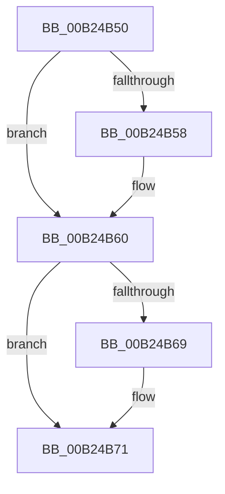

# sub_00B24B50

- RVA: `0x00B24B50`–`0x00B24B82` (길이 `50` bytes)
- VA: `0x0000000140B24B50`
- 실행 섹션: `PAGE`
- PDB 이름 있음: `아니요`; PDB Function 태그: `아니요`
- unwind 정보 RVA: `0x0008F2A0`
- 디코드: `15`개 명령, `50/50` bytes 표시
- 미해석 바이트: `0` (있으면 어셈블리에 `.byte`로 보존)

> 이 문서는 커널 이미지의 기계어와 PDB 기호를 분석해 생성했습니다. 4번과 5번은 함수 원형과 자료형을 바이너리 사용 방식에서 추정한 C 해석이며 원본 소스 복구 결과는 아닙니다.

## 1. Dependencies

- 직접 호출 지점: **3**; 고유 호출 대상: **1**
- 직접 호출자로 확인된 함수: **0**
- RIP 상대 이미지 참조: **0**

### Outgoing calls
- `0x00B24B5B` → [ExFreePoolWithTag](../../poolcode/B8/ExFreePoolWithTag_function_00B82870.md) (function, `0x00B82870`)
- `0x00B24B6C` → [ExFreePoolWithTag](../../poolcode/B8/ExFreePoolWithTag_function_00B82870.md) (function, `0x00B82870`)
- `0x00B24B77` → [ExFreePoolWithTag](../../poolcode/B8/ExFreePoolWithTag_function_00B82870.md) (function, `0x00B82870`)

### Direct callers
- 이 함수 시작 RVA로 연결되는 직접 call은 확인되지 않았습니다. 간접 호출은 완전히 역산할 수 없습니다.

### Static image references
- 디코드된 RIP-relative 메모리 참조가 없습니다.

## 2. Other-region calls and transfers

- 다른 실행 섹션으로 향하는 call: **3**
  - `0x00B24B5B` → [ExFreePoolWithTag](../../poolcode/B8/ExFreePoolWithTag_function_00B82870.md) (`PAGE` → `POOLCODE`)
  - `0x00B24B6C` → [ExFreePoolWithTag](../../poolcode/B8/ExFreePoolWithTag_function_00B82870.md) (`PAGE` → `POOLCODE`)
  - `0x00B24B77` → [ExFreePoolWithTag](../../poolcode/B8/ExFreePoolWithTag_function_00B82870.md) (`PAGE` → `POOLCODE`)
- call이 아닌 외부 분기/꼬리 이동: **1**
  - `0x00B24B7D` → [VrpCreateNamespaceNode + 0x230](../93/VrpCreateNamespaceNode_function_00935538.md) (`tail-transfer`)

## 3. Assembly (complete function range)

```asm
00B24B50  48 8B 0E                        mov rcx, qword ptr [rsi]
00B24B53  48 85 C9                        test rcx, rcx
00B24B56  74 08                           je 0x140b24b60
00B24B58  41 8B D6                        mov edx, r14d
00B24B5B  E8 10 DD 05 00                  call 0x140b82870
00B24B60  48 8B 4F 30                     mov rcx, qword ptr [rdi + 0x30]
00B24B64  48 85 C9                        test rcx, rcx
00B24B67  74 08                           je 0x140b24b71
00B24B69  41 8B D6                        mov edx, r14d
00B24B6C  E8 FF DC 05 00                  call 0x140b82870
00B24B71  41 8B D6                        mov edx, r14d
00B24B74  48 8B CF                        mov rcx, rdi
00B24B77  E8 F4 DC 05 00                  call 0x140b82870
00B24B7C  90                              nop
00B24B7D  E9 E6 0B E1 FF                  jmp 0x140935768
```

## 4. C-style interpretation (structured pseudocode)

```c
__int64 __fastcall sub_00B24B50(void)
{
    __int64 result;

    if (*(unsigned __int64 *)(v_rsi) != 0) {
        a2 = (unsigned int)(v_r14);
        result = ExFreePoolWithTag(*(unsigned __int64 *)(v_rsi), a2, a3, a4);
    }
    if (*(unsigned __int64 *)(v_rdi + 48) != 0) {
        a2 = (unsigned int)(v_r14);
        result = ExFreePoolWithTag(*(unsigned __int64 *)(v_rdi + 48), a2, a3, a4);
    }
    result = ExFreePoolWithTag(v_rdi, (unsigned int)((unsigned int)(v_r14)), a3, a4);
}
```

## 5. (Beta) C Style

```c
void sub_00B24B50(void)
{
    int64_t result;

    if (*(uint64_t *)(local_rsi) != 0) {
        a2 = (uint32_t)(local_r14);
        result = ExFreePoolWithTag(*(uint64_t *)(local_rsi), a2, a3, a4);
    }
    if (*(uint64_t *)(local_rdi + 0x30) != 0) {
        a2 = (uint32_t)(local_r14);
        result = ExFreePoolWithTag(*(uint64_t *)(local_rdi + 0x30), a2, a3, a4);
    }
    result = ExFreePoolWithTag(local_rdi, (uint32_t)((uint32_t)(local_r14)), a3, a4);
}
```

## 6. Execution-region graph

[열기: 2D/3D 그래프와 함수 탐색 컨트롤 패널](../../../control-panel.html?section=page&rva=0x00B24B50&view=graph)

- 2D 그래프는 위에서 아래로 흐르고, 3D 그래프는 빈 공간을 드래그해 회전합니다. Shift+드래그는 이동, 휠은 확대·축소, 함수 노드 선택은 대상 보고서 이동입니다.

### Static fallback


