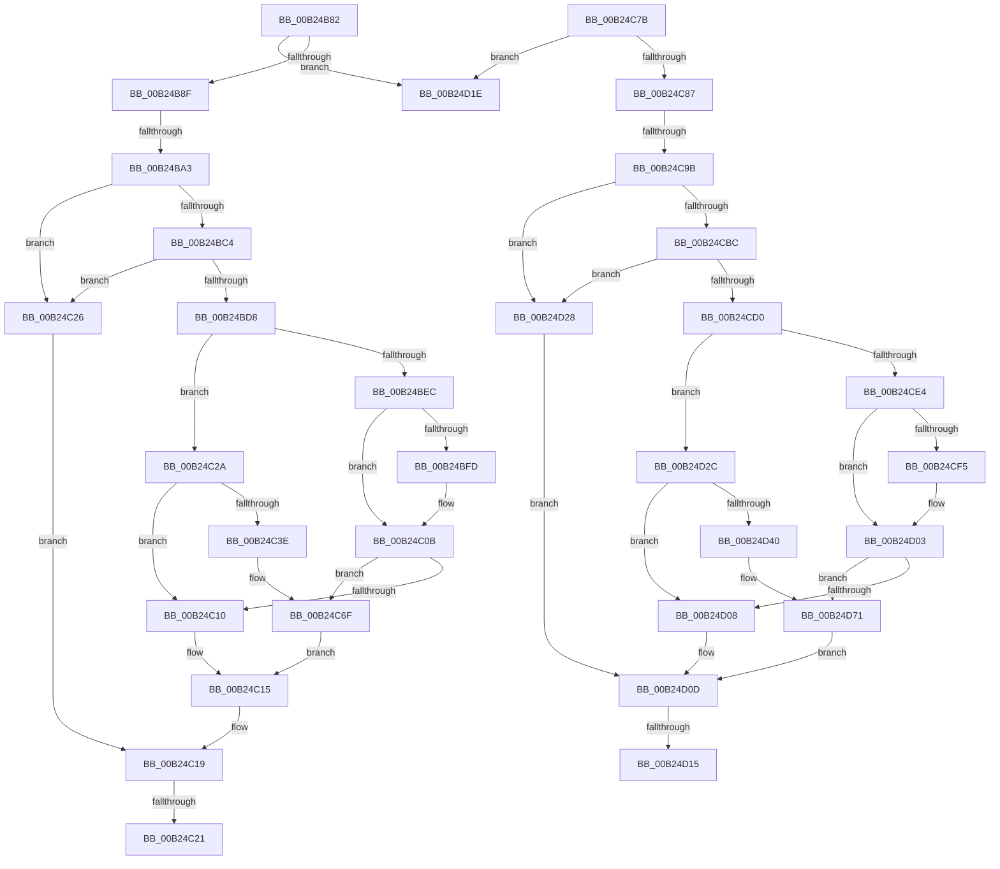

# sub_00B24B82

- RVA: `0x00B24B82`–`0x00B24D7D` (길이 `507` bytes)
- VA: `0x0000000140B24B82`
- 실행 섹션: `PAGE`
- PDB 이름 있음: `아니요`; PDB Function 태그: `아니요`
- unwind 정보 RVA: `0x0008F2EC`
- 디코드: `140`개 명령, `507/507` bytes 표시
- 미해석 바이트: `0` (있으면 어셈블리에 `.byte`로 보존)

> 이 문서는 커널 이미지의 기계어와 PDB 기호를 분석해 생성했습니다. 4번과 5번은 함수 원형과 자료형을 바이너리 사용 방식에서 추정한 C 해석이며 원본 소스 복구 결과는 아닙니다.

## 1. Dependencies

- 직접 호출 지점: **16**; 고유 호출 대상: **5**
- 직접 호출자로 확인된 함수: **0**
- RIP 상대 이미지 참조: **0**

### Outgoing calls
- `0x00B24BBB` → [ULongLongMult](../../text/44/ULongLongMult_function_00448380.md) (function, `0x00448380`)
- `0x00B24BCF` → [ULongLongMult](../../text/44/ULongLongMult_function_00448380.md) (function, `0x00448380`)
- `0x00B24BF0` → [ExAllocatePoolWithTag](../../poolcode/B8/ExAllocatePoolWithTag_function_00B82010.md) (function, `0x00B82010`)
- `0x00B24C06` → [memset](../../text/6C/memset_function_006C6C40.md) (function, `0x006C6C40`)
- `0x00B24C31` → [ExAllocatePoolWithTag](../../poolcode/B8/ExAllocatePoolWithTag_function_00B82010.md) (function, `0x00B82010`)
- `0x00B24C46` → [memset](../../text/6C/memset_function_006C6C40.md) (function, `0x006C6C40`)
- `0x00B24C5D` → [memcpy](../../text/6C/memcpy_function_006C6840.md) (function, `0x006C6840`)
- `0x00B24C6A` → [ExFreePoolWithTag](../../poolcode/B8/ExFreePoolWithTag_function_00B82870.md) (function, `0x00B82870`)
- `0x00B24CB3` → [ULongLongMult](../../text/44/ULongLongMult_function_00448380.md) (function, `0x00448380`)
- `0x00B24CC7` → [ULongLongMult](../../text/44/ULongLongMult_function_00448380.md) (function, `0x00448380`)
- `0x00B24CE8` → [ExAllocatePoolWithTag](../../poolcode/B8/ExAllocatePoolWithTag_function_00B82010.md) (function, `0x00B82010`)
- `0x00B24CFE` → [memset](../../text/6C/memset_function_006C6C40.md) (function, `0x006C6C40`)
- `0x00B24D33` → [ExAllocatePoolWithTag](../../poolcode/B8/ExAllocatePoolWithTag_function_00B82010.md) (function, `0x00B82010`)
- `0x00B24D48` → [memset](../../text/6C/memset_function_006C6C40.md) (function, `0x006C6C40`)
- `0x00B24D5F` → [memcpy](../../text/6C/memcpy_function_006C6840.md) (function, `0x006C6840`)
- `0x00B24D6C` → [ExFreePoolWithTag](../../poolcode/B8/ExFreePoolWithTag_function_00B82870.md) (function, `0x00B82870`)

### Direct callers
- 이 함수 시작 RVA로 연결되는 직접 call은 확인되지 않았습니다. 간접 호출은 완전히 역산할 수 없습니다.

### Static image references
- 디코드된 RIP-relative 메모리 참조가 없습니다.

## 2. Other-region calls and transfers

- 다른 실행 섹션으로 향하는 call: **16**
  - `0x00B24BBB` → [ULongLongMult](../../text/44/ULongLongMult_function_00448380.md) (`PAGE` → `.text`)
  - `0x00B24BCF` → [ULongLongMult](../../text/44/ULongLongMult_function_00448380.md) (`PAGE` → `.text`)
  - `0x00B24BF0` → [ExAllocatePoolWithTag](../../poolcode/B8/ExAllocatePoolWithTag_function_00B82010.md) (`PAGE` → `POOLCODE`)
  - `0x00B24C06` → [memset](../../text/6C/memset_function_006C6C40.md) (`PAGE` → `.text`)
  - `0x00B24C31` → [ExAllocatePoolWithTag](../../poolcode/B8/ExAllocatePoolWithTag_function_00B82010.md) (`PAGE` → `POOLCODE`)
  - `0x00B24C46` → [memset](../../text/6C/memset_function_006C6C40.md) (`PAGE` → `.text`)
  - `0x00B24C5D` → [memcpy](../../text/6C/memcpy_function_006C6840.md) (`PAGE` → `.text`)
  - `0x00B24C6A` → [ExFreePoolWithTag](../../poolcode/B8/ExFreePoolWithTag_function_00B82870.md) (`PAGE` → `POOLCODE`)
  - `0x00B24CB3` → [ULongLongMult](../../text/44/ULongLongMult_function_00448380.md) (`PAGE` → `.text`)
  - `0x00B24CC7` → [ULongLongMult](../../text/44/ULongLongMult_function_00448380.md) (`PAGE` → `.text`)
  - `0x00B24CE8` → [ExAllocatePoolWithTag](../../poolcode/B8/ExAllocatePoolWithTag_function_00B82010.md) (`PAGE` → `POOLCODE`)
  - `0x00B24CFE` → [memset](../../text/6C/memset_function_006C6C40.md) (`PAGE` → `.text`)
  - `0x00B24D33` → [ExAllocatePoolWithTag](../../poolcode/B8/ExAllocatePoolWithTag_function_00B82010.md) (`PAGE` → `POOLCODE`)
  - `0x00B24D48` → [memset](../../text/6C/memset_function_006C6C40.md) (`PAGE` → `.text`)
  - `0x00B24D5F` → [memcpy](../../text/6C/memcpy_function_006C6840.md) (`PAGE` → `.text`)
  - `0x00B24D6C` → [ExFreePoolWithTag](../../poolcode/B8/ExFreePoolWithTag_function_00B82870.md) (`PAGE` → `POOLCODE`)
- call이 아닌 외부 분기/꼬리 이동: **7**
  - `0x00B24B9D` → [VrpAddNamespaceNodeToList + 0x49](../93/VrpAddNamespaceNodeToList_function_00935A94.md) (`tail-transfer`)
  - `0x00B24C1B` → [VrpAddNamespaceNodeToList + 0x4B](../93/VrpAddNamespaceNodeToList_function_00935A94.md) (`tail-transfer`)
  - `0x00B24C21` → [VrpAddNamespaceNodeToList + 0x9D](../93/VrpAddNamespaceNodeToList_function_00935A94.md) (`tail-transfer`)
  - `0x00B24C95` → [VrpAddNamespaceNodeToList + 0x49](../93/VrpAddNamespaceNodeToList_function_00935A94.md) (`tail-transfer`)
  - `0x00B24D0F` → [VrpAddNamespaceNodeToList + 0x4B](../93/VrpAddNamespaceNodeToList_function_00935A94.md) (`tail-transfer`)
  - `0x00B24D19` → [VrpAddNamespaceNodeToList + 0x80](../93/VrpAddNamespaceNodeToList_function_00935A94.md) (`tail-transfer`)
  - `0x00B24D23` → [VrpAddNamespaceNodeToList + 0x4B](../93/VrpAddNamespaceNodeToList_function_00935A94.md) (`tail-transfer`)

## 3. Assembly (complete function range)

```asm
00B24B82  48 8D 56 01                     lea rdx, [rsi + 1]
00B24B86  48 3B D1                        cmp rdx, rcx
00B24B89  0F 86 8F 01 00 00               jbe 0x140b24d1e
00B24B8F  4C 8B 7B 40                     mov r15, qword ptr [rbx + 0x40]
00B24B93  49 FF CF                        dec r15
00B24B96  49 8D 04 17                     lea rax, [r15 + rdx]
00B24B9A  48 3B C2                        cmp rax, rdx
00B24B9D  0F 82 3A 0F E1 FF               jb 0x140935add
00B24BA3  48 8B 53 28                     mov rdx, qword ptr [rbx + 0x28]
00B24BA7  4C 8D 45 58                     lea r8, [rbp + 0x58]
00B24BAB  48 83 65 58 00                  and qword ptr [rbp + 0x58], 0
00B24BB0  49 F7 D7                        not r15
00B24BB3  48 83 65 50 00                  and qword ptr [rbp + 0x50], 0
00B24BB8  4C 23 F8                        and r15, rax
00B24BBB  E8 C0 37 92 FF                  call 0x140448380
00B24BC0  85 C0                           test eax, eax
00B24BC2  78 62                           js 0x140b24c26
00B24BC4  48 8B 53 28                     mov rdx, qword ptr [rbx + 0x28]
00B24BC8  4C 8D 45 50                     lea r8, [rbp + 0x50]
00B24BCC  49 8B CF                        mov rcx, r15
00B24BCF  E8 AC 37 92 FF                  call 0x140448380
00B24BD4  85 C0                           test eax, eax
00B24BD6  78 4E                           js 0x140b24c26
00B24BD8  4C 8B 63 48                     mov r12, qword ptr [rbx + 0x48]
00B24BDC  41 B8 52 54 61 72               mov r8d, 0x72615452
00B24BE2  B9 01 00 00 00                  mov ecx, 1
00B24BE7  4D 85 E4                        test r12, r12
00B24BEA  75 3E                           jne 0x140b24c2a
00B24BEC  48 8B 55 50                     mov rdx, qword ptr [rbp + 0x50]
00B24BF0  E8 1B D4 05 00                  call 0x140b82010
00B24BF5  4C 8B F0                        mov r14, rax
00B24BF8  48 85 C0                        test rax, rax
00B24BFB  74 0E                           je 0x140b24c0b
00B24BFD  4C 8B 45 50                     mov r8, qword ptr [rbp + 0x50]
00B24C01  33 D2                           xor edx, edx
00B24C03  48 8B C8                        mov rcx, rax
00B24C06  E8 35 20 BA FF                  call 0x1406c6c40
00B24C0B  4D 85 F6                        test r14, r14
00B24C0E  75 5F                           jne 0x140b24c6f
00B24C10  B8 17 00 00 C0                  mov eax, 0xc0000017
00B24C15  4C 8B 75 48                     mov r14, qword ptr [rbp + 0x48]
00B24C19  85 C0                           test eax, eax
00B24C1B  0F 85 BE 0E E1 FF               jne 0x140935adf
00B24C21  E9 0B 0F E1 FF                  jmp 0x140935b31
00B24C26  8B C7                           mov eax, edi
00B24C28  EB EF                           jmp 0x140b24c19
00B24C2A  4C 8B 6D 50                     mov r13, qword ptr [rbp + 0x50]
00B24C2E  49 8B D5                        mov rdx, r13
00B24C31  E8 DA D3 05 00                  call 0x140b82010
00B24C36  4C 8B F0                        mov r14, rax
00B24C39  48 85 C0                        test rax, rax
00B24C3C  74 D2                           je 0x140b24c10
00B24C3E  4D 8B C5                        mov r8, r13
00B24C41  33 D2                           xor edx, edx
00B24C43  48 8B C8                        mov rcx, rax
00B24C46  E8 F5 1F BA FF                  call 0x1406c6c40
00B24C4B  4C 39 6D 58                     cmp qword ptr [rbp + 0x58], r13
00B24C4F  49 8B D4                        mov rdx, r12
00B24C52  49 8B CE                        mov rcx, r14
00B24C55  4C 0F 42 6D 58                  cmovb r13, qword ptr [rbp + 0x58]
00B24C5A  4D 8B C5                        mov r8, r13
00B24C5D  E8 DE 1B BA FF                  call 0x1406c6840
00B24C62  BA 52 54 61 72                  mov edx, 0x72615452
00B24C67  49 8B CC                        mov rcx, r12
00B24C6A  E8 01 DC 05 00                  call 0x140b82870
00B24C6F  4C 89 73 48                     mov qword ptr [rbx + 0x48], r14
00B24C73  33 C0                           xor eax, eax
00B24C75  4C 89 7B 38                     mov qword ptr [rbx + 0x38], r15
00B24C79  EB 9A                           jmp 0x140b24c15
00B24C7B  48 FF C6                        inc rsi
00B24C7E  48 3B F1                        cmp rsi, rcx
00B24C81  0F 86 97 00 00 00               jbe 0x140b24d1e
00B24C87  4C 8B 73 40                     mov r14, qword ptr [rbx + 0x40]
00B24C8B  49 FF CE                        dec r14
00B24C8E  49 8D 04 36                     lea rax, [r14 + rsi]
00B24C92  48 3B C6                        cmp rax, rsi
00B24C95  0F 82 42 0E E1 FF               jb 0x140935add
00B24C9B  48 8B 53 28                     mov rdx, qword ptr [rbx + 0x28]
00B24C9F  4C 8D 45 58                     lea r8, [rbp + 0x58]
00B24CA3  48 83 65 58 00                  and qword ptr [rbp + 0x58], 0
00B24CA8  49 F7 D6                        not r14
00B24CAB  48 83 65 50 00                  and qword ptr [rbp + 0x50], 0
00B24CB0  4C 23 F0                        and r14, rax
00B24CB3  E8 C8 36 92 FF                  call 0x140448380
00B24CB8  85 C0                           test eax, eax
00B24CBA  78 6C                           js 0x140b24d28
00B24CBC  48 8B 53 28                     mov rdx, qword ptr [rbx + 0x28]
00B24CC0  4C 8D 45 50                     lea r8, [rbp + 0x50]
00B24CC4  49 8B CE                        mov rcx, r14
00B24CC7  E8 B4 36 92 FF                  call 0x140448380
00B24CCC  85 C0                           test eax, eax
00B24CCE  78 58                           js 0x140b24d28
00B24CD0  4C 8B 6B 48                     mov r13, qword ptr [rbx + 0x48]
00B24CD4  41 B8 52 54 61 72               mov r8d, 0x72615452
00B24CDA  B9 01 00 00 00                  mov ecx, 1
00B24CDF  4D 85 ED                        test r13, r13
00B24CE2  75 48                           jne 0x140b24d2c
00B24CE4  48 8B 55 50                     mov rdx, qword ptr [rbp + 0x50]
00B24CE8  E8 23 D3 05 00                  call 0x140b82010
00B24CED  48 8B F0                        mov rsi, rax
00B24CF0  48 85 C0                        test rax, rax
00B24CF3  74 0E                           je 0x140b24d03
00B24CF5  4C 8B 45 50                     mov r8, qword ptr [rbp + 0x50]
00B24CF9  33 D2                           xor edx, edx
00B24CFB  48 8B C8                        mov rcx, rax
00B24CFE  E8 3D 1F BA FF                  call 0x1406c6c40
00B24D03  48 85 F6                        test rsi, rsi
00B24D06  75 69                           jne 0x140b24d71
00B24D08  B8 17 00 00 C0                  mov eax, 0xc0000017
00B24D0D  85 C0                           test eax, eax
00B24D0F  0F 85 CA 0D E1 FF               jne 0x140935adf
00B24D15  4C 8B 75 48                     mov r14, qword ptr [rbp + 0x48]
00B24D19  E9 F6 0D E1 FF                  jmp 0x140935b14
00B24D1E  B8 0D 00 00 C0                  mov eax, 0xc000000d
00B24D23  E9 B7 0D E1 FF                  jmp 0x140935adf
00B24D28  8B C7                           mov eax, edi
00B24D2A  EB E1                           jmp 0x140b24d0d
00B24D2C  4C 8B 65 50                     mov r12, qword ptr [rbp + 0x50]
00B24D30  49 8B D4                        mov rdx, r12
00B24D33  E8 D8 D2 05 00                  call 0x140b82010
00B24D38  48 8B F0                        mov rsi, rax
00B24D3B  48 85 C0                        test rax, rax
00B24D3E  74 C8                           je 0x140b24d08
00B24D40  4D 8B C4                        mov r8, r12
00B24D43  33 D2                           xor edx, edx
00B24D45  48 8B C8                        mov rcx, rax
00B24D48  E8 F3 1E BA FF                  call 0x1406c6c40
00B24D4D  4C 39 65 58                     cmp qword ptr [rbp + 0x58], r12
00B24D51  49 8B D5                        mov rdx, r13
00B24D54  48 8B CE                        mov rcx, rsi
00B24D57  4C 0F 42 65 58                  cmovb r12, qword ptr [rbp + 0x58]
00B24D5C  4D 8B C4                        mov r8, r12
00B24D5F  E8 DC 1A BA FF                  call 0x1406c6840
00B24D64  BA 52 54 61 72                  mov edx, 0x72615452
00B24D69  49 8B CD                        mov rcx, r13
00B24D6C  E8 FF DA 05 00                  call 0x140b82870
00B24D71  48 89 73 48                     mov qword ptr [rbx + 0x48], rsi
00B24D75  33 C0                           xor eax, eax
00B24D77  4C 89 73 38                     mov qword ptr [rbx + 0x38], r14
00B24D7B  EB 90                           jmp 0x140b24d0d
```

## 4. C-style interpretation (structured pseudocode)

```c
__int64 __fastcall sub_00B24B82(__int64 a1)
{
    __int64 result;
    __int64 v_r13;
    __int64 v_r15;

    if ((v_rsi + 1) <= a1) goto loc_00B24D1E;
    v_r15 = (*(unsigned __int64 *)(v_rbx + 64)) - 1;
    v_r15 = ~(v_r15);
    v_r15 = (v_r15) & (v_r15 + v_rsi + 1 * 1);
    result = ULongLongMult(a1, *(unsigned __int64 *)(v_rbx + 40), v_rbp + 88, a4);
    if (sign_flag) goto loc_00B24C26;
    result = ULongLongMult(v_r15, *(unsigned __int64 *)(v_rbx + 40), v_rbp + 80, a4);
    if (sign_flag) goto loc_00B24C26;
    if (*(unsigned __int64 *)(v_rbx + 72) != 0) goto loc_00B24C2A;
    result = ExAllocatePoolWithTag(1, *(unsigned __int64 *)(v_rbp + 80), (unsigned int)(0x72615452ULL), a4);
    if (result != 0) {
        a3 = *(unsigned __int64 *)(v_rbp + 80);
        a2 = 0;
        a1 = result;
        result = memset(a1, a2, a3, a4);
    }
    if (result != 0) goto loc_00B24C6F;
loc_00B24C10:
loc_00B24C15:
loc_00B24C19:
loc_00B24C26:
    goto loc_00B24C19;
loc_00B24C2A:
    result = ExAllocatePoolWithTag(a1, *(unsigned __int64 *)(v_rbp + 80), a3, a4);
    if (result == 0) goto loc_00B24C10;
    a2 = 0;
    result = memset(result, a2, *(unsigned __int64 *)(v_rbp + 80), a4);
    v_r13 = *(unsigned __int64 *)(v_rbp + 80);
    if ((*(unsigned __int64 *)(v_rbp + 88)) < (*(unsigned __int64 *)(v_rbp + 80))) { v_r13 = *(unsigned __int64 *)(v_rbp + 88); }
    result = memcpy(result, *(unsigned __int64 *)(v_rbx + 72), v_r13, a4);
    result = ExFreePoolWithTag(*(unsigned __int64 *)(v_rbx + 72), (unsigned int)(0x72615452ULL), v_r13, a4);
loc_00B24C6F:
    *(unsigned __int64 *)(v_rbx + 72) = result;
    result = 0;
    *(unsigned __int64 *)(v_rbx + 56) = v_r15;
    goto loc_00B24C15;
loc_00B24D1E:
}
```

## 5. (Beta) C Style

```c
int64_t sub_00B24B82(int64_t Arg1)
{
    int64_t result;
    int64_t local_r13;
    int64_t local_r15;

    if ((local_rsi + 1) <= Arg1) goto loc_00B24D1E;
    local_r15 = (*(uint64_t *)(local_rbx + 0x40)) - 1;
    local_r15 = ~(local_r15);
    local_r15 = (local_r15) & (local_r15 + local_rsi + 1 * 1);
    result = ULongLongMult(Arg1, *(uint64_t *)(local_rbx + 0x28), local_rbp + 88, a4);
    if (sign_flag) goto loc_00B24C26;
    result = ULongLongMult(local_r15, *(uint64_t *)(local_rbx + 0x28), local_rbp + 80, a4);
    if (sign_flag) goto loc_00B24C26;
    if (*(uint64_t *)(local_rbx + 0x48) != 0) goto loc_00B24C2A;
    result = ExAllocatePoolWithTag(1, *(uint64_t *)(local_rbp + 0x50), (uint32_t)(0x72615452ULL), a4);
    if (result != 0) {
        a3 = *(uint64_t *)(local_rbp + 0x50);
        a2 = 0;
        Arg1 = result;
        result = memset(Arg1, a2, a3, a4);
    }
    if (result != 0) goto loc_00B24C6F;
loc_00B24C10:
loc_00B24C15:
loc_00B24C19:
loc_00B24C26:
    goto loc_00B24C19;
loc_00B24C2A:
    result = ExAllocatePoolWithTag(Arg1, *(uint64_t *)(local_rbp + 0x50), a3, a4);
    if (result == 0) goto loc_00B24C10;
    a2 = 0;
    result = memset(result, a2, *(uint64_t *)(local_rbp + 0x50), a4);
    local_r13 = *(uint64_t *)(local_rbp + 0x50);
    if ((*(uint64_t *)(local_rbp + 0x58)) < (*(uint64_t *)(local_rbp + 0x50))) { local_r13 = *(uint64_t *)(local_rbp + 0x58); }
    result = memcpy(result, *(uint64_t *)(local_rbx + 0x48), local_r13, a4);
    result = ExFreePoolWithTag(*(uint64_t *)(local_rbx + 0x48), (uint32_t)(0x72615452ULL), local_r13, a4);
loc_00B24C6F:
    *(uint64_t *)(local_rbx + 0x48) = result;
    result = 0;
    *(uint64_t *)(local_rbx + 0x38) = local_r15;
    goto loc_00B24C15;
loc_00B24D1E:
}
```

## 6. Execution-region graph

[열기: 2D/3D 그래프와 함수 탐색 컨트롤 패널](../../../control-panel.html?section=page&rva=0x00B24B82&view=graph)

- 2D 그래프는 위에서 아래로 흐르고, 3D 그래프는 빈 공간을 드래그해 회전합니다. Shift+드래그는 이동, 휠은 확대·축소, 함수 노드 선택은 대상 보고서 이동입니다.

### Static fallback


