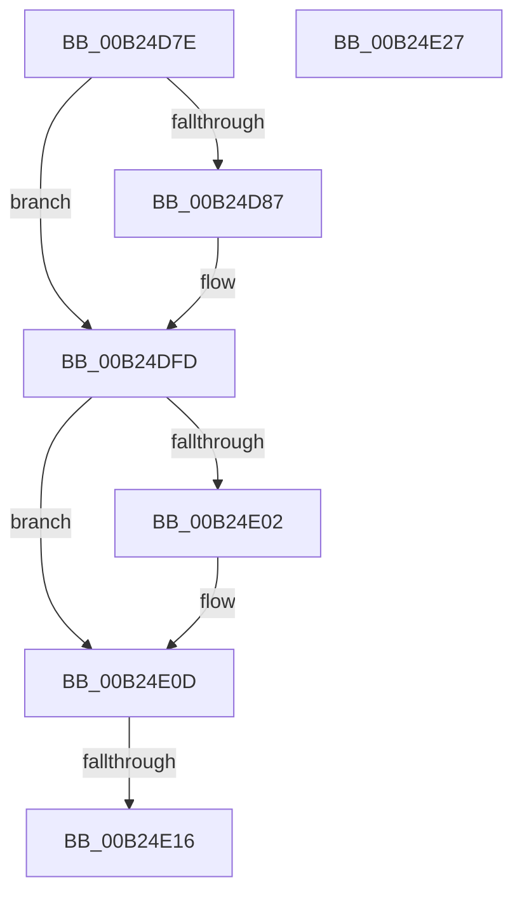

# sub_00B24D7E

- RVA: `0x00B24D7E`–`0x00B24EA0` (길이 `290` bytes)
- VA: `0x0000000140B24D7E`
- 실행 섹션: `PAGE`
- PDB 이름 있음: `아니요`; PDB Function 태그: `아니요`
- unwind 정보 RVA: `0x0008F384`
- 디코드: `64`개 명령, `290/290` bytes 표시
- 미해석 바이트: `0` (있으면 어셈블리에 `.byte`로 보존)

> 이 문서는 커널 이미지의 기계어와 PDB 기호를 분석해 생성했습니다. 4번과 5번은 함수 원형과 자료형을 바이너리 사용 방식에서 추정한 C 해석이며 원본 소스 복구 결과는 아닙니다.

## 1. Dependencies

- 직접 호출 지점: **4**; 고유 호출 대상: **3**
- 직접 호출자로 확인된 함수: **0**
- RIP 상대 이미지 참조: **4**

### Outgoing calls
- `0x00B24DF5` → [tlgWriteTransfer_EtwWriteTransfer](../../text/42/tlgWriteTransfer_EtwWriteTransfer_function_004260E0.md) (function, `0x004260E0`)
- `0x00B24E05` → [VrpFreeKeyContext](../9F/VrpFreeKeyContext_function_009FEED4.md) (function, `0x009FEED4`)
- `0x00B24E1A` → [CmpFreeExtraParameter](../87/CmpFreeExtraParameter_function_00876894.md) (function, `0x00876894`)
- `0x00B24E95` → [tlgWriteTransfer_EtwWriteTransfer](../../text/42/tlgWriteTransfer_EtwWriteTransfer_function_004260E0.md) (function, `0x004260E0`)

### Direct callers
- 이 함수 시작 RVA로 연결되는 직접 call은 확인되지 않았습니다. 간접 호출은 완전히 역산할 수 없습니다.

### Static image references
- `0x00B24D7E` → RVA `0x00E0A630` (`.data`; read)
- `0x00B24D8B` → RVA `0x00002F28` (`.rdata`; read)
- `0x00B24DC7` → RVA `0x0005A830` (`.rdata`; read)
- `0x00B24E67` → RVA `0x0005AAD5` (`.rdata`; read)

## 2. Other-region calls and transfers

- 다른 실행 섹션으로 향하는 call: **2**
  - `0x00B24DF5` → [tlgWriteTransfer_EtwWriteTransfer](../../text/42/tlgWriteTransfer_EtwWriteTransfer_function_004260E0.md) (`PAGE` → `.text`)
  - `0x00B24E95` → [tlgWriteTransfer_EtwWriteTransfer](../../text/42/tlgWriteTransfer_EtwWriteTransfer_function_004260E0.md) (`PAGE` → `.text`)
- call이 아닌 외부 분기/꼬리 이동: **3**
  - `0x00B24E10` → [VrpPostOpenOrCreate + 0x1FE](../93/VrpPostOpenOrCreate_function_00936510.md) (`tail-transfer`)
  - `0x00B24E22` → [VrpPostOpenOrCreate + 0x1FE](../93/VrpPostOpenOrCreate_function_00936510.md) (`tail-transfer`)
  - `0x00B24E9B` → [VrpPostOpenOrCreate + 0x245](../93/VrpPostOpenOrCreate_function_00936510.md) (`tail-transfer`)

## 3. Assembly (complete function range)

```asm
00B24D7E  83 3D AB 58 2E 00 02            cmp dword ptr [rip + 0x2e58ab], 2
00B24D85  76 76                           jbe 0x140b24dfd
00B24D87  49 8B 04 24                     mov rax, qword ptr [r12]
00B24D8B  48 8D 0D 96 E1 4D FF            lea rcx, [rip - 0xb21e6a]
00B24D92  4C 8D 45 B7                     lea r8, [rbp - 0x49]
00B24D96  4C 39 48 08                     cmp qword ptr [rax + 8], r9
00B24D9A  48 0F 45 C8                     cmovne rcx, rax
00B24D9E  48 8B 41 08                     mov rax, qword ptr [rcx + 8]
00B24DA2  0F B7 11                        movzx edx, word ptr [rcx]
00B24DA5  48 8D 4D FF                     lea rcx, [rbp - 1]
00B24DA9  48 89 45 F7                     mov qword ptr [rbp - 9], rax
00B24DAD  48 8D 45 A7                     lea rax, [rbp - 0x59]
00B24DB1  48 89 45 07                     mov qword ptr [rbp + 7], rax
00B24DB5  48 8D 45 C7                     lea rax, [rbp - 0x39]
00B24DB9  48 89 4D E7                     mov qword ptr [rbp - 0x19], rcx
00B24DBD  48 8D 0D 6C 58 2E 00            lea rcx, [rip + 0x2e586c]
00B24DC4  89 55 FF                        mov dword ptr [rbp - 1], edx
00B24DC7  48 8D 15 62 5A 53 FF            lea rdx, [rip - 0xaca59e]
00B24DCE  44 89 4D 03                     mov dword ptr [rbp + 3], r9d
00B24DD2  45 33 C9                        xor r9d, r9d
00B24DD5  48 89 44 24 28                  mov qword ptr [rsp + 0x28], rax
00B24DDA  C7 44 24 20 05 00 00 00         mov dword ptr [rsp + 0x20], 5
00B24DE2  48 C7 45 EF 02 00 00 00         mov qword ptr [rbp - 0x11], 2
00B24DEA  89 5D A7                        mov dword ptr [rbp - 0x59], ebx
00B24DED  48 C7 45 0F 04 00 00 00         mov qword ptr [rbp + 0xf], 4
00B24DF5  E8 E6 12 90 FF                  call 0x1404260e0
00B24DFA  45 33 C9                        xor r9d, r9d
00B24DFD  4D 85 F6                        test r14, r14
00B24E00  74 0B                           je 0x140b24e0d
00B24E02  49 8B CE                        mov rcx, r14
00B24E05  E8 CA A0 ED FF                  call 0x1409feed4
00B24E0A  45 33 C9                        xor r9d, r9d
00B24E0D  4D 85 FF                        test r15, r15
00B24E10  0F 84 F8 18 E1 FF               je 0x14093670e
00B24E16  49 8D 4F D0                     lea rcx, [r15 - 0x30]
00B24E1A  E8 75 1A D5 FF                  call 0x140876894
00B24E1F  45 33 C9                        xor r9d, r9d
00B24E22  E9 E7 18 E1 FF                  jmp 0x14093670e
00B24E27  49 8B 04 24                     mov rax, qword ptr [r12]
00B24E2B  48 8D 0D F6 E0 4D FF            lea rcx, [rip - 0xb21f0a]
00B24E32  4C 8D 45 B7                     lea r8, [rbp - 0x49]
00B24E36  4C 39 48 08                     cmp qword ptr [rax + 8], r9
00B24E3A  48 0F 45 C8                     cmovne rcx, rax
00B24E3E  48 8B 41 08                     mov rax, qword ptr [rcx + 8]
00B24E42  0F B7 11                        movzx edx, word ptr [rcx]
00B24E45  48 8D 4D FF                     lea rcx, [rbp - 1]
00B24E49  48 89 45 F7                     mov qword ptr [rbp - 9], rax
00B24E4D  48 8D 45 A7                     lea rax, [rbp - 0x59]
00B24E51  48 89 45 07                     mov qword ptr [rbp + 7], rax
00B24E55  48 8D 45 C7                     lea rax, [rbp - 0x39]
00B24E59  48 89 4D E7                     mov qword ptr [rbp - 0x19], rcx
00B24E5D  48 8D 0D CC 57 2E 00            lea rcx, [rip + 0x2e57cc]
00B24E64  89 55 FF                        mov dword ptr [rbp - 1], edx
00B24E67  48 8D 15 67 5C 53 FF            lea rdx, [rip - 0xaca399]
00B24E6E  44 89 4D 03                     mov dword ptr [rbp + 3], r9d
00B24E72  45 33 C9                        xor r9d, r9d
00B24E75  48 89 44 24 28                  mov qword ptr [rsp + 0x28], rax
00B24E7A  C7 44 24 20 05 00 00 00         mov dword ptr [rsp + 0x20], 5
00B24E82  48 C7 45 EF 02 00 00 00         mov qword ptr [rbp - 0x11], 2
00B24E8A  89 5D A7                        mov dword ptr [rbp - 0x59], ebx
00B24E8D  48 C7 45 0F 04 00 00 00         mov qword ptr [rbp + 0xf], 4
00B24E95  E8 46 12 90 FF                  call 0x1404260e0
00B24E9A  90                              nop
00B24E9B  E9 B5 18 E1 FF                  jmp 0x140936755
```

## 4. C-style interpretation (structured pseudocode)

```c
__int64 __fastcall sub_00B24D7E(__int64 a1, __int64 a2, __int64 a3, __int64 a4)
{
    __int64 result;
    unsigned int v_stack_p20;
    unsigned __int64 v_stack_p28;

    if ((*(unsigned int *)(v_rip + 3037355)) >= = 2) {
        result = *(unsigned __int64 *)(v_r12);
        a1 = v_rip - 11673194;
        a3 = v_rbp - 73;
        if ((*(unsigned __int64 *)(result + 8)) != a4) { a1 = result; }
        result = *(unsigned __int64 *)(a1 + 8);
        a2 = *(unsigned __int16 *)(a1);
        a1 = v_rbp - 1;
        *(unsigned __int64 *)(v_rbp - 9) = result;
        result = v_rbp - 89;
        *(unsigned __int64 *)(v_rbp + 7) = result;
        result = v_rbp - 57;
        *(unsigned __int64 *)(v_rbp - 25) = a1;
        a1 = v_rip + 3037292;
        *(unsigned int *)(v_rbp - 1) = (unsigned int)(a2);
        a2 = v_rip - 11314590;
        *(unsigned int *)(v_rbp + 3) = (unsigned int)(a4);
        a4 = 0;
        v_stack_p28 = result;
        v_stack_p20 = 5;
        *(unsigned __int64 *)(v_rbp - 17) = 2;
        *(unsigned int *)(v_rbp - 89) = (unsigned int)(v_rbx);
        *(unsigned __int64 *)(v_rbp + 15) = 4;
        result = tlgWriteTransfer_EtwWriteTransfer(a1, a2, a3, a4);
        a4 = 0;
    }
    if (v_r14 != 0) {
        a1 = v_r14;
        result = VrpFreeKeyContext(a1, a2, a3, a4);
        a4 = 0;
    }
    result = CmpFreeExtraParameter(v_r15 - 48, a2, a3, a4);
    a4 = 0;
}
```

## 5. (Beta) C Style

```c
int64_t sub_00B24D7E(int64_t Arg1, int64_t Arg2, int64_t Arg3, int64_t Arg4)
{
    int64_t result;
    uint32_t v_stack_p20;
    uint64_t v_stack_p28;

    if ((*(uint32_t *)(v_rip + 0x2E58AB)) >= = 2) {
        result = *(uint64_t *)(local_r12);
        Arg1 = v_rip - 11673194;
        Arg3 = local_rbp - 73;
        if ((*(uint64_t *)(result + 0x8)) != Arg4) { Arg1 = result; }
        result = *(uint64_t *)(Arg1 + 0x8);
        Arg2 = *(uint16_t *)(Arg1);
        Arg1 = local_rbp - 1;
        *(uint64_t *)(local_rbp - 0x9) = result;
        result = local_rbp - 89;
        *(uint64_t *)(local_rbp + 0x7) = result;
        result = local_rbp - 57;
        *(uint64_t *)(local_rbp - 0x19) = Arg1;
        Arg1 = v_rip + 3037292;
        *(uint32_t *)(local_rbp - 0x1) = (uint32_t)(Arg2);
        Arg2 = v_rip - 11314590;
        *(uint32_t *)(local_rbp + 0x3) = (uint32_t)(Arg4);
        Arg4 = 0;
        v_stack_p28 = result;
        v_stack_p20 = 5;
        *(uint64_t *)(local_rbp - 0x11) = 2;
        *(uint32_t *)(local_rbp - 0x59) = (uint32_t)(local_rbx);
        *(uint64_t *)(local_rbp + 0xF) = 4;
        result = tlgWriteTransfer_EtwWriteTransfer(Arg1, Arg2, Arg3, Arg4);
        Arg4 = 0;
    }
    if (local_r14 != 0) {
        Arg1 = local_r14;
        result = VrpFreeKeyContext(Arg1, Arg2, Arg3, Arg4);
        Arg4 = 0;
    }
    result = CmpFreeExtraParameter(local_r15 - 48, Arg2, Arg3, Arg4);
    Arg4 = 0;
}
```

## 6. Execution-region graph

[열기: 2D/3D 그래프와 함수 탐색 컨트롤 패널](../../../control-panel.html?section=page&rva=0x00B24D7E&view=graph)

- 2D 그래프는 위에서 아래로 흐르고, 3D 그래프는 빈 공간을 드래그해 회전합니다. Shift+드래그는 이동, 휠은 확대·축소, 함수 노드 선택은 대상 보고서 이동입니다.

### Static fallback


