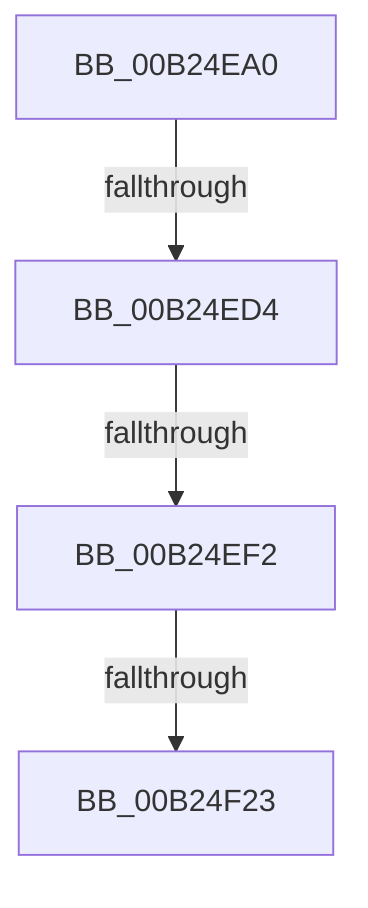

# sub_00B24EA0

- RVA: `0x00B24EA0`–`0x00B24F3F` (길이 `159` bytes)
- VA: `0x0000000140B24EA0`
- 실행 섹션: `PAGE`
- PDB 이름 있음: `아니요`; PDB Function 태그: `아니요`
- unwind 정보 RVA: `0x0008F454`
- 디코드: `40`개 명령, `159/159` bytes 표시
- 미해석 바이트: `0` (있으면 어셈블리에 `.byte`로 보존)

> 이 문서는 커널 이미지의 기계어와 PDB 기호를 분석해 생성했습니다. 4번과 5번은 함수 원형과 자료형을 바이너리 사용 방식에서 추정한 C 해석이며 원본 소스 복구 결과는 아닙니다.

## 1. Dependencies

- 직접 호출 지점: **6**; 고유 호출 대상: **6**
- 직접 호출자로 확인된 함수: **0**
- RIP 상대 이미지 참조: **3**

### Outgoing calls
- `0x00B24EBA` → [RtlUnicodeStringCopy](../../text/3D/RtlUnicodeStringCopy_function_003D4130.md) (function, `0x003D4130`)
- `0x00B24EC2` → [CmInitSiloNamespace](../9E/CmInitSiloNamespace_function_009E7DD8.md) (function, `0x009E7DD8`)
- `0x00B24EE0` → [PsInsertSiloContext](../9E/PsInsertSiloContext_function_009E7D40.md) (function, `0x009E7D40`)
- `0x00B24EF9` → [CmGetRootKeyObjectForSilo](../9E/CmGetRootKeyObjectForSilo_function_009E7CCC.md) (function, `0x009E7CCC`)
- `0x00B24F11` → [CmSetCallbackObjectContext](../93/CmSetCallbackObjectContext_function_009368D0.md) (function, `0x009368D0`)
- `0x00B24F2F` → [PsMakeSiloContextPermanent](../70/PsMakeSiloContextPermanent_function_007049A0.md) (function, `0x007049A0`)

### Direct callers
- 이 함수 시작 RVA로 연결되는 직접 call은 확인되지 않았습니다. 간접 호출은 완전히 역산할 수 없습니다.

### Static image references
- `0x00B24EA8` → RVA `0x00FD9F98` (`PAGEDATA`; read)
- `0x00B24ED4` → RVA `0x00EF02B8` (`.data`; read)
- `0x00B24F01` → RVA `0x00EF02C8` (`.data`; read)

## 2. Other-region calls and transfers

- 다른 실행 섹션으로 향하는 call: **1**
  - `0x00B24EBA` → [RtlUnicodeStringCopy](../../text/3D/RtlUnicodeStringCopy_function_003D4130.md) (`PAGE` → `.text`)
- call이 아닌 외부 분기/꼬리 이동: **4**
  - `0x00B24ECE` → [VrpHandleIoctlInitializeJobForVreg + 0x25C](../93/VrpHandleIoctlInitializeJobForVreg_function_00937254.md) (`tail-transfer`)
  - `0x00B24EEC` → [VrpHandleIoctlInitializeJobForVreg + 0x25C](../93/VrpHandleIoctlInitializeJobForVreg_function_00937254.md) (`tail-transfer`)
  - `0x00B24F1D` → [VrpHandleIoctlInitializeJobForVreg + 0x25C](../93/VrpHandleIoctlInitializeJobForVreg_function_00937254.md) (`tail-transfer`)
  - `0x00B24F3A` → [VrpHandleIoctlInitializeJobForVreg + 0x260](../93/VrpHandleIoctlInitializeJobForVreg_function_00937254.md) (`tail-transfer`)

## 3. Assembly (complete function range)

```asm
00B24EA0  48 8D 4E 10                     lea rcx, [rsi + 0x10]
00B24EA4  66 44 89 09                     mov word ptr [rcx], r9w
00B24EA8  48 8D 15 E9 50 4B 00            lea rdx, [rip + 0x4b50e9]
00B24EAF  0F B7 05 E2 50 4B 00            movzx eax, word ptr [rip + 0x4b50e2]
00B24EB6  66 89 46 12                     mov word ptr [rsi + 0x12], ax
00B24EBA  E8 71 F2 8A FF                  call 0x1403d4130
00B24EBF  49 8B CE                        mov rcx, r14
00B24EC2  E8 11 2F EC FF                  call 0x1409e7dd8
00B24EC7  45 33 C9                        xor r9d, r9d
00B24ECA  8B D8                           mov ebx, eax
00B24ECC  85 C0                           test eax, eax
00B24ECE  0F 88 DC 25 E1 FF               js 0x1409374b0
00B24ED4  8B 15 DE B3 3C 00               mov edx, dword ptr [rip + 0x3cb3de]
00B24EDA  4C 8B C7                        mov r8, rdi
00B24EDD  49 8B CE                        mov rcx, r14
00B24EE0  E8 5B 2E EC FF                  call 0x1409e7d40
00B24EE5  45 33 C9                        xor r9d, r9d
00B24EE8  8B D8                           mov ebx, eax
00B24EEA  85 C0                           test eax, eax
00B24EEC  0F 88 BE 25 E1 FF               js 0x1409374b0
00B24EF2  49 8B CE                        mov rcx, r14
00B24EF5  44 89 65 48                     mov dword ptr [rbp + 0x48], r12d
00B24EF9  E8 CE 2D EC FF                  call 0x1409e7ccc
00B24EFE  45 33 C9                        xor r9d, r9d
00B24F01  48 8D 15 C0 B3 3C 00            lea rdx, [rip + 0x3cb3c0]
00B24F08  4C 8B C6                        mov r8, rsi
00B24F0B  48 8B C8                        mov rcx, rax
00B24F0E  4C 8B F8                        mov r15, rax
00B24F11  E8 BA 19 E1 FF                  call 0x1409368d0
00B24F16  45 33 C9                        xor r9d, r9d
00B24F19  8B D8                           mov ebx, eax
00B24F1B  85 C0                           test eax, eax
00B24F1D  0F 88 8D 25 E1 FF               js 0x1409374b0
00B24F23  8B 15 8F B3 3C 00               mov edx, dword ptr [rip + 0x3cb38f]
00B24F29  49 8B CE                        mov rcx, r14
00B24F2C  41 8B F1                        mov esi, r9d
00B24F2F  E8 6C FA BD FF                  call 0x1407049a0
00B24F34  45 33 C9                        xor r9d, r9d
00B24F37  41 8B D9                        mov ebx, r9d
00B24F3A  E9 75 25 E1 FF                  jmp 0x1409374b4
```

## 4. C-style interpretation (structured pseudocode)

```c
__int64 __fastcall sub_00B24EA0(__int64 a1, __int64 a2, __int64 a3, int a4)
{
    __int64 result;

    *(unsigned __int16 *)(v_rsi + 16) = (unsigned __int16)(a4);
    *(unsigned __int16 *)(v_rsi + 18) = (unsigned __int16)(*(unsigned __int16 *)(v_rip + 4935906));
    result = RtlUnicodeStringCopy(v_rsi + 16, v_rip + 4935913, a3, a4);
    result = CmInitSiloNamespace(v_r14, v_rip + 4935913, a3, a4);
    a4 = 0;
    result = PsInsertSiloContext(v_r14, (unsigned int)(*(unsigned int *)(v_rip + 3978206)), v_rdi, a4);
    a4 = 0;
    *(unsigned int *)(v_rbp + 72) = (unsigned int)(v_r12);
    result = CmGetRootKeyObjectForSilo(v_r14, (unsigned int)(*(unsigned int *)(v_rip + 3978206)), v_rdi, a4);
    a4 = 0;
    result = CmSetCallbackObjectContext(result, v_rip + 3978176, v_rsi, a4);
    a4 = 0;
    result = PsMakeSiloContextPermanent(v_r14, (unsigned int)(*(unsigned int *)(v_rip + 3978127)), v_rsi, a4);
    a4 = 0;
}
```

## 5. (Beta) C Style

```c
int64_t sub_00B24EA0(int64_t Arg1, int64_t Arg2, int64_t Arg3, int32_t Arg4)
{
    int64_t result;

    *(uint16_t *)(local_rsi + 0x10) = (uint16_t)(Arg4);
    *(uint16_t *)(local_rsi + 0x12) = (uint16_t)(*(uint16_t *)(v_rip + 0x4B50E2));
    result = RtlUnicodeStringCopy(local_rsi + 16, v_rip + 4935913, Arg3, Arg4);
    result = CmInitSiloNamespace(local_r14, v_rip + 4935913, Arg3, Arg4);
    Arg4 = 0;
    result = PsInsertSiloContext(local_r14, (uint32_t)(*(uint32_t *)(v_rip + 0x3CB3DE)), local_rdi, Arg4);
    Arg4 = 0;
    *(uint32_t *)(local_rbp + 0x48) = (uint32_t)(local_r12);
    result = CmGetRootKeyObjectForSilo(local_r14, (uint32_t)(*(uint32_t *)(v_rip + 0x3CB3DE)), local_rdi, Arg4);
    Arg4 = 0;
    result = CmSetCallbackObjectContext(result, v_rip + 3978176, local_rsi, Arg4);
    Arg4 = 0;
    result = PsMakeSiloContextPermanent(local_r14, (uint32_t)(*(uint32_t *)(v_rip + 0x3CB38F)), local_rsi, Arg4);
    Arg4 = 0;
}
```

## 6. Execution-region graph

[열기: 2D/3D 그래프와 함수 탐색 컨트롤 패널](../../../control-panel.html?section=page&rva=0x00B24EA0&view=graph)

- 2D 그래프는 위에서 아래로 흐르고, 3D 그래프는 빈 공간을 드래그해 회전합니다. Shift+드래그는 이동, 휠은 확대·축소, 함수 노드 선택은 대상 보고서 이동입니다.

### Static fallback


