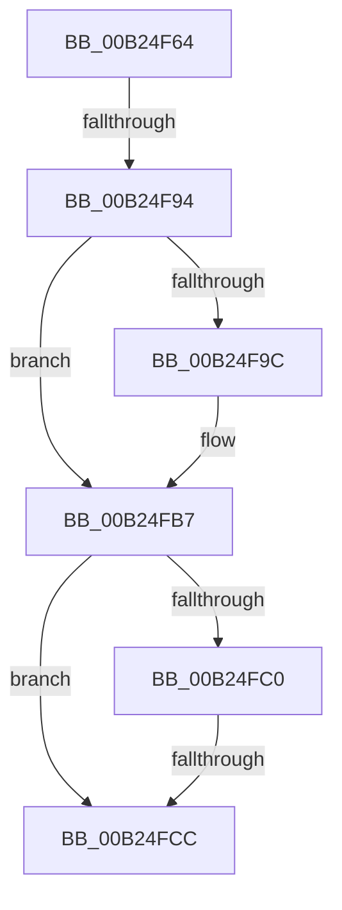

# sub_00B24F64

- RVA: `0x00B24F64`–`0x00B24FD6` (길이 `114` bytes)
- VA: `0x0000000140B24F64`
- 실행 섹션: `PAGE`
- PDB 이름 있음: `아니요`; PDB Function 태그: `아니요`
- unwind 정보 RVA: `0x0008FB84`
- 디코드: `28`개 명령, `114/114` bytes 표시
- 미해석 바이트: `0` (있으면 어셈블리에 `.byte`로 보존)

> 이 문서는 커널 이미지의 기계어와 PDB 기호를 분석해 생성했습니다. 4번과 5번은 함수 원형과 자료형을 바이너리 사용 방식에서 추정한 C 해석이며 원본 소스 복구 결과는 아닙니다.

## 1. Dependencies

- 직접 호출 지점: **2**; 고유 호출 대상: **2**
- 직접 호출자로 확인된 함수: **0**
- RIP 상대 이미지 참조: **0**

### Outgoing calls
- `0x00B24F7E` → [NtQueryVolumeInformationFile](../8A/NtQueryVolumeInformationFile_function_008AC8C0.md) (function, `0x008AC8C0`)
- `0x00B24FB1` → [KeBugCheckEx](../../text/4F/KeBugCheckEx_function_004FD660.md) (function, `0x004FD660`)

### Direct callers
- 이 함수 시작 RVA로 연결되는 직접 call은 확인되지 않았습니다. 간접 호출은 완전히 역산할 수 없습니다.

### Static image references
- 디코드된 RIP-relative 메모리 참조가 없습니다.

## 2. Other-region calls and transfers

- 다른 실행 섹션으로 향하는 call: **1**
  - `0x00B24FB1` → [KeBugCheckEx](../../text/4F/KeBugCheckEx_function_004FD660.md) (`PAGE` → `.text`)
- call이 아닌 외부 분기/꼬리 이동: **3**
  - `0x00B24F8E` → [PfpVolumeOpenAndVerify + 0x281](../93/PfpVolumeOpenAndVerify_function_009381F4.md) (`tail-transfer`)
  - `0x00B24FC6` → [PfpVolumeOpenAndVerify + 0x1D9](../93/PfpVolumeOpenAndVerify_function_009381F4.md) (`tail-transfer`)
  - `0x00B24FD1` → [PfpVolumeOpenAndVerify + 0x281](../93/PfpVolumeOpenAndVerify_function_009381F4.md) (`tail-transfer`)

## 3. Assembly (complete function range)

```asm
00B24F64  48 8B 4D B0                     mov rcx, qword ptr [rbp - 0x50]
00B24F68  4C 8D 45 38                     lea r8, [rbp + 0x38]
00B24F6C  41 B9 18 00 00 00               mov r9d, 0x18
00B24F72  C7 44 24 20 01 00 00 00         mov dword ptr [rsp + 0x20], 1
00B24F7A  48 8D 55 F8                     lea rdx, [rbp - 8]
00B24F7E  E8 3D 79 D8 FF                  call 0x1408ac8c0
00B24F83  B9 00 00 00 C0                  mov ecx, 0xc0000000
00B24F88  8B D8                           mov ebx, eax
00B24F8A  23 C1                           and eax, ecx
00B24F8C  3B C1                           cmp eax, ecx
00B24F8E  0F 84 E1 34 E1 FF               je 0x140938475
00B24F94  81 FB 03 01 00 00               cmp ebx, 0x103
00B24F9A  75 1B                           jne 0x140b24fb7
00B24F9C  45 33 C9                        xor r9d, r9d
00B24F9F  4C 89 64 24 20                  mov qword ptr [rsp + 0x20], r12
00B24FA4  45 33 C0                        xor r8d, r8d
00B24FA7  BA A8 14 00 00                  mov edx, 0x14a8
00B24FAC  B9 91 01 00 00                  mov ecx, 0x191
00B24FB1  E8 AA 86 9D FF                  call 0x1404fd660
00B24FB6  CC                              int3
00B24FB7  48 8B 07                        mov rax, qword ptr [rdi]
00B24FBA  48 39 45 38                     cmp qword ptr [rbp + 0x38], rax
00B24FBE  75 0C                           jne 0x140b24fcc
00B24FC0  8B 47 08                        mov eax, dword ptr [rdi + 8]
00B24FC3  39 45 40                        cmp dword ptr [rbp + 0x40], eax
00B24FC6  0F 84 01 34 E1 FF               je 0x1409383cd
00B24FCC  BB 59 00 00 C0                  mov ebx, 0xc0000059
00B24FD1  E9 9F 34 E1 FF                  jmp 0x140938475
```

## 4. C-style interpretation (structured pseudocode)

```c
__int64 __fastcall sub_00B24F64(void)
{
    __int64 result;
    unsigned int v_stack_p20;

    v_stack_p20 = 1;
    result = NtQueryVolumeInformationFile(*(unsigned __int64 *)(v_rbp - 80), v_rbp - 8, v_rbp + 56, 24);
    result = (unsigned int)((result) & ((unsigned int)((unsigned int)(0xC0000000ULL))));
    if (((unsigned int)((unsigned int)((unsigned int)(result)))) == 259) {
        a4 = 0;
        v_stack_p20 = v_r12;
        a3 = 0;
        a2 = 0x14A8ULL;
        a1 = 401;
        result = KeBugCheckEx(a1, a2, a3, a4);
    }
    if ((*(unsigned __int64 *)(v_rbp + 56)) != (*(unsigned __int64 *)(v_rdi))) goto loc_00B24FCC;
loc_00B24FCC:
}
```

## 5. (Beta) C Style

```c
void sub_00B24F64(void)
{
    int64_t result;
    uint32_t v_stack_p20;

    v_stack_p20 = 1;
    result = NtQueryVolumeInformationFile(*(uint64_t *)(local_rbp - 0x50), local_rbp - 8, local_rbp + 56, 24);
    result = (uint32_t)((result) & ((uint32_t)((uint32_t)(0xC0000000ULL))));
    if (((uint32_t)((uint32_t)((uint32_t)(result)))) == 259) {
        a4 = 0;
        v_stack_p20 = local_r12;
        a3 = 0;
        a2 = 0x14A8ULL;
        a1 = 401;
        result = KeBugCheckEx(a1, a2, a3, a4);
    }
    if ((*(uint64_t *)(local_rbp + 0x38)) != (*(uint64_t *)(local_rdi))) goto loc_00B24FCC;
loc_00B24FCC:
}
```

## 6. Execution-region graph

[열기: 2D/3D 그래프와 함수 탐색 컨트롤 패널](../../../control-panel.html?section=page&rva=0x00B24F64&view=graph)

- 2D 그래프는 위에서 아래로 흐르고, 3D 그래프는 빈 공간을 드래그해 회전합니다. Shift+드래그는 이동, 휠은 확대·축소, 함수 노드 선택은 대상 보고서 이동입니다.

### Static fallback


