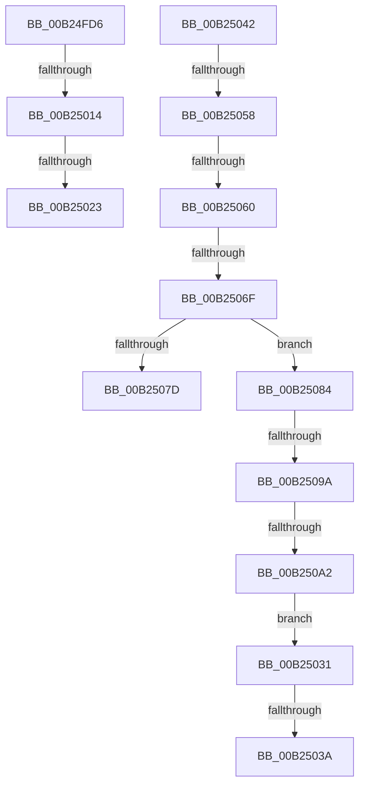

# sub_00B24FD6

- RVA: `0x00B24FD6`–`0x00B250A4` (길이 `206` bytes)
- VA: `0x0000000140B24FD6`
- 실행 섹션: `PAGE`
- PDB 이름 있음: `아니요`; PDB Function 태그: `아니요`
- unwind 정보 RVA: `0x0008FC34`
- 디코드: `50`개 명령, `206/206` bytes 표시
- 미해석 바이트: `0` (있으면 어셈블리에 `.byte`로 보존)

> 이 문서는 커널 이미지의 기계어와 PDB 기호를 분석해 생성했습니다. 4번과 5번은 함수 원형과 자료형을 바이너리 사용 방식에서 추정한 C 해석이며 원본 소스 복구 결과는 아닙니다.

## 1. Dependencies

- 직접 호출 지점: **4**; 고유 호출 대상: **3**
- 직접 호출자로 확인된 함수: **0**
- RIP 상대 이미지 참조: **2**

### Outgoing calls
- `0x00B25005` → [PfpScenCtxPrefetchAbortSet](../../pagelk/B6/PfpScenCtxPrefetchAbortSet_function_00B6B3B0.md) (function, `0x00B6B3B0`)
- `0x00B25044` → [PfpPrefetchFiles](../93/PfpPrefetchFiles_function_0093AD58.md) (function, `0x0093AD58`)
- `0x00B25074` → [PfpCheckPrefetchAbort](../../text/49/PfpCheckPrefetchAbort_function_00492808.md) (function, `0x00492808`)
- `0x00B2508B` → [PfpPrefetchFiles](../93/PfpPrefetchFiles_function_0093AD58.md) (function, `0x0093AD58`)

### Direct callers
- 이 함수 시작 RVA로 연결되는 직접 call은 확인되지 않았습니다. 간접 호출은 완전히 역산할 수 없습니다.

### Static image references
- `0x00B24FD6` → RVA `0x00F0F230` (`.data`; read/write)
- `0x00B24FFE` → RVA `0x00E670D0` (`.data`; read)

## 2. Other-region calls and transfers

- 다른 실행 섹션으로 향하는 call: **2**
  - `0x00B25005` → [PfpScenCtxPrefetchAbortSet](../../pagelk/B6/PfpScenCtxPrefetchAbortSet_function_00B6B3B0.md) (`PAGE` → `PAGELK`)
  - `0x00B25074` → [PfpCheckPrefetchAbort](../../text/49/PfpCheckPrefetchAbort_function_00492808.md) (`PAGE` → `.text`)
- call이 아닌 외부 분기/꼬리 이동: **11**
  - `0x00B2500E` → [PfpPrefetchRequestPerform + 0x43C](../93/PfpPrefetchRequestPerform_function_00938F74.md) (`tail-transfer`)
  - `0x00B2501D` → [PfpPrefetchRequestPerform + 0x117](../93/PfpPrefetchRequestPerform_function_00938F74.md) (`tail-transfer`)
  - `0x00B2502C` → [PfpPrefetchRequestPerform + 0x117](../93/PfpPrefetchRequestPerform_function_00938F74.md) (`tail-transfer`)
  - `0x00B25034` → [PfpPrefetchRequestPerform + 0x3E2](../93/PfpPrefetchRequestPerform_function_00938F74.md) (`tail-transfer`)
  - `0x00B2503D` → [PfpPrefetchRequestPerform + 0x3E2](../93/PfpPrefetchRequestPerform_function_00938F74.md) (`tail-transfer`)
  - `0x00B25052` → [PfpPrefetchRequestPerform + 0x3E2](../93/PfpPrefetchRequestPerform_function_00938F74.md) (`tail-transfer`)
  - `0x00B2505A` → [PfpPrefetchRequestPerform + 0x3E2](../93/PfpPrefetchRequestPerform_function_00938F74.md) (`tail-transfer`)
  - `0x00B25069` → [PfpPrefetchRequestPerform + 0x3E2](../93/PfpPrefetchRequestPerform_function_00938F74.md) (`tail-transfer`)
  - `0x00B2507F` → [PfpPrefetchRequestPerform + 0x3E2](../93/PfpPrefetchRequestPerform_function_00938F74.md) (`tail-transfer`)
  - `0x00B25094` → [PfpPrefetchRequestPerform + 0x3E2](../93/PfpPrefetchRequestPerform_function_00938F74.md) (`tail-transfer`)
  - `0x00B2509C` → [PfpPrefetchRequestPerform + 0x3E2](../93/PfpPrefetchRequestPerform_function_00938F74.md) (`tail-transfer`)

## 3. Assembly (complete function range)

```asm
00B24FD6  F0 44 01 35 52 A2 3E 00         lock add dword ptr [rip + 0x3ea252], r14d
00B24FDE  48 8B 44 24 50                  mov rax, qword ptr [rsp + 0x50]
00B24FE3  4C 8D 44 24 30                  lea r8, [rsp + 0x30]
00B24FE8  41 8B D7                        mov edx, r15d
00B24FEB  44 89 6C 24 20                  mov dword ptr [rsp + 0x20], r13d
00B24FF0  48 8B 48 48                     mov rcx, qword ptr [rax + 0x48]
00B24FF4  48 85 C9                        test rcx, rcx
00B24FF7  4C 0F 45 C1                     cmovne r8, rcx
00B24FFB  45 33 C9                        xor r9d, r9d
00B24FFE  48 8D 0D CB 20 34 00            lea rcx, [rip + 0x3420cb]
00B25005  E8 A6 63 04 00                  call 0x140b6b3b0
00B2500A  8B D8                           mov ebx, eax
00B2500C  85 C0                           test eax, eax
00B2500E  0F 88 9C 43 E1 FF               js 0x1409393b0
00B25014  48 8B 44 24 50                  mov rax, qword ptr [rsp + 0x50]
00B25019  4C 39 68 48                     cmp qword ptr [rax + 0x48], r13
00B2501D  0F 85 68 40 E1 FF               jne 0x14093908b
00B25023  48 8D 4C 24 30                  lea rcx, [rsp + 0x30]
00B25028  48 89 48 48                     mov qword ptr [rax + 0x48], rcx
00B2502C  E9 5A 40 E1 FF                  jmp 0x14093908b
00B25031  41 3B C6                        cmp eax, r14d
00B25034  0F 84 1C 43 E1 FF               je 0x140939356
00B2503A  41 8B DD                        mov ebx, r13d
00B2503D  E9 14 43 E1 FF                  jmp 0x140939356
00B25042  33 D2                           xor edx, edx
00B25044  E8 0F 5D E1 FF                  call 0x14093ad58
00B25049  BE 40 02 00 C0                  mov esi, 0xc0000240
00B2504E  8B D8                           mov ebx, eax
00B25050  3B C6                           cmp eax, esi
00B25052  0F 84 FE 42 E1 FF               je 0x140939356
00B25058  3B C7                           cmp eax, edi
00B2505A  0F 84 F6 42 E1 FF               je 0x140939356
00B25060  41 BE 17 00 00 C0               mov r14d, 0xc0000017
00B25066  41 3B C6                        cmp eax, r14d
00B25069  0F 84 E7 42 E1 FF               je 0x140939356
00B2506F  48 8D 4C 24 50                  lea rcx, [rsp + 0x50]
00B25074  E8 8F D7 96 FF                  call 0x140492808
00B25079  85 C0                           test eax, eax
00B2507B  74 07                           je 0x140b25084
00B2507D  8B DE                           mov ebx, esi
00B2507F  E9 D2 42 E1 FF                  jmp 0x140939356
00B25084  B2 01                           mov dl, 1
00B25086  48 8D 4C 24 50                  lea rcx, [rsp + 0x50]
00B2508B  E8 C8 5C E1 FF                  call 0x14093ad58
00B25090  8B D8                           mov ebx, eax
00B25092  3B C6                           cmp eax, esi
00B25094  0F 84 BC 42 E1 FF               je 0x140939356
00B2509A  3B C7                           cmp eax, edi
00B2509C  0F 84 B4 42 E1 FF               je 0x140939356
00B250A2  EB 8D                           jmp 0x140b25031
```

## 4. C-style interpretation (structured pseudocode)

```c
__int64 __fastcall sub_00B24FD6(__int64 a1, __int64 a2, __int64 a3, int a4, __int64 a5, __int64 a6, __int64 a7, __int64 a8, __int64 a9, __int64 a10)
{
    __int64 result;
    unsigned int v_stack_p20;
    unsigned __int64 v_stack_p50;

    v_stack_p20 = (unsigned int)(v_r13);
    if (*(unsigned __int64 *)(a10 + 72) != 0) { a6 = *(unsigned __int64 *)(a10 + 72); }
    a4 = 0;
    result = PfpScenCtxPrefetchAbortSet(v_rip + 3416267, (unsigned int)((unsigned int)(v_r15)), a6, a4);
    *(unsigned __int64 *)(a10 + 72) = a6;
}
```

## 5. (Beta) C Style

```c
int64_t sub_00B24FD6(int64_t Arg1, int64_t Arg2, int64_t Arg3, int32_t Arg4, uint64_t Arg5, int64_t Arg6, uint64_t Arg7, uint64_t Arg8, uint64_t Arg9, void *Arg10)
{
    uint8_t *arg10 = (uint8_t *)Arg10;

    int64_t result;
    uint32_t v_stack_p20;
    uint64_t v_stack_p50;

    v_stack_p20 = (uint32_t)(local_r13);
    if (*(uint64_t *)(arg10 + 0x48) != 0) { Arg6 = *(uint64_t *)(arg10 + 0x48); }
    Arg4 = 0;
    result = PfpScenCtxPrefetchAbortSet(v_rip + 3416267, (uint32_t)((uint32_t)(local_r15)), Arg6, Arg4);
    *(uint64_t *)(arg10 + 0x48) = Arg6;
}
```

### 관측된 메모리 오프셋

구조체 형식이 확인되지 않은 접근은 인자 기준의 오프셋으로만 기록했습니다.

| 기준 인자 | 오프셋 표현 | 폭 (bit) | 접근 |
|---|---:|---:|---|
| `Arg10` | `+ 0x48` | `64` | `R` |
| `Arg10` | `+ 0x48` | `64` | `W` |

## 6. Execution-region graph

[열기: 2D/3D 그래프와 함수 탐색 컨트롤 패널](../../../control-panel.html?section=page&rva=0x00B24FD6&view=graph)

- 2D 그래프는 위에서 아래로 흐르고, 3D 그래프는 빈 공간을 드래그해 회전합니다. Shift+드래그는 이동, 휠은 확대·축소, 함수 노드 선택은 대상 보고서 이동입니다.

### Static fallback


