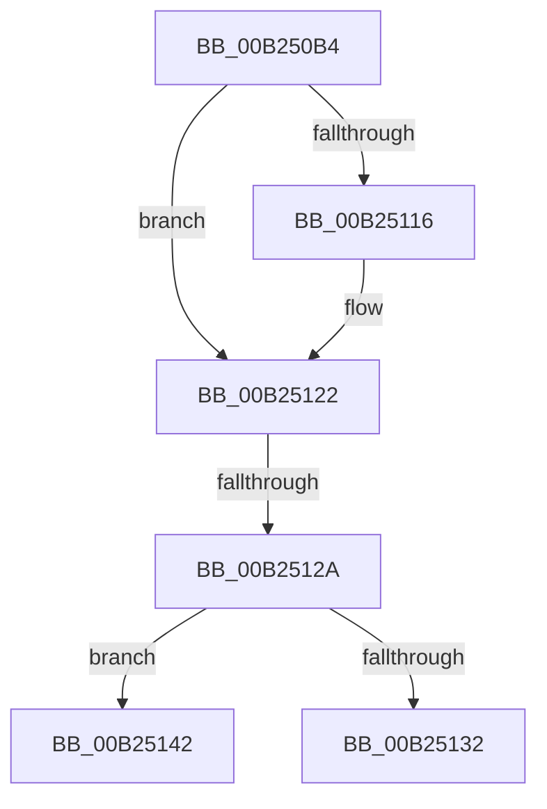

# sub_00B250B4

- RVA: `0x00B250B4`–`0x00B2515E` (길이 `170` bytes)
- VA: `0x0000000140B250B4`
- 실행 섹션: `PAGE`
- PDB 이름 있음: `아니요`; PDB Function 태그: `아니요`
- unwind 정보 RVA: `0x0008FCFC`
- 디코드: `41`개 명령, `170/170` bytes 표시
- 미해석 바이트: `0` (있으면 어셈블리에 `.byte`로 보존)

> 이 문서는 커널 이미지의 기계어와 PDB 기호를 분석해 생성했습니다. 4번과 5번은 함수 원형과 자료형을 바이너리 사용 방식에서 추정한 C 해석이며 원본 소스 복구 결과는 아닙니다.

## 1. Dependencies

- 직접 호출 지점: **3**; 고유 호출 대상: **3**
- 직접 호출자로 확인된 함수: **0**
- RIP 상대 이미지 참조: **0**

### Outgoing calls
- `0x00B25102` → [IopXxxControlFile](../8E/IopXxxControlFile_function_008E9AD0.md) (function, `0x008E9AD0`)
- `0x00B2511D` → [PfpUpdateRepurposedByPrefetch](../93/PfpUpdateRepurposedByPrefetch_function_0093C838.md) (function, `0x0093C838`)
- `0x00B25158` → [KeBugCheckEx](../../text/4F/KeBugCheckEx_function_004FD660.md) (function, `0x004FD660`)

### Direct callers
- 이 함수 시작 RVA로 연결되는 직접 call은 확인되지 않았습니다. 간접 호출은 완전히 역산할 수 없습니다.

### Static image references
- 디코드된 RIP-relative 메모리 참조가 없습니다.

## 2. Other-region calls and transfers

- 다른 실행 섹션으로 향하는 call: **1**
  - `0x00B25158` → [KeBugCheckEx](../../text/4F/KeBugCheckEx_function_004FD660.md) (`PAGE` → `.text`)
- call이 아닌 외부 분기/꼬리 이동: **2**
  - `0x00B25124` → [PfpVolumePrefetchMetadata + 0x2AC](../93/PfpVolumePrefetchMetadata_function_0093A158.md) (`tail-transfer`)
  - `0x00B2513D` → [PfpVolumePrefetchMetadata + 0xCC](../93/PfpVolumePrefetchMetadata_function_0093A158.md) (`tail-transfer`)

## 3. Assembly (complete function range)

```asm
00B250B4  83 64 24 58 00                  and dword ptr [rsp + 0x58], 0
00B250B9  49 8B CC                        mov rcx, r12
00B250BC  48 8B 47 10                     mov rax, qword ptr [rdi + 0x10]
00B250C0  45 33 C9                        xor r9d, r9d
00B250C3  C6 44 24 50 00                  mov byte ptr [rsp + 0x50], 0
00B250C8  45 33 C0                        xor r8d, r8d
00B250CB  83 64 24 48 00                  and dword ptr [rsp + 0x48], 0
00B250D0  33 D2                           xor edx, edx
00B250D2  48 83 64 24 40 00               and qword ptr [rsp + 0x40], 0
00B250D8  48 C1 E1 06                     shl rcx, 6
00B250DC  48 8B 0C 01                     mov rcx, qword ptr [rcx + rax]
00B250E0  42 8D 04 DD 10 00 00 00         lea eax, [r11*8 + 0x10]
00B250E8  89 44 24 38                     mov dword ptr [rsp + 0x38], eax
00B250EC  48 8D 45 D7                     lea rax, [rbp - 0x29]
00B250F0  48 89 74 24 30                  mov qword ptr [rsp + 0x30], rsi
00B250F5  C7 44 24 28 20 01 09 00         mov dword ptr [rsp + 0x28], 0x90120
00B250FD  48 89 44 24 20                  mov qword ptr [rsp + 0x20], rax
00B25102  E8 C9 49 DC FF                  call 0x1408e9ad0
00B25107  48 8B 17                        mov rdx, qword ptr [rdi]
00B2510A  8B D8                           mov ebx, eax
00B2510C  44 8B 42 50                     mov r8d, dword ptr [rdx + 0x50]
00B25110  41 F6 C0 04                     test r8b, 4
00B25114  74 0C                           je 0x140b25122
00B25116  8B 56 04                        mov edx, dword ptr [rsi + 4]
00B25119  48 8D 4F 30                     lea rcx, [rdi + 0x30]
00B2511D  E8 16 77 E1 FF                  call 0x14093c838
00B25122  85 DB                           test ebx, ebx
00B25124  0F 88 DA 52 E1 FF               js 0x14093a404
00B2512A  81 FB 03 01 00 00               cmp ebx, 0x103
00B25130  74 10                           je 0x140b25142
00B25132  4C 8B 4D 7F                     mov r9, qword ptr [rbp + 0x7f]
00B25136  4C 8B 55 B7                     mov r10, qword ptr [rbp - 0x49]
00B2513A  8B 5D 67                        mov ebx, dword ptr [rbp + 0x67]
00B2513D  E9 E2 50 E1 FF                  jmp 0x14093a224
00B25142  48 83 64 24 20 00               and qword ptr [rsp + 0x20], 0
00B25148  45 33 C9                        xor r9d, r9d
00B2514B  45 33 C0                        xor r8d, r8d
00B2514E  BA 14 17 00 00                  mov edx, 0x1714
00B25153  B9 91 01 00 00                  mov ecx, 0x191
00B25158  E8 03 85 9D FF                  call 0x1404fd660
00B2515D  CC                              int3
```

## 4. C-style interpretation (structured pseudocode)

```c
__int64 __fastcall sub_00B250B4(__int64 a1, int a2, int a3, int a4, __int64 a5, __int64 a6, __int64 a7, __int64 a8, unsigned int a9, __int64 a10, unsigned int a11)
{
    __int64 result;
    unsigned __int64 v_stack_p20;
    unsigned int v_stack_p28;
    unsigned __int64 v_stack_p30;
    unsigned int v_stack_p38;
    unsigned __int8 v_stack_p50;

    a4 = 0;
    v_stack_p50 = 0;
    a3 = 0;
    a2 = 0;
    a1 = (v_r12) << (6);
    v_stack_p38 = (unsigned int)(v_r11 * 8 + 16);
    v_stack_p30 = v_rsi;
    v_stack_p28 = 0x90120ULL;
    v_stack_p20 = v_rbp - 41;
    result = IopXxxControlFile(*(unsigned __int64 *)(a1 + *(unsigned __int64 *)(v_rdi + 16) * 1), a2, a3, a4);
    if ((((unsigned __int8)((unsigned int)(*(unsigned int *)(*(unsigned __int64 *)(v_rdi) + 80)))) & (4)) != 0) {
        a2 = *(unsigned int *)(v_rsi + 4);
        a1 = v_rdi + 48;
        result = PfpUpdateRepurposedByPrefetch(a1, a2, (unsigned int)(*(unsigned int *)(*(unsigned __int64 *)(v_rdi) + 80)), a4);
    }
    if (((unsigned int)((unsigned int)((unsigned int)(result)))) == 259) goto loc_00B25142;
loc_00B25142:
    a4 = 0;
    a3 = 0;
    result = KeBugCheckEx(401, (unsigned int)(0x1714ULL), a3, a4);
    return result;
}
```

## 5. (Beta) C Style

```c
int64_t sub_00B250B4(int64_t Arg1, int32_t Arg2, int32_t Arg3, int32_t Arg4, uint64_t Arg5, uint64_t Arg6, uint64_t Arg7, int64_t Arg8, uint32_t Arg9, uint64_t Arg10, uint32_t Arg11)
{
    int64_t result;
    uint64_t v_stack_p20;
    uint32_t v_stack_p28;
    uint64_t v_stack_p30;
    uint32_t v_stack_p38;
    uint8_t v_stack_p50;

    Arg4 = 0;
    v_stack_p50 = 0;
    Arg3 = 0;
    Arg2 = 0;
    Arg1 = (local_r12) << (6);
    v_stack_p38 = (uint32_t)(local_r11 * 8 + 16);
    v_stack_p30 = local_rsi;
    v_stack_p28 = 0x90120ULL;
    v_stack_p20 = local_rbp - 41;
    result = IopXxxControlFile(*(uint64_t *)(Arg1 + *(uint64_t *)(local_rdi + 0x10) * 1), Arg2, Arg3, Arg4);
    if ((((uint8_t)((uint32_t)(*(uint32_t *)(*(uint64_t *)(local_rdi) + 0x50)))) & (4)) != 0) {
        Arg2 = *(uint32_t *)(local_rsi + 0x4);
        Arg1 = local_rdi + 48;
        result = PfpUpdateRepurposedByPrefetch(Arg1, Arg2, (uint32_t)(*(uint32_t *)(*(uint64_t *)(local_rdi) + 0x50)), Arg4);
    }
    if (((uint32_t)((uint32_t)((uint32_t)(result)))) == 259) goto loc_00B25142;
loc_00B25142:
    Arg4 = 0;
    Arg3 = 0;
    result = KeBugCheckEx(401, (uint32_t)(0x1714ULL), Arg3, Arg4);
    return result;
}
```

## 6. Execution-region graph

[열기: 2D/3D 그래프와 함수 탐색 컨트롤 패널](../../../control-panel.html?section=page&rva=0x00B250B4&view=graph)

- 2D 그래프는 위에서 아래로 흐르고, 3D 그래프는 빈 공간을 드래그해 회전합니다. Shift+드래그는 이동, 휠은 확대·축소, 함수 노드 선택은 대상 보고서 이동입니다.

### Static fallback


