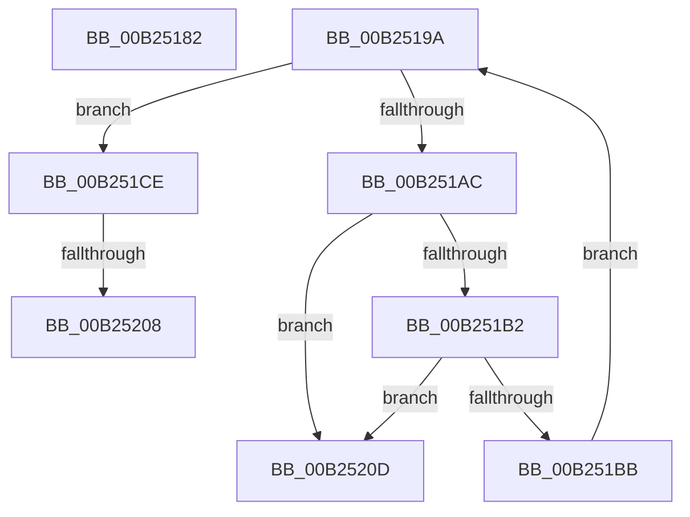

# sub_00B25182

- RVA: `0x00B25182`–`0x00B25214` (길이 `146` bytes)
- VA: `0x0000000140B25182`
- 실행 섹션: `PAGE`
- PDB 이름 있음: `아니요`; PDB Function 태그: `아니요`
- unwind 정보 RVA: `0x0008FF5C`
- 디코드: `38`개 명령, `146/146` bytes 표시
- 미해석 바이트: `0` (있으면 어셈블리에 `.byte`로 보존)

> 이 문서는 커널 이미지의 기계어와 PDB 기호를 분석해 생성했습니다. 4번과 5번은 함수 원형과 자료형을 바이너리 사용 방식에서 추정한 C 해석이며 원본 소스 복구 결과는 아닙니다.

## 1. Dependencies

- 직접 호출 지점: **4**; 고유 호출 대상: **3**
- 직접 호출자로 확인된 함수: **0**
- RIP 상대 이미지 참조: **0**

### Outgoing calls
- `0x00B25184` → [ExFreePoolWithTag](../../poolcode/B8/ExFreePoolWithTag_function_00B82870.md) (function, `0x00B82870`)
- `0x00B251C2` → [MiFreeInPageSupportBlock](../../text/2B/MiFreeInPageSupportBlock_function_002B5900.md) (function, `0x002B5900`)
- `0x00B251D1` → [MiReleaseReadListResources](../93/MiReleaseReadListResources_function_0093D570.md) (function, `0x0093D570`)
- `0x00B251E0` → [ExFreePoolWithTag](../../poolcode/B8/ExFreePoolWithTag_function_00B82870.md) (function, `0x00B82870`)

### Direct callers
- 이 함수 시작 RVA로 연결되는 직접 call은 확인되지 않았습니다. 간접 호출은 완전히 역산할 수 없습니다.

### Static image references
- 디코드된 RIP-relative 메모리 참조가 없습니다.

## 2. Other-region calls and transfers

- 다른 실행 섹션으로 향하는 call: **3**
  - `0x00B25184` → [ExFreePoolWithTag](../../poolcode/B8/ExFreePoolWithTag_function_00B82870.md) (`PAGE` → `POOLCODE`)
  - `0x00B251C2` → [MiFreeInPageSupportBlock](../../text/2B/MiFreeInPageSupportBlock_function_002B5900.md) (`PAGE` → `.text`)
  - `0x00B251E0` → [ExFreePoolWithTag](../../poolcode/B8/ExFreePoolWithTag_function_00B82870.md) (`PAGE` → `POOLCODE`)
- call이 아닌 외부 분기/꼬리 이동: **3**
  - `0x00B25195` → [MmPrefetchPagesEx + 0x152](../93/MmPrefetchPagesEx_function_0093C9A0.md) (`tail-transfer`)
  - `0x00B25202` → [MmPrefetchPagesEx + 0x342](../93/MmPrefetchPagesEx_function_0093C9A0.md) (`tail-transfer`)
  - `0x00B25208` → [MmPrefetchPagesEx + 0x275](../93/MmPrefetchPagesEx_function_0093C9A0.md) (`tail-transfer`)

## 3. Assembly (complete function range)

```asm
00B25182  33 D2                           xor edx, edx
00B25184  E8 E7 D6 05 00                  call 0x140b82870
00B25189  33 D2                           xor edx, edx
00B2518B  8B CA                           mov ecx, edx
00B2518D  48 89 94 24 B8 00 00 00         mov qword ptr [rsp + 0xb8], rdx
00B25195  E9 58 79 E1 FF                  jmp 0x14093caf2
00B2519A  48 8B 10                        mov rdx, qword ptr [rax]
00B2519D  48 8D 82 E0 00 00 00            lea rax, [rdx + 0xe0]
00B251A4  48 8B 08                        mov rcx, qword ptr [rax]
00B251A7  48 3B C8                        cmp rcx, rax
00B251AA  74 22                           je 0x140b251ce
00B251AC  48 39 41 08                     cmp qword ptr [rcx + 8], rax
00B251B0  75 5B                           jne 0x140b2520d
00B251B2  48 8B 11                        mov rdx, qword ptr [rcx]
00B251B5  48 39 4A 08                     cmp qword ptr [rdx + 8], rcx
00B251B9  75 52                           jne 0x140b2520d
00B251BB  48 89 10                        mov qword ptr [rax], rdx
00B251BE  48 89 42 08                     mov qword ptr [rdx + 8], rax
00B251C2  E8 39 07 79 FF                  call 0x1402b5900
00B251C7  48 8B 44 24 30                  mov rax, qword ptr [rsp + 0x30]
00B251CC  EB CC                           jmp 0x140b2519a
00B251CE  48 8B CA                        mov rcx, rdx
00B251D1  E8 9A 83 E1 FF                  call 0x14093d570
00B251D6  48 8B 4C 24 30                  mov rcx, qword ptr [rsp + 0x30]
00B251DB  33 D2                           xor edx, edx
00B251DD  48 8B 09                        mov rcx, qword ptr [rcx]
00B251E0  E8 8B D6 05 00                  call 0x140b82870
00B251E5  48 8B 44 24 30                  mov rax, qword ptr [rsp + 0x30]
00B251EA  33 D2                           xor edx, edx
00B251EC  48 89 10                        mov qword ptr [rax], rdx
00B251EF  8B 84 24 A0 00 00 00            mov eax, dword ptr [rsp + 0xa0]
00B251F6  FF C0                           inc eax
00B251F8  89 84 24 A0 00 00 00            mov dword ptr [rsp + 0xa0], eax
00B251FF  41 3B C4                        cmp eax, r12d
00B25202  0F 82 DA 7A E1 FF               jb 0x14093cce2
00B25208  E9 08 7A E1 FF                  jmp 0x14093cc15
00B2520D  B9 03 00 00 00                  mov ecx, 3
00B25212  CD 29                           int 0x29
```

## 4. C-style interpretation (structured pseudocode)

```c
__int64 __fastcall sub_00B25182(__int64 a1, int a2)
{
    __int64 result;
    unsigned __int64 v_stack_p30;
    unsigned int v_stack_pA0;
    unsigned __int64 v_stack_pB8;

    a2 = 0;
    result = ExFreePoolWithTag(a1, a2, a3, a4);
    a2 = 0;
    v_stack_pB8 = 0;
}
```

## 5. (Beta) C Style

```c
int64_t sub_00B25182(int64_t Arg1, int32_t Arg2)
{
    int64_t result;
    uint64_t v_stack_p30;
    uint32_t v_stack_pA0;
    uint64_t v_stack_pB8;

    Arg2 = 0;
    result = ExFreePoolWithTag(Arg1, Arg2, a3, a4);
    Arg2 = 0;
    v_stack_pB8 = 0;
}
```

## 6. Execution-region graph

[열기: 2D/3D 그래프와 함수 탐색 컨트롤 패널](../../../control-panel.html?section=page&rva=0x00B25182&view=graph)

- 2D 그래프는 위에서 아래로 흐르고, 3D 그래프는 빈 공간을 드래그해 회전합니다. Shift+드래그는 이동, 휠은 확대·축소, 함수 노드 선택은 대상 보고서 이동입니다.

### Static fallback


