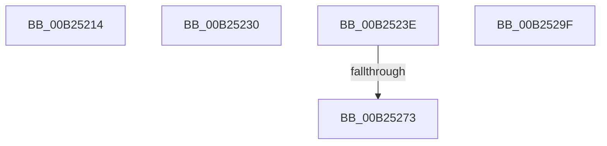

# sub_00B25214

- RVA: `0x00B25214`–`0x00B252AF` (길이 `155` bytes)
- VA: `0x0000000140B25214`
- 실행 섹션: `PAGE`
- PDB 이름 있음: `아니요`; PDB Function 태그: `아니요`
- unwind 정보 RVA: `0x0008FFCC`
- 디코드: `36`개 명령, `155/155` bytes 표시
- 미해석 바이트: `0` (있으면 어셈블리에 `.byte`로 보존)

> 이 문서는 커널 이미지의 기계어와 PDB 기호를 분석해 생성했습니다. 4번과 5번은 함수 원형과 자료형을 바이너리 사용 방식에서 추정한 C 해석이며 원본 소스 복구 결과는 아닙니다.

## 1. Dependencies

- 직접 호출 지점: **5**; 고유 호출 대상: **5**
- 직접 호출자로 확인된 함수: **0**
- RIP 상대 이미지 참조: **0**

### Outgoing calls
- `0x00B25222` → [MiInitializePageHeatList](../../text/44/MiInitializePageHeatList_function_00446000.md) (function, `0x00446000`)
- `0x00B25242` → [MiGetNextPageColor](../../text/44/MiGetNextPageColor_function_00442D64.md) (function, `0x00442D64`)
- `0x00B25264` → [MiGetSlabPage](../../text/37/MiGetSlabPage_function_00376FBC.md) (function, `0x00376FBC`)
- `0x00B25294` → [MiInsertPageChainHead](../../text/2A/MiInsertPageChainHead_function_002A24EC.md) (function, `0x002A24EC`)
- `0x00B252A4` → [ExFreePoolWithTag](../../poolcode/B8/ExFreePoolWithTag_function_00B82870.md) (function, `0x00B82870`)

### Direct callers
- 이 함수 시작 RVA로 연결되는 직접 call은 확인되지 않았습니다. 간접 호출은 완전히 역산할 수 없습니다.

### Static image references
- 디코드된 RIP-relative 메모리 참조가 없습니다.

## 2. Other-region calls and transfers

- 다른 실행 섹션으로 향하는 call: **5**
  - `0x00B25222` → [MiInitializePageHeatList](../../text/44/MiInitializePageHeatList_function_00446000.md) (`PAGE` → `.text`)
  - `0x00B25242` → [MiGetNextPageColor](../../text/44/MiGetNextPageColor_function_00442D64.md) (`PAGE` → `.text`)
  - `0x00B25264` → [MiGetSlabPage](../../text/37/MiGetSlabPage_function_00376FBC.md) (`PAGE` → `.text`)
  - `0x00B25294` → [MiInsertPageChainHead](../../text/2A/MiInsertPageChainHead_function_002A24EC.md) (`PAGE` → `.text`)
  - `0x00B252A4` → [ExFreePoolWithTag](../../poolcode/B8/ExFreePoolWithTag_function_00B82870.md) (`PAGE` → `POOLCODE`)
- call이 아닌 외부 분기/꼬리 이동: **5**
  - `0x00B2522B` → [MiPfPrepareSequentialReadList + 0x2DB](../93/MiPfPrepareSequentialReadList_function_0093D8E8.md) (`tail-transfer`)
  - `0x00B25239` → [MiPfPrepareSequentialReadList + 0x729](../93/MiPfPrepareSequentialReadList_function_0093D8E8.md) (`tail-transfer`)
  - `0x00B2526D` → [MiPfPrepareSequentialReadList + 0x7DB](../93/MiPfPrepareSequentialReadList_function_0093D8E8.md) (`tail-transfer`)
  - `0x00B2529A` → [MiPfPrepareSequentialReadList + 0x4C8](../93/MiPfPrepareSequentialReadList_function_0093D8E8.md) (`tail-transfer`)
  - `0x00B252AA` → [MiPfPrepareSequentialReadList + 0x20B](../93/MiPfPrepareSequentialReadList_function_0093D8E8.md) (`tail-transfer`)

## 3. Assembly (complete function range)

```asm
00B25214  BA 01 00 00 00                  mov edx, 1
00B25219  44 8B CF                        mov r9d, edi
00B2521C  44 8B C2                        mov r8d, edx
00B2521F  48 8B C8                        mov rcx, rax
00B25222  E8 D9 0D 92 FF                  call 0x140446000
00B25227  48 8B 7D F0                     mov rdi, qword ptr [rbp - 0x10]
00B2522B  E9 93 89 E1 FF                  jmp 0x14093dbc3
00B25230  4C 8B 60 48                     mov r12, qword ptr [rax + 0x48]
00B25234  4C 89 64 24 70                  mov qword ptr [rsp + 0x70], r12
00B25239  E9 D3 8D E1 FF                  jmp 0x14093e011
00B2523E  48 8D 4D 38                     lea rcx, [rbp + 0x38]
00B25242  E8 1D DB 91 FF                  call 0x140442d64
00B25247  48 8B 4D 98                     mov rcx, qword ptr [rbp - 0x68]
00B2524B  41 B9 04 00 00 00               mov r9d, 4
00B25251  44 8B C0                        mov r8d, eax
00B25254  C7 44 24 28 00 00 02 00         mov dword ptr [rsp + 0x28], 0x20000
00B2525C  48 83 4C 24 20 FF               or qword ptr [rsp + 0x20], 0xffffffffffffffff
00B25262  8B D3                           mov edx, ebx
00B25264  E8 53 1D 85 FF                  call 0x140376fbc
00B25269  48 83 F8 FF                     cmp rax, -1
00B2526D  0F 84 50 8E E1 FF               je 0x14093e0c3
00B25273  48 8D 14 40                     lea rdx, [rax + rax*2]
00B25277  48 C1 E2 04                     shl rdx, 4
00B2527B  48 B8 00 00 00 00 00 DE FF FF   movabs rax, 0xffffde0000000000
00B25285  48 8D 4B 04                     lea rcx, [rbx + 4]
00B25289  48 03 D0                        add rdx, rax
00B2528C  48 8D 0C 4B                     lea rcx, [rbx + rcx*2]
00B25290  49 8D 0C CF                     lea rcx, [r15 + rcx*8]
00B25294  E8 53 D2 77 FF                  call 0x1402a24ec
00B25299  90                              nop
00B2529A  E9 11 8B E1 FF                  jmp 0x14093ddb0
00B2529F  33 D2                           xor edx, edx
00B252A1  48 8B CB                        mov rcx, rbx
00B252A4  E8 C7 D5 05 00                  call 0x140b82870
00B252A9  90                              nop
00B252AA  E9 44 88 E1 FF                  jmp 0x14093daf3
```

## 4. C-style interpretation (structured pseudocode)

```c
__int64 __fastcall sub_00B25214(void)
{
    __int64 result;
    unsigned __int64 v_stack_p20;
    unsigned int v_stack_p28;
    unsigned __int64 v_stack_p70;

    result = MiInitializePageHeatList(result, 1, 1, (unsigned int)((unsigned int)(v_rdi)));
}
```

## 5. (Beta) C Style

```c
void sub_00B25214(void)
{
    int64_t result;
    uint64_t v_stack_p20;
    uint32_t v_stack_p28;
    uint64_t v_stack_p70;

    result = MiInitializePageHeatList(result, 1, 1, (uint32_t)((uint32_t)(local_rdi)));
}
```

## 6. Execution-region graph

[열기: 2D/3D 그래프와 함수 탐색 컨트롤 패널](../../../control-panel.html?section=page&rva=0x00B25214&view=graph)

- 2D 그래프는 위에서 아래로 흐르고, 3D 그래프는 빈 공간을 드래그해 회전합니다. Shift+드래그는 이동, 휠은 확대·축소, 함수 노드 선택은 대상 보고서 이동입니다.

### Static fallback


