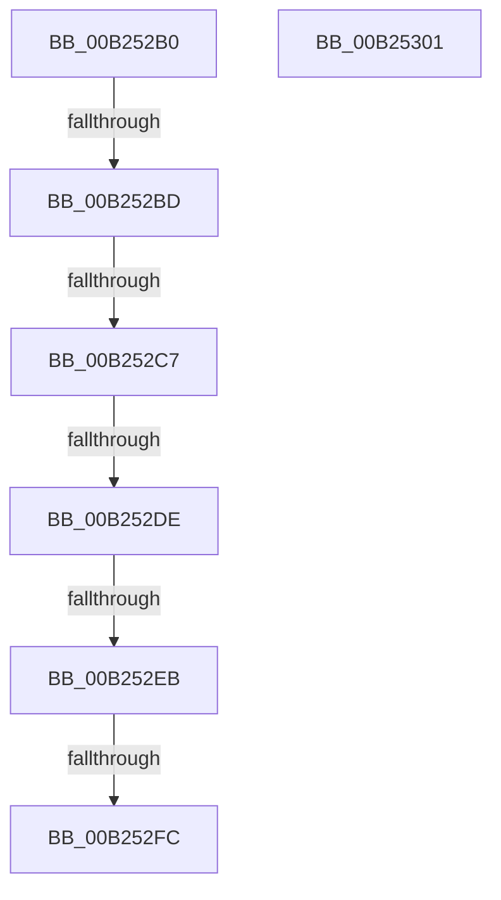

# sub_00B252B0

- RVA: `0x00B252B0`–`0x00B25312` (길이 `98` bytes)
- VA: `0x0000000140B252B0`
- 실행 섹션: `PAGE`
- PDB 이름 있음: `아니요`; PDB Function 태그: `아니요`
- unwind 정보 RVA: `0x00090018`
- 디코드: `22`개 명령, `98/98` bytes 표시
- 미해석 바이트: `0` (있으면 어셈블리에 `.byte`로 보존)

> 이 문서는 커널 이미지의 기계어와 PDB 기호를 분석해 생성했습니다. 4번과 5번은 함수 원형과 자료형을 바이너리 사용 방식에서 추정한 C 해석이며 원본 소스 복구 결과는 아닙니다.

## 1. Dependencies

- 직접 호출 지점: **1**; 고유 호출 대상: **1**
- 직접 호출자로 확인된 함수: **0**
- RIP 상대 이미지 참조: **0**

### Outgoing calls
- `0x00B252D0` → [MiGetSharedProtos](../../text/34/MiGetSharedProtos_function_00348D58.md) (function, `0x00348D58`)

### Direct callers
- 이 함수 시작 RVA로 연결되는 직접 call은 확인되지 않았습니다. 간접 호출은 완전히 역산할 수 없습니다.

### Static image references
- 디코드된 RIP-relative 메모리 참조가 없습니다.

## 2. Other-region calls and transfers

- 다른 실행 섹션으로 향하는 call: **1**
  - `0x00B252D0` → [MiGetSharedProtos](../../text/34/MiGetSharedProtos_function_00348D58.md) (`PAGE` → `.text`)
- call이 아닌 외부 분기/꼬리 이동: **7**
  - `0x00B252B7` → [MiPfAllocateMdls + 0x2B9](../93/MiPfAllocateMdls_function_0093E45C.md) (`tail-transfer`)
  - `0x00B252C1` → [MiPfAllocateMdls + 0x2B9](../93/MiPfAllocateMdls_function_0093E45C.md) (`tail-transfer`)
  - `0x00B252D8` → [MiPfAllocateMdls + 0x2B9](../93/MiPfAllocateMdls_function_0093E45C.md) (`tail-transfer`)
  - `0x00B252E5` → [MiPfAllocateMdls + 0x2B9](../93/MiPfAllocateMdls_function_0093E45C.md) (`tail-transfer`)
  - `0x00B252F6` → [MiPfAllocateMdls + 0x1CD](../93/MiPfAllocateMdls_function_0093E45C.md) (`tail-transfer`)
  - `0x00B252FC` → [MiPfAllocateMdls + 0x2B9](../93/MiPfAllocateMdls_function_0093E45C.md) (`tail-transfer`)
  - `0x00B2530D` → [MiPfAllocateMdls + 0x39D](../93/MiPfAllocateMdls_function_0093E45C.md) (`tail-transfer`)

## 3. Assembly (complete function range)

```asm
00B252B0  F7 47 38 00 00 00 08            test dword ptr [rdi + 0x38], 0x8000000
00B252B7  0F 84 58 94 E1 FF               je 0x14093e715
00B252BD  49 39 5E 18                     cmp qword ptr [r14 + 0x18], rbx
00B252C1  0F 84 4E 94 E1 FF               je 0x14093e715
00B252C7  4D 8B C6                        mov r8, r14
00B252CA  41 8B D7                        mov edx, r15d
00B252CD  48 8B CF                        mov rcx, rdi
00B252D0  E8 83 3A 82 FF                  call 0x140348d58
00B252D5  48 85 C0                        test rax, rax
00B252D8  0F 84 37 94 E1 FF               je 0x14093e715
00B252DE  48 8B 48 48                     mov rcx, qword ptr [rax + 0x48]
00B252E2  4C 3B E1                        cmp r12, rcx
00B252E5  0F 82 2A 94 E1 FF               jb 0x14093e715
00B252EB  41 8B 46 2C                     mov eax, dword ptr [r14 + 0x2c]
00B252EF  48 8D 0C C1                     lea rcx, [rcx + rax*8]
00B252F3  4C 3B E1                        cmp r12, rcx
00B252F6  0F 82 2D 93 E1 FF               jb 0x14093e629
00B252FC  E9 14 94 E1 FF                  jmp 0x14093e715
00B25301  48 8B 12                        mov rdx, qword ptr [rdx]
00B25304  48 89 54 24 38                  mov qword ptr [rsp + 0x38], rdx
00B25309  4C 8B 72 18                     mov r14, qword ptr [rdx + 0x18]
00B2530D  E9 E7 94 E1 FF                  jmp 0x14093e7f9
```

## 4. C-style interpretation (structured pseudocode)

```c
__int64 __fastcall sub_00B252B0(void)
{
    __int64 result;
    unsigned __int64 v_stack_p38;

    result = MiGetSharedProtos(v_rdi, (unsigned int)((unsigned int)(v_r15)), v_r14, a4);
}
```

## 5. (Beta) C Style

```c
void sub_00B252B0(void)
{
    int64_t result;
    uint64_t v_stack_p38;

    result = MiGetSharedProtos(local_rdi, (uint32_t)((uint32_t)(local_r15)), local_r14, a4);
}
```

## 6. Execution-region graph

[열기: 2D/3D 그래프와 함수 탐색 컨트롤 패널](../../../control-panel.html?section=page&rva=0x00B252B0&view=graph)

- 2D 그래프는 위에서 아래로 흐르고, 3D 그래프는 빈 공간을 드래그해 회전합니다. Shift+드래그는 이동, 휠은 확대·축소, 함수 노드 선택은 대상 보고서 이동입니다.

### Static fallback


