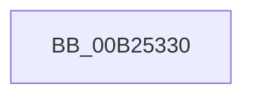

# sub_00B25330

- RVA: `0x00B25330`–`0x00B25347` (길이 `23` bytes)
- VA: `0x0000000140B25330`
- 실행 섹션: `PAGE`
- PDB 이름 있음: `아니요`; PDB Function 태그: `아니요`
- unwind 정보 RVA: `0x000900CC`
- 디코드: `5`개 명령, `23/23` bytes 표시
- 미해석 바이트: `0` (있으면 어셈블리에 `.byte`로 보존)

> 이 문서는 커널 이미지의 기계어와 PDB 기호를 분석해 생성했습니다. 4번과 5번은 함수 원형과 자료형을 바이너리 사용 방식에서 추정한 C 해석이며 원본 소스 복구 결과는 아닙니다.

## 1. Dependencies

- 직접 호출 지점: **1**; 고유 호출 대상: **1**
- 직접 호출자로 확인된 함수: **0**
- RIP 상대 이미지 참조: **0**

### Outgoing calls
- `0x00B2533A` → [MiReturnImageBase](../98/MiReturnImageBase_function_00988B00.md) (function, `0x00988B00`)

### Direct callers
- 이 함수 시작 RVA로 연결되는 직접 call은 확인되지 않았습니다. 간접 호출은 완전히 역산할 수 없습니다.

### Static image references
- 디코드된 RIP-relative 메모리 참조가 없습니다.

## 2. Other-region calls and transfers

- 다른 실행 섹션으로 향하는 call: **0**
- call이 아닌 외부 분기/꼬리 이동: **1**
  - `0x00B25342` → [MiFreeRelocations + 0x36](../93/MiFreeRelocations_function_0093F08C.md) (`tail-transfer`)

## 3. Assembly (complete function range)

```asm
00B25330  C6 44 24 2C 00                  mov byte ptr [rsp + 0x2c], 0
00B25335  48 8D 4C 24 20                  lea rcx, [rsp + 0x20]
00B2533A  E8 C1 37 E6 FF                  call 0x140988b00
00B2533F  89 73 58                        mov dword ptr [rbx + 0x58], esi
00B25342  E9 7B 9D E1 FF                  jmp 0x14093f0c2
```

## 4. C-style interpretation (structured pseudocode)

```c
__int64 __fastcall sub_00B25330(void)
{
    __int64 result;
    unsigned __int64 v_stack_p20;
    unsigned __int8 v_stack_p2C;

    v_stack_p2C = 0;
    result = MiReturnImageBase(v_stack_p20, a2, a3, a4);
    *(unsigned int *)(v_rbx + 88) = (unsigned int)(v_rsi);
}
```

## 5. (Beta) C Style

```c
void sub_00B25330(void)
{
    int64_t result;
    uint64_t v_stack_p20;
    uint8_t v_stack_p2C;

    v_stack_p2C = 0;
    result = MiReturnImageBase(v_stack_p20, a2, a3, a4);
    *(uint32_t *)(local_rbx + 0x58) = (uint32_t)(local_rsi);
}
```

## 6. Execution-region graph

[열기: 2D/3D 그래프와 함수 탐색 컨트롤 패널](../../../control-panel.html?section=page&rva=0x00B25330&view=graph)

- 2D 그래프는 위에서 아래로 흐르고, 3D 그래프는 빈 공간을 드래그해 회전합니다. Shift+드래그는 이동, 휠은 확대·축소, 함수 노드 선택은 대상 보고서 이동입니다.

### Static fallback


