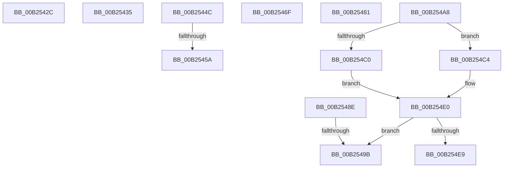

# sub_00B2542C

- RVA: `0x00B2542C`–`0x00B254F8` (길이 `204` bytes)
- VA: `0x0000000140B2542C`
- 실행 섹션: `PAGE`
- PDB 이름 있음: `아니요`; PDB Function 태그: `아니요`
- unwind 정보 RVA: `0x00090224`
- 디코드: `44`개 명령, `204/204` bytes 표시
- 미해석 바이트: `0` (있으면 어셈블리에 `.byte`로 보존)

> 이 문서는 커널 이미지의 기계어와 PDB 기호를 분석해 생성했습니다. 4번과 5번은 함수 원형과 자료형을 바이너리 사용 방식에서 추정한 C 해석이며 원본 소스 복구 결과는 아닙니다.

## 1. Dependencies

- 직접 호출 지점: **3**; 고유 호출 대상: **3**
- 직접 호출자로 확인된 함수: **0**
- RIP 상대 이미지 참조: **2**

### Outgoing calls
- `0x00B25464` → [PsRevertToUserPagePriorityThread](../../text/46/PsRevertToUserPagePriorityThread_function_00462D40.md) (function, `0x00462D40`)
- `0x00B254D1` → [guard_dispatch_icall](../../text/6B/guard_dispatch_icall_function_006BAAD0.md) (function, `0x006BAAD0`)
- `0x00B254E0` → [SeReleaseImageValidationContext](../AB/SeReleaseImageValidationContext_function_00AB0028.md) (function, `0x00AB0028`)

### Direct callers
- 이 함수 시작 RVA로 연결되는 직접 call은 확인되지 않았습니다. 간접 호출은 완전히 역산할 수 없습니다.

### Static image references
- `0x00B254B4` → RVA `0x00F04F20` (`.data`; read)
- `0x00B254E9` → RVA `0x00E2D7F8` (`.data`; write)

## 2. Other-region calls and transfers

- 다른 실행 섹션으로 향하는 call: **2**
  - `0x00B25464` → [PsRevertToUserPagePriorityThread](../../text/46/PsRevertToUserPagePriorityThread_function_00462D40.md) (`PAGE` → `.text`)
  - `0x00B254D1` → [guard_dispatch_icall](../../text/6B/guard_dispatch_icall_function_006BAAD0.md) (`PAGE` → `.text`)
- call이 아닌 외부 분기/꼬리 이동: **9**
  - `0x00B25430` → [MiValidateSectionCreate + 0x113](../94/MiValidateSectionCreate_function_00940190.md) (`tail-transfer`)
  - `0x00B25447` → [MiValidateSectionCreate + 0x374](../94/MiValidateSectionCreate_function_00940190.md) (`tail-transfer`)
  - `0x00B25454` → [MiValidateSectionCreate + 0x793](../94/MiValidateSectionCreate_function_00940190.md) (`tail-transfer`)
  - `0x00B2546A` → [MiValidateSectionCreate + 0x793](../94/MiValidateSectionCreate_function_00940190.md) (`tail-transfer`)
  - `0x00B2547C` → [MiValidateSectionCreate + 0x854](../94/MiValidateSectionCreate_function_00940190.md) (`tail-transfer`)
  - `0x00B25489` → [MiValidateSectionCreate + 0x70B](../94/MiValidateSectionCreate_function_00940190.md) (`tail-transfer`)
  - `0x00B25495` → [MiValidateSectionCreate + 0x732](../94/MiValidateSectionCreate_function_00940190.md) (`tail-transfer`)
  - `0x00B254A3` → [MiValidateSectionCreate + 0x743](../94/MiValidateSectionCreate_function_00940190.md) (`tail-transfer`)
  - `0x00B254F3` → [MiValidateSectionCreate + 0x793](../94/MiValidateSectionCreate_function_00940190.md) (`tail-transfer`)

## 3. Assembly (complete function range)

```asm
00B2542C  0F BA E9 1C                     bts ecx, 0x1c
00B25430  E9 6E AE E1 FF                  jmp 0x1409402a3
00B25435  45 8B EE                        mov r13d, r14d
00B25438  44 89 B4 24 C4 00 00 00         mov dword ptr [rsp + 0xc4], r14d
00B25440  8B 9C 24 A8 00 00 00            mov ebx, dword ptr [rsp + 0xa8]
00B25447  E9 B8 B0 E1 FF                  jmp 0x140940504
00B2544C  83 BC 24 B8 00 00 00 00         cmp dword ptr [rsp + 0xb8], 0
00B25454  0F 84 C9 B4 E1 FF               je 0x140940923
00B2545A  8B 94 24 C8 00 00 00            mov edx, dword ptr [rsp + 0xc8]
00B25461  49 8B CC                        mov rcx, r12
00B25464  E8 D7 D8 93 FF                  call 0x140462d40
00B25469  90                              nop
00B2546A  E9 B4 B4 E1 FF                  jmp 0x140940923
00B2546F  85 F6                           test esi, esi
00B25471  0F 49 F0                        cmovns esi, eax
00B25474  48 8B 8C 24 08 01 00 00         mov rcx, qword ptr [rsp + 0x108]
00B2547C  E9 63 B5 E1 FF                  jmp 0x1409409e4
00B25481  48 83 E1 FE                     and rcx, 0xfffffffffffffffe
00B25485  48 83 C9 02                     or rcx, 2
00B25489  E9 0D B4 E1 FF                  jmp 0x14094089b
00B2548E  48 C1 E8 03                     shr rax, 3
00B25492  48 3B C2                        cmp rax, rdx
00B25495  0F 82 27 B4 E1 FF               jb 0x1409408c2
00B2549B  48 89 9C 24 98 00 00 00         mov qword ptr [rsp + 0x98], rbx
00B254A3  E9 2B B4 E1 FF                  jmp 0x1409408d3
00B254A8  48 83 E1 F8                     and rcx, 0xfffffffffffffff8
00B254AC  48 89 8C 24 98 00 00 00         mov qword ptr [rsp + 0x98], rcx
00B254B4  48 8B 05 65 FA 3D 00            mov rax, qword ptr [rip + 0x3dfa65]
00B254BB  48 85 C0                        test rax, rax
00B254BE  75 04                           jne 0x140b254c4
00B254C0  33 F6                           xor esi, esi
00B254C2  EB 1C                           jmp 0x140b254e0
00B254C4  4C 8B C3                        mov r8, rbx
00B254C7  49 83 E0 F8                     and r8, 0xfffffffffffffff8
00B254CB  48 8B D1                        mov rdx, rcx
00B254CE  49 8B C8                        mov rcx, r8
00B254D1  E8 FA 55 B9 FF                  call 0x1406baad0
00B254D6  8B F0                           mov esi, eax
00B254D8  48 8B 8C 24 98 00 00 00         mov rcx, qword ptr [rsp + 0x98]
00B254E0  E8 43 AB F8 FF                  call 0x140ab0028
00B254E5  85 F6                           test esi, esi
00B254E7  79 B2                           jns 0x140b2549b
00B254E9  C7 05 05 83 30 00 82 00 00 00   mov dword ptr [rip + 0x308305], 0x82
00B254F3  E9 2B B4 E1 FF                  jmp 0x140940923
```

## 4. C-style interpretation (structured pseudocode)

```c
__int64 __fastcall sub_00B2542C(int a1)
{
    unsigned __int64 v_stack_p108;
    unsigned __int64 v_stack_p98;
    unsigned int v_stack_pA8;
    unsigned int v_stack_pB8;
    unsigned int v_stack_pC4;
    unsigned int v_stack_pC8;
}
```

## 5. (Beta) C Style

```c
int64_t sub_00B2542C(int32_t Arg1)
{
    uint64_t v_stack_p108;
    uint64_t v_stack_p98;
    uint32_t v_stack_pA8;
    uint32_t v_stack_pB8;
    uint32_t v_stack_pC4;
    uint32_t v_stack_pC8;
}
```

## 6. Execution-region graph

[열기: 2D/3D 그래프와 함수 탐색 컨트롤 패널](../../../control-panel.html?section=page&rva=0x00B2542C&view=graph)

- 2D 그래프는 위에서 아래로 흐르고, 3D 그래프는 빈 공간을 드래그해 회전합니다. Shift+드래그는 이동, 휠은 확대·축소, 함수 노드 선택은 대상 보고서 이동입니다.

### Static fallback


