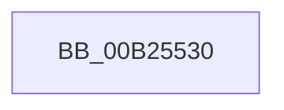

# sub_00B25530

- RVA: `0x00B25530`–`0x00B25562` (길이 `50` bytes)
- VA: `0x0000000140B25530`
- 실행 섹션: `PAGE`
- PDB 이름 있음: `아니요`; PDB Function 태그: `아니요`
- unwind 정보 RVA: `0x00090754`
- 디코드: `13`개 명령, `50/50` bytes 표시
- 미해석 바이트: `0` (있으면 어셈블리에 `.byte`로 보존)

> 이 문서는 커널 이미지의 기계어와 PDB 기호를 분석해 생성했습니다. 4번과 5번은 함수 원형과 자료형을 바이너리 사용 방식에서 추정한 C 해석이며 원본 소스 복구 결과는 아닙니다.

## 1. Dependencies

- 직접 호출 지점: **1**; 고유 호출 대상: **1**
- 직접 호출자로 확인된 함수: **0**
- RIP 상대 이미지 참조: **0**

### Outgoing calls
- `0x00B25557` → [CmpCompareUnicodeString](../A1/CmpCompareUnicodeString_function_00A17340.md) (function, `0x00A17340`)

### Direct callers
- 이 함수 시작 RVA로 연결되는 직접 call은 확인되지 않았습니다. 간접 호출은 완전히 역산할 수 없습니다.

### Static image references
- 디코드된 RIP-relative 메모리 참조가 없습니다.

## 2. Other-region calls and transfers

- 다른 실행 섹션으로 향하는 call: **0**
- call이 아닌 외부 분기/꼬리 이동: **1**
  - `0x00B2555D` → [CmpCompareKeysByName + 0x69](../94/CmpCompareKeysByName_function_00944950.md) (`tail-transfer`)

## 3. Assembly (complete function range)

```asm
00B25530  0F B7 42 48                     movzx eax, word ptr [rdx + 0x48]
00B25534  45 33 C0                        xor r8d, r8d
00B25537  66 89 45 F0                     mov word ptr [rbp - 0x10], ax
00B2553B  48 8D 55 F0                     lea rdx, [rbp - 0x10]
00B2553F  66 89 45 F2                     mov word ptr [rbp - 0xe], ax
00B25543  0F B7 41 48                     movzx eax, word ptr [rcx + 0x48]
00B25547  48 8D 4D E0                     lea rcx, [rbp - 0x20]
00B2554B  66 89 45 E0                     mov word ptr [rbp - 0x20], ax
00B2554F  66 89 45 E2                     mov word ptr [rbp - 0x1e], ax
00B25553  4C 89 65 F8                     mov qword ptr [rbp - 8], r12
00B25557  E8 E4 1D EF FF                  call 0x140a17340
00B2555C  90                              nop
00B2555D  E9 57 F4 E1 FF                  jmp 0x1409449b9
```

## 4. C-style interpretation (structured pseudocode)

```c
__int64 __fastcall sub_00B25530(__int64 a1, __int64 a2, int a3)
{
    __int64 result;

    a3 = 0;
    *(unsigned __int16 *)(v_rbp - 16) = (unsigned __int16)(*(unsigned __int16 *)(a2 + 72));
    *(unsigned __int16 *)(v_rbp - 14) = (unsigned __int16)(*(unsigned __int16 *)(a2 + 72));
    *(unsigned __int16 *)(v_rbp - 32) = (unsigned __int16)(*(unsigned __int16 *)(a1 + 72));
    *(unsigned __int16 *)(v_rbp - 30) = (unsigned __int16)(*(unsigned __int16 *)(a1 + 72));
    *(unsigned __int64 *)(v_rbp - 8) = v_r12;
    result = CmpCompareUnicodeString(v_rbp - 32, v_rbp - 16, a3, a4);
}
```

## 5. (Beta) C Style

```c
int64_t sub_00B25530(void *Arg1, void *Arg2, int32_t Arg3)
{
    uint8_t *arg1 = (uint8_t *)Arg1;
    uint8_t *arg2 = (uint8_t *)Arg2;

    int64_t result;

    Arg3 = 0;
    *(uint16_t *)(local_rbp - 0x10) = (uint16_t)(*(uint16_t *)(arg2 + 0x48));
    *(uint16_t *)(local_rbp - 0xE) = (uint16_t)(*(uint16_t *)(arg2 + 0x48));
    *(uint16_t *)(local_rbp - 0x20) = (uint16_t)(*(uint16_t *)(arg1 + 0x48));
    *(uint16_t *)(local_rbp - 0x1E) = (uint16_t)(*(uint16_t *)(arg1 + 0x48));
    *(uint64_t *)(local_rbp - 0x8) = local_r12;
    result = CmpCompareUnicodeString(local_rbp - 32, local_rbp - 16, Arg3, a4);
}
```

### 관측된 메모리 오프셋

구조체 형식이 확인되지 않은 접근은 인자 기준의 오프셋으로만 기록했습니다.

| 기준 인자 | 오프셋 표현 | 폭 (bit) | 접근 |
|---|---:|---:|---|
| `Arg1` | `+ 0x48` | `16` | `R` |
| `Arg2` | `+ 0x48` | `16` | `R` |

## 6. Execution-region graph

[열기: 2D/3D 그래프와 함수 탐색 컨트롤 패널](../../../control-panel.html?section=page&rva=0x00B25530&view=graph)

- 2D 그래프는 위에서 아래로 흐르고, 3D 그래프는 빈 공간을 드래그해 회전합니다. Shift+드래그는 이동, 휠은 확대·축소, 함수 노드 선택은 대상 보고서 이동입니다.

### Static fallback


