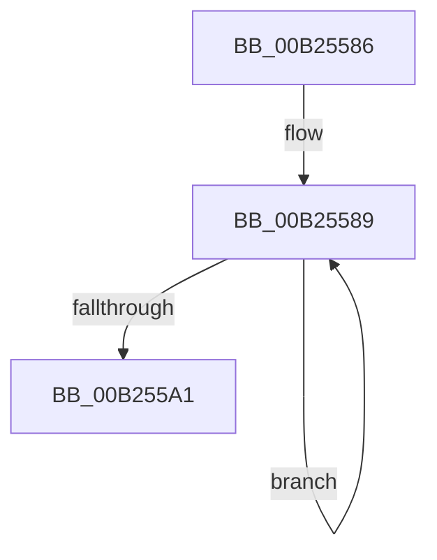

# sub_00B25586

- RVA: `0x00B25586`–`0x00B255A6` (길이 `32` bytes)
- VA: `0x0000000140B25586`
- 실행 섹션: `PAGE`
- PDB 이름 있음: `아니요`; PDB Function 태그: `아니요`
- unwind 정보 RVA: `0x00090858`
- 디코드: `8`개 명령, `32/32` bytes 표시
- 미해석 바이트: `0` (있으면 어셈블리에 `.byte`로 보존)

> 이 문서는 커널 이미지의 기계어와 PDB 기호를 분석해 생성했습니다. 4번과 5번은 함수 원형과 자료형을 바이너리 사용 방식에서 추정한 C 해석이며 원본 소스 복구 결과는 아닙니다.

## 1. Dependencies

- 직접 호출 지점: **1**; 고유 호출 대상: **1**
- 직접 호출자로 확인된 함수: **0**
- RIP 상대 이미지 참조: **0**

### Outgoing calls
- `0x00B25593` → [CmpKeyEnumStackEntryInitialize](../94/CmpKeyEnumStackEntryInitialize_function_00946D88.md) (function, `0x00946D88`)

### Direct callers
- 이 함수 시작 RVA로 연결되는 직접 call은 확인되지 않았습니다. 간접 호출은 완전히 역산할 수 없습니다.

### Static image references
- 디코드된 RIP-relative 메모리 참조가 없습니다.

## 2. Other-region calls and transfers

- 다른 실행 섹션으로 향하는 call: **0**
- call이 아닌 외부 분기/꼬리 이동: **1**
  - `0x00B255A1` → [CmpKeyEnumStackStart + 0x25](../94/CmpKeyEnumStackStart_function_009452A0.md) (`tail-transfer`)

## 3. Assembly (complete function range)

```asm
00B25586  0F B7 ED                        movzx ebp, bp
00B25589  48 8B 8F 58 01 00 00            mov rcx, qword ptr [rdi + 0x158]
00B25590  48 03 CE                        add rcx, rsi
00B25593  E8 F0 17 E2 FF                  call 0x140946d88
00B25598  48 83 EE 80                     sub rsi, -0x80
00B2559C  49 2B EE                        sub rbp, r14
00B2559F  75 E8                           jne 0x140b25589
00B255A1  E9 1F FD E1 FF                  jmp 0x1409452c5
```

## 4. C-style interpretation (structured pseudocode)

```c
__int64 __fastcall sub_00B25586(void)
{
    __int64 result;
    __int64 v_rbp;
    __int64 v_rsi;

loc_00B25589:
    a1 = (*(unsigned __int64 *)(v_rdi + 344)) + (v_rsi);
    result = CmpKeyEnumStackEntryInitialize(a1, a2, a3, a4);
    v_rsi = (v_rsi) - (-128);
    v_rbp = ((unsigned __int16)(v_rbp)) - (v_r14);
    if (condition_is_not_equal) goto loc_00B25589;
}
```

## 5. (Beta) C Style

```c
void sub_00B25586(void)
{
    int64_t result;
    int64_t local_rbp;
    int64_t local_rsi;

loc_00B25589:
    a1 = (*(uint64_t *)(local_rdi + 0x158)) + (local_rsi);
    result = CmpKeyEnumStackEntryInitialize(a1, a2, a3, a4);
    local_rsi = (local_rsi) - (-128);
    local_rbp = ((uint16_t)(local_rbp)) - (local_r14);
    if (condition_is_not_equal) goto loc_00B25589;
}
```

## 6. Execution-region graph

[열기: 2D/3D 그래프와 함수 탐색 컨트롤 패널](../../../control-panel.html?section=page&rva=0x00B25586&view=graph)

- 2D 그래프는 위에서 아래로 흐르고, 3D 그래프는 빈 공간을 드래그해 회전합니다. Shift+드래그는 이동, 휠은 확대·축소, 함수 노드 선택은 대상 보고서 이동입니다.

### Static fallback


