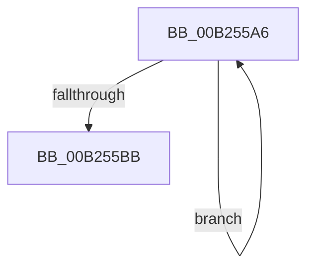

# sub_00B255A6

- RVA: `0x00B255A6`–`0x00B255C0` (길이 `26` bytes)
- VA: `0x0000000140B255A6`
- 실행 섹션: `PAGE`
- PDB 이름 있음: `아니요`; PDB Function 태그: `아니요`
- unwind 정보 RVA: `0x00090884`
- 디코드: `7`개 명령, `26/26` bytes 표시
- 미해석 바이트: `0` (있으면 어셈블리에 `.byte`로 보존)

> 이 문서는 커널 이미지의 기계어와 PDB 기호를 분석해 생성했습니다. 4번과 5번은 함수 원형과 자료형을 바이너리 사용 방식에서 추정한 C 해석이며 원본 소스 복구 결과는 아닙니다.

## 1. Dependencies

- 직접 호출 지점: **1**; 고유 호출 대상: **1**
- 직접 호출자로 확인된 함수: **0**
- RIP 상대 이미지 참조: **0**

### Outgoing calls
- `0x00B255AD` → [CmpKeyNodeStackEntryInitialize](../94/CmpKeyNodeStackEntryInitialize_function_00946840.md) (function, `0x00946840`)

### Direct callers
- 이 함수 시작 RVA로 연결되는 직접 call은 확인되지 않았습니다. 간접 호출은 완전히 역산할 수 없습니다.

### Static image references
- 디코드된 RIP-relative 메모리 참조가 없습니다.

## 2. Other-region calls and transfers

- 다른 실행 섹션으로 향하는 call: **0**
- call이 아닌 외부 분기/꼬리 이동: **1**
  - `0x00B255BB` → [CmpStartKeyNodeStack + 0x27](../94/CmpStartKeyNodeStack_function_00945338.md) (`tail-transfer`)

## 3. Assembly (complete function range)

```asm
00B255A6  48 8B 4E 48                     mov rcx, qword ptr [rsi + 0x48]
00B255AA  48 03 CA                        add rcx, rdx
00B255AD  E8 8E 12 E2 FF                  call 0x140946840
00B255B2  48 83 C2 20                     add rdx, 0x20
00B255B6  4D 2B C6                        sub r8, r14
00B255B9  75 EB                           jne 0x140b255a6
00B255BB  E9 9F FD E1 FF                  jmp 0x14094535f
```

## 4. C-style interpretation (structured pseudocode)

```c
__int64 __fastcall sub_00B255A6(__int64 a1, __int64 a2, __int64 a3)
{
    __int64 result;

    a1 = (*(unsigned __int64 *)(v_rsi + 72)) + (a2);
    result = CmpKeyNodeStackEntryInitialize(a1, a2, a3, a4);
    a2 = (a2) + (32);
    a3 = (a3) - (v_r14);
    if (condition_is_not_equal) goto loc_00B255A6;
}
```

## 5. (Beta) C Style

```c
int64_t sub_00B255A6(int64_t Arg1, int64_t Arg2, int64_t Arg3)
{
    int64_t result;

    Arg1 = (*(uint64_t *)(local_rsi + 0x48)) + (Arg2);
    result = CmpKeyNodeStackEntryInitialize(Arg1, Arg2, Arg3, a4);
    Arg2 = (Arg2) + (32);
    Arg3 = (Arg3) - (local_r14);
    if (condition_is_not_equal) goto loc_00B255A6;
}
```

## 6. Execution-region graph

[열기: 2D/3D 그래프와 함수 탐색 컨트롤 패널](../../../control-panel.html?section=page&rva=0x00B255A6&view=graph)

- 2D 그래프는 위에서 아래로 흐르고, 3D 그래프는 빈 공간을 드래그해 회전합니다. Shift+드래그는 이동, 휠은 확대·축소, 함수 노드 선택은 대상 보고서 이동입니다.

### Static fallback


