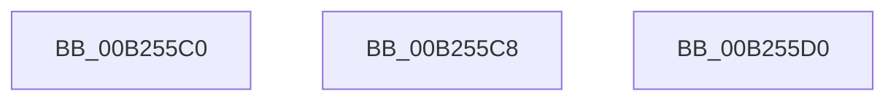

# sub_00B255C0

- RVA: `0x00B255C0`–`0x00B255E7` (길이 `39` bytes)
- VA: `0x0000000140B255C0`
- 실행 섹션: `PAGE`
- PDB 이름 있음: `아니요`; PDB Function 태그: `아니요`
- unwind 정보 RVA: `0x00090958`
- 디코드: `10`개 명령, `39/39` bytes 표시
- 미해석 바이트: `0` (있으면 어셈블리에 `.byte`로 보존)

> 이 문서는 커널 이미지의 기계어와 PDB 기호를 분석해 생성했습니다. 4번과 5번은 함수 원형과 자료형을 바이너리 사용 방식에서 추정한 C 해석이며 원본 소스 복구 결과는 아닙니다.

## 1. Dependencies

- 직접 호출 지점: **0**; 고유 호출 대상: **0**
- 직접 호출자로 확인된 함수: **0**
- RIP 상대 이미지 참조: **0**

### Outgoing calls
- 직접 디코드된 call 명령이 없습니다.

### Direct callers
- 이 함수 시작 RVA로 연결되는 직접 call은 확인되지 않았습니다. 간접 호출은 완전히 역산할 수 없습니다.

### Static image references
- 디코드된 RIP-relative 메모리 참조가 없습니다.

## 2. Other-region calls and transfers

- 다른 실행 섹션으로 향하는 call: **0**
- call이 아닌 외부 분기/꼬리 이동: **3**
  - `0x00B255C3` → [CmpCopyMergeOfLayeredKeyNode + 0x66](../94/CmpCopyMergeOfLayeredKeyNode_function_00945A78.md) (`tail-transfer`)
  - `0x00B255CB` → [CmpCopyMergeOfLayeredKeyNode + 0x278](../94/CmpCopyMergeOfLayeredKeyNode_function_00945A78.md) (`tail-transfer`)
  - `0x00B255E2` → [CmpCopyMergeOfLayeredKeyNode + 0xB7](../94/CmpCopyMergeOfLayeredKeyNode_function_00945A78.md) (`tail-transfer`)

## 3. Assembly (complete function range)

```asm
00B255C0  45 8B F8                        mov r15d, r8d
00B255C3  E9 16 05 E2 FF                  jmp 0x140945ade
00B255C8  66 FF CB                        dec bx
00B255CB  E9 20 07 E2 FF                  jmp 0x140945cf0
00B255D0  8B 42 30                        mov eax, dword ptr [rdx + 0x30]
00B255D3  89 45 48                        mov dword ptr [rbp + 0x48], eax
00B255D6  0F B7 42 4A                     movzx eax, word ptr [rdx + 0x4a]
00B255DA  66 89 45 60                     mov word ptr [rbp + 0x60], ax
00B255DE  48 89 4D F8                     mov qword ptr [rbp - 8], rcx
00B255E2  E9 48 05 E2 FF                  jmp 0x140945b2f
```

## 4. C-style interpretation (structured pseudocode)

```c
__int64 __fastcall sub_00B255C0(__int64 a1, __int64 a2, int a3)
{
}
```

## 5. (Beta) C Style

```c
int64_t sub_00B255C0(int64_t Arg1, int64_t Arg2, int32_t Arg3)
{
}
```

## 6. Execution-region graph

[열기: 2D/3D 그래프와 함수 탐색 컨트롤 패널](../../../control-panel.html?section=page&rva=0x00B255C0&view=graph)

- 2D 그래프는 위에서 아래로 흐르고, 3D 그래프는 빈 공간을 드래그해 회전합니다. Shift+드래그는 이동, 휠은 확대·축소, 함수 노드 선택은 대상 보고서 이동입니다.

### Static fallback


