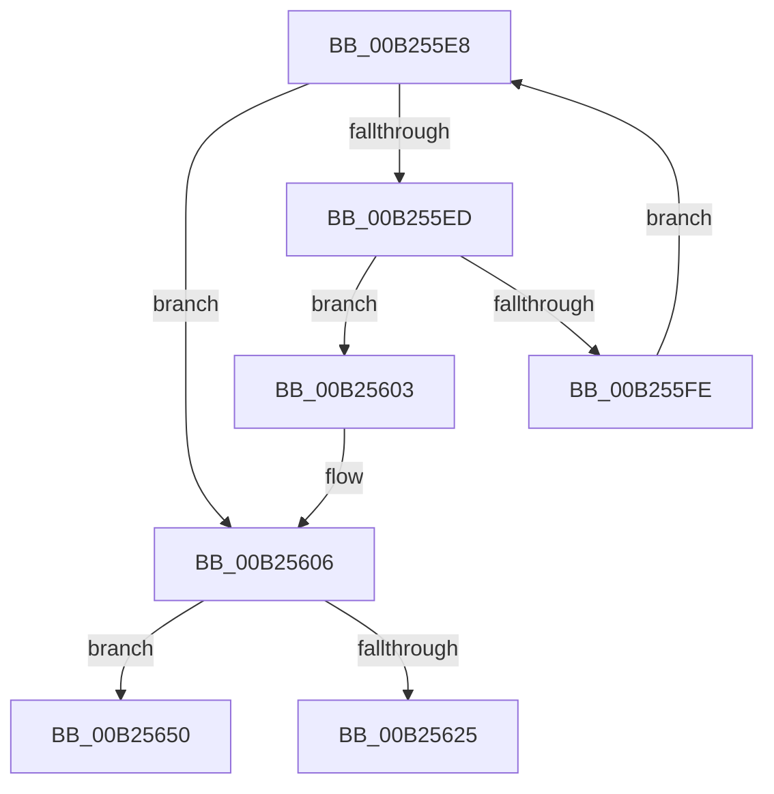

# sub_00B255E8

- RVA: `0x00B255E8`–`0x00B25678` (길이 `144` bytes)
- VA: `0x0000000140B255E8`
- 실행 섹션: `PAGE`
- PDB 이름 있음: `아니요`; PDB Function 태그: `아니요`
- unwind 정보 RVA: `0x000909CC`
- 디코드: `39`개 명령, `144/144` bytes 표시
- 미해석 바이트: `0` (있으면 어셈블리에 `.byte`로 보존)

> 이 문서는 커널 이미지의 기계어와 PDB 기호를 분석해 생성했습니다. 4번과 5번은 함수 원형과 자료형을 바이너리 사용 방식에서 추정한 C 해석이며 원본 소스 복구 결과는 아닙니다.

## 1. Dependencies

- 직접 호출 지점: **5**; 고유 호출 대상: **5**
- 직접 호출자로 확인된 함수: **0**
- RIP 상대 이미지 참조: **0**

### Outgoing calls
- `0x00B255F0` → [CmpKeyNodeStackGetEntryAtLayerHeight](../94/CmpKeyNodeStackGetEntryAtLayerHeight_function_00946ABC.md) (function, `0x00946ABC`)
- `0x00B2562A` → [CmpHashCompressedComponent](../85/CmpHashCompressedComponent_function_0085E420.md) (function, `0x0085E420`)
- `0x00B25645` → [CmpFindKcbInHashEntryByCompressedName](../AB/CmpFindKcbInHashEntryByCompressedName_function_00ABC800.md) (function, `0x00ABC800`)
- `0x00B25655` → [CmpHashUnicodeComponent](../84/CmpHashUnicodeComponent_function_0084AC24.md) (function, `0x0084AC24`)
- `0x00B2566D` → [CmpFindKcbInHashEntryByName](../94/CmpFindKcbInHashEntryByName_function_0094D7A0.md) (function, `0x0094D7A0`)

### Direct callers
- 이 함수 시작 RVA로 연결되는 직접 call은 확인되지 않았습니다. 간접 호출은 완전히 역산할 수 없습니다.

### Static image references
- 디코드된 RIP-relative 메모리 참조가 없습니다.

## 2. Other-region calls and transfers

- 다른 실행 섹션으로 향하는 call: **0**
- call이 아닌 외부 분기/꼬리 이동: **2**
  - `0x00B2564B` → [CmpSubtreeEnumeratorAdvance + 0x95](../94/CmpSubtreeEnumeratorAdvance_function_00946590.md) (`tail-transfer`)
  - `0x00B25673` → [CmpSubtreeEnumeratorAdvance + 0x95](../94/CmpSubtreeEnumeratorAdvance_function_00946590.md) (`tail-transfer`)

## 3. Assembly (complete function range)

```asm
00B255E8  66 85 D2                        test dx, dx
00B255EB  78 19                           js 0x140b25606
00B255ED  49 8B CF                        mov rcx, r15
00B255F0  E8 C7 14 E2 FF                  call 0x140946abc
00B255F5  48 8B 48 10                     mov rcx, qword ptr [rax + 0x10]
00B255F9  48 85 C9                        test rcx, rcx
00B255FC  75 05                           jne 0x140b25603
00B255FE  66 FF CA                        dec dx
00B25601  EB E5                           jmp 0x140b255e8
00B25603  4C 8B C9                        mov r9, rcx
00B25606  41 F6 41 02 20                  test byte ptr [r9 + 2], 0x20
00B2560B  4D 8D 61 4C                     lea r12, [r9 + 0x4c]
00B2560F  41 0F B7 69 48                  movzx ebp, word ptr [r9 + 0x48]
00B25614  4C 89 64 24 38                  mov qword ptr [rsp + 0x38], r12
00B25619  66 89 6C 24 30                  mov word ptr [rsp + 0x30], bp
00B2561E  66 89 6C 24 32                  mov word ptr [rsp + 0x32], bp
00B25623  74 2B                           je 0x140b25650
00B25625  8B D5                           mov edx, ebp
00B25627  49 8B CC                        mov rcx, r12
00B2562A  E8 F1 8D D3 FF                  call 0x14085e420
00B2562F  41 6B 56 10 25                  imul edx, dword ptr [r14 + 0x10], 0x25
00B25634  4D 8B CC                        mov r9, r12
00B25637  49 8B 4E 20                     mov rcx, qword ptr [r14 + 0x20]
00B2563B  4D 8B C6                        mov r8, r14
00B2563E  66 89 6C 24 20                  mov word ptr [rsp + 0x20], bp
00B25643  03 D0                           add edx, eax
00B25645  E8 B6 71 F9 FF                  call 0x140abc800
00B2564A  90                              nop
00B2564B  E9 D5 0F E2 FF                  jmp 0x140946625
00B25650  48 8D 4C 24 30                  lea rcx, [rsp + 0x30]
00B25655  E8 CA 55 D2 FF                  call 0x14084ac24
00B2565A  41 6B 56 10 25                  imul edx, dword ptr [r14 + 0x10], 0x25
00B2565F  4C 8D 4C 24 30                  lea r9, [rsp + 0x30]
00B25664  49 8B 4E 20                     mov rcx, qword ptr [r14 + 0x20]
00B25668  4D 8B C6                        mov r8, r14
00B2566B  03 D0                           add edx, eax
00B2566D  E8 2E 81 E2 FF                  call 0x14094d7a0
00B25672  90                              nop
00B25673  E9 AD 0F E2 FF                  jmp 0x140946625
```

## 4. C-style interpretation (structured pseudocode)

```c
__int64 __fastcall sub_00B255E8(__int64 a1, unsigned __int16 a2, __int64 a3, __int64 a4, __int64 a5, __int64 a6)
{
    __int64 result;
    unsigned __int16 v_stack_p20;
    unsigned __int16 v_stack_p30;
    unsigned __int16 v_stack_p32;
    unsigned __int64 v_stack_p38;

    if (sign_flag) goto loc_00B25606;
    result = CmpKeyNodeStackGetEntryAtLayerHeight(v_r15, a2, a3, a4);
    if (*(unsigned __int64 *)(result + 16) != 0) goto loc_00B25603;
    a2 = (unsigned __int16)((a2) - 1);
    goto loc_00B255E8;
loc_00B25603:
loc_00B25606:
    v_stack_p38 = *(unsigned __int64 *)(result + 16) + 76;
    v_stack_p30 = (unsigned __int16)(*(unsigned __int16 *)(*(unsigned __int64 *)(result + 16) + 72));
    v_stack_p32 = (unsigned __int16)(*(unsigned __int16 *)(*(unsigned __int64 *)(result + 16) + 72));
    if (((*(unsigned __int8 *)(*(unsigned __int64 *)(result + 16) + 2)) & (32)) == 0) goto loc_00B25650;
    result = CmpHashCompressedComponent(*(unsigned __int64 *)(result + 16) + 76, (unsigned int)((unsigned int)(*(unsigned __int16 *)(*(unsigned __int64 *)(result + 16) + 72))), a3, *(unsigned __int64 *)(result + 16));
    a2 = (unsigned int)(((unsigned int)((unsigned int)(*(unsigned __int16 *)(*(unsigned __int64 *)(result + 16) + 72)))) * (*(unsigned int *)(v_r14 + 16)));
    v_stack_p20 = (unsigned __int16)(*(unsigned __int16 *)(*(unsigned __int64 *)(result + 16) + 72));
    a2 = (unsigned int)((a2) + ((unsigned int)(result)));
    result = CmpFindKcbInHashEntryByCompressedName(*(unsigned __int64 *)(v_r14 + 32), a2, v_r14, *(unsigned __int64 *)(result + 16) + 76);
loc_00B25650:
    result = CmpHashUnicodeComponent(a6, a2, v_r14, *(unsigned __int64 *)(result + 16) + 76);
    a2 = (unsigned int)((a2) * (*(unsigned int *)(v_r14 + 16)));
    a2 = (unsigned int)((a2) + ((unsigned int)(result)));
    result = CmpFindKcbInHashEntryByName(*(unsigned __int64 *)(v_r14 + 32), a2, v_r14, a6);
}
```

## 5. (Beta) C Style

```c
int64_t sub_00B255E8(int64_t Arg1, uint16_t Arg2, int64_t Arg3, int64_t Arg4, uint64_t Arg5, int64_t Arg6)
{
    int64_t result;
    uint16_t v_stack_p20;
    uint16_t v_stack_p30;
    uint16_t v_stack_p32;
    uint64_t v_stack_p38;

    if (sign_flag) goto loc_00B25606;
    result = CmpKeyNodeStackGetEntryAtLayerHeight(local_r15, Arg2, Arg3, Arg4);
    if (*(uint64_t *)(result + 0x10) != 0) goto loc_00B25603;
    Arg2 = (uint16_t)((Arg2) - 1);
    goto loc_00B255E8;
loc_00B25603:
loc_00B25606:
    v_stack_p38 = *(uint64_t *)(result + 0x10) + 76;
    v_stack_p30 = (uint16_t)(*(uint16_t *)(*(uint64_t *)(result + 0x10) + 0x48));
    v_stack_p32 = (uint16_t)(*(uint16_t *)(*(uint64_t *)(result + 0x10) + 0x48));
    if (((*(uint8_t *)(*(uint64_t *)(result + 0x10) + 0x2)) & (32)) == 0) goto loc_00B25650;
    result = CmpHashCompressedComponent(*(uint64_t *)(result + 0x10) + 76, (uint32_t)((uint32_t)(*(uint16_t *)(*(uint64_t *)(result + 0x10) + 0x48))), Arg3, *(uint64_t *)(result + 0x10));
    Arg2 = (uint32_t)(((uint32_t)((uint32_t)(*(uint16_t *)(*(uint64_t *)(result + 0x10) + 0x48)))) * (*(uint32_t *)(local_r14 + 0x10)));
    v_stack_p20 = (uint16_t)(*(uint16_t *)(*(uint64_t *)(result + 0x10) + 0x48));
    Arg2 = (uint32_t)((Arg2) + ((uint32_t)(result)));
    result = CmpFindKcbInHashEntryByCompressedName(*(uint64_t *)(local_r14 + 0x20), Arg2, local_r14, *(uint64_t *)(result + 0x10) + 76);
loc_00B25650:
    result = CmpHashUnicodeComponent(Arg6, Arg2, local_r14, *(uint64_t *)(result + 0x10) + 76);
    Arg2 = (uint32_t)((Arg2) * (*(uint32_t *)(local_r14 + 0x10)));
    Arg2 = (uint32_t)((Arg2) + ((uint32_t)(result)));
    result = CmpFindKcbInHashEntryByName(*(uint64_t *)(local_r14 + 0x20), Arg2, local_r14, Arg6);
}
```

## 6. Execution-region graph

[열기: 2D/3D 그래프와 함수 탐색 컨트롤 패널](../../../control-panel.html?section=page&rva=0x00B255E8&view=graph)

- 2D 그래프는 위에서 아래로 흐르고, 3D 그래프는 빈 공간을 드래그해 회전합니다. Shift+드래그는 이동, 휠은 확대·축소, 함수 노드 선택은 대상 보고서 이동입니다.

### Static fallback


