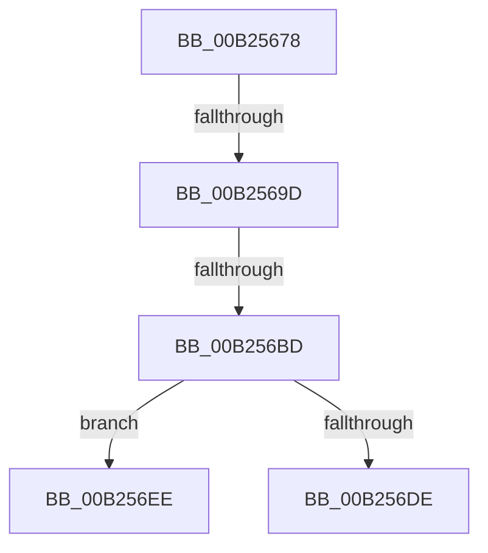

# sub_00B25678

- RVA: `0x00B25678`–`0x00B256F6` (길이 `126` bytes)
- VA: `0x0000000140B25678`
- 실행 섹션: `PAGE`
- PDB 이름 있음: `아니요`; PDB Function 태그: `아니요`
- unwind 정보 RVA: `0x00090AE4`
- 디코드: `32`개 명령, `126/126` bytes 표시
- 미해석 바이트: `0` (있으면 어셈블리에 `.byte`로 보존)

> 이 문서는 커널 이미지의 기계어와 PDB 기호를 분석해 생성했습니다. 4번과 5번은 함수 원형과 자료형을 바이너리 사용 방식에서 추정한 C 해석이며 원본 소스 복구 결과는 아닙니다.

## 1. Dependencies

- 직접 호출 지점: **4**; 고유 호출 대상: **3**
- 직접 호출자로 확인된 함수: **0**
- RIP 상대 이미지 참조: **0**

### Outgoing calls
- `0x00B2568D` → [PsQueryProcessCommandLine](../../text/46/PsQueryProcessCommandLine_function_00469810.md) (function, `0x00469810`)
- `0x00B256AC` → [ExAllocatePool2](../../poolcode/B8/ExAllocatePool2_function_00B820F0.md) (function, `0x00B820F0`)
- `0x00B256D5` → [PsQueryProcessCommandLine](../../text/46/PsQueryProcessCommandLine_function_00469810.md) (function, `0x00469810`)
- `0x00B256E3` → [ExFreePoolWithTag](../../poolcode/B8/ExFreePoolWithTag_function_00B82870.md) (function, `0x00B82870`)

### Direct callers
- 이 함수 시작 RVA로 연결되는 직접 call은 확인되지 않았습니다. 간접 호출은 완전히 역산할 수 없습니다.

### Static image references
- 디코드된 RIP-relative 메모리 참조가 없습니다.

## 2. Other-region calls and transfers

- 다른 실행 섹션으로 향하는 call: **4**
  - `0x00B2568D` → [PsQueryProcessCommandLine](../../text/46/PsQueryProcessCommandLine_function_00469810.md) (`PAGE` → `.text`)
  - `0x00B256AC` → [ExAllocatePool2](../../poolcode/B8/ExAllocatePool2_function_00B820F0.md) (`PAGE` → `POOLCODE`)
  - `0x00B256D5` → [PsQueryProcessCommandLine](../../text/46/PsQueryProcessCommandLine_function_00469810.md) (`PAGE` → `.text`)
  - `0x00B256E3` → [ExFreePoolWithTag](../../poolcode/B8/ExFreePoolWithTag_function_00B82870.md) (`PAGE` → `POOLCODE`)
- call이 아닌 외부 분기/꼬리 이동: **4**
  - `0x00B25697` → [SeAuditProcessCreation + 0x3ED](../94/SeAuditProcessCreation_function_00947624.md) (`tail-transfer`)
  - `0x00B256B7` → [SeAuditProcessCreation + 0x3ED](../94/SeAuditProcessCreation_function_00947624.md) (`tail-transfer`)
  - `0x00B256E9` → [SeAuditProcessCreation + 0x3ED](../94/SeAuditProcessCreation_function_00947624.md) (`tail-transfer`)
  - `0x00B256F1` → [SeAuditProcessCreation + 0x1D7](../94/SeAuditProcessCreation_function_00947624.md) (`tail-transfer`)

## 3. Assembly (complete function range)

```asm
00B25678  48 8D 44 24 34                  lea rax, [rsp + 0x34]
00B2567D  45 33 C9                        xor r9d, r9d
00B25680  45 33 C0                        xor r8d, r8d
00B25683  48 89 44 24 20                  mov qword ptr [rsp + 0x20], rax
00B25688  33 D2                           xor edx, edx
00B2568A  49 8B CF                        mov rcx, r15
00B2568D  E8 7E 41 94 FF                  call 0x140469810
00B25692  3D 04 00 00 C0                  cmp eax, 0xc0000004
00B25697  0F 85 74 23 E2 FF               jne 0x140947a11
00B2569D  8B 54 24 34                     mov edx, dword ptr [rsp + 0x34]
00B256A1  B9 00 01 00 00                  mov ecx, 0x100
00B256A6  41 B8 53 65 43 4C               mov r8d, 0x4c436553
00B256AC  E8 3F CA 05 00                  call 0x140b820f0
00B256B1  48 8B F8                        mov rdi, rax
00B256B4  48 85 C0                        test rax, rax
00B256B7  0F 84 54 23 E2 FF               je 0x140947a11
00B256BD  44 8B 44 24 34                  mov r8d, dword ptr [rsp + 0x34]
00B256C2  48 8D 44 24 34                  lea rax, [rsp + 0x34]
00B256C7  45 33 C9                        xor r9d, r9d
00B256CA  48 89 44 24 20                  mov qword ptr [rsp + 0x20], rax
00B256CF  48 8B D7                        mov rdx, rdi
00B256D2  49 8B CF                        mov rcx, r15
00B256D5  E8 36 41 94 FF                  call 0x140469810
00B256DA  85 C0                           test eax, eax
00B256DC  79 10                           jns 0x140b256ee
00B256DE  33 D2                           xor edx, edx
00B256E0  48 8B CF                        mov rcx, rdi
00B256E3  E8 88 D1 05 00                  call 0x140b82870
00B256E8  90                              nop
00B256E9  E9 23 23 E2 FF                  jmp 0x140947a11
00B256EE  40 B6 01                        mov sil, 1
00B256F1  E9 05 21 E2 FF                  jmp 0x1409477fb
```

## 4. C-style interpretation (structured pseudocode)

```c
__int64 __fastcall sub_00B25678(__int64 a1, int a2, int a3, int a4)
{
    __int64 result;
    unsigned __int64 v_stack_p20;
    unsigned __int64 v_stack_p34;

    a4 = 0;
    a3 = 0;
    v_stack_p20 = v_stack_p34;
    a2 = 0;
    result = PsQueryProcessCommandLine(v_r15, a2, a3, a4);
    result = ExAllocatePool2(256, (unsigned int)(v_stack_p34), (unsigned int)(0x4C436553ULL), a4);
    a4 = 0;
    v_stack_p20 = v_stack_p34;
    result = PsQueryProcessCommandLine(v_r15, result, (unsigned int)(v_stack_p34), a4);
    if (!sign_flag) goto loc_00B256EE;
    a2 = 0;
    result = ExFreePoolWithTag(result, a2, (unsigned int)(v_stack_p34), a4);
loc_00B256EE:
}
```

## 5. (Beta) C Style

```c
int64_t sub_00B25678(int64_t Arg1, int32_t Arg2, int32_t Arg3, int32_t Arg4)
{
    int64_t result;
    uint64_t v_stack_p20;
    uint64_t v_stack_p34;

    Arg4 = 0;
    Arg3 = 0;
    v_stack_p20 = v_stack_p34;
    Arg2 = 0;
    result = PsQueryProcessCommandLine(local_r15, Arg2, Arg3, Arg4);
    result = ExAllocatePool2(256, (uint32_t)(v_stack_p34), (uint32_t)(0x4C436553ULL), Arg4);
    Arg4 = 0;
    v_stack_p20 = v_stack_p34;
    result = PsQueryProcessCommandLine(local_r15, result, (uint32_t)(v_stack_p34), Arg4);
    if (!sign_flag) goto loc_00B256EE;
    Arg2 = 0;
    result = ExFreePoolWithTag(result, Arg2, (uint32_t)(v_stack_p34), Arg4);
loc_00B256EE:
}
```

## 6. Execution-region graph

[열기: 2D/3D 그래프와 함수 탐색 컨트롤 패널](../../../control-panel.html?section=page&rva=0x00B25678&view=graph)

- 2D 그래프는 위에서 아래로 흐르고, 3D 그래프는 빈 공간을 드래그해 회전합니다. Shift+드래그는 이동, 휠은 확대·축소, 함수 노드 선택은 대상 보고서 이동입니다.

### Static fallback


