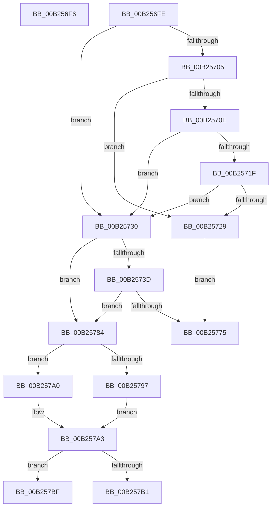

# sub_00B256F6

- RVA: `0x00B256F6`–`0x00B257CF` (길이 `217` bytes)
- VA: `0x0000000140B256F6`
- 실행 섹션: `PAGE`
- PDB 이름 있음: `아니요`; PDB Function 태그: `아니요`
- unwind 정보 RVA: `0x00090BA4`
- 디코드: `58`개 명령, `217/217` bytes 표시
- 미해석 바이트: `0` (있으면 어셈블리에 `.byte`로 보존)

> 이 문서는 커널 이미지의 기계어와 PDB 기호를 분석해 생성했습니다. 4번과 5번은 함수 원형과 자료형을 바이너리 사용 방식에서 추정한 C 해석이며 원본 소스 복구 결과는 아닙니다.

## 1. Dependencies

- 직접 호출 지점: **7**; 고유 호출 대상: **6**
- 직접 호출자로 확인된 함수: **0**
- RIP 상대 이미지 참조: **0**

### Outgoing calls
- `0x00B25748` → [memset](../../text/6C/memset_function_006C6C40.md) (function, `0x006C6C40`)
- `0x00B2576A` → [VslpEnterIumSecureMode](../../text/23/VslpEnterIumSecureMode_function_00235E50.md) (function, `0x00235E50`)
- `0x00B25778` → [ObfDereferenceObject](../../text/2F/ObfDereferenceObject_function_002F9350.md) (function, `0x002F9350`)
- `0x00B2578B` → [ExAcquireFastMutex](../../text/20/ExAcquireFastMutex_function_0020E5A0.md) (function, `0x0020E5A0`)
- `0x00B257A7` → [ExReleaseFastMutex](../../text/25/ExReleaseFastMutex_function_002519C0.md) (function, `0x002519C0`)
- `0x00B257B4` → [ObfDereferenceObject](../../text/2F/ObfDereferenceObject_function_002F9350.md) (function, `0x002F9350`)
- `0x00B257C2` → [DbgkpMarkProcessPeb](../AC/DbgkpMarkProcessPeb_function_00AC8D0C.md) (function, `0x00AC8D0C`)

### Direct callers
- 이 함수 시작 RVA로 연결되는 직접 call은 확인되지 않았습니다. 간접 호출은 완전히 역산할 수 없습니다.

### Static image references
- 디코드된 RIP-relative 메모리 참조가 없습니다.

## 2. Other-region calls and transfers

- 다른 실행 섹션으로 향하는 call: **6**
  - `0x00B25748` → [memset](../../text/6C/memset_function_006C6C40.md) (`PAGE` → `.text`)
  - `0x00B2576A` → [VslpEnterIumSecureMode](../../text/23/VslpEnterIumSecureMode_function_00235E50.md) (`PAGE` → `.text`)
  - `0x00B25778` → [ObfDereferenceObject](../../text/2F/ObfDereferenceObject_function_002F9350.md) (`PAGE` → `.text`)
  - `0x00B2578B` → [ExAcquireFastMutex](../../text/20/ExAcquireFastMutex_function_0020E5A0.md) (`PAGE` → `.text`)
  - `0x00B257A7` → [ExReleaseFastMutex](../../text/25/ExReleaseFastMutex_function_002519C0.md) (`PAGE` → `.text`)
  - `0x00B257B4` → [ObfDereferenceObject](../../text/2F/ObfDereferenceObject_function_002F9350.md) (`PAGE` → `.text`)
- call이 아닌 외부 분기/꼬리 이동: **4**
  - `0x00B256F9` → [DbgkCopyProcessDebugPort + 0x9F](../94/DbgkCopyProcessDebugPort_function_00947BE8.md) (`tail-transfer`)
  - `0x00B2577F` → [DbgkCopyProcessDebugPort + 0x4A](../94/DbgkCopyProcessDebugPort_function_00947BE8.md) (`tail-transfer`)
  - `0x00B257BA` → [DbgkCopyProcessDebugPort + 0x45](../94/DbgkCopyProcessDebugPort_function_00947BE8.md) (`tail-transfer`)
  - `0x00B257CA` → [DbgkCopyProcessDebugPort + 0x45](../94/DbgkCopyProcessDebugPort_function_00947BE8.md) (`tail-transfer`)

## 3. Assembly (complete function range)

```asm
00B256F6  48 8B DF                        mov rbx, rdi
00B256F9  E9 89 25 E2 FF                  jmp 0x140947c87
00B256FE  8B 43 60                        mov eax, dword ptr [rbx + 0x60]
00B25701  A8 04                           test al, 4
00B25703  74 2B                           je 0x140b25730
00B25705  48 39 BE 10 03 00 00            cmp qword ptr [rsi + 0x310], rdi
00B2570C  74 1B                           je 0x140b25729
00B2570E  0F B7 86 EC 06 00 00            movzx eax, word ptr [rsi + 0x6ec]
00B25715  B9 4C 01 00 00                  mov ecx, 0x14c
00B2571A  66 3B C1                        cmp ax, cx
00B2571D  74 11                           je 0x140b25730
00B2571F  B9 C4 01 00 00                  mov ecx, 0x1c4
00B25724  66 3B C1                        cmp ax, cx
00B25727  74 07                           je 0x140b25730
00B25729  BD BB 00 00 C0                  mov ebp, 0xc00000bb
00B2572E  EB 45                           jmp 0x140b25775
00B25730  48 8B AE 70 01 00 00            mov rbp, qword ptr [rsi + 0x170]
00B25737  40 F6 C5 01                     test bpl, 1
00B2573B  74 47                           je 0x140b25784
00B2573D  33 D2                           xor edx, edx
00B2573F  48 8D 4C 24 20                  lea rcx, [rsp + 0x20]
00B25744  44 8D 42 68                     lea r8d, [rdx + 0x68]
00B25748  E8 F3 14 BA FF                  call 0x1406c6c40
00B2574D  BA 0C 00 00 00                  mov edx, 0xc
00B25752  48 89 6C 24 28                  mov qword ptr [rsp + 0x28], rbp
00B25757  4C 8D 4C 24 20                  lea r9, [rsp + 0x20]
00B2575C  48 C7 44 24 30 01 00 00 00      mov qword ptr [rsp + 0x30], 1
00B25765  45 33 C0                        xor r8d, r8d
00B25768  B1 02                           mov cl, 2
00B2576A  E8 E1 06 71 FF                  call 0x140235e50
00B2576F  8B E8                           mov ebp, eax
00B25771  85 C0                           test eax, eax
00B25773  79 0F                           jns 0x140b25784
00B25775  48 8B CB                        mov rcx, rbx
00B25778  E8 D3 3B 7D FF                  call 0x1402f9350
00B2577D  8B C5                           mov eax, ebp
00B2577F  E9 AE 24 E2 FF                  jmp 0x140947c32
00B25784  48 8D 4B 18                     lea rcx, [rbx + 0x18]
00B25788  40 8A EF                        mov bpl, dil
00B2578B  E8 10 8E 6E FF                  call 0x14020e5a0
00B25790  8B 43 60                        mov eax, dword ptr [rbx + 0x60]
00B25793  A8 01                           test al, 1
00B25795  75 09                           jne 0x140b257a0
00B25797  48 89 9E 08 03 00 00            mov qword ptr [rsi + 0x308], rbx
00B2579E  EB 03                           jmp 0x140b257a3
00B257A0  40 B5 01                        mov bpl, 1
00B257A3  48 8D 4B 18                     lea rcx, [rbx + 0x18]
00B257A7  E8 14 C2 72 FF                  call 0x1402519c0
00B257AC  40 84 ED                        test bpl, bpl
00B257AF  74 0E                           je 0x140b257bf
00B257B1  48 8B CB                        mov rcx, rbx
00B257B4  E8 97 3B 7D FF                  call 0x1402f9350
00B257B9  90                              nop
00B257BA  E9 6E 24 E2 FF                  jmp 0x140947c2d
00B257BF  48 8B CE                        mov rcx, rsi
00B257C2  E8 45 35 FA FF                  call 0x140ac8d0c
00B257C7  40 B7 01                        mov dil, 1
00B257CA  E9 5E 24 E2 FF                  jmp 0x140947c2d
```

## 4. C-style interpretation (structured pseudocode)

```c
__int64 __fastcall sub_00B256F6(__int64 a1, int a2)
{
    unsigned __int64 v_stack_p20;
    unsigned __int64 v_stack_p28;
    unsigned __int64 v_stack_p30;
}
```

## 5. (Beta) C Style

```c
int64_t sub_00B256F6(int64_t Arg1, int32_t Arg2)
{
    uint64_t v_stack_p20;
    uint64_t v_stack_p28;
    uint64_t v_stack_p30;
}
```

## 6. Execution-region graph

[열기: 2D/3D 그래프와 함수 탐색 컨트롤 패널](../../../control-panel.html?section=page&rva=0x00B256F6&view=graph)

- 2D 그래프는 위에서 아래로 흐르고, 3D 그래프는 빈 공간을 드래그해 회전합니다. Shift+드래그는 이동, 휠은 확대·축소, 함수 노드 선택은 대상 보고서 이동입니다.

### Static fallback


