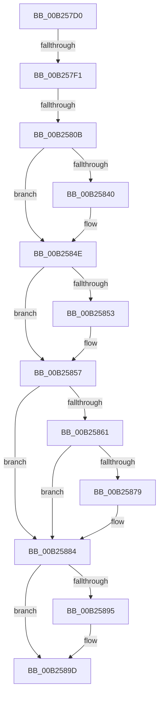

# sub_00B257D0

- RVA: `0x00B257D0`–`0x00B258BA` (길이 `234` bytes)
- VA: `0x0000000140B257D0`
- 실행 섹션: `PAGE`
- PDB 이름 있음: `아니요`; PDB Function 태그: `아니요`
- unwind 정보 RVA: `0x00090BB4`
- 디코드: `55`개 명령, `234/234` bytes 표시
- 미해석 바이트: `0` (있으면 어셈블리에 `.byte`로 보존)

> 이 문서는 커널 이미지의 기계어와 PDB 기호를 분석해 생성했습니다. 4번과 5번은 함수 원형과 자료형을 바이너리 사용 방식에서 추정한 C 해석이며 원본 소스 복구 결과는 아닙니다.

## 1. Dependencies

- 직접 호출 지점: **10**; 고유 호출 대상: **10**
- 직접 호출자로 확인된 함수: **0**
- RIP 상대 이미지 참조: **4**

### Outgoing calls
- `0x00B257D0` → [PsGetProcessImageFileName](../../text/45/PsGetProcessImageFileName_function_00453720.md) (function, `0x00453720`)
- `0x00B257DD` → [RtlInitAnsiString](../../text/47/RtlInitAnsiString_function_00470F40.md) (function, `0x00470F40`)
- `0x00B257FE` → [RtlAnsiStringToUnicodeString](../90/RtlAnsiStringToUnicodeString_function_0090BEA0.md) (function, `0x0090BEA0`)
- `0x00B2582F` → [KeAbPreAcquire](../../text/21/KeAbPreAcquire_function_00210230.md) (function, `0x00210230`)
- `0x00B25849` → [ExfAcquirePushLockExclusiveEx](../../text/20/ExfAcquirePushLockExclusiveEx_function_0020FC90.md) (function, `0x0020FC90`)
- `0x00B25870` → [RtlPrefixUnicodeString](../8F/RtlPrefixUnicodeString_function_008F4F70.md) (function, `0x008F4F70`)
- `0x00B25898` → [ExfTryToWakePushLock](../../text/26/ExfTryToWakePushLock_function_00265DD0.md) (function, `0x00265DD0`)
- `0x00B258A0` → [KeAbPostRelease](../../text/2E/KeAbPostRelease_function_002E1600.md) (function, `0x002E1600`)
- `0x00B258A5` → [KeLeaveGuardedRegion](../../text/2E/KeLeaveGuardedRegion_function_002E2C40.md) (function, `0x002E2C40`)
- `0x00B258AF` → [RtlFreeAnsiString](../9C/RtlFreeAnsiString_function_009C0800.md) (function, `0x009C0800`)

### Direct callers
- 이 함수 시작 RVA로 연결되는 직접 call은 확인되지 않았습니다. 간접 호출은 완전히 역산할 수 없습니다.

### Static image references
- `0x00B25814` → RVA `0x00F0F580` (`.data`; read)
- `0x00B25857` → RVA `0x00FC5010` (`ALMOSTRO`; read)
- `0x00B25861` → RVA `0x00F0F2C8` (`.data`; read)
- `0x00B25884` → RVA `0x00F0F580` (`.data`; read/write)

## 2. Other-region calls and transfers

- 다른 실행 섹션으로 향하는 call: **7**
  - `0x00B257D0` → [PsGetProcessImageFileName](../../text/45/PsGetProcessImageFileName_function_00453720.md) (`PAGE` → `.text`)
  - `0x00B257DD` → [RtlInitAnsiString](../../text/47/RtlInitAnsiString_function_00470F40.md) (`PAGE` → `.text`)
  - `0x00B2582F` → [KeAbPreAcquire](../../text/21/KeAbPreAcquire_function_00210230.md) (`PAGE` → `.text`)
  - `0x00B25849` → [ExfAcquirePushLockExclusiveEx](../../text/20/ExfAcquirePushLockExclusiveEx_function_0020FC90.md) (`PAGE` → `.text`)
  - `0x00B25898` → [ExfTryToWakePushLock](../../text/26/ExfTryToWakePushLock_function_00265DD0.md) (`PAGE` → `.text`)
  - `0x00B258A0` → [KeAbPostRelease](../../text/2E/KeAbPostRelease_function_002E1600.md) (`PAGE` → `.text`)
  - `0x00B258A5` → [KeLeaveGuardedRegion](../../text/2E/KeLeaveGuardedRegion_function_002E2C40.md) (`PAGE` → `.text`)
- call이 아닌 외부 분기/꼬리 이동: **3**
  - `0x00B257EB` → [ObCheckRefTraceProcess + 0x38](../94/ObCheckRefTraceProcess_function_00947CD0.md) (`tail-transfer`)
  - `0x00B25805` → [ObCheckRefTraceProcess + 0x3A](../94/ObCheckRefTraceProcess_function_00947CD0.md) (`tail-transfer`)
  - `0x00B258B5` → [ObCheckRefTraceProcess + 0x38](../94/ObCheckRefTraceProcess_function_00947CD0.md) (`tail-transfer`)

## 3. Assembly (complete function range)

```asm
00B257D0  E8 4B DF 92 FF                  call 0x140453720
00B257D5  48 8B D0                        mov rdx, rax
00B257D8  48 8D 4C 24 20                  lea rcx, [rsp + 0x20]
00B257DD  E8 5E B7 94 FF                  call 0x140470f40
00B257E2  45 33 F6                        xor r14d, r14d
00B257E5  66 44 39 74 24 20               cmp word ptr [rsp + 0x20], r14w
00B257EB  0F 84 17 25 E2 FF               je 0x140947d08
00B257F1  41 B0 01                        mov r8b, 1
00B257F4  48 8D 54 24 20                  lea rdx, [rsp + 0x20]
00B257F9  48 8D 4C 24 30                  lea rcx, [rsp + 0x30]
00B257FE  E8 9D 66 DE FF                  call 0x14090bea0
00B25803  85 C0                           test eax, eax
00B25805  0F 88 FF 24 E2 FF               js 0x140947d0a
00B2580B  65 48 8B 04 25 88 01 00 00      mov rax, qword ptr gs:[0x188]
00B25814  48 8D 2D 65 9D 3E 00            lea rbp, [rip + 0x3e9d65]
00B2581B  48 83 CB FF                     or rbx, 0xffffffffffffffff
00B2581F  45 33 C0                        xor r8d, r8d
00B25822  33 D2                           xor edx, edx
00B25824  48 8B CD                        mov rcx, rbp
00B25827  66 01 98 E6 01 00 00            add word ptr [rax + 0x1e6], bx
00B2582E  90                              nop
00B2582F  E8 FC A9 6E FF                  call 0x140210230
00B25834  F0 48 0F BA 6D 00 00            lock bts qword ptr [rbp], 0
00B2583B  48 8B F0                        mov rsi, rax
00B2583E  73 0E                           jae 0x140b2584e
00B25840  4C 8B C5                        mov r8, rbp
00B25843  48 8B D0                        mov rdx, rax
00B25846  48 8B CD                        mov rcx, rbp
00B25849  E8 42 A4 6E FF                  call 0x14020fc90
00B2584E  48 85 F6                        test rsi, rsi
00B25851  74 04                           je 0x140b25857
00B25853  C6 46 0A 01                     mov byte ptr [rsi + 0xa], 1
00B25857  8B 05 B3 F7 49 00               mov eax, dword ptr [rip + 0x49f7b3]
00B2585D  A8 20                           test al, 0x20
00B2585F  74 23                           je 0x140b25884
00B25861  48 8B 15 60 9A 3E 00            mov rdx, qword ptr [rip + 0x3e9a60]
00B25868  48 8D 4C 24 30                  lea rcx, [rsp + 0x30]
00B2586D  41 B0 01                        mov r8b, 1
00B25870  E8 FB F6 DC FF                  call 0x1408f4f70
00B25875  84 C0                           test al, al
00B25877  74 0B                           je 0x140b25884
00B25879  F0 81 8F F0 01 00 00 00 02 00 00  lock or dword ptr [rdi + 0x1f0], 0x200
00B25884  F0 48 0F C1 1D F3 9C 3E 00      lock xadd qword ptr [rip + 0x3e9cf3], rbx
00B2588D  80 E3 06                        and bl, 6
00B25890  80 FB 02                        cmp bl, 2
00B25893  75 08                           jne 0x140b2589d
00B25895  48 8B CD                        mov rcx, rbp
00B25898  E8 33 05 74 FF                  call 0x140265dd0
00B2589D  48 8B CD                        mov rcx, rbp
00B258A0  E8 5B BD 7B FF                  call 0x1402e1600
00B258A5  E8 96 D3 7B FF                  call 0x1402e2c40
00B258AA  48 8D 4C 24 30                  lea rcx, [rsp + 0x30]
00B258AF  E8 4C AF E9 FF                  call 0x1409c0800
00B258B4  90                              nop
00B258B5  E9 4E 24 E2 FF                  jmp 0x140947d08
```

## 4. C-style interpretation (structured pseudocode)

```c
__int64 __fastcall sub_00B257D0(__int64 a1, __int64 a2, __int64 a3, __int64 a4, __int64 a5, __int64 a6)
{
    __int64 result;
    __int64 v_r14;
    __int64 v_rbx;
    unsigned __int64 v_stack_p20;

    result = PsGetProcessImageFileName(a1, a2, a3, a4);
    result = RtlInitAnsiString(v_stack_p20, result, a3, a4);
    v_r14 = 0;
    result = RtlAnsiStringToUnicodeString(a6, v_stack_p20, 1, a4);
    v_rbx = (v_rbx) | (-1);
    a3 = 0;
    a2 = 0;
    result = KeAbPreAcquire(v_rip + 4103525, a2, a3, a4);
    if (!(condition_is_above_or_equal)) {
        a3 = v_rip + 4103525;
        a2 = result;
        a1 = v_rip + 4103525;
        result = ExfAcquirePushLockExclusiveEx(a1, a2, a3, a4);
    }
    if (result != 0) {
        *(unsigned __int8 *)(result + 10) = 1;
    }
    if ((((unsigned __int8)((unsigned int)(*(unsigned int *)(v_rip + 4847539)))) & (32)) == 0) goto loc_00B25884;
    result = RtlPrefixUnicodeString(a6, *(unsigned __int64 *)(v_rip + 4102752), 1, a4);
    if ((unsigned __int8)(result) != 0) {
    }
    v_rbx = (unsigned __int8)((v_rbx) & (6));
    if (((unsigned __int8)(v_rbx)) == 2) {
        a1 = v_rip + 4103525;
        result = ExfTryToWakePushLock(a1, *(unsigned __int64 *)(v_rip + 4102752), 1, a4);
    }
    result = KeAbPostRelease(v_rip + 4103525, *(unsigned __int64 *)(v_rip + 4102752), 1, a4);
    result = KeLeaveGuardedRegion(v_rip + 4103525, *(unsigned __int64 *)(v_rip + 4102752), 1, a4);
    result = RtlFreeAnsiString(a6, *(unsigned __int64 *)(v_rip + 4102752), 1, a4);
}
```

## 5. (Beta) C Style

```c
int64_t sub_00B257D0(int64_t Arg1, int64_t Arg2, int64_t Arg3, int64_t Arg4, uint64_t Arg5, int64_t Arg6)
{
    int64_t result;
    int64_t local_r14;
    int64_t local_rbx;
    uint64_t v_stack_p20;

    result = PsGetProcessImageFileName(Arg1, Arg2, Arg3, Arg4);
    result = RtlInitAnsiString(v_stack_p20, result, Arg3, Arg4);
    local_r14 = 0;
    result = RtlAnsiStringToUnicodeString(Arg6, v_stack_p20, 1, Arg4);
    local_rbx = (local_rbx) | (-1);
    Arg3 = 0;
    Arg2 = 0;
    result = KeAbPreAcquire(v_rip + 4103525, Arg2, Arg3, Arg4);
    if (!(condition_is_above_or_equal)) {
        Arg3 = v_rip + 4103525;
        Arg2 = result;
        Arg1 = v_rip + 4103525;
        result = ExfAcquirePushLockExclusiveEx(Arg1, Arg2, Arg3, Arg4);
    }
    if (result != 0) {
        *(uint8_t *)(result + 0xA) = 1;
    }
    if ((((uint8_t)((uint32_t)(*(uint32_t *)(v_rip + 0x49F7B3)))) & (32)) == 0) goto loc_00B25884;
    result = RtlPrefixUnicodeString(Arg6, *(uint64_t *)(v_rip + 0x3E9A60), 1, Arg4);
    if ((uint8_t)(result) != 0) {
    }
    local_rbx = (uint8_t)((local_rbx) & (6));
    if (((uint8_t)(local_rbx)) == 2) {
        Arg1 = v_rip + 4103525;
        result = ExfTryToWakePushLock(Arg1, *(uint64_t *)(v_rip + 0x3E9A60), 1, Arg4);
    }
    result = KeAbPostRelease(v_rip + 4103525, *(uint64_t *)(v_rip + 0x3E9A60), 1, Arg4);
    result = KeLeaveGuardedRegion(v_rip + 4103525, *(uint64_t *)(v_rip + 0x3E9A60), 1, Arg4);
    result = RtlFreeAnsiString(Arg6, *(uint64_t *)(v_rip + 0x3E9A60), 1, Arg4);
}
```

## 6. Execution-region graph

[열기: 2D/3D 그래프와 함수 탐색 컨트롤 패널](../../../control-panel.html?section=page&rva=0x00B257D0&view=graph)

- 2D 그래프는 위에서 아래로 흐르고, 3D 그래프는 빈 공간을 드래그해 회전합니다. Shift+드래그는 이동, 휠은 확대·축소, 함수 노드 선택은 대상 보고서 이동입니다.

### Static fallback


