# sub_00B258D8

- RVA: `0x00B258D8`–`0x00B25C41` (길이 `873` bytes)
- VA: `0x0000000140B258D8`
- 실행 섹션: `PAGE`
- PDB 이름 있음: `아니요`; PDB Function 태그: `아니요`
- unwind 정보 RVA: `0x00090CDC`
- 디코드: `189`개 명령, `873/873` bytes 표시
- 미해석 바이트: `0` (있으면 어셈블리에 `.byte`로 보존)

> 이 문서는 커널 이미지의 기계어와 PDB 기호를 분석해 생성했습니다. 4번과 5번은 함수 원형과 자료형을 바이너리 사용 방식에서 추정한 C 해석이며 원본 소스 복구 결과는 아닙니다.

## 1. Dependencies

- 직접 호출 지점: **21**; 고유 호출 대상: **13**
- 직접 호출자로 확인된 함수: **0**
- RIP 상대 이미지 참조: **0**

### Outgoing calls
- `0x00B258E7` → [CmListGetPrevElement](../9D/CmListGetPrevElement_function_009DA2B0.md) (function, `0x009DA2B0`)
- `0x00B25929` → [memcpy](../../text/6C/memcpy_function_006C6840.md) (function, `0x006C6840`)
- `0x00B25945` → [CmpRecordParseFailure](../85/CmpRecordParseFailure_function_00851280.md) (function, `0x00851280`)
- `0x00B259A3` → [HvpReleaseCellFlat](../85/HvpReleaseCellFlat_function_0085CC20.md) (function, `0x0085CC20`)
- `0x00B259AA` → [HvpReleaseCellPaged](../85/HvpReleaseCellPaged_function_00855F40.md) (function, `0x00855F40`)
- `0x00B259BC` → [CmpAllocateUnitOfWork](../84/CmpAllocateUnitOfWork_function_00844BB0.md) (function, `0x00844BB0`)
- `0x00B259E9` → [CmpTransEnlistUowInKcb](../../text/48/CmpTransEnlistUowInKcb_function_0048F094.md) (function, `0x0048F094`)
- `0x00B259FB` → [CmpTransEnlistUowInCmTrans](../../text/48/CmpTransEnlistUowInCmTrans_function_0048B330.md) (function, `0x0048B330`)
- `0x00B25A27` → [CmpLockIXLockIntent](../84/CmpLockIXLockIntent_function_00844C08.md) (function, `0x00844C08`)
- `0x00B25A52` → [CmpLockIXLockExclusive](../84/CmpLockIXLockExclusive_function_00844CB4.md) (function, `0x00844CB4`)
- `0x00B25A78` → [CmpLockIXLockExclusive](../84/CmpLockIXLockExclusive_function_00844CB4.md) (function, `0x00844CB4`)
- `0x00B25AA7` → [CmpSnapshotTxOwnerArray](../84/CmpSnapshotTxOwnerArray_function_00846808.md) (function, `0x00846808`)
- `0x00B25AD9` → [CmpLogTransactionAbortedWithChildName](../9A/CmpLogTransactionAbortedWithChildName_function_009AED70.md) (function, `0x009AED70`)
- `0x00B25AF3` → [CmpSnapshotTxOwnerArray](../84/CmpSnapshotTxOwnerArray_function_00846808.md) (function, `0x00846808`)
- `0x00B25B25` → [CmpLogTransactionAbortedWithChildName](../9A/CmpLogTransactionAbortedWithChildName_function_009AED70.md) (function, `0x009AED70`)
- `0x00B25B3F` → [CmpSnapshotTxOwnerArray](../84/CmpSnapshotTxOwnerArray_function_00846808.md) (function, `0x00846808`)
- `0x00B25B71` → [CmpLogTransactionAbortedWithChildName](../9A/CmpLogTransactionAbortedWithChildName_function_009AED70.md) (function, `0x009AED70`)
- `0x00B25B88` → [CmpSnapshotTxOwnerArray](../84/CmpSnapshotTxOwnerArray_function_00846808.md) (function, `0x00846808`)
- `0x00B25BBA` → [CmpLogTransactionAbortedWithChildName](../9A/CmpLogTransactionAbortedWithChildName_function_009AED70.md) (function, `0x009AED70`)
- `0x00B25C27` → [HvpReleaseCellPaged](../85/HvpReleaseCellPaged_function_00855F40.md) (function, `0x00855F40`)
- `0x00B25C36` → [HvFreeCell](../85/HvFreeCell_function_0085A72C.md) (function, `0x0085A72C`)

### Direct callers
- 이 함수 시작 RVA로 연결되는 직접 call은 확인되지 않았습니다. 간접 호출은 완전히 역산할 수 없습니다.

### Static image references
- 디코드된 RIP-relative 메모리 참조가 없습니다.

## 2. Other-region calls and transfers

- 다른 실행 섹션으로 향하는 call: **3**
  - `0x00B25929` → [memcpy](../../text/6C/memcpy_function_006C6840.md) (`PAGE` → `.text`)
  - `0x00B259E9` → [CmpTransEnlistUowInKcb](../../text/48/CmpTransEnlistUowInKcb_function_0048F094.md) (`PAGE` → `.text`)
  - `0x00B259FB` → [CmpTransEnlistUowInCmTrans](../../text/48/CmpTransEnlistUowInCmTrans_function_0048B330.md) (`PAGE` → `.text`)
- call이 아닌 외부 분기/꼬리 이동: **19**
  - `0x00B258FD` → [CmpCreateChild + 0x1F3](../94/CmpCreateChild_function_0094817C.md) (`tail-transfer`)
  - `0x00B25906` → [CmpCreateChild + 0x1ED](../94/CmpCreateChild_function_0094817C.md) (`tail-transfer`)
  - `0x00B25913` → [CmpCreateChild + 0x227](../94/CmpCreateChild_function_0094817C.md) (`tail-transfer`)
  - `0x00B2598D` → [CmpCreateChild + 0x65A](../94/CmpCreateChild_function_0094817C.md) (`tail-transfer`)
  - `0x00B259B7` → [CmpCreateChild + 0xB53](../94/CmpCreateChild_function_0094817C.md) (`tail-transfer`)
  - `0x00B259DE` → [CmpCreateChild + 0x75A](../94/CmpCreateChild_function_0094817C.md) (`tail-transfer`)
  - `0x00B25A0E` → [CmpCreateChild + 0x75D](../94/CmpCreateChild_function_0094817C.md) (`tail-transfer`)
  - `0x00B25A3B` → [CmpCreateChild + 0x75A](../94/CmpCreateChild_function_0094817C.md) (`tail-transfer`)
  - `0x00B25A66` → [CmpCreateChild + 0x75A](../94/CmpCreateChild_function_0094817C.md) (`tail-transfer`)
  - `0x00B25A7F` → [CmpCreateChild + 0x2AA](../94/CmpCreateChild_function_0094817C.md) (`tail-transfer`)
  - `0x00B25A90` → [CmpCreateChild + 0x75A](../94/CmpCreateChild_function_0094817C.md) (`tail-transfer`)
  - `0x00B25ABA` → [CmpCreateChild + 0x75D](../94/CmpCreateChild_function_0094817C.md) (`tail-transfer`)
  - `0x00B25B06` → [CmpCreateChild + 0x75D](../94/CmpCreateChild_function_0094817C.md) (`tail-transfer`)
  - `0x00B25B52` → [CmpCreateChild + 0x75D](../94/CmpCreateChild_function_0094817C.md) (`tail-transfer`)
  - `0x00B25B9B` → [CmpCreateChild + 0x75D](../94/CmpCreateChild_function_0094817C.md) (`tail-transfer`)
  - `0x00B25BCE` → [CmpCreateChild + 0x75A](../94/CmpCreateChild_function_0094817C.md) (`tail-transfer`)
  - `0x00B25C22` → [CmpCreateChild + 0x66D](../94/CmpCreateChild_function_0094817C.md) (`tail-transfer`)
  - `0x00B25C2D` → [CmpCreateChild + 0x6D8](../94/CmpCreateChild_function_0094817C.md) (`tail-transfer`)
  - `0x00B25C3C` → [CmpCreateChild + 0x715](../94/CmpCreateChild_function_0094817C.md) (`tail-transfer`)

## 3. Assembly (complete function range)

```asm
00B258D8  48 8D 94 24 D8 00 00 00         lea rdx, [rsp + 0xd8]
00B258E0  48 8D 8B D0 00 00 00            lea rcx, [rbx + 0xd0]
00B258E7  E8 C4 49 EB FF                  call 0x1409da2b0
00B258EC  48 85 C0                        test rax, rax
00B258EF  74 11                           je 0x140b25902
00B258F1  39 78 44                        cmp dword ptr [rax + 0x44], edi
00B258F4  75 E2                           jne 0x140b258d8
00B258F6  8B 40 48                        mov eax, dword ptr [rax + 0x48]
00B258F9  8B 4C 24 68                     mov ecx, dword ptr [rsp + 0x68]
00B258FD  E9 6D 2A E2 FF                  jmp 0x14094836f
00B25902  8B 4C 24 68                     mov ecx, dword ptr [rsp + 0x68]
00B25906  E9 5E 2A E2 FF                  jmp 0x140948369
00B2590B  48 8B 84 24 60 01 00 00         mov rax, qword ptr [rsp + 0x160]
00B25913  E9 8B 2A E2 FF                  jmp 0x1409483a3
00B25918  44 0F B7 46 04                  movzx r8d, word ptr [rsi + 4]
00B2591D  48 8B 56 08                     mov rdx, qword ptr [rsi + 8]
00B25921  48 8B 8C 24 A0 00 00 00         mov rcx, qword ptr [rsp + 0xa0]
00B25929  E8 12 0F BA FF                  call 0x1406c6840
00B2592E  EB 62                           jmp 0x140b25992
00B25930  8B D8                           mov ebx, eax
00B25932  44 8B C0                        mov r8d, eax
00B25935  BA 00 0D 04 00                  mov edx, 0x40d00
00B2593A  48 8B B4 24 40 01 00 00         mov rsi, qword ptr [rsp + 0x140]
00B25942  48 8B CE                        mov rcx, rsi
00B25945  E8 36 B9 D2 FF                  call 0x140851280
00B2594A  33 FF                           xor edi, edi
00B2594C  44 8D 67 01                     lea r12d, [rdi + 1]
00B25950  4C 8B BC 24 C8 00 00 00         mov r15, qword ptr [rsp + 0xc8]
00B25958  4C 8B B4 24 D0 00 00 00         mov r14, qword ptr [rsp + 0xd0]
00B25960  4C 8B 6C 24 60                  mov r13, qword ptr [rsp + 0x60]
00B25965  40 88 7C 24 45                  mov byte ptr [rsp + 0x45], dil
00B2596A  8B C7                           mov eax, edi
00B2596C  48 89 84 24 90 00 00 00         mov qword ptr [rsp + 0x90], rax
00B25974  8A 54 24 43                     mov dl, byte ptr [rsp + 0x43]
00B25978  88 54 24 41                     mov byte ptr [rsp + 0x41], dl
00B2597C  48 89 84 24 80 00 00 00         mov qword ptr [rsp + 0x80], rax
00B25984  48 89 44 24 78                  mov qword ptr [rsp + 0x78], rax
00B25989  88 44 24 42                     mov byte ptr [rsp + 0x42], al
00B2598D  E9 44 2E E2 FF                  jmp 0x1409487d6
00B25992  48 8D 54 24 70                  lea rdx, [rsp + 0x70]
00B25997  49 8B CE                        mov rcx, r14
00B2599A  45 84 A6 8C 00 00 00            test byte ptr [r14 + 0x8c], r12b
00B259A1  74 07                           je 0x140b259aa
00B259A3  E8 78 72 D3 FF                  call 0x14085cc20
00B259A8  EB 05                           jmp 0x140b259af
00B259AA  E8 91 05 D3 FF                  call 0x140855f40
00B259AF  48 89 BC 24 A0 00 00 00         mov qword ptr [rsp + 0xa0], rdi
00B259B7  E9 13 33 E2 FF                  jmp 0x140948ccf
00B259BC  E8 EF F1 D1 FF                  call 0x140844bb0
00B259C1  48 89 44 24 78                  mov qword ptr [rsp + 0x78], rax
00B259C6  48 89 84 24 C0 00 00 00         mov qword ptr [rsp + 0xc0], rax
00B259CE  48 85 C0                        test rax, rax
00B259D1  75 10                           jne 0x140b259e3
00B259D3  41 B8 9A 00 00 C0               mov r8d, 0xc000009a
00B259D9  BA 00 11 04 00                  mov edx, 0x41100
00B259DE  E9 F3 2E E2 FF                  jmp 0x1409488d6
00B259E3  49 8B D7                        mov rdx, r15
00B259E6  48 8B C8                        mov rcx, rax
00B259E9  E8 A6 96 96 FF                  call 0x14048f094
00B259EE  48 8B 94 24 60 01 00 00         mov rdx, qword ptr [rsp + 0x160]
00B259F6  48 8B 4C 24 78                  mov rcx, qword ptr [rsp + 0x78]
00B259FB  E8 30 59 96 FF                  call 0x14048b330
00B25A00  8B D8                           mov ebx, eax
00B25A02  85 C0                           test eax, eax
00B25A04  79 0D                           jns 0x140b25a13
00B25A06  44 8B C0                        mov r8d, eax
00B25A09  BA 00 12 04 00                  mov edx, 0x41200
00B25A0E  E9 C6 2E E2 FF                  jmp 0x1409488d9
00B25A13  48 8B 4C 24 58                  mov rcx, qword ptr [rsp + 0x58]
00B25A18  48 81 C1 F8 00 00 00            add rcx, 0xf8
00B25A1F  48 8B 94 24 80 00 00 00         mov rdx, qword ptr [rsp + 0x80]
00B25A27  E8 DC F1 D1 FF                  call 0x140844c08
00B25A2C  84 C0                           test al, al
00B25A2E  75 10                           jne 0x140b25a40
00B25A30  41 B8 01 00 19 C0               mov r8d, 0xc0190001
00B25A36  BA 00 13 04 00                  mov edx, 0x41300
00B25A3B  E9 96 2E E2 FF                  jmp 0x1409488d6
00B25A40  49 8D 8F F8 00 00 00            lea rcx, [r15 + 0xf8]
00B25A47  45 33 C0                        xor r8d, r8d
00B25A4A  48 8B 5C 24 78                  mov rbx, qword ptr [rsp + 0x78]
00B25A4F  48 8B D3                        mov rdx, rbx
00B25A52  E8 5D F2 D1 FF                  call 0x140844cb4
00B25A57  84 C0                           test al, al
00B25A59  75 10                           jne 0x140b25a6b
00B25A5B  41 B8 01 00 19 C0               mov r8d, 0xc0190001
00B25A61  BA 00 14 04 00                  mov edx, 0x41400
00B25A66  E9 6B 2E E2 FF                  jmp 0x1409488d6
00B25A6B  49 8D 8F 08 01 00 00            lea rcx, [r15 + 0x108]
00B25A72  45 8B C4                        mov r8d, r12d
00B25A75  48 8B D3                        mov rdx, rbx
00B25A78  E8 37 F2 D1 FF                  call 0x140844cb4
00B25A7D  84 C0                           test al, al
00B25A7F  0F 85 A1 29 E2 FF               jne 0x140948426
00B25A85  41 B8 01 00 19 C0               mov r8d, 0xc0190001
00B25A8B  BA 00 15 04 00                  mov edx, 0x41500
00B25A90  E9 41 2E E2 FF                  jmp 0x1409488d6
00B25A95  48 8D 56 78                     lea rdx, [rsi + 0x78]
00B25A99  4C 8D 86 80 00 00 00            lea r8, [rsi + 0x80]
00B25AA0  48 8D 8B F8 00 00 00            lea rcx, [rbx + 0xf8]
00B25AA7  E8 5C 0D D2 FF                  call 0x140846808
00B25AAC  8B D8                           mov ebx, eax
00B25AAE  85 C0                           test eax, eax
00B25AB0  79 0D                           jns 0x140b25abf
00B25AB2  44 8B C0                        mov r8d, eax
00B25AB5  BA 00 16 04 00                  mov edx, 0x41600
00B25ABA  E9 1A 2E E2 FF                  jmp 0x1409488d9
00B25ABF  8B 46 78                        mov eax, dword ptr [rsi + 0x78]
00B25AC2  89 44 24 20                     mov dword ptr [rsp + 0x20], eax
00B25AC6  41 B8 06 00 00 00               mov r8d, 6
00B25ACC  48 8B 94 24 38 01 00 00         mov rdx, qword ptr [rsp + 0x138]
00B25AD4  48 8B 4C 24 58                  mov rcx, qword ptr [rsp + 0x58]
00B25AD9  E8 92 92 E8 FF                  call 0x1409aed70
00B25ADE  BA 00 17 04 00                  mov edx, 0x41700
00B25AE3  E9 DC 00 00 00                  jmp 0x140b25bc4
00B25AE8  48 8D 56 78                     lea rdx, [rsi + 0x78]
00B25AEC  4C 8D 86 80 00 00 00            lea r8, [rsi + 0x80]
00B25AF3  E8 10 0D D2 FF                  call 0x140846808
00B25AF8  8B D8                           mov ebx, eax
00B25AFA  85 C0                           test eax, eax
00B25AFC  79 0D                           jns 0x140b25b0b
00B25AFE  44 8B C0                        mov r8d, eax
00B25B01  BA 00 18 04 00                  mov edx, 0x41800
00B25B06  E9 CE 2D E2 FF                  jmp 0x1409488d9
00B25B0B  8B 46 78                        mov eax, dword ptr [rsi + 0x78]
00B25B0E  89 44 24 20                     mov dword ptr [rsp + 0x20], eax
00B25B12  41 B8 06 00 00 00               mov r8d, 6
00B25B18  48 8B 94 24 38 01 00 00         mov rdx, qword ptr [rsp + 0x138]
00B25B20  48 8B 4C 24 58                  mov rcx, qword ptr [rsp + 0x58]
00B25B25  E8 46 92 E8 FF                  call 0x1409aed70
00B25B2A  BA 00 19 04 00                  mov edx, 0x41900
00B25B2F  E9 90 00 00 00                  jmp 0x140b25bc4
00B25B34  48 8D 56 78                     lea rdx, [rsi + 0x78]
00B25B38  4C 8D 86 80 00 00 00            lea r8, [rsi + 0x80]
00B25B3F  E8 C4 0C D2 FF                  call 0x140846808
00B25B44  8B D8                           mov ebx, eax
00B25B46  85 C0                           test eax, eax
00B25B48  79 0D                           jns 0x140b25b57
00B25B4A  44 8B C0                        mov r8d, eax
00B25B4D  BA 00 1C 04 00                  mov edx, 0x41c00
00B25B52  E9 82 2D E2 FF                  jmp 0x1409488d9
00B25B57  8B 46 78                        mov eax, dword ptr [rsi + 0x78]
00B25B5A  89 44 24 20                     mov dword ptr [rsp + 0x20], eax
00B25B5E  41 B8 06 00 00 00               mov r8d, 6
00B25B64  48 8B 94 24 38 01 00 00         mov rdx, qword ptr [rsp + 0x138]
00B25B6C  48 8B 4C 24 58                  mov rcx, qword ptr [rsp + 0x58]
00B25B71  E8 FA 91 E8 FF                  call 0x1409aed70
00B25B76  BA 00 1D 04 00                  mov edx, 0x41d00
00B25B7B  EB 47                           jmp 0x140b25bc4
00B25B7D  48 8D 56 78                     lea rdx, [rsi + 0x78]
00B25B81  4C 8D 86 80 00 00 00            lea r8, [rsi + 0x80]
00B25B88  E8 7B 0C D2 FF                  call 0x140846808
00B25B8D  8B D8                           mov ebx, eax
00B25B8F  85 C0                           test eax, eax
00B25B91  79 0D                           jns 0x140b25ba0
00B25B93  44 8B C0                        mov r8d, eax
00B25B96  BA 00 1A 04 00                  mov edx, 0x41a00
00B25B9B  E9 39 2D E2 FF                  jmp 0x1409488d9
00B25BA0  8B 46 78                        mov eax, dword ptr [rsi + 0x78]
00B25BA3  89 44 24 20                     mov dword ptr [rsp + 0x20], eax
00B25BA7  41 B8 06 00 00 00               mov r8d, 6
00B25BAD  48 8B 94 24 38 01 00 00         mov rdx, qword ptr [rsp + 0x138]
00B25BB5  48 8B 4C 24 58                  mov rcx, qword ptr [rsp + 0x58]
00B25BBA  E8 B1 91 E8 FF                  call 0x1409aed70
00B25BBF  BA 00 1B 04 00                  mov edx, 0x41b00
00B25BC4  41 B8 2D 02 00 C0               mov r8d, 0xc000022d
00B25BCA  83 4E 64 04                     or dword ptr [rsi + 0x64], 4
00B25BCE  E9 03 2D E2 FF                  jmp 0x1409488d6
00B25BD3  41 8B 47 28                     mov eax, dword ptr [r15 + 0x28]
00B25BD7  89 44 24 4C                     mov dword ptr [rsp + 0x4c], eax
00B25BDB  83 C8 FF                        or eax, 0xffffffff
00B25BDE  41 89 47 28                     mov dword ptr [r15 + 0x28], eax
00B25BE2  41 89 7F 60                     mov dword ptr [r15 + 0x60], edi
00B25BE6  41 89 47 64                     mov dword ptr [r15 + 0x64], eax
00B25BEA  66 41 89 BF BA 00 00 00         mov word ptr [r15 + 0xba], di
00B25BF2  41 89 7F 70                     mov dword ptr [r15 + 0x70], edi
00B25BF6  49 89 BF A8 00 00 00            mov qword ptr [r15 + 0xa8], rdi
00B25BFD  49 83 A7 B0 00 00 00 00         and qword ptr [r15 + 0xb0], 0
00B25C05  41 81 A7 B8 00 00 00 00 FF FF FF  and dword ptr [r15 + 0xb8], 0xffffff00
00B25C10  41 88 BF B9 00 00 00            mov byte ptr [r15 + 0xb9], dil
00B25C17  49 89 BF F0 00 00 00            mov qword ptr [r15 + 0xf0], rdi
00B25C1E  49 89 7F 58                     mov qword ptr [r15 + 0x58], rdi
00B25C22  E9 C2 2B E2 FF                  jmp 0x1409487e9
00B25C27  E8 14 03 D3 FF                  call 0x140855f40
00B25C2C  90                              nop
00B25C2D  E9 22 2C E2 FF                  jmp 0x140948854
00B25C32  8B 54 24 4C                     mov edx, dword ptr [rsp + 0x4c]
00B25C36  E8 F1 4A D3 FF                  call 0x14085a72c
00B25C3B  90                              nop
00B25C3C  E9 50 2C E2 FF                  jmp 0x140948891
```

## 4. C-style interpretation (structured pseudocode)

```c
__int64 __fastcall sub_00B258D8(__int64 a1, __int64 a2, __int64 a3, __int64 a4, __int64 a5, __int64 a6, __int64 a7, __int64 a8, __int64 a9, __int64 a10, __int64 a11, __int64 a12, unsigned int a13, __int64 a14, __int64 a15, __int64 a16, __int64 a17, __int64 a18, __int64 a19, __int64 a20, __int64 a21, __int64 a22, __int64 a23, __int64 a24, __int64 a25, __int64 a26, __int64 a27)
{
    __int64 result;
    unsigned __int64 v_stack_p138;
    unsigned __int64 v_stack_p140;
    unsigned __int64 v_stack_p160;
    unsigned int v_stack_p20;
    unsigned __int8 v_stack_p41;
    unsigned __int8 v_stack_p42;
    unsigned __int8 v_stack_p43;
    unsigned __int8 v_stack_p45;
    unsigned int v_stack_p4C;
    unsigned __int64 v_stack_p58;
    unsigned __int64 v_stack_p60;
    unsigned __int64 v_stack_p70;
    unsigned __int64 v_stack_p78;
    unsigned __int64 v_stack_p80;
    unsigned __int64 v_stack_p90;
    unsigned __int64 v_stack_pA0;
    unsigned __int64 v_stack_pC0;
    unsigned __int64 v_stack_pC8;
    unsigned __int64 v_stack_pD0;

    result = CmListGetPrevElement(v_rbx + 208, a27, a3, a4);
    if (result == 0) goto loc_00B25902;
    if ((*(unsigned int *)(result + 68)) != ((unsigned int)(v_rdi))) goto loc_00B258D8;
loc_00B25902:
}
```

## 5. (Beta) C Style

```c
int64_t sub_00B258D8(int64_t Arg1, int64_t Arg2, int64_t Arg3, int64_t Arg4, uint64_t Arg5, uint64_t Arg6, uint64_t Arg7, uint64_t Arg8, uint64_t Arg9, uint64_t Arg10, uint64_t Arg11, uint64_t Arg12, uint32_t Arg13, uint64_t Arg14, uint64_t Arg15, uint64_t Arg16, uint64_t Arg17, uint64_t Arg18, uint64_t Arg19, uint64_t Arg20, uint64_t Arg21, uint64_t Arg22, uint64_t Arg23, uint64_t Arg24, uint64_t Arg25, uint64_t Arg26, int64_t Arg27)
{
    int64_t result;
    uint64_t v_stack_p138;
    uint64_t v_stack_p140;
    uint64_t v_stack_p160;
    uint32_t v_stack_p20;
    uint8_t v_stack_p41;
    uint8_t v_stack_p42;
    uint8_t v_stack_p43;
    uint8_t v_stack_p45;
    uint32_t v_stack_p4C;
    uint64_t v_stack_p58;
    uint64_t v_stack_p60;
    uint64_t v_stack_p70;
    uint64_t v_stack_p78;
    uint64_t v_stack_p80;
    uint64_t v_stack_p90;
    uint64_t v_stack_pA0;
    uint64_t v_stack_pC0;
    uint64_t v_stack_pC8;
    uint64_t v_stack_pD0;

    result = CmListGetPrevElement(local_rbx + 208, Arg27, Arg3, Arg4);
    if (result == 0) goto loc_00B25902;
    if ((*(uint32_t *)(result + 0x44)) != ((uint32_t)(local_rdi))) goto loc_00B258D8;
loc_00B25902:
}
```

## 6. Execution-region graph

[열기: 2D/3D 그래프와 함수 탐색 컨트롤 패널](../../../control-panel.html?section=page&rva=0x00B258D8&view=graph)

- 2D 그래프는 위에서 아래로 흐르고, 3D 그래프는 빈 공간을 드래그해 회전합니다. Shift+드래그는 이동, 휠은 확대·축소, 함수 노드 선택은 대상 보고서 이동입니다.

### Static fallback

```mermaid
flowchart TD
  bb_00B258D8[BB_00B258D8]
  bb_00B258F1[BB_00B258F1]
  bb_00B258F6[BB_00B258F6]
  bb_00B25902[BB_00B25902]
  bb_00B2590B[BB_00B2590B]
  bb_00B25918[BB_00B25918]
  bb_00B25930[BB_00B25930]
  bb_00B25992[BB_00B25992]
  bb_00B259A3[BB_00B259A3]
  bb_00B259AA[BB_00B259AA]
  bb_00B259AF[BB_00B259AF]
  bb_00B259BC[BB_00B259BC]
  bb_00B259D3[BB_00B259D3]
  bb_00B259E3[BB_00B259E3]
  bb_00B25A06[BB_00B25A06]
  bb_00B25A13[BB_00B25A13]
  bb_00B25A30[BB_00B25A30]
  bb_00B25A40[BB_00B25A40]
  bb_00B25A5B[BB_00B25A5B]
  bb_00B25A6B[BB_00B25A6B]
  bb_00B25A85[BB_00B25A85]
  bb_00B25A95[BB_00B25A95]
  bb_00B25AB2[BB_00B25AB2]
  bb_00B25ABF[BB_00B25ABF]
  bb_00B25AE8[BB_00B25AE8]
  bb_00B25AFE[BB_00B25AFE]
  bb_00B25B0B[BB_00B25B0B]
  bb_00B25B34[BB_00B25B34]
  bb_00B25B4A[BB_00B25B4A]
  bb_00B25B57[BB_00B25B57]
  bb_00B25B7D[BB_00B25B7D]
  bb_00B25B93[BB_00B25B93]
  bb_00B25BA0[BB_00B25BA0]
  bb_00B25BC4[BB_00B25BC4]
  bb_00B25BD3[BB_00B25BD3]
  bb_00B25C27[BB_00B25C27]
  bb_00B25C32[BB_00B25C32]
  bb_00B258D8 -->|branch| bb_00B25902
  bb_00B258D8 -->|fallthrough| bb_00B258F1
  bb_00B258F1 -->|branch| bb_00B258D8
  bb_00B258F1 -->|fallthrough| bb_00B258F6
  bb_00B25918 -->|branch| bb_00B25992
  bb_00B25992 -->|branch| bb_00B259AA
  bb_00B25992 -->|fallthrough| bb_00B259A3
  bb_00B259A3 -->|branch| bb_00B259AF
  bb_00B259AA -->|flow| bb_00B259AF
  bb_00B259BC -->|branch| bb_00B259E3
  bb_00B259BC -->|fallthrough| bb_00B259D3
  bb_00B259E3 -->|branch| bb_00B25A13
  bb_00B259E3 -->|fallthrough| bb_00B25A06
  bb_00B25A13 -->|branch| bb_00B25A40
  bb_00B25A13 -->|fallthrough| bb_00B25A30
  bb_00B25A40 -->|branch| bb_00B25A6B
  bb_00B25A40 -->|fallthrough| bb_00B25A5B
  bb_00B25A6B -->|fallthrough| bb_00B25A85
  bb_00B25A95 -->|branch| bb_00B25ABF
  bb_00B25A95 -->|fallthrough| bb_00B25AB2
  bb_00B25ABF -->|branch| bb_00B25BC4
  bb_00B25AE8 -->|branch| bb_00B25B0B
  bb_00B25AE8 -->|fallthrough| bb_00B25AFE
  bb_00B25B0B -->|branch| bb_00B25BC4
  bb_00B25B34 -->|branch| bb_00B25B57
  bb_00B25B34 -->|fallthrough| bb_00B25B4A
  bb_00B25B57 -->|branch| bb_00B25BC4
  bb_00B25B7D -->|branch| bb_00B25BA0
  bb_00B25B7D -->|fallthrough| bb_00B25B93
  bb_00B25BA0 -->|flow| bb_00B25BC4
```


