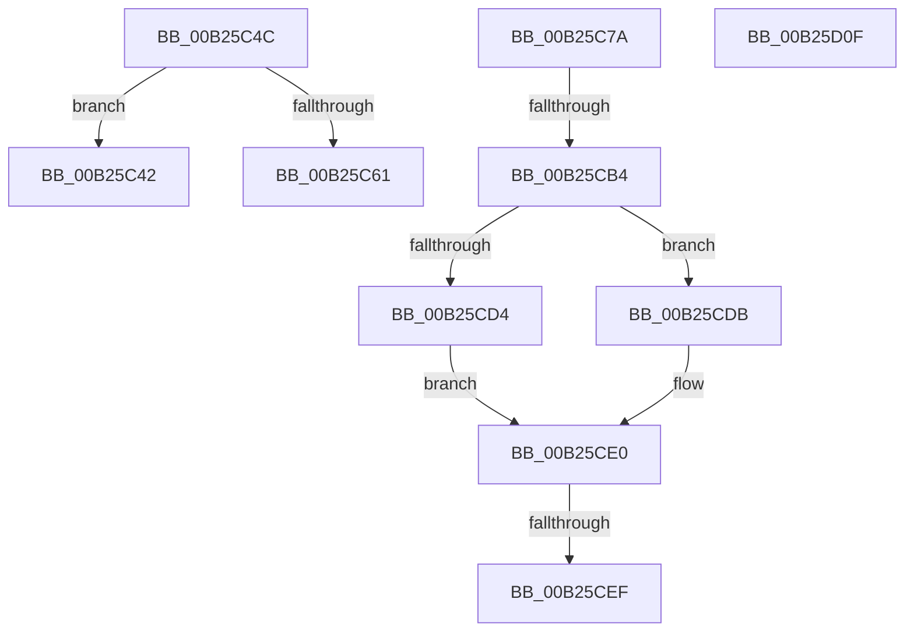

# sub_00B25C42

- RVA: `0x00B25C42`–`0x00B25D1A` (길이 `216` bytes)
- VA: `0x0000000140B25C42`
- 실행 섹션: `PAGE`
- PDB 이름 있음: `아니요`; PDB Function 태그: `아니요`
- unwind 정보 RVA: `0x00090D44`
- 디코드: `56`개 명령, `216/216` bytes 표시
- 미해석 바이트: `0` (있으면 어셈블리에 `.byte`로 보존)

> 이 문서는 커널 이미지의 기계어와 PDB 기호를 분석해 생성했습니다. 4번과 5번은 함수 원형과 자료형을 바이너리 사용 방식에서 추정한 C 해석이며 원본 소스 복구 결과는 아닙니다.

## 1. Dependencies

- 직접 호출 지점: **8**; 고유 호출 대상: **7**
- 직접 호출자로 확인된 함수: **0**
- RIP 상대 이미지 참조: **0**

### Outgoing calls
- `0x00B25C4C` → [HvpGetCellPaged](../85/HvpGetCellPaged_function_00854CB0.md) (function, `0x00854CB0`)
- `0x00B25CA1` → [CmAddLogForAction](../84/CmAddLogForAction_function_008445AC.md) (function, `0x008445AC`)
- `0x00B25CBD` → [CmpKeySecurityDecrementReferenceCount](../../text/4A/CmpKeySecurityDecrementReferenceCount_function_004A67DC.md) (function, `0x004A67DC`)
- `0x00B25CD4` → [HvpReleaseCellFlat](../85/HvpReleaseCellFlat_function_0085CC20.md) (function, `0x0085CC20`)
- `0x00B25CDB` → [HvpReleaseCellPaged](../85/HvpReleaseCellPaged_function_00855F40.md) (function, `0x00855F40`)
- `0x00B25CF5` → [CmpRemoveSecurityCellList](../../text/4B/CmpRemoveSecurityCellList_function_004BC1FC.md) (function, `0x004BC1FC`)
- `0x00B25D00` → [HvFreeCell](../85/HvFreeCell_function_0085A72C.md) (function, `0x0085A72C`)
- `0x00B25D0F` → [HvpReleaseCellPaged](../85/HvpReleaseCellPaged_function_00855F40.md) (function, `0x00855F40`)

### Direct callers
- 이 함수 시작 RVA로 연결되는 직접 call은 확인되지 않았습니다. 간접 호출은 완전히 역산할 수 없습니다.

### Static image references
- 디코드된 RIP-relative 메모리 참조가 없습니다.

## 2. Other-region calls and transfers

- 다른 실행 섹션으로 향하는 call: **2**
  - `0x00B25CBD` → [CmpKeySecurityDecrementReferenceCount](../../text/4A/CmpKeySecurityDecrementReferenceCount_function_004A67DC.md) (`PAGE` → `.text`)
  - `0x00B25CF5` → [CmpRemoveSecurityCellList](../../text/4B/CmpRemoveSecurityCellList_function_004BC1FC.md) (`PAGE` → `.text`)
- call이 아닌 외부 분기/꼬리 이동: **6**
  - `0x00B25C47` → [CmpSetSecurityDescriptorInfo + 0x2B1](../94/CmpSetSecurityDescriptorInfo_function_00949688.md) (`tail-transfer`)
  - `0x00B25C75` → [CmpSetSecurityDescriptorInfo + 0x53F](../94/CmpSetSecurityDescriptorInfo_function_00949688.md) (`tail-transfer`)
  - `0x00B25CAE` → [CmpSetSecurityDescriptorInfo + 0x2B1](../94/CmpSetSecurityDescriptorInfo_function_00949688.md) (`tail-transfer`)
  - `0x00B25CE9` → [CmpSetSecurityDescriptorInfo + 0x2B1](../94/CmpSetSecurityDescriptorInfo_function_00949688.md) (`tail-transfer`)
  - `0x00B25D0A` → [CmpSetSecurityDescriptorInfo + 0x2B1](../94/CmpSetSecurityDescriptorInfo_function_00949688.md) (`tail-transfer`)
  - `0x00B25D15` → [CmpSetSecurityDescriptorInfo + 0x2EA](../94/CmpSetSecurityDescriptorInfo_function_00949688.md) (`tail-transfer`)

## 3. Assembly (complete function range)

```asm
00B25C42  BE 9A 00 00 C0                  mov esi, 0xc000009a
00B25C47  E9 ED 3C E2 FF                  jmp 0x140949939
00B25C4C  E8 5F F0 D2 FF                  call 0x140854cb0
00B25C51  4C 8B 75 AF                     mov r14, qword ptr [rbp - 0x51]
00B25C55  48 8B C8                        mov rcx, rax
00B25C58  48 89 45 8F                     mov qword ptr [rbp - 0x71], rax
00B25C5C  48 85 C0                        test rax, rax
00B25C5F  74 E1                           je 0x140b25c42
00B25C61  41 8B 45 04                     mov eax, dword ptr [r13 + 4]
00B25C65  41 89 46 04                     mov dword ptr [r14 + 4], eax
00B25C69  45 89 66 08                     mov dword ptr [r14 + 8], r12d
00B25C6D  45 89 7D 04                     mov dword ptr [r13 + 4], r15d
00B25C71  44 89 79 08                     mov dword ptr [rcx + 8], r15d
00B25C75  E9 4D 3F E2 FF                  jmp 0x140949bc7
00B25C7A  48 8B 87 60 07 00 00            mov rax, qword ptr [rdi + 0x760]
00B25C81  48 8B 8D 87 00 00 00            mov rcx, qword ptr [rbp + 0x87]
00B25C88  8B 55 5F                        mov edx, dword ptr [rbp + 0x5f]
00B25C8B  48 03 D2                        add rdx, rdx
00B25C8E  48 8B 44 D0 08                  mov rax, qword ptr [rax + rdx*8 + 8]
00B25C93  48 89 41 58                     mov qword ptr [rcx + 0x58], rax
00B25C97  8B 00                           mov eax, dword ptr [rax]
00B25C99  89 41 60                        mov dword ptr [rcx + 0x60], eax
00B25C9C  BA 01 00 00 00                  mov edx, 1
00B25CA1  E8 06 E9 D1 FF                  call 0x1408445ac
00B25CA6  83 65 67 00                     and dword ptr [rbp + 0x67], 0
00B25CAA  8B F0                           mov esi, eax
00B25CAC  85 C0                           test eax, eax
00B25CAE  0F 89 85 3C E2 FF               jns 0x140949939
00B25CB4  45 8B C7                        mov r8d, r15d
00B25CB7  48 8B D7                        mov rdx, rdi
00B25CBA  49 8B CE                        mov rcx, r14
00B25CBD  E8 1A 0B 98 FF                  call 0x1404a67dc
00B25CC2  F6 87 8C 00 00 00 01            test byte ptr [rdi + 0x8c], 1
00B25CC9  48 8D 55 A7                     lea rdx, [rbp - 0x59]
00B25CCD  8A D8                           mov bl, al
00B25CCF  48 8B CF                        mov rcx, rdi
00B25CD2  74 07                           je 0x140b25cdb
00B25CD4  E8 47 6F D3 FF                  call 0x14085cc20
00B25CD9  EB 05                           jmp 0x140b25ce0
00B25CDB  E8 60 02 D3 FF                  call 0x140855f40
00B25CE0  45 33 F6                        xor r14d, r14d
00B25CE3  44 21 75 67                     and dword ptr [rbp + 0x67], r14d
00B25CE7  84 DB                           test bl, bl
00B25CE9  0F 84 4A 3C E2 FF               je 0x140949939
00B25CEF  41 8B D7                        mov edx, r15d
00B25CF2  48 8B CF                        mov rcx, rdi
00B25CF5  E8 02 65 99 FF                  call 0x1404bc1fc
00B25CFA  41 8B D7                        mov edx, r15d
00B25CFD  48 8B CF                        mov rcx, rdi
00B25D00  E8 27 4A D3 FF                  call 0x14085a72c
00B25D05  33 C0                           xor eax, eax
00B25D07  89 45 67                        mov dword ptr [rbp + 0x67], eax
00B25D0A  E9 2A 3C E2 FF                  jmp 0x140949939
00B25D0F  E8 2C 02 D3 FF                  call 0x140855f40
00B25D14  90                              nop
00B25D15  E9 58 3C E2 FF                  jmp 0x140949972
```

## 4. C-style interpretation (structured pseudocode)

```c
__int64 __fastcall sub_00B25C42(void)
{
}
```

## 5. (Beta) C Style

```c
void sub_00B25C42(void)
{
}
```

## 6. Execution-region graph

[열기: 2D/3D 그래프와 함수 탐색 컨트롤 패널](../../../control-panel.html?section=page&rva=0x00B25C42&view=graph)

- 2D 그래프는 위에서 아래로 흐르고, 3D 그래프는 빈 공간을 드래그해 회전합니다. Shift+드래그는 이동, 휠은 확대·축소, 함수 노드 선택은 대상 보고서 이동입니다.

### Static fallback


