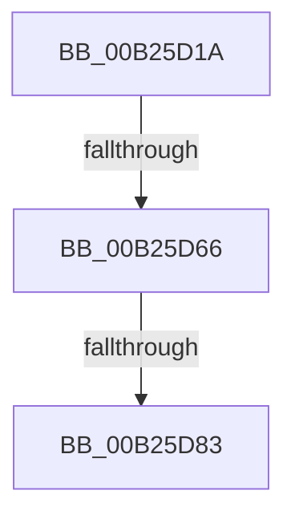

# sub_00B25D1A

- RVA: `0x00B25D1A`–`0x00B25E36` (길이 `284` bytes)
- VA: `0x0000000140B25D1A`
- 실행 섹션: `PAGE`
- PDB 이름 있음: `아니요`; PDB Function 태그: `아니요`
- unwind 정보 RVA: `0x00090DE0`
- 디코드: `70`개 명령, `284/284` bytes 표시
- 미해석 바이트: `0` (있으면 어셈블리에 `.byte`로 보존)

> 이 문서는 커널 이미지의 기계어와 PDB 기호를 분석해 생성했습니다. 4번과 5번은 함수 원형과 자료형을 바이너리 사용 방식에서 추정한 C 해석이며 원본 소스 복구 결과는 아닙니다.

## 1. Dependencies

- 직접 호출 지점: **5**; 고유 호출 대상: **3**
- 직접 호출자로 확인된 함수: **0**
- RIP 상대 이미지 참조: **2**

### Outgoing calls
- `0x00B25D1D` → [RtlLengthSecurityDescriptorStrict](../../text/48/RtlLengthSecurityDescriptorStrict_function_0048B770.md) (function, `0x0048B770`)
- `0x00B25D31` → [RtlLengthSecurityDescriptorStrict](../../text/48/RtlLengthSecurityDescriptorStrict_function_0048B770.md) (function, `0x0048B770`)
- `0x00B25D45` → [RtlLengthSecurityDescriptorStrict](../../text/48/RtlLengthSecurityDescriptorStrict_function_0048B770.md) (function, `0x0048B770`)
- `0x00B25D76` → [tlgKeywordOn](../../text/42/tlgKeywordOn_function_0042EAA0.md) (function, `0x0042EAA0`)
- `0x00B25E2B` → [tlgWriteTransfer_EtwWriteTransfer](../../text/42/tlgWriteTransfer_EtwWriteTransfer_function_004260E0.md) (function, `0x004260E0`)

### Direct callers
- 이 함수 시작 RVA로 연결되는 직접 call은 확인되지 않았습니다. 간접 호출은 완전히 역산할 수 없습니다.

### Static image references
- `0x00B25D59` → RVA `0x00E09F58` (`.data`; read)
- `0x00B25DFE` → RVA `0x00056AA7` (`.rdata`; read)

## 2. Other-region calls and transfers

- 다른 실행 섹션으로 향하는 call: **5**
  - `0x00B25D1D` → [RtlLengthSecurityDescriptorStrict](../../text/48/RtlLengthSecurityDescriptorStrict_function_0048B770.md) (`PAGE` → `.text`)
  - `0x00B25D31` → [RtlLengthSecurityDescriptorStrict](../../text/48/RtlLengthSecurityDescriptorStrict_function_0048B770.md) (`PAGE` → `.text`)
  - `0x00B25D45` → [RtlLengthSecurityDescriptorStrict](../../text/48/RtlLengthSecurityDescriptorStrict_function_0048B770.md) (`PAGE` → `.text`)
  - `0x00B25D76` → [tlgKeywordOn](../../text/42/tlgKeywordOn_function_0042EAA0.md) (`PAGE` → `.text`)
  - `0x00B25E2B` → [tlgWriteTransfer_EtwWriteTransfer](../../text/42/tlgWriteTransfer_EtwWriteTransfer_function_004260E0.md) (`PAGE` → `.text`)
- call이 아닌 외부 분기/꼬리 이동: **3**
  - `0x00B25D60` → [CmpTraceSecurityChanging + 0x6D](../94/CmpTraceSecurityChanging_function_00949EEC.md) (`tail-transfer`)
  - `0x00B25D7D` → [CmpTraceSecurityChanging + 0x6D](../94/CmpTraceSecurityChanging_function_00949EEC.md) (`tail-transfer`)
  - `0x00B25E31` → [CmpTraceSecurityChanging + 0x6D](../94/CmpTraceSecurityChanging_function_00949EEC.md) (`tail-transfer`)

## 3. Assembly (complete function range)

```asm
00B25D1A  49 8B CE                        mov rcx, r14
00B25D1D  E8 4E 5A 96 FF                  call 0x14048b770
00B25D22  8B D8                           mov ebx, eax
00B25D24  49 8B CF                        mov rcx, r15
00B25D27  B8 FF FF 00 00                  mov eax, 0xffff
00B25D2C  3B D8                           cmp ebx, eax
00B25D2E  0F 47 D8                        cmova ebx, eax
00B25D31  E8 3A 5A 96 FF                  call 0x14048b770
00B25D36  8B F0                           mov esi, eax
00B25D38  49 8B CC                        mov rcx, r12
00B25D3B  B8 FF FF 00 00                  mov eax, 0xffff
00B25D40  3B F0                           cmp esi, eax
00B25D42  0F 47 F0                        cmova esi, eax
00B25D45  E8 26 5A 96 FF                  call 0x14048b770
00B25D4A  44 8B C0                        mov r8d, eax
00B25D4D  B8 FF FF 00 00                  mov eax, 0xffff
00B25D52  44 3B C0                        cmp r8d, eax
00B25D55  44 0F 47 C0                     cmova r8d, eax
00B25D59  83 3D F8 41 2E 00 05            cmp dword ptr [rip + 0x2e41f8], 5
00B25D60  0F 86 F3 41 E2 FF               jbe 0x140949f59
00B25D66  41 B9 02 00 00 00               mov r9d, 2
00B25D6C  48 8D 0D E5 41 2E 00            lea rcx, [rip + 0x2e41e5]
00B25D73  41 8B D1                        mov edx, r9d
00B25D76  E8 25 8D 90 FF                  call 0x14042eaa0
00B25D7B  84 C0                           test al, al
00B25D7D  0F 84 D6 41 E2 FF               je 0x140949f59
00B25D83  48 8B 47 08                     mov rax, qword ptr [rdi + 8]
00B25D87  48 8D 55 97                     lea rdx, [rbp - 0x69]
00B25D8B  0F B7 0F                        movzx ecx, word ptr [rdi]
00B25D8E  48 89 45 8F                     mov qword ptr [rbp - 0x71], rax
00B25D92  48 8D 45 B7                     lea rax, [rbp - 0x49]
00B25D96  48 89 45 9F                     mov qword ptr [rbp - 0x61], rax
00B25D9A  48 89 54 24 60                  mov qword ptr [rsp + 0x60], rdx
00B25D9F  33 D2                           xor edx, edx
00B25DA1  0F B7 C3                        movzx eax, bx
00B25DA4  89 45 B7                        mov dword ptr [rbp - 0x49], eax
00B25DA7  48 8D 44 24 30                  lea rax, [rsp + 0x30]
00B25DAC  48 89 45 BF                     mov qword ptr [rbp - 0x41], rax
00B25DB0  48 8D 45 E7                     lea rax, [rbp - 0x19]
00B25DB4  48 89 45 CF                     mov qword ptr [rbp - 0x31], rax
00B25DB8  0F B7 C6                        movzx eax, si
00B25DBB  89 45 E7                        mov dword ptr [rbp - 0x19], eax
00B25DBE  48 8D 45 07                     lea rax, [rbp + 7]
00B25DC2  48 89 45 EF                     mov qword ptr [rbp - 0x11], rax
00B25DC6  41 0F B7 C0                     movzx eax, r8w
00B25DCA  45 33 C0                        xor r8d, r8d
00B25DCD  89 45 07                        mov dword ptr [rbp + 7], eax
00B25DD0  48 8D 44 24 40                  lea rax, [rsp + 0x40]
00B25DD5  4C 89 4D 87                     mov qword ptr [rbp - 0x79], r9
00B25DD9  89 4D 97                        mov dword ptr [rbp - 0x69], ecx
00B25DDC  48 8D 0D 75 41 2E 00            lea rcx, [rip + 0x2e4175]
00B25DE3  89 55 9B                        mov dword ptr [rbp - 0x65], edx
00B25DE6  4C 89 4D A7                     mov qword ptr [rbp - 0x59], r9
00B25DEA  89 55 BB                        mov dword ptr [rbp - 0x45], edx
00B25DED  4C 89 4D D7                     mov qword ptr [rbp - 0x29], r9
00B25DF1  89 55 EB                        mov dword ptr [rbp - 0x15], edx
00B25DF4  4C 89 4D F7                     mov qword ptr [rbp - 9], r9
00B25DF8  45 33 C9                        xor r9d, r9d
00B25DFB  89 55 0B                        mov dword ptr [rbp + 0xb], edx
00B25DFE  48 8D 15 A2 0C 53 FF            lea rdx, [rip - 0xacf35e]
00B25E05  48 89 44 24 28                  mov qword ptr [rsp + 0x28], rax
00B25E0A  C7 44 24 20 0B 00 00 00         mov dword ptr [rsp + 0x20], 0xb
00B25E12  4C 89 75 AF                     mov qword ptr [rbp - 0x51], r14
00B25E16  44 89 6C 24 30                  mov dword ptr [rsp + 0x30], r13d
00B25E1B  48 C7 45 C7 04 00 00 00         mov qword ptr [rbp - 0x39], 4
00B25E23  4C 89 7D DF                     mov qword ptr [rbp - 0x21], r15
00B25E27  4C 89 65 FF                     mov qword ptr [rbp - 1], r12
00B25E2B  E8 B0 02 90 FF                  call 0x1404260e0
00B25E30  90                              nop
00B25E31  E9 23 41 E2 FF                  jmp 0x140949f59
```

## 4. C-style interpretation (structured pseudocode)

```c
__int64 __fastcall sub_00B25D1A(__int64 a1, __int64 a2, __int64 a3, __int64 a4, __int64 a5, __int64 a6, __int64 a7, __int64 a8)
{
    __int64 result;
    __int64 v_rbx;
    __int64 v_rsi;
    unsigned int v_stack_p20;
    unsigned __int64 v_stack_p28;
    unsigned int v_stack_p30;
    unsigned __int64 v_stack_p60;

    result = RtlLengthSecurityDescriptorStrict(v_r14, a2, a3, a4);
    v_rbx = (unsigned int)((unsigned int)(result));
    if (((unsigned int)((unsigned int)((unsigned int)(result)))) > ((unsigned int)((unsigned int)(0xFFFFULL)))) { v_rbx = (unsigned int)((unsigned int)(0xFFFFULL)); }
    result = RtlLengthSecurityDescriptorStrict(v_r15, a2, a3, a4);
    v_rsi = (unsigned int)((unsigned int)(result));
    if (((unsigned int)((unsigned int)((unsigned int)(result)))) > ((unsigned int)((unsigned int)(0xFFFFULL)))) { v_rsi = (unsigned int)((unsigned int)(0xFFFFULL)); }
    result = RtlLengthSecurityDescriptorStrict(v_r12, a2, a3, a4);
    a3 = (unsigned int)((unsigned int)(result));
    if (((unsigned int)((unsigned int)((unsigned int)(result)))) > ((unsigned int)((unsigned int)(0xFFFFULL)))) { a3 = (unsigned int)((unsigned int)(0xFFFFULL)); }
    result = tlgKeywordOn(v_rip + 3031525, 2, a3, 2);
    *(unsigned __int64 *)(v_rbp - 113) = *(unsigned __int64 *)(v_rdi + 8);
    *(unsigned __int64 *)(v_rbp - 97) = v_rbp - 73;
    v_stack_p60 = v_rbp - 105;
    a2 = 0;
    *(unsigned int *)(v_rbp - 73) = (unsigned int)((unsigned __int16)(v_rbx));
    *(unsigned __int64 *)(v_rbp - 65) = a6;
    *(unsigned __int64 *)(v_rbp - 49) = v_rbp - 25;
    *(unsigned int *)(v_rbp - 25) = (unsigned int)((unsigned __int16)(v_rsi));
    *(unsigned __int64 *)(v_rbp - 17) = v_rbp + 7;
    a3 = 0;
    *(unsigned int *)(v_rbp + 7) = (unsigned int)((unsigned __int16)(a3));
    *(unsigned __int64 *)(v_rbp - 121) = 2;
    *(unsigned int *)(v_rbp - 105) = (unsigned int)(*(unsigned __int16 *)(v_rdi));
    *(unsigned int *)(v_rbp - 101) = 0;
    *(unsigned __int64 *)(v_rbp - 89) = 2;
    *(unsigned int *)(v_rbp - 69) = 0;
    *(unsigned __int64 *)(v_rbp - 41) = 2;
    *(unsigned int *)(v_rbp - 21) = 0;
    *(unsigned __int64 *)(v_rbp - 9) = 2;
    a4 = 0;
    *(unsigned int *)(v_rbp + 11) = 0;
    v_stack_p28 = a8;
    v_stack_p20 = 11;
    *(unsigned __int64 *)(v_rbp - 81) = v_r14;
    v_stack_p30 = (unsigned int)(v_r13);
    *(unsigned __int64 *)(v_rbp - 57) = 4;
    *(unsigned __int64 *)(v_rbp - 33) = v_r15;
    *(unsigned __int64 *)(v_rbp - 1) = v_r12;
    result = tlgWriteTransfer_EtwWriteTransfer(v_rip + 3031413, v_rip - 11334494, a3, a4);
}
```

## 5. (Beta) C Style

```c
int64_t sub_00B25D1A(int64_t Arg1, int64_t Arg2, int64_t Arg3, int64_t Arg4, uint64_t Arg5, int64_t Arg6, uint64_t Arg7, int64_t Arg8)
{
    int64_t result;
    int64_t local_rbx;
    int64_t local_rsi;
    uint32_t v_stack_p20;
    uint64_t v_stack_p28;
    uint32_t v_stack_p30;
    uint64_t v_stack_p60;

    result = RtlLengthSecurityDescriptorStrict(local_r14, Arg2, Arg3, Arg4);
    local_rbx = (uint32_t)((uint32_t)(result));
    if (((uint32_t)((uint32_t)((uint32_t)(result)))) > ((uint32_t)((uint32_t)(0xFFFFULL)))) { local_rbx = (uint32_t)((uint32_t)(0xFFFFULL)); }
    result = RtlLengthSecurityDescriptorStrict(local_r15, Arg2, Arg3, Arg4);
    local_rsi = (uint32_t)((uint32_t)(result));
    if (((uint32_t)((uint32_t)((uint32_t)(result)))) > ((uint32_t)((uint32_t)(0xFFFFULL)))) { local_rsi = (uint32_t)((uint32_t)(0xFFFFULL)); }
    result = RtlLengthSecurityDescriptorStrict(local_r12, Arg2, Arg3, Arg4);
    Arg3 = (uint32_t)((uint32_t)(result));
    if (((uint32_t)((uint32_t)((uint32_t)(result)))) > ((uint32_t)((uint32_t)(0xFFFFULL)))) { Arg3 = (uint32_t)((uint32_t)(0xFFFFULL)); }
    result = tlgKeywordOn(v_rip + 3031525, 2, Arg3, 2);
    *(uint64_t *)(local_rbp - 0x71) = *(uint64_t *)(local_rdi + 0x8);
    *(uint64_t *)(local_rbp - 0x61) = local_rbp - 73;
    v_stack_p60 = local_rbp - 105;
    Arg2 = 0;
    *(uint32_t *)(local_rbp - 0x49) = (uint32_t)((uint16_t)(local_rbx));
    *(uint64_t *)(local_rbp - 0x41) = Arg6;
    *(uint64_t *)(local_rbp - 0x31) = local_rbp - 25;
    *(uint32_t *)(local_rbp - 0x19) = (uint32_t)((uint16_t)(local_rsi));
    *(uint64_t *)(local_rbp - 0x11) = local_rbp + 7;
    Arg3 = 0;
    *(uint32_t *)(local_rbp + 0x7) = (uint32_t)((uint16_t)(Arg3));
    *(uint64_t *)(local_rbp - 0x79) = 2;
    *(uint32_t *)(local_rbp - 0x69) = (uint32_t)(*(uint16_t *)(local_rdi));
    *(uint32_t *)(local_rbp - 0x65) = 0;
    *(uint64_t *)(local_rbp - 0x59) = 2;
    *(uint32_t *)(local_rbp - 0x45) = 0;
    *(uint64_t *)(local_rbp - 0x29) = 2;
    *(uint32_t *)(local_rbp - 0x15) = 0;
    *(uint64_t *)(local_rbp - 0x9) = 2;
    Arg4 = 0;
    *(uint32_t *)(local_rbp + 0xB) = 0;
    v_stack_p28 = Arg8;
    v_stack_p20 = 11;
    *(uint64_t *)(local_rbp - 0x51) = local_r14;
    v_stack_p30 = (uint32_t)(local_r13);
    *(uint64_t *)(local_rbp - 0x39) = 4;
    *(uint64_t *)(local_rbp - 0x21) = local_r15;
    *(uint64_t *)(local_rbp - 0x1) = local_r12;
    result = tlgWriteTransfer_EtwWriteTransfer(v_rip + 3031413, v_rip - 11334494, Arg3, Arg4);
}
```

## 6. Execution-region graph

[열기: 2D/3D 그래프와 함수 탐색 컨트롤 패널](../../../control-panel.html?section=page&rva=0x00B25D1A&view=graph)

- 2D 그래프는 위에서 아래로 흐르고, 3D 그래프는 빈 공간을 드래그해 회전합니다. Shift+드래그는 이동, 휠은 확대·축소, 함수 노드 선택은 대상 보고서 이동입니다.

### Static fallback


