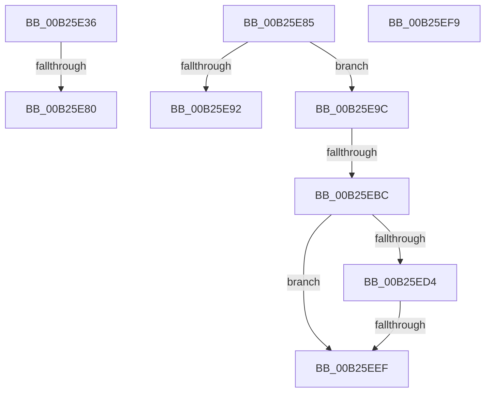

# sub_00B25E36

- RVA: `0x00B25E36`–`0x00B25F07` (길이 `209` bytes)
- VA: `0x0000000140B25E36`
- 실행 섹션: `PAGE`
- PDB 이름 있음: `아니요`; PDB Function 태그: `아니요`
- unwind 정보 RVA: `0x00090E30`
- 디코드: `52`개 명령, `209/209` bytes 표시
- 미해석 바이트: `0` (있으면 어셈블리에 `.byte`로 보존)

> 이 문서는 커널 이미지의 기계어와 PDB 기호를 분석해 생성했습니다. 4번과 5번은 함수 원형과 자료형을 바이너리 사용 방식에서 추정한 C 해석이며 원본 소스 복구 결과는 아닙니다.

## 1. Dependencies

- 직접 호출 지점: **10**; 고유 호출 대상: **9**
- 직접 호출자로 확인된 함수: **0**
- RIP 상대 이미지 참조: **0**

### Outgoing calls
- `0x00B25E3B` → [CmpCleanupKcbStack](../94/CmpCleanupKcbStack_function_009470A0.md) (function, `0x009470A0`)
- `0x00B25E55` → [CmpUnlockRegistry](../../pagecmrc/BC/CmpUnlockRegistry_function_00BC9A84.md) (function, `0x00BC9A84`)
- `0x00B25E5A` → [CmpReleaseShutdownRundown](../../pagecmrc/BC/CmpReleaseShutdownRundown_function_00BC9880.md) (function, `0x00BC9880`)
- `0x00B25E71` → [CmpRollbackTransactionArray](../94/CmpRollbackTransactionArray_function_0094B3AC.md) (function, `0x0094B3AC`)
- `0x00B25E85` → [CmpAllocateUnitOfWork](../84/CmpAllocateUnitOfWork_function_00844BB0.md) (function, `0x00844BB0`)
- `0x00B25EA2` → [CmpTransEnlistUowInKcb](../../text/48/CmpTransEnlistUowInKcb_function_0048F094.md) (function, `0x0048F094`)
- `0x00B25EAD` → [CmpTransEnlistUowInCmTrans](../../text/48/CmpTransEnlistUowInCmTrans_function_0048B330.md) (function, `0x0048B330`)
- `0x00B25EC9` → [CmpLockIXLockExclusive](../84/CmpLockIXLockExclusive_function_00844CB4.md) (function, `0x00844CB4`)
- `0x00B25EE2` → [CmpLockIXLockExclusive](../84/CmpLockIXLockExclusive_function_00844CB4.md) (function, `0x00844CB4`)
- `0x00B25EF9` → [HvpReleaseCellPaged](../85/HvpReleaseCellPaged_function_00855F40.md) (function, `0x00855F40`)

### Direct callers
- 이 함수 시작 RVA로 연결되는 직접 call은 확인되지 않았습니다. 간접 호출은 완전히 역산할 수 없습니다.

### Static image references
- 디코드된 RIP-relative 메모리 참조가 없습니다.

## 2. Other-region calls and transfers

- 다른 실행 섹션으로 향하는 call: **4**
  - `0x00B25E55` → [CmpUnlockRegistry](../../pagecmrc/BC/CmpUnlockRegistry_function_00BC9A84.md) (`PAGE` → `PAGECMRC`)
  - `0x00B25E5A` → [CmpReleaseShutdownRundown](../../pagecmrc/BC/CmpReleaseShutdownRundown_function_00BC9880.md) (`PAGE` → `PAGECMRC`)
  - `0x00B25EA2` → [CmpTransEnlistUowInKcb](../../text/48/CmpTransEnlistUowInKcb_function_0048F094.md) (`PAGE` → `.text`)
  - `0x00B25EAD` → [CmpTransEnlistUowInCmTrans](../../text/48/CmpTransEnlistUowInCmTrans_function_0048B330.md) (`PAGE` → `.text`)
- call이 아닌 외부 분기/꼬리 이동: **7**
  - `0x00B25E7A` → [CmpSetKeySecurity + 0x32A](../94/CmpSetKeySecurity_function_0094A124.md) (`tail-transfer`)
  - `0x00B25E80` → [CmpSetKeySecurity + 0x48A](../94/CmpSetKeySecurity_function_0094A124.md) (`tail-transfer`)
  - `0x00B25E97` → [CmpSetKeySecurity + 0x311](../94/CmpSetKeySecurity_function_0094A124.md) (`tail-transfer`)
  - `0x00B25EB6` → [CmpSetKeySecurity + 0x5E4](../94/CmpSetKeySecurity_function_0094A124.md) (`tail-transfer`)
  - `0x00B25EE9` → [CmpSetKeySecurity + 0x1F9](../94/CmpSetKeySecurity_function_0094A124.md) (`tail-transfer`)
  - `0x00B25EF4` → [CmpSetKeySecurity + 0x5E4](../94/CmpSetKeySecurity_function_0094A124.md) (`tail-transfer`)
  - `0x00B25F02` → [CmpSetKeySecurity + 0x27D](../94/CmpSetKeySecurity_function_0094A124.md) (`tail-transfer`)

## 3. Assembly (complete function range)

```asm
00B25E36  48 8D 4C 24 58                  lea rcx, [rsp + 0x58]
00B25E3B  E8 60 12 E2 FF                  call 0x1409470a0
00B25E40  0F 57 C0                        xorps xmm0, xmm0
00B25E43  83 C8 FF                        or eax, 0xffffffff
00B25E46  0F 11 44 24 58                  movups xmmword ptr [rsp + 0x58], xmm0
00B25E4B  66 89 44 24 5A                  mov word ptr [rsp + 0x5a], ax
00B25E50  0F 11 44 24 68                  movups xmmword ptr [rsp + 0x68], xmm0
00B25E55  E8 2A 3C 0A 00                  call 0x140bc9a84
00B25E5A  E8 21 3A 0A 00                  call 0x140bc9880
00B25E5F  48 8B 55 88                     mov rdx, qword ptr [rbp - 0x78]
00B25E63  4C 8D 4C 24 7C                  lea r9, [rsp + 0x7c]
00B25E68  8B 4C 24 54                     mov ecx, dword ptr [rsp + 0x54]
00B25E6C  33 C0                           xor eax, eax
00B25E6E  44 8A E0                        mov r12b, al
00B25E71  E8 36 55 E2 FF                  call 0x14094b3ac
00B25E76  8B D8                           mov ebx, eax
00B25E78  85 C0                           test eax, eax
00B25E7A  0F 88 CE 45 E2 FF               js 0x14094a44e
00B25E80  E9 29 47 E2 FF                  jmp 0x14094a5ae
00B25E85  E8 26 ED D1 FF                  call 0x140844bb0
00B25E8A  48 8B F0                        mov rsi, rax
00B25E8D  48 85 C0                        test rax, rax
00B25E90  75 0A                           jne 0x140b25e9c
00B25E92  BB 9A 00 00 C0                  mov ebx, 0xc000009a
00B25E97  E9 99 45 E2 FF                  jmp 0x14094a435
00B25E9C  48 8B D7                        mov rdx, rdi
00B25E9F  48 8B CE                        mov rcx, rsi
00B25EA2  E8 ED 91 96 FF                  call 0x14048f094
00B25EA7  49 8B D4                        mov rdx, r12
00B25EAA  48 8B CE                        mov rcx, rsi
00B25EAD  E8 7E 54 96 FF                  call 0x14048b330
00B25EB2  8B D8                           mov ebx, eax
00B25EB4  85 C0                           test eax, eax
00B25EB6  0F 88 4C 48 E2 FF               js 0x14094a708
00B25EBC  48 8D 8F F8 00 00 00            lea rcx, [rdi + 0xf8]
00B25EC3  45 33 C0                        xor r8d, r8d
00B25EC6  48 8B D6                        mov rdx, rsi
00B25EC9  E8 E6 ED D1 FF                  call 0x140844cb4
00B25ECE  33 DB                           xor ebx, ebx
00B25ED0  84 C0                           test al, al
00B25ED2  74 1B                           je 0x140b25eef
00B25ED4  48 8D 8F 08 01 00 00            lea rcx, [rdi + 0x108]
00B25EDB  48 8B D6                        mov rdx, rsi
00B25EDE  44 8D 43 01                     lea r8d, [rbx + 1]
00B25EE2  E8 CD ED D1 FF                  call 0x140844cb4
00B25EE7  84 C0                           test al, al
00B25EE9  0F 85 2E 44 E2 FF               jne 0x14094a31d
00B25EEF  BB 01 00 19 C0                  mov ebx, 0xc0190001
00B25EF4  E9 0F 48 E2 FF                  jmp 0x14094a708
00B25EF9  E8 42 00 D3 FF                  call 0x140855f40
00B25EFE  C6 47 41 02                     mov byte ptr [rdi + 0x41], 2
00B25F02  E9 9A 44 E2 FF                  jmp 0x14094a3a1
```

## 4. C-style interpretation (structured pseudocode)

```c
__int64 __fastcall sub_00B25E36(__int64 a1, __int64 a2, int a3, __int64 a4, __int64 a5, __int64 a6, __int64 a7, __int64 a8, __int64 a9, __int64 a10, __int64 a11, __int64 a12, __int64 a13)
{
    __int64 result;
    unsigned int v_stack_p54;
    unsigned __int16 v_stack_p5A;
    unsigned __int64 v_stack_p7C;

    result = CmpCleanupKcbStack(a11, a2, a3, a4);
    result = (unsigned int)((result) | (0xFFFFFFFFULL));
    a11 = v_xmm0;
    v_stack_p5A = (unsigned __int16)(result);
    a13 = v_xmm0;
    result = CmpUnlockRegistry(a11, a2, a3, a4);
    result = CmpReleaseShutdownRundown(a11, a2, a3, a4);
    result = 0;
    result = CmpRollbackTransactionArray((unsigned int)(v_stack_p54), *(unsigned __int64 *)(v_rbp - 120), a3, v_stack_p7C);
}
```

## 5. (Beta) C Style

```c
int64_t sub_00B25E36(int64_t Arg1, int64_t Arg2, int32_t Arg3, int64_t Arg4, uint64_t Arg5, uint64_t Arg6, uint64_t Arg7, uint64_t Arg8, uint64_t Arg9, uint64_t Arg10, int64_t Arg11, uint64_t Arg12, int64_t Arg13)
{
    int64_t result;
    uint32_t v_stack_p54;
    uint16_t v_stack_p5A;
    uint64_t v_stack_p7C;

    result = CmpCleanupKcbStack(Arg11, Arg2, Arg3, Arg4);
    result = (uint32_t)((result) | (0xFFFFFFFFULL));
    Arg11 = v_xmm0;
    v_stack_p5A = (uint16_t)(result);
    Arg13 = v_xmm0;
    result = CmpUnlockRegistry(Arg11, Arg2, Arg3, Arg4);
    result = CmpReleaseShutdownRundown(Arg11, Arg2, Arg3, Arg4);
    result = 0;
    result = CmpRollbackTransactionArray((uint32_t)(v_stack_p54), *(uint64_t *)(local_rbp - 0x78), Arg3, v_stack_p7C);
}
```

## 6. Execution-region graph

[열기: 2D/3D 그래프와 함수 탐색 컨트롤 패널](../../../control-panel.html?section=page&rva=0x00B25E36&view=graph)

- 2D 그래프는 위에서 아래로 흐르고, 3D 그래프는 빈 공간을 드래그해 회전합니다. Shift+드래그는 이동, 휠은 확대·축소, 함수 노드 선택은 대상 보고서 이동입니다.

### Static fallback


