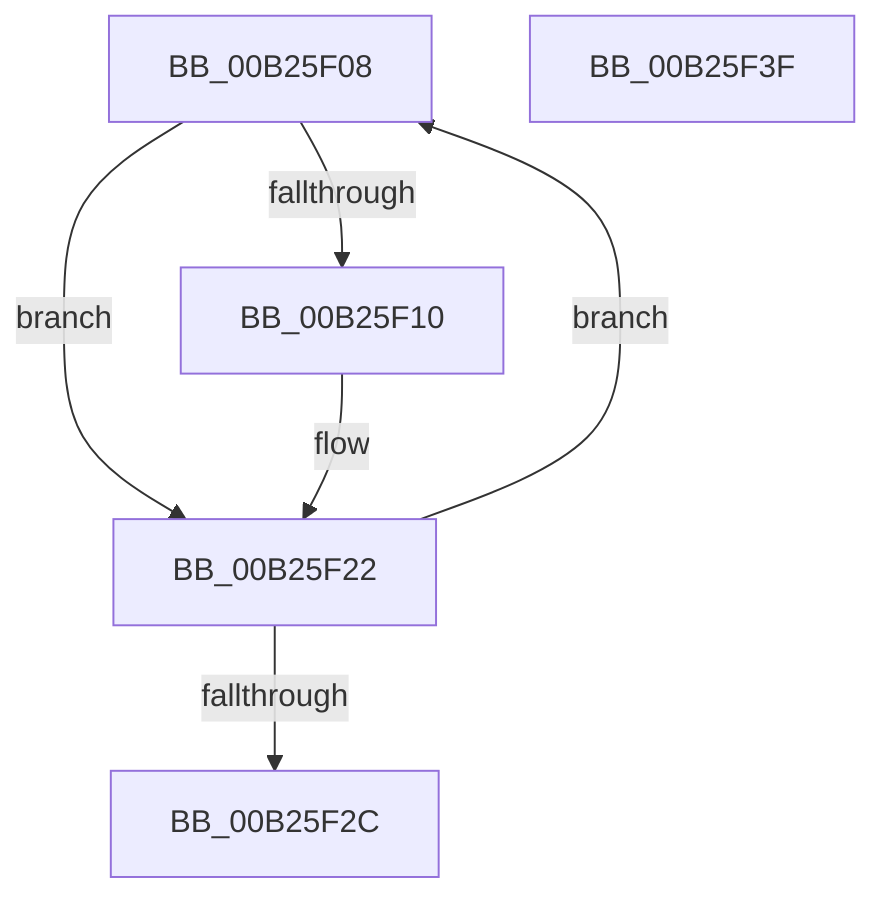

# sub_00B25F08

- RVA: `0x00B25F08`–`0x00B25F4A` (길이 `66` bytes)
- VA: `0x0000000140B25F08`
- 실행 섹션: `PAGE`
- PDB 이름 있음: `아니요`; PDB Function 태그: `아니요`
- unwind 정보 RVA: `0x00090E5C`
- 디코드: `18`개 명령, `66/66` bytes 표시
- 미해석 바이트: `0` (있으면 어셈블리에 `.byte`로 보존)

> 이 문서는 커널 이미지의 기계어와 PDB 기호를 분석해 생성했습니다. 4번과 5번은 함수 원형과 자료형을 바이너리 사용 방식에서 추정한 C 해석이며 원본 소스 복구 결과는 아닙니다.

## 1. Dependencies

- 직접 호출 지점: **4**; 고유 호출 대상: **3**
- 직접 호출자로 확인된 함수: **0**
- RIP 상대 이미지 참조: **0**

### Outgoing calls
- `0x00B25F10` → [CmpRundownUnitOfWork](../87/CmpRundownUnitOfWork_function_0087497C.md) (function, `0x0087497C`)
- `0x00B25F1D` → [ExFreePoolWithTag](../../poolcode/B8/ExFreePoolWithTag_function_00B82870.md) (function, `0x00B82870`)
- `0x00B25F34` → [ExFreePoolWithTag](../../poolcode/B8/ExFreePoolWithTag_function_00B82870.md) (function, `0x00B82870`)
- `0x00B25F3F` → [HvpReleaseCellPaged](../85/HvpReleaseCellPaged_function_00855F40.md) (function, `0x00855F40`)

### Direct callers
- 이 함수 시작 RVA로 연결되는 직접 call은 확인되지 않았습니다. 간접 호출은 완전히 역산할 수 없습니다.

### Static image references
- 디코드된 RIP-relative 메모리 참조가 없습니다.

## 2. Other-region calls and transfers

- 다른 실행 섹션으로 향하는 call: **2**
  - `0x00B25F1D` → [ExFreePoolWithTag](../../poolcode/B8/ExFreePoolWithTag_function_00B82870.md) (`PAGE` → `POOLCODE`)
  - `0x00B25F34` → [ExFreePoolWithTag](../../poolcode/B8/ExFreePoolWithTag_function_00B82870.md) (`PAGE` → `POOLCODE`)
- call이 아닌 외부 분기/꼬리 이동: **2**
  - `0x00B25F3A` → [CmpUndoDeleteKeyForTrans + 0x399](../94/CmpUndoDeleteKeyForTrans_function_0094A728.md) (`tail-transfer`)
  - `0x00B25F45` → [CmpUndoDeleteKeyForTrans + 0x3A2](../94/CmpUndoDeleteKeyForTrans_function_0094A728.md) (`tail-transfer`)

## 3. Assembly (complete function range)

```asm
00B25F08  48 8B 0E                        mov rcx, qword ptr [rsi]
00B25F0B  48 85 C9                        test rcx, rcx
00B25F0E  74 12                           je 0x140b25f22
00B25F10  E8 67 EA D4 FF                  call 0x14087497c
00B25F15  48 8B 0E                        mov rcx, qword ptr [rsi]
00B25F18  BA 43 4D 55 77                  mov edx, 0x77554d43
00B25F1D  E8 4E C9 05 00                  call 0x140b82870
00B25F22  48 83 C6 08                     add rsi, 8
00B25F26  49 83 EE 01                     sub r14, 1
00B25F2A  75 DC                           jne 0x140b25f08
00B25F2C  BA 43 4D 34 37                  mov edx, 0x37344d43
00B25F31  49 8B CC                        mov rcx, r12
00B25F34  E8 37 C9 05 00                  call 0x140b82870
00B25F39  90                              nop
00B25F3A  E9 82 4B E2 FF                  jmp 0x14094aac1
00B25F3F  E8 FC FF D2 FF                  call 0x140855f40
00B25F44  90                              nop
00B25F45  E9 80 4B E2 FF                  jmp 0x14094aaca
```

## 4. C-style interpretation (structured pseudocode)

```c
__int64 __fastcall sub_00B25F08(void)
{
    __int64 result;
    __int64 v_r14;
    __int64 v_rsi;

    if (*(unsigned __int64 *)(v_rsi) != 0) {
        result = CmpRundownUnitOfWork(*(unsigned __int64 *)(v_rsi), a2, a3, a4);
        a1 = *(unsigned __int64 *)(v_rsi);
        a2 = 0x77554D43ULL;
        result = ExFreePoolWithTag(a1, a2, a3, a4);
    }
    v_rsi = (v_rsi) + (8);
    v_r14 = (v_r14) - (1);
    if (condition_is_not_equal) goto loc_00B25F08;
    result = ExFreePoolWithTag(v_r12, (unsigned int)(0x37344D43ULL), a3, a4);
}
```

## 5. (Beta) C Style

```c
void sub_00B25F08(void)
{
    int64_t result;
    int64_t local_r14;
    int64_t local_rsi;

    if (*(uint64_t *)(local_rsi) != 0) {
        result = CmpRundownUnitOfWork(*(uint64_t *)(local_rsi), a2, a3, a4);
        a1 = *(uint64_t *)(local_rsi);
        a2 = 0x77554D43ULL;
        result = ExFreePoolWithTag(a1, a2, a3, a4);
    }
    local_rsi = (local_rsi) + (8);
    local_r14 = (local_r14) - (1);
    if (condition_is_not_equal) goto loc_00B25F08;
    result = ExFreePoolWithTag(local_r12, (uint32_t)(0x37344D43ULL), a3, a4);
}
```

## 6. Execution-region graph

[열기: 2D/3D 그래프와 함수 탐색 컨트롤 패널](../../../control-panel.html?section=page&rva=0x00B25F08&view=graph)

- 2D 그래프는 위에서 아래로 흐르고, 3D 그래프는 빈 공간을 드래그해 회전합니다. Shift+드래그는 이동, 휠은 확대·축소, 함수 노드 선택은 대상 보고서 이동입니다.

### Static fallback


