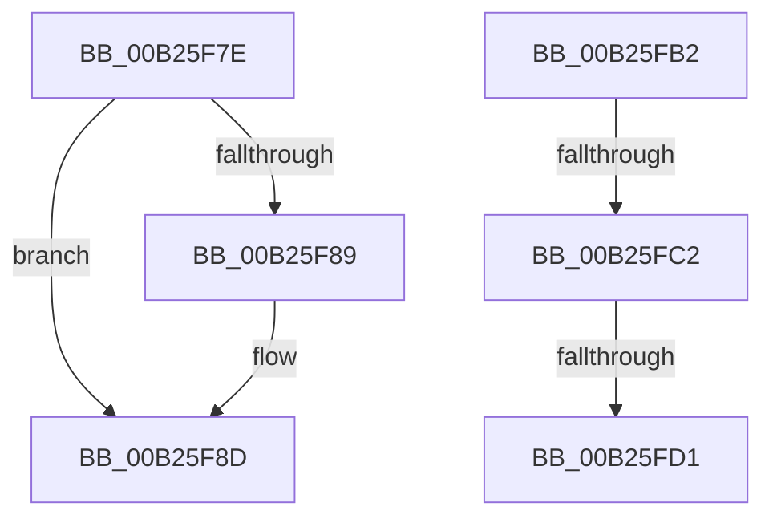

# sub_00B25F7E

- RVA: `0x00B25F7E`–`0x00B26012` (길이 `148` bytes)
- VA: `0x0000000140B25F7E`
- 실행 섹션: `PAGE`
- PDB 이름 있음: `아니요`; PDB Function 태그: `아니요`
- unwind 정보 RVA: `0x00091A14`
- 디코드: `34`개 명령, `148/148` bytes 표시
- 미해석 바이트: `0` (있으면 어셈블리에 `.byte`로 보존)

> 이 문서는 커널 이미지의 기계어와 PDB 기호를 분석해 생성했습니다. 4번과 5번은 함수 원형과 자료형을 바이너리 사용 방식에서 추정한 C 해석이며 원본 소스 복구 결과는 아닙니다.

## 1. Dependencies

- 직접 호출 지점: **2**; 고유 호출 대상: **2**
- 직접 호출자로 확인된 함수: **0**
- RIP 상대 이미지 참조: **0**

### Outgoing calls
- `0x00B25FA7` → [McTemplateK0zzztdd_EtwWriteTransfer](../../text/5A/McTemplateK0zzztdd_EtwWriteTransfer_function_005A9BB4.md) (function, `0x005A9BB4`)
- `0x00B25FFC` → [IofCompleteRequest](../../text/29/IofCompleteRequest_function_0029B5C0.md) (function, `0x0029B5C0`)

### Direct callers
- 이 함수 시작 RVA로 연결되는 직접 call은 확인되지 않았습니다. 간접 호출은 완전히 역산할 수 없습니다.

### Static image references
- 디코드된 RIP-relative 메모리 참조가 없습니다.

## 2. Other-region calls and transfers

- 다른 실행 섹션으로 향하는 call: **2**
  - `0x00B25FA7` → [McTemplateK0zzztdd_EtwWriteTransfer](../../text/5A/McTemplateK0zzztdd_EtwWriteTransfer_function_005A9BB4.md) (`PAGE` → `.text`)
  - `0x00B25FFC` → [IofCompleteRequest](../../text/29/IofCompleteRequest_function_0029B5C0.md) (`PAGE` → `.text`)
- call이 아닌 외부 분기/꼬리 이동: **4**
  - `0x00B25FAD` → [PiSwProcessRemove + 0x48](../94/PiSwProcessRemove_function_0094E3B8.md) (`tail-transfer`)
  - `0x00B25FBC` → [PiSwProcessRemove + 0x209](../94/PiSwProcessRemove_function_0094E3B8.md) (`tail-transfer`)
  - `0x00B25FCB` → [PiSwProcessRemove + 0x209](../94/PiSwProcessRemove_function_0094E3B8.md) (`tail-transfer`)
  - `0x00B2600D` → [PiSwProcessRemove + 0x209](../94/PiSwProcessRemove_function_0094E3B8.md) (`tail-transfer`)

## 3. Assembly (complete function range)

```asm
00B25F7E  45 33 D2                        xor r10d, r10d
00B25F81  49 8B D1                        mov rdx, r9
00B25F84  4D 85 C0                        test r8, r8
00B25F87  74 04                           je 0x140b25f8d
00B25F89  4D 8B 48 08                     mov r9, qword ptr [r8 + 8]
00B25F8D  8B 43 08                        mov eax, dword ptr [rbx + 8]
00B25F90  89 44 24 40                     mov dword ptr [rsp + 0x40], eax
00B25F94  44 89 54 24 38                  mov dword ptr [rsp + 0x38], r10d
00B25F99  89 74 24 30                     mov dword ptr [rsp + 0x30], esi
00B25F9D  4C 89 5C 24 28                  mov qword ptr [rsp + 0x28], r11
00B25FA2  48 89 54 24 20                  mov qword ptr [rsp + 0x20], rdx
00B25FA7  E8 08 3C A8 FF                  call 0x1405a9bb4
00B25FAC  90                              nop
00B25FAD  E9 4E 84 E2 FF                  jmp 0x14094e400
00B25FB2  48 8B 88 90 00 00 00            mov rcx, qword ptr [rax + 0x90]
00B25FB9  48 85 C9                        test rcx, rcx
00B25FBC  0F 84 FF 85 E2 FF               je 0x14094e5c1
00B25FC2  33 C0                           xor eax, eax
00B25FC4  48 87 41 68                     xchg qword ptr [rcx + 0x68], rax
00B25FC8  48 85 C0                        test rax, rax
00B25FCB  0F 84 F0 85 E2 FF               je 0x14094e5c1
00B25FD1  48 8B 45 10                     mov rax, qword ptr [rbp + 0x10]
00B25FD5  48 8B 88 90 00 00 00            mov rcx, qword ptr [rax + 0x90]
00B25FDC  48 83 61 38 00                  and qword ptr [rcx + 0x38], 0
00B25FE1  48 8B 45 10                     mov rax, qword ptr [rbp + 0x10]
00B25FE5  48 8B 88 90 00 00 00            mov rcx, qword ptr [rax + 0x90]
00B25FEC  89 51 30                        mov dword ptr [rcx + 0x30], edx
00B25FEF  33 D2                           xor edx, edx
00B25FF1  48 8B 4D 10                     mov rcx, qword ptr [rbp + 0x10]
00B25FF5  48 8B 89 90 00 00 00            mov rcx, qword ptr [rcx + 0x90]
00B25FFC  E8 BF 55 77 FF                  call 0x14029b5c0
00B26001  48 8B 45 10                     mov rax, qword ptr [rbp + 0x10]
00B26005  48 83 A0 90 00 00 00 00         and qword ptr [rax + 0x90], 0
00B2600D  E9 AF 85 E2 FF                  jmp 0x14094e5c1
```

## 4. C-style interpretation (structured pseudocode)

```c
__int64 __fastcall sub_00B25F7E(__int64 a1, __int64 a2, __int64 a3, __int64 a4)
{
    __int64 result;
    __int64 v_r10;
    unsigned __int64 v_stack_p20;
    unsigned __int64 v_stack_p28;
    unsigned int v_stack_p30;
    unsigned int v_stack_p38;
    unsigned int v_stack_p40;

    v_r10 = 0;
    if (a3 != 0) {
        a4 = *(unsigned __int64 *)(a3 + 8);
    }
    v_stack_p40 = (unsigned int)((unsigned int)(*(unsigned int *)(v_rbx + 8)));
    v_stack_p38 = 0;
    v_stack_p30 = (unsigned int)(v_rsi);
    v_stack_p28 = v_r11;
    v_stack_p20 = a4;
    result = McTemplateK0zzztdd_EtwWriteTransfer(a1, a4, a3, a4);
}
```

## 5. (Beta) C Style

```c
int64_t sub_00B25F7E(int64_t Arg1, int64_t Arg2, int64_t Arg3, int64_t Arg4)
{
    int64_t result;
    int64_t local_r10;
    uint64_t v_stack_p20;
    uint64_t v_stack_p28;
    uint32_t v_stack_p30;
    uint32_t v_stack_p38;
    uint32_t v_stack_p40;

    local_r10 = 0;
    if (Arg3 != 0) {
        Arg4 = *(uint64_t *)(Arg3 + 0x8);
    }
    v_stack_p40 = (uint32_t)((uint32_t)(*(uint32_t *)(local_rbx + 0x8)));
    v_stack_p38 = 0;
    v_stack_p30 = (uint32_t)(local_rsi);
    v_stack_p28 = local_r11;
    v_stack_p20 = Arg4;
    result = McTemplateK0zzztdd_EtwWriteTransfer(Arg1, Arg4, Arg3, Arg4);
}
```

## 6. Execution-region graph

[열기: 2D/3D 그래프와 함수 탐색 컨트롤 패널](../../../control-panel.html?section=page&rva=0x00B25F7E&view=graph)

- 2D 그래프는 위에서 아래로 흐르고, 3D 그래프는 빈 공간을 드래그해 회전합니다. Shift+드래그는 이동, 휠은 확대·축소, 함수 노드 선택은 대상 보고서 이동입니다.

### Static fallback


