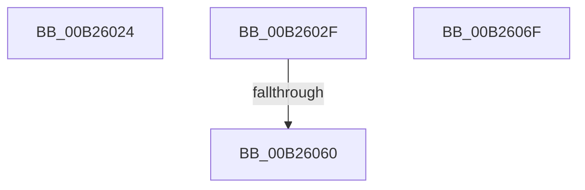

# sub_00B26024

- RVA: `0x00B26024`–`0x00B26086` (길이 `98` bytes)
- VA: `0x0000000140B26024`
- 실행 섹션: `PAGE`
- PDB 이름 있음: `아니요`; PDB Function 태그: `아니요`
- unwind 정보 RVA: `0x00091AF8`
- 디코드: `23`개 명령, `98/98` bytes 표시
- 미해석 바이트: `0` (있으면 어셈블리에 `.byte`로 보존)

> 이 문서는 커널 이미지의 기계어와 PDB 기호를 분석해 생성했습니다. 4번과 5번은 함수 원형과 자료형을 바이너리 사용 방식에서 추정한 C 해석이며 원본 소스 복구 결과는 아닙니다.

## 1. Dependencies

- 직접 호출 지점: **5**; 고유 호출 대상: **5**
- 직접 호출자로 확인된 함수: **0**
- RIP 상대 이미지 참조: **0**

### Outgoing calls
- `0x00B26024` → [PpProfileCancelHardwareProfileTransition](../73/PpProfileCancelHardwareProfileTransition_function_00737918.md) (function, `0x00737918`)
- `0x00B2603E` → [PnpUpdateRebootRequiredReason](../72/PnpUpdateRebootRequiredReason_function_0072CE64.md) (function, `0x0072CE64`)
- `0x00B2604E` → [PnpRequestDeviceRemoval](../8F/PnpRequestDeviceRemoval_function_008FC294.md) (function, `0x008FC294`)
- `0x00B26064` → [IoRequestDeviceEject](../../text/5A/IoRequestDeviceEject_function_005A59B0.md) (function, `0x005A59B0`)
- `0x00B2607B` → [IopAllocateLegacyBootResources](../../init/C3/IopAllocateLegacyBootResources_function_00C34138.md) (function, `0x00C34138`)

### Direct callers
- 이 함수 시작 RVA로 연결되는 직접 call은 확인되지 않았습니다. 간접 호출은 완전히 역산할 수 없습니다.

### Static image references
- 디코드된 RIP-relative 메모리 참조가 없습니다.

## 2. Other-region calls and transfers

- 다른 실행 섹션으로 향하는 call: **2**
  - `0x00B26064` → [IoRequestDeviceEject](../../text/5A/IoRequestDeviceEject_function_005A59B0.md) (`PAGE` → `.text`)
  - `0x00B2607B` → [IopAllocateLegacyBootResources](../../init/C3/IopAllocateLegacyBootResources_function_00C34138.md) (`PAGE` → `INIT`)
- call이 아닌 외부 분기/꼬리 이동: **4**
  - `0x00B2602A` → [PipProcessStartPhase2 + 0xA0](../94/PipProcessStartPhase2_function_0094EE60.md) (`tail-transfer`)
  - `0x00B2605A` → [PipProcessStartPhase2 + 0x4C](../94/PipProcessStartPhase2_function_0094EE60.md) (`tail-transfer`)
  - `0x00B2606A` → [PipProcessStartPhase2 + 0x4C](../94/PipProcessStartPhase2_function_0094EE60.md) (`tail-transfer`)
  - `0x00B26081` → [PipProcessStartPhase2 + 0x3F](../94/PipProcessStartPhase2_function_0094EE60.md) (`tail-transfer`)

## 3. Assembly (complete function range)

```asm
00B26024  E8 EF 18 C1 FF                  call 0x140737918
00B26029  90                              nop
00B2602A  E9 D1 8E E2 FF                  jmp 0x14094ef00
00B2602F  48 8B 4B 30                     mov rcx, qword ptr [rbx + 0x30]
00B26033  41 B8 00 00 00 40               mov r8d, 0x40000000
00B26039  BE 0E 00 00 00                  mov esi, 0xe
00B2603E  E8 21 6E C0 FF                  call 0x14072ce64
00B26043  44 8B CF                        mov r9d, edi
00B26046  44 8B C6                        mov r8d, esi
00B26049  33 D2                           xor edx, edx
00B2604B  48 8B CB                        mov rcx, rbx
00B2604E  E8 41 62 DD FF                  call 0x1408fc294
00B26053  83 BB 38 02 00 00 00            cmp dword ptr [rbx + 0x238], 0
00B2605A  0F 84 4C 8E E2 FF               je 0x14094eeac
00B26060  48 8B 4B 20                     mov rcx, qword ptr [rbx + 0x20]
00B26064  E8 47 F9 A7 FF                  call 0x1405a59b0
00B26069  90                              nop
00B2606A  E9 3D 8E E2 FF                  jmp 0x14094eeac
00B2606F  8B 93 C4 01 00 00               mov edx, dword ptr [rbx + 0x1c4]
00B26075  8B 8B C0 01 00 00               mov ecx, dword ptr [rbx + 0x1c0]
00B2607B  E8 B8 E0 10 00                  call 0x140c34138
00B26080  90                              nop
00B26081  E9 19 8E E2 FF                  jmp 0x14094ee9f
```

## 4. C-style interpretation (structured pseudocode)

```c
__int64 __fastcall sub_00B26024(__int64 a1, int a2)
{
    __int64 result;

    result = PpProfileCancelHardwareProfileTransition(a1, a2, a3, a4);
}
```

## 5. (Beta) C Style

```c
int64_t sub_00B26024(int64_t Arg1, int32_t Arg2)
{
    int64_t result;

    result = PpProfileCancelHardwareProfileTransition(Arg1, Arg2, a3, a4);
}
```

## 6. Execution-region graph

[열기: 2D/3D 그래프와 함수 탐색 컨트롤 패널](../../../control-panel.html?section=page&rva=0x00B26024&view=graph)

- 2D 그래프는 위에서 아래로 흐르고, 3D 그래프는 빈 공간을 드래그해 회전합니다. Shift+드래그는 이동, 휠은 확대·축소, 함수 노드 선택은 대상 보고서 이동입니다.

### Static fallback


