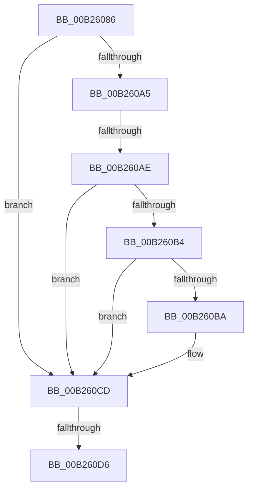

# sub_00B26086

- RVA: `0x00B26086`–`0x00B260E3` (길이 `93` bytes)
- VA: `0x0000000140B26086`
- 실행 섹션: `PAGE`
- PDB 이름 있음: `아니요`; PDB Function 태그: `아니요`
- unwind 정보 RVA: `0x00091BAC`
- 디코드: `25`개 명령, `93/93` bytes 표시
- 미해석 바이트: `0` (있으면 어셈블리에 `.byte`로 보존)

> 이 문서는 커널 이미지의 기계어와 PDB 기호를 분석해 생성했습니다. 4번과 5번은 함수 원형과 자료형을 바이너리 사용 방식에서 추정한 C 해석이며 원본 소스 복구 결과는 아닙니다.

## 1. Dependencies

- 직접 호출 지점: **2**; 고유 호출 대상: **2**
- 직접 호출자로 확인된 함수: **0**
- RIP 상대 이미지 참조: **1**

### Outgoing calls
- `0x00B26098` → [IopGetRegistryValue](../99/IopGetRegistryValue_function_009990EC.md) (function, `0x009990EC`)
- `0x00B260D8` → [ExFreePoolWithTag](../../poolcode/B8/ExFreePoolWithTag_function_00B82870.md) (function, `0x00B82870`)

### Direct callers
- 이 함수 시작 RVA로 연결되는 직접 call은 확인되지 않았습니다. 간접 호출은 완전히 역산할 수 없습니다.

### Static image references
- `0x00B26091` → RVA `0x00AFD8C0` (` ?? ::NNGAKEGL::`string'`; read)

## 2. Other-region calls and transfers

- 다른 실행 섹션으로 향하는 call: **1**
  - `0x00B260D8` → [ExFreePoolWithTag](../../poolcode/B8/ExFreePoolWithTag_function_00B82870.md) (`PAGE` → `POOLCODE`)
- call이 아닌 외부 분기/꼬리 이동: **3**
  - `0x00B260A8` → [PipCheckForDenyExecute + 0xD4](../94/PipCheckForDenyExecute_function_0094F880.md) (`tail-transfer`)
  - `0x00B260D0` → [PipCheckForDenyExecute + 0xD4](../94/PipCheckForDenyExecute_function_0094F880.md) (`tail-transfer`)
  - `0x00B260DE` → [PipCheckForDenyExecute + 0xD4](../94/PipCheckForDenyExecute_function_0094F880.md) (`tail-transfer`)

## 3. Assembly (complete function range)

```asm
00B26086  48 8B 4D 30                     mov rcx, qword ptr [rbp + 0x30]
00B2608A  4C 8D 4D 38                     lea r9, [rbp + 0x38]
00B2608E  45 33 C0                        xor r8d, r8d
00B26091  48 8D 15 28 78 FD FF            lea rdx, [rip - 0x287d8]
00B26098  E8 4F 30 E7 FF                  call 0x1409990ec
00B2609D  48 8B 4D 38                     mov rcx, qword ptr [rbp + 0x38]
00B260A1  85 C0                           test eax, eax
00B260A3  78 28                           js 0x140b260cd
00B260A5  48 85 C9                        test rcx, rcx
00B260A8  0F 84 A6 98 E2 FF               je 0x14094f954
00B260AE  83 79 04 04                     cmp dword ptr [rcx + 4], 4
00B260B2  75 19                           jne 0x140b260cd
00B260B4  83 79 0C 04                     cmp dword ptr [rcx + 0xc], 4
00B260B8  75 13                           jne 0x140b260cd
00B260BA  8B 41 08                        mov eax, dword ptr [rcx + 8]
00B260BD  BA 01 00 00 00                  mov edx, 1
00B260C2  40 0F B6 FF                     movzx edi, dil
00B260C6  83 3C 08 00                     cmp dword ptr [rax + rcx], 0
00B260CA  0F 45 FA                        cmovne edi, edx
00B260CD  48 85 C9                        test rcx, rcx
00B260D0  0F 84 7E 98 E2 FF               je 0x14094f954
00B260D6  33 D2                           xor edx, edx
00B260D8  E8 93 C7 05 00                  call 0x140b82870
00B260DD  90                              nop
00B260DE  E9 71 98 E2 FF                  jmp 0x14094f954
```

## 4. C-style interpretation (structured pseudocode)

```c
__int64 __fastcall sub_00B26086(__int64 a1, __int64 a2, int a3)
{
    __int64 result;
    __int64 v_rdi;

    a3 = 0;
    result = IopGetRegistryValue(*(unsigned __int64 *)(v_rbp + 48), v_rip - 165848, a3, v_rbp + 56);
    if (sign_flag) goto loc_00B260CD;
    if ((*(unsigned int *)(*(unsigned __int64 *)(v_rbp + 56) + 4)) != 4) goto loc_00B260CD;
    if ((*(unsigned int *)(*(unsigned __int64 *)(v_rbp + 56) + 12)) == 4) {
        result = *(unsigned int *)(*(unsigned __int64 *)(v_rbp + 56) + 8);
        a2 = 1;
        v_rdi = (unsigned __int8)(v_rdi);
        if ((*(unsigned int *)(result + *(unsigned __int64 *)(v_rbp + 56) * 1)) != 0) { v_rdi = (unsigned int)(a2); }
    }
    a2 = 0;
    result = ExFreePoolWithTag(*(unsigned __int64 *)(v_rbp + 56), a2, a3, v_rbp + 56);
}
```

## 5. (Beta) C Style

```c
int64_t sub_00B26086(int64_t Arg1, int64_t Arg2, int32_t Arg3)
{
    int64_t result;
    int64_t local_rdi;

    Arg3 = 0;
    result = IopGetRegistryValue(*(uint64_t *)(local_rbp + 0x30), v_rip - 165848, Arg3, local_rbp + 56);
    if (sign_flag) goto loc_00B260CD;
    if ((*(uint32_t *)(*(uint64_t *)(local_rbp + 0x38) + 0x4)) != 4) goto loc_00B260CD;
    if ((*(uint32_t *)(*(uint64_t *)(local_rbp + 0x38) + 0xC)) == 4) {
        result = *(uint32_t *)(*(uint64_t *)(local_rbp + 0x38) + 0x8);
        Arg2 = 1;
        local_rdi = (uint8_t)(local_rdi);
        if ((*(uint32_t *)(result + *(uint64_t *)(local_rbp + 0x38) * 1)) != 0) { local_rdi = (uint32_t)(Arg2); }
    }
    Arg2 = 0;
    result = ExFreePoolWithTag(*(uint64_t *)(local_rbp + 0x38), Arg2, Arg3, local_rbp + 56);
}
```

## 6. Execution-region graph

[열기: 2D/3D 그래프와 함수 탐색 컨트롤 패널](../../../control-panel.html?section=page&rva=0x00B26086&view=graph)

- 2D 그래프는 위에서 아래로 흐르고, 3D 그래프는 빈 공간을 드래그해 회전합니다. Shift+드래그는 이동, 휠은 확대·축소, 함수 노드 선택은 대상 보고서 이동입니다.

### Static fallback


