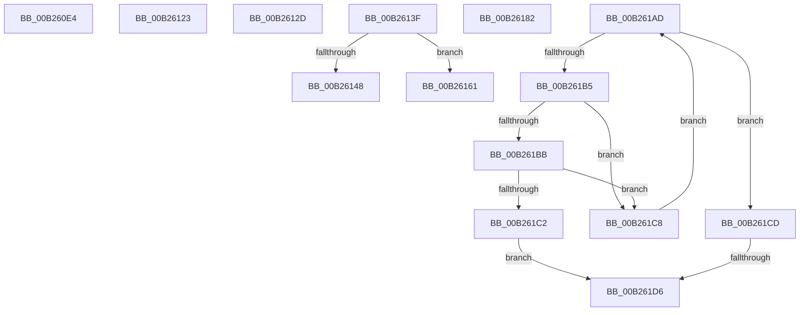

# sub_00B260E4

- RVA: `0x00B260E4`–`0x00B261E4` (길이 `256` bytes)
- VA: `0x0000000140B260E4`
- 실행 섹션: `PAGE`
- PDB 이름 있음: `아니요`; PDB Function 태그: `아니요`
- unwind 정보 RVA: `0x00091BFC`
- 디코드: `67`개 명령, `256/256` bytes 표시
- 미해석 바이트: `0` (있으면 어셈블리에 `.byte`로 보존)

> 이 문서는 커널 이미지의 기계어와 PDB 기호를 분석해 생성했습니다. 4번과 5번은 함수 원형과 자료형을 바이너리 사용 방식에서 추정한 C 해석이며 원본 소스 복구 결과는 아닙니다.

## 1. Dependencies

- 직접 호출 지점: **3**; 고유 호출 대상: **3**
- 직접 호출자로 확인된 함수: **0**
- RIP 상대 이미지 참조: **0**

### Outgoing calls
- `0x00B260ED` → [memset](../../text/6C/memset_function_006C6C40.md) (function, `0x006C6C40`)
- `0x00B26176` → [KeWaitForSingleObject](../../text/20/KeWaitForSingleObject_function_0020E6B0.md) (function, `0x0020E6B0`)
- `0x00B26195` → [memcpy](../../text/6C/memcpy_function_006C6840.md) (function, `0x006C6840`)

### Direct callers
- 이 함수 시작 RVA로 연결되는 직접 call은 확인되지 않았습니다. 간접 호출은 완전히 역산할 수 없습니다.

### Static image references
- 디코드된 RIP-relative 메모리 참조가 없습니다.

## 2. Other-region calls and transfers

- 다른 실행 섹션으로 향하는 call: **3**
  - `0x00B260ED` → [memset](../../text/6C/memset_function_006C6C40.md) (`PAGE` → `.text`)
  - `0x00B26176` → [KeWaitForSingleObject](../../text/20/KeWaitForSingleObject_function_0020E6B0.md) (`PAGE` → `.text`)
  - `0x00B26195` → [memcpy](../../text/6C/memcpy_function_006C6840.md) (`PAGE` → `.text`)
- call이 아닌 외부 분기/꼬리 이동: **8**
  - `0x00B2611E` → [PnpQueueQueryAndRemoveEvent + 0xBD](../94/PnpQueueQueryAndRemoveEvent_function_0094FD2C.md) (`tail-transfer`)
  - `0x00B26128` → [PnpQueueQueryAndRemoveEvent + 0xEB](../94/PnpQueueQueryAndRemoveEvent_function_0094FD2C.md) (`tail-transfer`)
  - `0x00B2613A` → [PnpQueueQueryAndRemoveEvent + 0x377](../94/PnpQueueQueryAndRemoveEvent_function_0094FD2C.md) (`tail-transfer`)
  - `0x00B2615C` → [PnpQueueQueryAndRemoveEvent + 0x377](../94/PnpQueueQueryAndRemoveEvent_function_0094FD2C.md) (`tail-transfer`)
  - `0x00B2617D` → [PnpQueueQueryAndRemoveEvent + 0x202](../94/PnpQueueQueryAndRemoveEvent_function_0094FD2C.md) (`tail-transfer`)
  - `0x00B261A8` → [PnpQueueQueryAndRemoveEvent + 0x23E](../94/PnpQueueQueryAndRemoveEvent_function_0094FD2C.md) (`tail-transfer`)
  - `0x00B261D0` → [PnpQueueQueryAndRemoveEvent + 0x24F](../94/PnpQueueQueryAndRemoveEvent_function_0094FD2C.md) (`tail-transfer`)
  - `0x00B261DF` → [PnpQueueQueryAndRemoveEvent + 0x24F](../94/PnpQueueQueryAndRemoveEvent_function_0094FD2C.md) (`tail-transfer`)

## 3. Assembly (complete function range)

```asm
00B260E4  4C 8D 47 14                     lea r8, [rdi + 0x14]
00B260E8  33 D2                           xor edx, edx
00B260EA  49 8B CD                        mov rcx, r13
00B260ED  E8 4E 0B BA FF                  call 0x1406c6c40
00B260F2  48 8B BC 24 80 00 00 00         mov rdi, qword ptr [rsp + 0x80]
00B260FA  49 8D 75 04                     lea rsi, [r13 + 4]
00B260FE  33 D2                           xor edx, edx
00B26100  48 8D 46 10                     lea rax, [rsi + 0x10]
00B26104  48 89 46 08                     mov qword ptr [rsi + 8], rax
00B26108  44 8B F2                        mov r14d, edx
00B2610B  41 0F B7 07                     movzx eax, word ptr [r15]
00B2610F  66 89 46 02                     mov word ptr [rsi + 2], ax
00B26113  8D 6A 01                        lea ebp, [rdx + 1]
00B26116  66 89 16                        mov word ptr [rsi], dx
00B26119  40 88 6C 24 70                  mov byte ptr [rsp + 0x70], bpl
00B2611E  E9 C6 9C E2 FF                  jmp 0x14094fde9
00B26123  BB 15 00 00 00                  mov ebx, 0x15
00B26128  E9 EA 9C E2 FF                  jmp 0x14094fe17
00B2612D  BB 9A 00 00 C0                  mov ebx, 0xc000009a
00B26132  4C 8B B4 24 80 00 00 00         mov r14, qword ptr [rsp + 0x80]
00B2613A  E9 64 9F E2 FF                  jmp 0x1409500a3
00B2613F  8B C5                           mov eax, ebp
00B26141  87 47 44                        xchg dword ptr [rdi + 0x44], eax
00B26144  85 C0                           test eax, eax
00B26146  75 19                           jne 0x140b26161
00B26148  41 8B C4                        mov eax, r12d
00B2614B  40 88 6F 48                     mov byte ptr [rdi + 0x48], bpl
00B2614F  87 47 44                        xchg dword ptr [rdi + 0x44], eax
00B26152  BB 20 01 00 C0                  mov ebx, 0xc0000120
00B26157  44 88 64 24 70                  mov byte ptr [rsp + 0x70], r12b
00B2615C  E9 42 9F E2 FF                  jmp 0x1409500a3
00B26161  45 33 C9                        xor r9d, r9d
00B26164  4C 89 64 24 20                  mov qword ptr [rsp + 0x20], r12
00B26169  45 33 C0                        xor r8d, r8d
00B2616C  48 8D 8C 24 90 00 00 00         lea rcx, [rsp + 0x90]
00B26174  33 D2                           xor edx, edx
00B26176  E8 35 85 6E FF                  call 0x14020e6b0
00B2617B  8B D8                           mov ebx, eax
00B2617D  E9 AC 9D E2 FF                  jmp 0x14094ff2e
00B26182  48 8B BC 24 00 01 00 00         mov rdi, qword ptr [rsp + 0x100]
00B2618A  48 8B 56 08                     mov rdx, qword ptr [rsi + 8]
00B2618E  44 0F B7 C1                     movzx r8d, cx
00B26192  48 8B CF                        mov rcx, rdi
00B26195  E8 A6 06 BA FF                  call 0x1406c6840
00B2619A  0F B7 06                        movzx eax, word ptr [rsi]
00B2619D  48 D1 E8                        shr rax, 1
00B261A0  45 33 C0                        xor r8d, r8d
00B261A3  66 44 89 04 47                  mov word ptr [rdi + rax*2], r8w
00B261A8  E9 BD 9D E2 FF                  jmp 0x14094ff6a
00B261AD  0F B7 10                        movzx edx, word ptr [rax]
00B261B0  66 85 D2                        test dx, dx
00B261B3  74 18                           je 0x140b261cd
00B261B5  66 83 FA 5C                     cmp dx, 0x5c
00B261B9  75 0D                           jne 0x140b261c8
00B261BB  03 CD                           add ecx, ebp
00B261BD  83 F9 03                        cmp ecx, 3
00B261C0  75 06                           jne 0x140b261c8
00B261C2  66 44 89 00                     mov word ptr [rax], r8w
00B261C6  EB 0E                           jmp 0x140b261d6
00B261C8  49 03 C1                        add rax, r9
00B261CB  EB E0                           jmp 0x140b261ad
00B261CD  83 F9 03                        cmp ecx, 3
00B261D0  0F 85 A5 9D E2 FF               jne 0x14094ff7b
00B261D6  66 2B C7                        sub ax, di
00B261D9  0F B7 C0                        movzx eax, ax
00B261DC  41 89 07                        mov dword ptr [r15], eax
00B261DF  E9 97 9D E2 FF                  jmp 0x14094ff7b
```

## 4. C-style interpretation (structured pseudocode)

```c
__int64 __fastcall sub_00B260E4(__int64 a1, int a2, __int64 a3, int a4, __int64 a5, __int64 a6, __int64 a7, __int64 a8, __int64 a9, __int64 a10, __int64 a11, __int64 a12, __int64 a13, __int64 a14, __int64 a15, __int64 a16)
{
    __int64 result;
    unsigned __int64 v_stack_p100;
    unsigned __int64 v_stack_p20;
    unsigned __int8 v_stack_p70;
    unsigned __int64 v_stack_p80;
    unsigned __int64 v_stack_p90;

    a2 = 0;
    result = memset(v_r13, a2, v_rdi + 20, a4);
    a2 = 0;
    *(unsigned __int64 *)(v_r13 + 4 + 8) = v_r13 + 4 + 16;
    *(unsigned __int16 *)(v_r13 + 4 + 2) = (unsigned __int16)(*(unsigned __int16 *)(v_r15));
    *(unsigned __int16 *)(v_r13 + 4) = 0;
    v_stack_p70 = (unsigned __int8)(a2 + 1);
}
```

## 5. (Beta) C Style

```c
int64_t sub_00B260E4(int64_t Arg1, int32_t Arg2, int64_t Arg3, int32_t Arg4, uint64_t Arg5, uint64_t Arg6, uint64_t Arg7, uint64_t Arg8, uint64_t Arg9, uint64_t Arg10, uint64_t Arg11, uint64_t Arg12, uint64_t Arg13, uint64_t Arg14, uint64_t Arg15, int64_t Arg16)
{
    int64_t result;
    uint64_t v_stack_p100;
    uint64_t v_stack_p20;
    uint8_t v_stack_p70;
    uint64_t v_stack_p80;
    uint64_t v_stack_p90;

    Arg2 = 0;
    result = memset(local_r13, Arg2, local_rdi + 20, Arg4);
    Arg2 = 0;
    *(uint64_t *)(local_r13 + 0x4 + 0x8) = local_r13 + 4 + 16;
    *(uint16_t *)(local_r13 + 0x4 + 0x2) = (uint16_t)(*(uint16_t *)(local_r15));
    *(uint16_t *)(local_r13 + 0x4) = 0;
    v_stack_p70 = (uint8_t)(Arg2 + 1);
}
```

## 6. Execution-region graph

[열기: 2D/3D 그래프와 함수 탐색 컨트롤 패널](../../../control-panel.html?section=page&rva=0x00B260E4&view=graph)

- 2D 그래프는 위에서 아래로 흐르고, 3D 그래프는 빈 공간을 드래그해 회전합니다. Shift+드래그는 이동, 휠은 확대·축소, 함수 노드 선택은 대상 보고서 이동입니다.

### Static fallback


