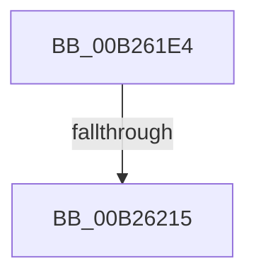

# sub_00B261E4

- RVA: `0x00B261E4`–`0x00B26246` (길이 `98` bytes)
- VA: `0x0000000140B261E4`
- 실행 섹션: `PAGE`
- PDB 이름 있음: `아니요`; PDB Function 태그: `아니요`
- unwind 정보 RVA: `0x00091C34`
- 디코드: `24`개 명령, `98/98` bytes 표시
- 미해석 바이트: `0` (있으면 어셈블리에 `.byte`로 보존)

> 이 문서는 커널 이미지의 기계어와 PDB 기호를 분석해 생성했습니다. 4번과 5번은 함수 원형과 자료형을 바이너리 사용 방식에서 추정한 C 해석이며 원본 소스 복구 결과는 아닙니다.

## 1. Dependencies

- 직접 호출 지점: **3**; 고유 호출 대상: **3**
- 직접 호출자로 확인된 함수: **0**
- RIP 상대 이미지 참조: **0**

### Outgoing calls
- `0x00B261EA` → [ExFreePoolWithTag](../../poolcode/B8/ExFreePoolWithTag_function_00B82870.md) (function, `0x00B82870`)
- `0x00B26203` → [ExAllocatePool2](../../poolcode/B8/ExAllocatePool2_function_00B820F0.md) (function, `0x00B820F0`)
- `0x00B2623A` → [CmGetDeviceInterfaceName](../8F/CmGetDeviceInterfaceName_function_008F3870.md) (function, `0x008F3870`)

### Direct callers
- 이 함수 시작 RVA로 연결되는 직접 call은 확인되지 않았습니다. 간접 호출은 완전히 역산할 수 없습니다.

### Static image references
- 디코드된 RIP-relative 메모리 참조가 없습니다.

## 2. Other-region calls and transfers

- 다른 실행 섹션으로 향하는 call: **2**
  - `0x00B261EA` → [ExFreePoolWithTag](../../poolcode/B8/ExFreePoolWithTag_function_00B82870.md) (`PAGE` → `POOLCODE`)
  - `0x00B26203` → [ExAllocatePool2](../../poolcode/B8/ExAllocatePool2_function_00B820F0.md) (`PAGE` → `POOLCODE`)
- call이 아닌 외부 분기/꼬리 이동: **2**
  - `0x00B2620F` → [IopRegisterDeviceInterface + 0x543](../95/IopRegisterDeviceInterface_function_009501B0.md) (`tail-transfer`)
  - `0x00B26241` → [IopRegisterDeviceInterface + 0x107](../95/IopRegisterDeviceInterface_function_009501B0.md) (`tail-transfer`)

## 3. Assembly (complete function range)

```asm
00B261E4  49 8B 0C 24                     mov rcx, qword ptr [r12]
00B261E8  33 D2                           xor edx, edx
00B261EA  E8 81 C6 05 00                  call 0x140b82870
00B261EF  8B 7C 24 64                     mov edi, dword ptr [rsp + 0x64]
00B261F3  B9 00 01 00 00                  mov ecx, 0x100
00B261F8  8B D7                           mov edx, edi
00B261FA  41 B8 50 70 20 20               mov r8d, 0x20207050
00B26200  48 03 D2                        add rdx, rdx
00B26203  E8 E8 BE 05 00                  call 0x140b820f0
00B26208  49 89 04 24                     mov qword ptr [r12], rax
00B2620C  48 85 C0                        test rax, rax
00B2620F  0F 84 DE A4 E2 FF               je 0x1409506f3
00B26215  4C 8B 4D A0                     mov r9, qword ptr [rbp - 0x60]
00B26219  48 8D 4C 24 64                  lea rcx, [rsp + 0x64]
00B2621E  4C 8B 45 88                     mov r8, qword ptr [rbp - 0x78]
00B26222  48 8D 55 D0                     lea rdx, [rbp - 0x30]
00B26226  48 89 4C 24 38                  mov qword ptr [rsp + 0x38], rcx
00B2622B  89 7C 24 30                     mov dword ptr [rsp + 0x30], edi
00B2622F  48 89 44 24 28                  mov qword ptr [rsp + 0x28], rax
00B26234  33 C0                           xor eax, eax
00B26236  88 44 24 20                     mov byte ptr [rsp + 0x20], al
00B2623A  E8 31 D6 DC FF                  call 0x1408f3870
00B2623F  8B F8                           mov edi, eax
00B26241  E9 71 A0 E2 FF                  jmp 0x1409502b7
```

## 4. C-style interpretation (structured pseudocode)

```c
__int64 __fastcall sub_00B261E4(__int64 a1, int a2)
{
    __int64 result;
    unsigned __int8 v_stack_p20;
    unsigned __int64 v_stack_p28;
    unsigned int v_stack_p30;
    unsigned __int64 v_stack_p38;
    unsigned int v_stack_p64;

    a2 = 0;
    result = ExFreePoolWithTag(*(unsigned __int64 *)(v_r12), a2, a3, a4);
    a2 = ((unsigned int)((unsigned int)((unsigned int)(v_stack_p64)))) + ((unsigned int)((unsigned int)((unsigned int)(v_stack_p64))));
    result = ExAllocatePool2(256, a2, (unsigned int)(0x20207050ULL), a4);
    *(unsigned __int64 *)(v_r12) = result;
    v_stack_p38 = v_stack_p64;
    v_stack_p30 = (unsigned int)((unsigned int)(v_stack_p64));
    v_stack_p28 = result;
    result = 0;
    v_stack_p20 = 0;
    result = CmGetDeviceInterfaceName(v_stack_p64, v_rbp - 48, *(unsigned __int64 *)(v_rbp - 120), *(unsigned __int64 *)(v_rbp - 96));
}
```

## 5. (Beta) C Style

```c
int64_t sub_00B261E4(int64_t Arg1, int32_t Arg2)
{
    int64_t result;
    uint8_t v_stack_p20;
    uint64_t v_stack_p28;
    uint32_t v_stack_p30;
    uint64_t v_stack_p38;
    uint32_t v_stack_p64;

    Arg2 = 0;
    result = ExFreePoolWithTag(*(uint64_t *)(local_r12), Arg2, a3, a4);
    Arg2 = ((uint32_t)((uint32_t)((uint32_t)(v_stack_p64)))) + ((uint32_t)((uint32_t)((uint32_t)(v_stack_p64))));
    result = ExAllocatePool2(256, Arg2, (uint32_t)(0x20207050ULL), a4);
    *(uint64_t *)(local_r12) = result;
    v_stack_p38 = v_stack_p64;
    v_stack_p30 = (uint32_t)((uint32_t)(v_stack_p64));
    v_stack_p28 = result;
    result = 0;
    v_stack_p20 = 0;
    result = CmGetDeviceInterfaceName(v_stack_p64, local_rbp - 48, *(uint64_t *)(local_rbp - 0x78), *(uint64_t *)(local_rbp - 0x60));
}
```

## 6. Execution-region graph

[열기: 2D/3D 그래프와 함수 탐색 컨트롤 패널](../../../control-panel.html?section=page&rva=0x00B261E4&view=graph)

- 2D 그래프는 위에서 아래로 흐르고, 3D 그래프는 빈 공간을 드래그해 회전합니다. Shift+드래그는 이동, 휠은 확대·축소, 함수 노드 선택은 대상 보고서 이동입니다.

### Static fallback


