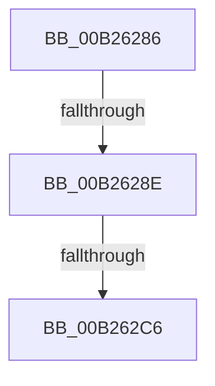

# sub_00B26286

- RVA: `0x00B26286`–`0x00B262D0` (길이 `74` bytes)
- VA: `0x0000000140B26286`
- 실행 섹션: `PAGE`
- PDB 이름 있음: `아니요`; PDB Function 태그: `아니요`
- unwind 정보 RVA: `0x00091F60`
- 디코드: `17`개 명령, `74/74` bytes 표시
- 미해석 바이트: `0` (있으면 어셈블리에 `.byte`로 보존)

> 이 문서는 커널 이미지의 기계어와 PDB 기호를 분석해 생성했습니다. 4번과 5번은 함수 원형과 자료형을 바이너리 사용 방식에서 추정한 C 해석이며 원본 소스 복구 결과는 아닙니다.

## 1. Dependencies

- 직접 호출 지점: **1**; 고유 호출 대상: **1**
- 직접 호출자로 확인된 함수: **0**
- RIP 상대 이미지 참조: **1**

### Outgoing calls
- `0x00B262AB` → [RtlCheckTokenMembershipEx](../../text/3A/RtlCheckTokenMembershipEx_function_003A5A30.md) (function, `0x003A5A30`)

### Direct callers
- 이 함수 시작 RVA로 연결되는 직접 call은 확인되지 않았습니다. 간접 호출은 완전히 역산할 수 없습니다.

### Static image references
- `0x00B2629B` → RVA `0x00FD9AA0` (`PAGEDATA`; read)

## 2. Other-region calls and transfers

- 다른 실행 섹션으로 향하는 call: **1**
  - `0x00B262AB` → [RtlCheckTokenMembershipEx](../../text/3A/RtlCheckTokenMembershipEx_function_003A5A30.md) (`PAGE` → `.text`)
- call이 아닌 외부 분기/꼬리 이동: **3**
  - `0x00B26288` → [NtQuerySystemEnvironmentValueEx + 0x93](../95/NtQuerySystemEnvironmentValueEx_function_00952180.md) (`tail-transfer`)
  - `0x00B262C0` → [NtQuerySystemEnvironmentValueEx + 0x93](../95/NtQuerySystemEnvironmentValueEx_function_00952180.md) (`tail-transfer`)
  - `0x00B262CB` → [NtQuerySystemEnvironmentValueEx + 0x2FB](../95/NtQuerySystemEnvironmentValueEx_function_00952180.md) (`tail-transfer`)

## 3. Assembly (complete function range)

```asm
00B26286  84 DB                           test bl, bl
00B26288  0F 85 85 BF E2 FF               jne 0x140952213
00B2628E  40 88 7C 24 30                  mov byte ptr [rsp + 0x30], dil
00B26293  4C 8D 4C 24 30                  lea r9, [rsp + 0x30]
00B26298  45 33 C0                        xor r8d, r8d
00B2629B  48 8B 15 FE 37 4B 00            mov rdx, qword ptr [rip + 0x4b37fe]
00B262A2  48 8B 92 10 02 00 00            mov rdx, qword ptr [rdx + 0x210]
00B262A9  33 C9                           xor ecx, ecx
00B262AB  E8 80 F7 87 FF                  call 0x1403a5a30
00B262B0  0F B6 4C 24 30                  movzx ecx, byte ptr [rsp + 0x30]
00B262B5  85 C0                           test eax, eax
00B262B7  0F 48 CF                        cmovs ecx, edi
00B262BA  88 4C 24 30                     mov byte ptr [rsp + 0x30], cl
00B262BE  84 C9                           test cl, cl
00B262C0  0F 85 4D BF E2 FF               jne 0x140952213
00B262C6  BB 61 00 00 C0                  mov ebx, 0xc0000061
00B262CB  E9 AB C1 E2 FF                  jmp 0x14095247b
```

## 4. C-style interpretation (structured pseudocode)

```c
__int64 __fastcall sub_00B26286(int a1, __int64 a2, int a3, __int64 a4, __int64 a5, unsigned __int8 a6)
{
    __int64 result;
    unsigned __int8 v_stack_p30;

    v_stack_p30 = (unsigned __int8)(v_rdi);
    a3 = 0;
    a1 = 0;
    result = RtlCheckTokenMembershipEx(a1, *(unsigned __int64 *)(*(unsigned __int64 *)(v_rip + 4929534) + 528), a3, a6);
    if (sign_flag) { a6 = (unsigned int)(v_rdi); }
    v_stack_p30 = a6;
}
```

## 5. (Beta) C Style

```c
int64_t sub_00B26286(int32_t Arg1, int64_t Arg2, int32_t Arg3, int64_t Arg4, uint64_t Arg5, uint8_t Arg6)
{
    int64_t result;
    uint8_t v_stack_p30;

    v_stack_p30 = (uint8_t)(local_rdi);
    Arg3 = 0;
    Arg1 = 0;
    result = RtlCheckTokenMembershipEx(Arg1, *(uint64_t *)(*(uint64_t *)(v_rip + 0x4B37FE) + 0x210), Arg3, Arg6);
    if (sign_flag) { Arg6 = (uint32_t)(local_rdi); }
    v_stack_p30 = Arg6;
}
```

## 6. Execution-region graph

[열기: 2D/3D 그래프와 함수 탐색 컨트롤 패널](../../../control-panel.html?section=page&rva=0x00B26286&view=graph)

- 2D 그래프는 위에서 아래로 흐르고, 3D 그래프는 빈 공간을 드래그해 회전합니다. Shift+드래그는 이동, 휠은 확대·축소, 함수 노드 선택은 대상 보고서 이동입니다.

### Static fallback


