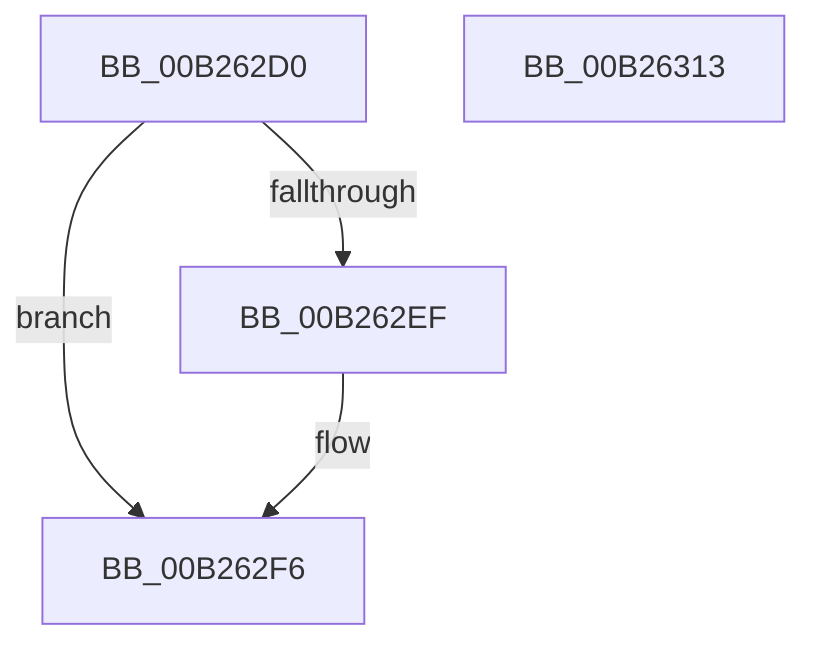

# sub_00B262D0

- RVA: `0x00B262D0`–`0x00B2631C` (길이 `76` bytes)
- VA: `0x0000000140B262D0`
- 실행 섹션: `PAGE`
- PDB 이름 있음: `아니요`; PDB Function 태그: `아니요`
- unwind 정보 RVA: `0x00091F90`
- 디코드: `17`개 명령, `76/76` bytes 표시
- 미해석 바이트: `0` (있으면 어셈블리에 `.byte`로 보존)

> 이 문서는 커널 이미지의 기계어와 PDB 기호를 분석해 생성했습니다. 4번과 5번은 함수 원형과 자료형을 바이너리 사용 방식에서 추정한 C 해석이며 원본 소스 복구 결과는 아닙니다.

## 1. Dependencies

- 직접 호출 지점: **1**; 고유 호출 대상: **1**
- 직접 호출자로 확인된 함수: **0**
- RIP 상대 이미지 참조: **4**

### Outgoing calls
- `0x00B262D7` → [CmSiRWLockAcquireExclusive](../A1/CmSiRWLockAcquireExclusive_function_00A1679C.md) (function, `0x00A1679C`)

### Direct callers
- 이 함수 시작 RVA로 연결되는 직접 call은 확인되지 않았습니다. 간접 호출은 완전히 역산할 수 없습니다.

### Static image references
- `0x00B262D0` → RVA `0x00FDA418` (`PAGEDATA`; read)
- `0x00B262DC` → RVA `0x00FDA428` (`PAGEDATA`; read)
- `0x00B262E3` → RVA `0x00FDA420` (`PAGEDATA`; read)
- `0x00B26307` → RVA `0x00FDA428` (`PAGEDATA`; write)

## 2. Other-region calls and transfers

- 다른 실행 섹션으로 향하는 call: **0**
- call이 아닌 외부 분기/꼬리 이동: **2**
  - `0x00B2630E` → [CmpVolumeManagerGetContextForFile + 0xF0](../95/CmpVolumeManagerGetContextForFile_function_009525A8.md) (`tail-transfer`)
  - `0x00B26317` → [CmpVolumeManagerGetContextForFile + 0x102](../95/CmpVolumeManagerGetContextForFile_function_009525A8.md) (`tail-transfer`)

## 3. Assembly (complete function range)

```asm
00B262D0  48 8D 0D 41 41 4B 00            lea rcx, [rip + 0x4b4141]
00B262D7  E8 C0 04 EF FF                  call 0x140a1679c
00B262DC  48 8B 0D 45 41 4B 00            mov rcx, qword ptr [rip + 0x4b4145]
00B262E3  48 8D 05 36 41 4B 00            lea rax, [rip + 0x4b4136]
00B262EA  48 39 01                        cmp qword ptr [rcx], rax
00B262ED  74 07                           je 0x140b262f6
00B262EF  B9 03 00 00 00                  mov ecx, 3
00B262F4  CD 29                           int 0x29
00B262F6  48 8B 5D D0                     mov rbx, qword ptr [rbp - 0x30]
00B262FA  49 8B FC                        mov rdi, r12
00B262FD  48 89 03                        mov qword ptr [rbx], rax
00B26300  48 89 4B 08                     mov qword ptr [rbx + 8], rcx
00B26304  48 89 19                        mov qword ptr [rcx], rbx
00B26307  48 89 1D 1A 41 4B 00            mov qword ptr [rip + 0x4b411a], rbx
00B2630E  E9 85 C3 E2 FF                  jmp 0x140952698
00B26313  48 8B 7D D0                     mov rdi, qword ptr [rbp - 0x30]
00B26317  E9 8E C3 E2 FF                  jmp 0x1409526aa
```

## 4. C-style interpretation (structured pseudocode)

```c
__int64 __fastcall sub_00B262D0(void)
{
    __int64 result;

    result = CmSiRWLockAcquireExclusive(v_rip + 4931905, a2, a3, a4);
    if ((*(unsigned __int64 *)(*(unsigned __int64 *)(v_rip + 4931909))) != (v_rip + 4931894)) {
        a1 = 3;
    }
    *(unsigned __int64 *)(*(unsigned __int64 *)(v_rbp - 48)) = v_rip + 4931894;
    *(unsigned __int64 *)(*(unsigned __int64 *)(v_rbp - 48) + 8) = a1;
    *(unsigned __int64 *)(a1) = *(unsigned __int64 *)(v_rbp - 48);
    *(unsigned __int64 *)(v_rip + 4931866) = *(unsigned __int64 *)(v_rbp - 48);
}
```

## 5. (Beta) C Style

```c
void sub_00B262D0(void)
{
    int64_t result;

    result = CmSiRWLockAcquireExclusive(v_rip + 4931905, a2, a3, a4);
    if ((*(uint64_t *)(*(uint64_t *)(v_rip + 0x4B4145))) != (v_rip + 4931894)) {
        a1 = 3;
    }
    *(uint64_t *)(*(uint64_t *)(local_rbp - 0x30)) = v_rip + 4931894;
    *(uint64_t *)(*(uint64_t *)(local_rbp - 0x30) + 0x8) = a1;
    *(uint64_t *)(a1) = *(uint64_t *)(local_rbp - 0x30);
    *(uint64_t *)(v_rip + 0x4B411A) = *(uint64_t *)(local_rbp - 0x30);
}
```

## 6. Execution-region graph

[열기: 2D/3D 그래프와 함수 탐색 컨트롤 패널](../../../control-panel.html?section=page&rva=0x00B262D0&view=graph)

- 2D 그래프는 위에서 아래로 흐르고, 3D 그래프는 빈 공간을 드래그해 회전합니다. Shift+드래그는 이동, 휠은 확대·축소, 함수 노드 선택은 대상 보고서 이동입니다.

### Static fallback


