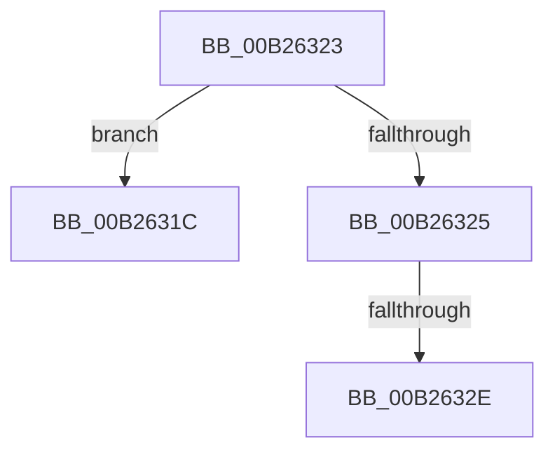

# sub_00B2631C

- RVA: `0x00B2631C`–`0x00B26333` (길이 `23` bytes)
- VA: `0x0000000140B2631C`
- 실행 섹션: `PAGE`
- PDB 이름 있음: `아니요`; PDB Function 태그: `아니요`
- unwind 정보 RVA: `0x00092058`
- 디코드: `6`개 명령, `23/23` bytes 표시
- 미해석 바이트: `0` (있으면 어셈블리에 `.byte`로 보존)

> 이 문서는 커널 이미지의 기계어와 PDB 기호를 분석해 생성했습니다. 4번과 5번은 함수 원형과 자료형을 바이너리 사용 방식에서 추정한 C 해석이며 원본 소스 복구 결과는 아닙니다.

## 1. Dependencies

- 직접 호출 지점: **0**; 고유 호출 대상: **0**
- 직접 호출자로 확인된 함수: **0**
- RIP 상대 이미지 참조: **0**

### Outgoing calls
- 직접 디코드된 call 명령이 없습니다.

### Direct callers
- 이 함수 시작 RVA로 연결되는 직접 call은 확인되지 않았습니다. 간접 호출은 완전히 역산할 수 없습니다.

### Static image references
- 디코드된 RIP-relative 메모리 참조가 없습니다.

## 2. Other-region calls and transfers

- 다른 실행 섹션으로 향하는 call: **0**
- call이 아닌 외부 분기/꼬리 이동: **3**
  - `0x00B2631E` → [NtApphelpCacheControl + 0x7E](../95/NtApphelpCacheControl_function_00953050.md) (`tail-transfer`)
  - `0x00B26328` → [NtApphelpCacheControl + 0x165](../95/NtApphelpCacheControl_function_00953050.md) (`tail-transfer`)
  - `0x00B2632E` → [NtApphelpCacheControl + 0x1AF](../95/NtApphelpCacheControl_function_00953050.md) (`tail-transfer`)

## 3. Assembly (complete function range)

```asm
00B2631C  33 DB                           xor ebx, ebx
00B2631E  E9 AB CD E2 FF                  jmp 0x1409530ce
00B26323  74 F7                           je 0x140b2631c
00B26325  83 F9 01                        cmp ecx, 1
00B26328  0F 85 87 CE E2 FF               jne 0x1409531b5
00B2632E  E9 CC CE E2 FF                  jmp 0x1409531ff
```

## 4. C-style interpretation (structured pseudocode)

```c
void __fastcall sub_00B2631C(int a1)
{
    __int64 v_rbx;

    v_rbx = 0;
}
```

## 5. (Beta) C Style

```c
void sub_00B2631C(int32_t Arg1)
{
    int64_t local_rbx;

    local_rbx = 0;
}
```

## 6. Execution-region graph

[열기: 2D/3D 그래프와 함수 탐색 컨트롤 패널](../../../control-panel.html?section=page&rva=0x00B2631C&view=graph)

- 2D 그래프는 위에서 아래로 흐르고, 3D 그래프는 빈 공간을 드래그해 회전합니다. Shift+드래그는 이동, 휠은 확대·축소, 함수 노드 선택은 대상 보고서 이동입니다.

### Static fallback


