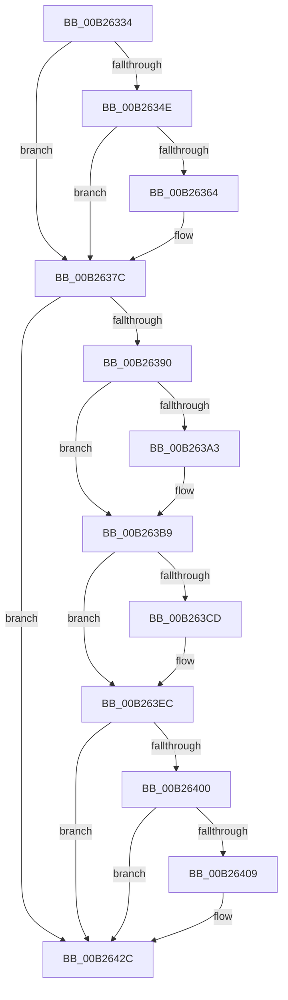

# sub_00B26334

- RVA: `0x00B26334`–`0x00B26445` (길이 `273` bytes)
- VA: `0x0000000140B26334`
- 실행 섹션: `PAGE`
- PDB 이름 있음: `아니요`; PDB Function 태그: `아니요`
- unwind 정보 RVA: `0x00092080`
- 디코드: `69`개 명령, `273/273` bytes 표시
- 미해석 바이트: `0` (있으면 어셈블리에 `.byte`로 보존)

> 이 문서는 커널 이미지의 기계어와 PDB 기호를 분석해 생성했습니다. 4번과 5번은 함수 원형과 자료형을 바이너리 사용 방식에서 추정한 C 해석이며 원본 소스 복구 결과는 아닙니다.

## 1. Dependencies

- 직접 호출 지점: **12**; 고유 호출 대상: **2**
- 직접 호출자로 확인된 함수: **0**
- RIP 상대 이미지 참조: **0**

### Outgoing calls
- `0x00B2633B` → [IoAddTriageDumpDataBlock](../../text/42/IoAddTriageDumpDataBlock_function_00428374.md) (function, `0x00428374`)
- `0x00B26352` → [IoAddTriageDumpDataBlock](../../text/42/IoAddTriageDumpDataBlock_function_00428374.md) (function, `0x00428374`)
- `0x00B26366` → [IoAddTriageDumpDataBlock](../../text/42/IoAddTriageDumpDataBlock_function_00428374.md) (function, `0x00428374`)
- `0x00B26377` → [IoAddTriageDumpDataBlock](../../text/42/IoAddTriageDumpDataBlock_function_00428374.md) (function, `0x00428374`)
- `0x00B26399` → [IoAddTriageDumpDataBlock](../../text/42/IoAddTriageDumpDataBlock_function_00428374.md) (function, `0x00428374`)
- `0x00B263A8` → [IoAddTriageDumpDataBlock](../../text/42/IoAddTriageDumpDataBlock_function_00428374.md) (function, `0x00428374`)
- `0x00B263B4` → [IoAddTriageDumpDataBlock](../../text/42/IoAddTriageDumpDataBlock_function_00428374.md) (function, `0x00428374`)
- `0x00B263CF` → [IoAddTriageDumpDataBlock](../../text/42/IoAddTriageDumpDataBlock_function_00428374.md) (function, `0x00428374`)
- `0x00B263E7` → [IoAddTriageDumpDataBlock](../../text/42/IoAddTriageDumpDataBlock_function_00428374.md) (function, `0x00428374`)
- `0x00B2640B` → [IoAddTriageDumpDataBlock](../../text/42/IoAddTriageDumpDataBlock_function_00428374.md) (function, `0x00428374`)
- `0x00B26427` → [IoAddTriageDumpDataBlock](../../text/42/IoAddTriageDumpDataBlock_function_00428374.md) (function, `0x00428374`)
- `0x00B2643F` → [KeBugCheckEx](../../text/4F/KeBugCheckEx_function_004FD660.md) (function, `0x004FD660`)

### Direct callers
- 이 함수 시작 RVA로 연결되는 직접 call은 확인되지 않았습니다. 간접 호출은 완전히 역산할 수 없습니다.

### Static image references
- 디코드된 RIP-relative 메모리 참조가 없습니다.

## 2. Other-region calls and transfers

- 다른 실행 섹션으로 향하는 call: **12**
  - `0x00B2633B` → [IoAddTriageDumpDataBlock](../../text/42/IoAddTriageDumpDataBlock_function_00428374.md) (`PAGE` → `.text`)
  - `0x00B26352` → [IoAddTriageDumpDataBlock](../../text/42/IoAddTriageDumpDataBlock_function_00428374.md) (`PAGE` → `.text`)
  - `0x00B26366` → [IoAddTriageDumpDataBlock](../../text/42/IoAddTriageDumpDataBlock_function_00428374.md) (`PAGE` → `.text`)
  - `0x00B26377` → [IoAddTriageDumpDataBlock](../../text/42/IoAddTriageDumpDataBlock_function_00428374.md) (`PAGE` → `.text`)
  - `0x00B26399` → [IoAddTriageDumpDataBlock](../../text/42/IoAddTriageDumpDataBlock_function_00428374.md) (`PAGE` → `.text`)
  - `0x00B263A8` → [IoAddTriageDumpDataBlock](../../text/42/IoAddTriageDumpDataBlock_function_00428374.md) (`PAGE` → `.text`)
  - `0x00B263B4` → [IoAddTriageDumpDataBlock](../../text/42/IoAddTriageDumpDataBlock_function_00428374.md) (`PAGE` → `.text`)
  - `0x00B263CF` → [IoAddTriageDumpDataBlock](../../text/42/IoAddTriageDumpDataBlock_function_00428374.md) (`PAGE` → `.text`)
  - `0x00B263E7` → [IoAddTriageDumpDataBlock](../../text/42/IoAddTriageDumpDataBlock_function_00428374.md) (`PAGE` → `.text`)
  - `0x00B2640B` → [IoAddTriageDumpDataBlock](../../text/42/IoAddTriageDumpDataBlock_function_00428374.md) (`PAGE` → `.text`)
  - `0x00B26427` → [IoAddTriageDumpDataBlock](../../text/42/IoAddTriageDumpDataBlock_function_00428374.md) (`PAGE` → `.text`)
  - `0x00B2643F` → [KeBugCheckEx](../../text/4F/KeBugCheckEx_function_004FD660.md) (`PAGE` → `.text`)
- 별도 외부 분기/꼬리 이동을 확인하지 못했습니다.

## 3. Assembly (complete function range)

```asm
00B26334  0F B7 53 02                     movzx edx, word ptr [rbx + 2]
00B26338  48 8B CB                        mov rcx, rbx
00B2633B  E8 34 20 90 FF                  call 0x140428374
00B26340  48 8B 4B 08                     mov rcx, qword ptr [rbx + 8]
00B26344  BD 02 00 00 00                  mov ebp, 2
00B26349  48 85 C9                        test rcx, rcx
00B2634C  74 2E                           je 0x140b2637c
00B2634E  0F BF 51 02                     movsx edx, word ptr [rcx + 2]
00B26352  E8 1D 20 90 FF                  call 0x140428374
00B26357  48 8B 4B 08                     mov rcx, qword ptr [rbx + 8]
00B2635B  48 83 C1 38                     add rcx, 0x38
00B2635F  66 39 31                        cmp word ptr [rcx], si
00B26362  74 18                           je 0x140b2637c
00B26364  8B D5                           mov edx, ebp
00B26366  E8 09 20 90 FF                  call 0x140428374
00B2636B  48 8B 4B 08                     mov rcx, qword ptr [rbx + 8]
00B2636F  0F B7 51 38                     movzx edx, word ptr [rcx + 0x38]
00B26373  48 8B 49 40                     mov rcx, qword ptr [rcx + 0x40]
00B26377  E8 F8 1F 90 FF                  call 0x140428374
00B2637C  48 8B 83 38 01 00 00            mov rax, qword ptr [rbx + 0x138]
00B26383  48 8B 48 28                     mov rcx, qword ptr [rax + 0x28]
00B26387  48 85 C9                        test rcx, rcx
00B2638A  0F 84 9C 00 00 00               je 0x140b2642c
00B26390  BA 88 03 00 00                  mov edx, 0x388
00B26395  48 8D 79 28                     lea rdi, [rcx + 0x28]
00B26399  E8 D6 1F 90 FF                  call 0x140428374
00B2639E  66 39 37                        cmp word ptr [rdi], si
00B263A1  74 16                           je 0x140b263b9
00B263A3  8B D5                           mov edx, ebp
00B263A5  48 8B CF                        mov rcx, rdi
00B263A8  E8 C7 1F 90 FF                  call 0x140428374
00B263AD  0F B7 17                        movzx edx, word ptr [rdi]
00B263B0  48 8B 4F 08                     mov rcx, qword ptr [rdi + 8]
00B263B4  E8 BB 1F 90 FF                  call 0x140428374
00B263B9  48 8B 83 38 01 00 00            mov rax, qword ptr [rbx + 0x138]
00B263C0  48 8B 48 28                     mov rcx, qword ptr [rax + 0x28]
00B263C4  48 83 C1 38                     add rcx, 0x38
00B263C8  66 39 31                        cmp word ptr [rcx], si
00B263CB  74 1F                           je 0x140b263ec
00B263CD  8B D5                           mov edx, ebp
00B263CF  E8 A0 1F 90 FF                  call 0x140428374
00B263D4  48 8B 83 38 01 00 00            mov rax, qword ptr [rbx + 0x138]
00B263DB  48 8B 48 28                     mov rcx, qword ptr [rax + 0x28]
00B263DF  0F B7 51 38                     movzx edx, word ptr [rcx + 0x38]
00B263E3  48 8B 49 40                     mov rcx, qword ptr [rcx + 0x40]
00B263E7  E8 88 1F 90 FF                  call 0x140428374
00B263EC  48 8B 83 38 01 00 00            mov rax, qword ptr [rbx + 0x138]
00B263F3  48 8B 48 28                     mov rcx, qword ptr [rax + 0x28]
00B263F7  48 8B 41 10                     mov rax, qword ptr [rcx + 0x10]
00B263FB  48 85 C0                        test rax, rax
00B263FE  74 2C                           je 0x140b2642c
00B26400  48 8D 48 38                     lea rcx, [rax + 0x38]
00B26404  66 39 31                        cmp word ptr [rcx], si
00B26407  74 23                           je 0x140b2642c
00B26409  8B D5                           mov edx, ebp
00B2640B  E8 64 1F 90 FF                  call 0x140428374
00B26410  48 8B 83 38 01 00 00            mov rax, qword ptr [rbx + 0x138]
00B26417  48 8B 48 28                     mov rcx, qword ptr [rax + 0x28]
00B2641B  48 8B 49 10                     mov rcx, qword ptr [rcx + 0x10]
00B2641F  0F B7 51 38                     movzx edx, word ptr [rcx + 0x38]
00B26423  48 8B 49 40                     mov rcx, qword ptr [rcx + 0x40]
00B26427  E8 48 1F 90 FF                  call 0x140428374
00B2642C  45 33 C9                        xor r9d, r9d
00B2642F  48 89 74 24 20                  mov qword ptr [rsp + 0x20], rsi
00B26434  4C 8B C3                        mov r8, rbx
00B26437  48 8B D5                        mov rdx, rbp
00B2643A  B9 CA 00 00 00                  mov ecx, 0xca
00B2643F  E8 1C 72 9D FF                  call 0x1404fd660
00B26444  CC                              int3
```

## 4. C-style interpretation (structured pseudocode)

```c
__int64 __fastcall sub_00B26334(__int64 a1, __int64 a2, __int64 a3, int a4)
{
    __int64 result;
    unsigned __int64 v_stack_p20;

    result = IoAddTriageDumpDataBlock(v_rbx, *(unsigned __int16 *)(v_rbx + 2), a3, a4);
    if (*(unsigned __int64 *)(v_rbx + 8) == 0) goto loc_00B2637C;
    result = IoAddTriageDumpDataBlock(*(unsigned __int64 *)(v_rbx + 8), (__int16)(*(unsigned __int16 *)(*(unsigned __int64 *)(v_rbx + 8) + 2)), a3, a4);
    a1 = (*(unsigned __int64 *)(v_rbx + 8)) + (56);
    if ((*(unsigned __int16 *)(a1)) != ((unsigned __int16)(v_rsi))) {
        a2 = 2;
        result = IoAddTriageDumpDataBlock(a1, a2, a3, a4);
        a1 = *(unsigned __int64 *)(v_rbx + 8);
        a2 = *(unsigned __int16 *)(a1 + 56);
        a1 = *(unsigned __int64 *)(a1 + 64);
        result = IoAddTriageDumpDataBlock(a1, a2, a3, a4);
    }
    if (*(unsigned __int64 *)(*(unsigned __int64 *)(v_rbx + 312) + 40) == 0) goto loc_00B2642C;
    result = IoAddTriageDumpDataBlock(*(unsigned __int64 *)(*(unsigned __int64 *)(v_rbx + 312) + 40), 904, a3, a4);
    if ((*(unsigned __int16 *)(*(unsigned __int64 *)(*(unsigned __int64 *)(v_rbx + 312) + 40) + 40)) != ((unsigned __int16)(v_rsi))) {
        a2 = 2;
        a1 = *(unsigned __int64 *)(*(unsigned __int64 *)(v_rbx + 312) + 40) + 40;
        result = IoAddTriageDumpDataBlock(a1, a2, a3, a4);
        a2 = *(unsigned __int16 *)(*(unsigned __int64 *)(*(unsigned __int64 *)(v_rbx + 312) + 40) + 40);
        a1 = *(unsigned __int64 *)(*(unsigned __int64 *)(*(unsigned __int64 *)(v_rbx + 312) + 40) + 40 + 8);
        result = IoAddTriageDumpDataBlock(a1, a2, a3, a4);
    }
    a1 = (*(unsigned __int64 *)(*(unsigned __int64 *)(v_rbx + 312) + 40)) + (56);
    result = *(unsigned __int64 *)(v_rbx + 312);
    if ((*(unsigned __int16 *)(a1)) != ((unsigned __int16)(v_rsi))) {
        a2 = 2;
        result = IoAddTriageDumpDataBlock(a1, a2, a3, a4);
        result = *(unsigned __int64 *)(v_rbx + 312);
        a1 = *(unsigned __int64 *)(result + 40);
        a2 = *(unsigned __int16 *)(a1 + 56);
        a1 = *(unsigned __int64 *)(a1 + 64);
        result = IoAddTriageDumpDataBlock(a1, a2, a3, a4);
    }
    if (*(unsigned __int64 *)(*(unsigned __int64 *)(*(unsigned __int64 *)(v_rbx + 312) + 40) + 16) == 0) goto loc_00B2642C;
    result = *(unsigned __int64 *)(*(unsigned __int64 *)(*(unsigned __int64 *)(v_rbx + 312) + 40) + 16);
    if ((*(unsigned __int16 *)(*(unsigned __int64 *)(*(unsigned __int64 *)(*(unsigned __int64 *)(v_rbx + 312) + 40) + 16) + 56)) != ((unsigned __int16)(v_rsi))) {
        a2 = 2;
        result = IoAddTriageDumpDataBlock(*(unsigned __int64 *)(*(unsigned __int64 *)(*(unsigned __int64 *)(v_rbx + 312) + 40) + 16) + 56, a2, a3, a4);
        result = *(unsigned __int64 *)(v_rbx + 312);
        a1 = *(unsigned __int64 *)(result + 40);
        a1 = *(unsigned __int64 *)(a1 + 16);
        a2 = *(unsigned __int16 *)(a1 + 56);
        a1 = *(unsigned __int64 *)(a1 + 64);
        result = IoAddTriageDumpDataBlock(a1, a2, a3, a4);
    }
    a4 = 0;
    v_stack_p20 = v_rsi;
    result = KeBugCheckEx(202, 2, v_rbx, a4);
    return result;
}
```

## 5. (Beta) C Style

```c
int64_t sub_00B26334(int64_t Arg1, int64_t Arg2, int64_t Arg3, int32_t Arg4)
{
    int64_t result;
    uint64_t v_stack_p20;

    result = IoAddTriageDumpDataBlock(local_rbx, *(uint16_t *)(local_rbx + 0x2), Arg3, Arg4);
    if (*(uint64_t *)(local_rbx + 0x8) == 0) goto loc_00B2637C;
    result = IoAddTriageDumpDataBlock(*(uint64_t *)(local_rbx + 0x8), (int16_t)(*(uint16_t *)(*(uint64_t *)(local_rbx + 0x8) + 0x2)), Arg3, Arg4);
    Arg1 = (*(uint64_t *)(local_rbx + 0x8)) + (56);
    if ((*(uint16_t *)(Arg1)) != ((uint16_t)(local_rsi))) {
        Arg2 = 2;
        result = IoAddTriageDumpDataBlock(Arg1, Arg2, Arg3, Arg4);
        Arg1 = *(uint64_t *)(local_rbx + 0x8);
        Arg2 = *(uint16_t *)(Arg1 + 0x38);
        Arg1 = *(uint64_t *)(Arg1 + 0x40);
        result = IoAddTriageDumpDataBlock(Arg1, Arg2, Arg3, Arg4);
    }
    if (*(uint64_t *)(*(uint64_t *)(local_rbx + 0x138) + 0x28) == 0) goto loc_00B2642C;
    result = IoAddTriageDumpDataBlock(*(uint64_t *)(*(uint64_t *)(local_rbx + 0x138) + 0x28), 904, Arg3, Arg4);
    if ((*(uint16_t *)(*(uint64_t *)(*(uint64_t *)(local_rbx + 0x138) + 0x28) + 0x28)) != ((uint16_t)(local_rsi))) {
        Arg2 = 2;
        Arg1 = *(uint64_t *)(*(uint64_t *)(local_rbx + 0x138) + 0x28) + 40;
        result = IoAddTriageDumpDataBlock(Arg1, Arg2, Arg3, Arg4);
        Arg2 = *(uint16_t *)(*(uint64_t *)(*(uint64_t *)(local_rbx + 0x138) + 0x28) + 0x28);
        Arg1 = *(uint64_t *)(*(uint64_t *)(*(uint64_t *)(local_rbx + 0x138) + 0x28) + 0x28 + 0x8);
        result = IoAddTriageDumpDataBlock(Arg1, Arg2, Arg3, Arg4);
    }
    Arg1 = (*(uint64_t *)(*(uint64_t *)(local_rbx + 0x138) + 0x28)) + (56);
    result = *(uint64_t *)(local_rbx + 0x138);
    if ((*(uint16_t *)(Arg1)) != ((uint16_t)(local_rsi))) {
        Arg2 = 2;
        result = IoAddTriageDumpDataBlock(Arg1, Arg2, Arg3, Arg4);
        result = *(uint64_t *)(local_rbx + 0x138);
        Arg1 = *(uint64_t *)(result + 0x28);
        Arg2 = *(uint16_t *)(Arg1 + 0x38);
        Arg1 = *(uint64_t *)(Arg1 + 0x40);
        result = IoAddTriageDumpDataBlock(Arg1, Arg2, Arg3, Arg4);
    }
    if (*(uint64_t *)(*(uint64_t *)(*(uint64_t *)(local_rbx + 0x138) + 0x28) + 0x10) == 0) goto loc_00B2642C;
    result = *(uint64_t *)(*(uint64_t *)(*(uint64_t *)(local_rbx + 0x138) + 0x28) + 0x10);
    if ((*(uint16_t *)(*(uint64_t *)(*(uint64_t *)(*(uint64_t *)(local_rbx + 0x138) + 0x28) + 0x10) + 0x38)) != ((uint16_t)(local_rsi))) {
        Arg2 = 2;
        result = IoAddTriageDumpDataBlock(*(uint64_t *)(*(uint64_t *)(*(uint64_t *)(local_rbx + 0x138) + 0x28) + 0x10) + 56, Arg2, Arg3, Arg4);
        result = *(uint64_t *)(local_rbx + 0x138);
        Arg1 = *(uint64_t *)(result + 0x28);
        Arg1 = *(uint64_t *)(Arg1 + 0x10);
        Arg2 = *(uint16_t *)(Arg1 + 0x38);
        Arg1 = *(uint64_t *)(Arg1 + 0x40);
        result = IoAddTriageDumpDataBlock(Arg1, Arg2, Arg3, Arg4);
    }
    Arg4 = 0;
    v_stack_p20 = local_rsi;
    result = KeBugCheckEx(202, 2, local_rbx, Arg4);
    return result;
}
```

## 6. Execution-region graph

[열기: 2D/3D 그래프와 함수 탐색 컨트롤 패널](../../../control-panel.html?section=page&rva=0x00B26334&view=graph)

- 2D 그래프는 위에서 아래로 흐르고, 3D 그래프는 빈 공간을 드래그해 회전합니다. Shift+드래그는 이동, 휠은 확대·축소, 함수 노드 선택은 대상 보고서 이동입니다.

### Static fallback


