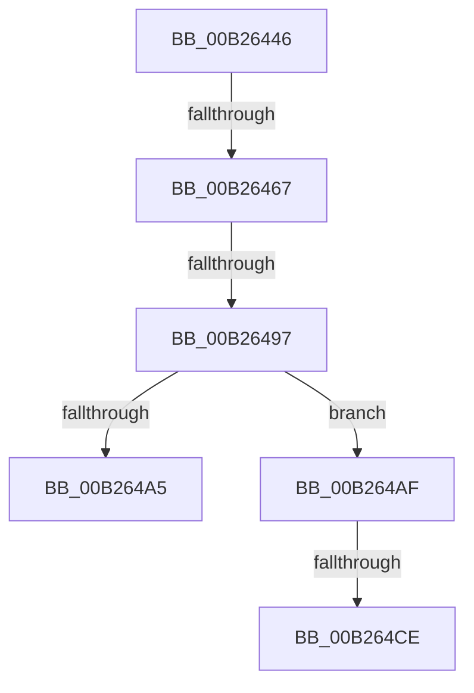

# sub_00B26446

- RVA: `0x00B26446`–`0x00B264E7` (길이 `161` bytes)
- VA: `0x0000000140B26446`
- 실행 섹션: `PAGE`
- PDB 이름 있음: `아니요`; PDB Function 태그: `아니요`
- unwind 정보 RVA: `0x00092100`
- 디코드: `37`개 명령, `161/161` bytes 표시
- 미해석 바이트: `0` (있으면 어셈블리에 `.byte`로 보존)

> 이 문서는 커널 이미지의 기계어와 PDB 기호를 분석해 생성했습니다. 4번과 5번은 함수 원형과 자료형을 바이너리 사용 방식에서 추정한 C 해석이며 원본 소스 복구 결과는 아닙니다.

## 1. Dependencies

- 직접 호출 지점: **4**; 고유 호출 대상: **4**
- 직접 호출자로 확인된 함수: **0**
- RIP 상대 이미지 참조: **4**

### Outgoing calls
- `0x00B26456` → [ExAllocatePool2](../../poolcode/B8/ExAllocatePool2_function_00B820F0.md) (function, `0x00B820F0`)
- `0x00B26488` → [PnpInitializeNotifyEntry](../A4/PnpInitializeNotifyEntry_function_00A456D0.md) (function, `0x00A456D0`)
- `0x00B2649A` → [PnpDeferNotification](../95/PnpDeferNotification_function_00951888.md) (function, `0x00951888`)
- `0x00B264B2` → [ExAcquireFastMutex](../../text/20/ExAcquireFastMutex_function_0020E5A0.md) (function, `0x0020E5A0`)

### Direct callers
- 이 함수 시작 RVA로 연결되는 직접 call은 확인되지 않았습니다. 간접 호출은 완전히 역산할 수 없습니다.

### Static image references
- `0x00B2646B` → RVA `0x00F8CCE0` (`.data`; read)
- `0x00B264B7` → RVA `0x00FD9FE0` (`PAGEDATA`; read)
- `0x00B264BE` → RVA `0x00FD9FD8` (`PAGEDATA`; read)
- `0x00B264DB` → RVA `0x00FD9FE0` (`PAGEDATA`; write)

## 2. Other-region calls and transfers

- 다른 실행 섹션으로 향하는 call: **2**
  - `0x00B26456` → [ExAllocatePool2](../../poolcode/B8/ExAllocatePool2_function_00B820F0.md) (`PAGE` → `POOLCODE`)
  - `0x00B264B2` → [ExAcquireFastMutex](../../text/20/ExAcquireFastMutex_function_0020E5A0.md) (`PAGE` → `.text`)
- call이 아닌 외부 분기/꼬리 이동: **5**
  - `0x00B26461` → [IoRegisterPlugPlayNotification + 0x3E3](../95/IoRegisterPlugPlayNotification_function_009535A0.md) (`tail-transfer`)
  - `0x00B26491` → [IoRegisterPlugPlayNotification + 0x14E](../95/IoRegisterPlugPlayNotification_function_009535A0.md) (`tail-transfer`)
  - `0x00B264AA` → [IoRegisterPlugPlayNotification + 0x39A](../95/IoRegisterPlugPlayNotification_function_009535A0.md) (`tail-transfer`)
  - `0x00B264C8` → [IoRegisterPlugPlayNotification + 0x132](../95/IoRegisterPlugPlayNotification_function_009535A0.md) (`tail-transfer`)
  - `0x00B264E2` → [IoRegisterPlugPlayNotification + 0x388](../95/IoRegisterPlugPlayNotification_function_009535A0.md) (`tail-transfer`)

## 3. Assembly (complete function range)

```asm
00B26446  BA 50 00 00 00                  mov edx, 0x50
00B2644B  B9 00 01 00 00                  mov ecx, 0x100
00B26450  41 B8 50 6E 70 39               mov r8d, 0x39706e50
00B26456  E8 95 BC 05 00                  call 0x140b820f0
00B2645B  48 8B F8                        mov rdi, rax
00B2645E  48 85 C0                        test rax, rax
00B26461  0F 84 1C D5 E2 FF               je 0x140953983
00B26467  4C 8B 4D 77                     mov r9, qword ptr [rbp + 0x77]
00B2646B  4C 8D 2D 6E 68 46 00            lea r13, [rip + 0x46686e]
00B26472  4C 8B 45 6F                     mov r8, qword ptr [rbp + 0x6f]
00B26476  BA 01 00 00 00                  mov edx, 1
00B2647B  4C 89 6C 24 28                  mov qword ptr [rsp + 0x28], r13
00B26480  48 8B C8                        mov rcx, rax
00B26483  48 89 74 24 20                  mov qword ptr [rsp + 0x20], rsi
00B26488  E8 43 F2 F1 FF                  call 0x140a456d0
00B2648D  8B D8                           mov ebx, eax
00B2648F  85 C0                           test eax, eax
00B26491  0F 88 57 D2 E2 FF               js 0x1409536ee
00B26497  48 8B CF                        mov rcx, rdi
00B2649A  E8 E9 B3 E2 FF                  call 0x140951888
00B2649F  8B D8                           mov ebx, eax
00B264A1  85 C0                           test eax, eax
00B264A3  79 0A                           jns 0x140b264af
00B264A5  BA 50 6E 70 39                  mov edx, 0x39706e50
00B264AA  E9 8B D4 E2 FF                  jmp 0x14095393a
00B264AF  49 8B CD                        mov rcx, r13
00B264B2  E8 E9 80 6E FF                  call 0x14020e5a0
00B264B7  48 8B 05 22 3B 4B 00            mov rax, qword ptr [rip + 0x4b3b22]
00B264BE  48 8D 15 13 3B 4B 00            lea rdx, [rip + 0x4b3b13]
00B264C5  48 39 10                        cmp qword ptr [rax], rdx
00B264C8  0F 85 04 D2 E2 FF               jne 0x1409536d2
00B264CE  48 89 17                        mov qword ptr [rdi], rdx
00B264D1  49 8B CD                        mov rcx, r13
00B264D4  48 89 47 08                     mov qword ptr [rdi + 8], rax
00B264D8  48 89 38                        mov qword ptr [rax], rdi
00B264DB  48 89 3D FE 3A 4B 00            mov qword ptr [rip + 0x4b3afe], rdi
00B264E2  E9 41 D4 E2 FF                  jmp 0x140953928
```

## 4. C-style interpretation (structured pseudocode)

```c
__int64 __fastcall sub_00B26446(void)
{
    __int64 result;
    unsigned __int64 v_stack_p20;
    unsigned __int64 v_stack_p28;

    result = ExAllocatePool2(256, 80, (unsigned int)(0x39706E50ULL), a4);
    v_stack_p28 = v_rip + 4614254;
    v_stack_p20 = v_rsi;
    result = PnpInitializeNotifyEntry(result, 1, *(unsigned __int64 *)(v_rbp + 111), *(unsigned __int64 *)(v_rbp + 119));
    result = PnpDeferNotification(result, 1, *(unsigned __int64 *)(v_rbp + 111), *(unsigned __int64 *)(v_rbp + 119));
    if (!sign_flag) goto loc_00B264AF;
loc_00B264AF:
    result = ExAcquireFastMutex(v_rip + 4614254, (unsigned int)(0x39706E50ULL), *(unsigned __int64 *)(v_rbp + 111), *(unsigned __int64 *)(v_rbp + 119));
    *(unsigned __int64 *)(result) = v_rip + 4930323;
    *(unsigned __int64 *)(result + 8) = *(unsigned __int64 *)(v_rip + 4930338);
    *(unsigned __int64 *)(*(unsigned __int64 *)(v_rip + 4930338)) = result;
    *(unsigned __int64 *)(v_rip + 4930302) = result;
}
```

## 5. (Beta) C Style

```c
void sub_00B26446(void)
{
    int64_t result;
    uint64_t v_stack_p20;
    uint64_t v_stack_p28;

    result = ExAllocatePool2(256, 80, (uint32_t)(0x39706E50ULL), a4);
    v_stack_p28 = v_rip + 4614254;
    v_stack_p20 = local_rsi;
    result = PnpInitializeNotifyEntry(result, 1, *(uint64_t *)(local_rbp + 0x6F), *(uint64_t *)(local_rbp + 0x77));
    result = PnpDeferNotification(result, 1, *(uint64_t *)(local_rbp + 0x6F), *(uint64_t *)(local_rbp + 0x77));
    if (!sign_flag) goto loc_00B264AF;
loc_00B264AF:
    result = ExAcquireFastMutex(v_rip + 4614254, (uint32_t)(0x39706E50ULL), *(uint64_t *)(local_rbp + 0x6F), *(uint64_t *)(local_rbp + 0x77));
    *(uint64_t *)(result) = v_rip + 4930323;
    *(uint64_t *)(result + 0x8) = *(uint64_t *)(v_rip + 0x4B3B22);
    *(uint64_t *)(*(uint64_t *)(v_rip + 0x4B3B22)) = result;
    *(uint64_t *)(v_rip + 0x4B3AFE) = result;
}
```

## 6. Execution-region graph

[열기: 2D/3D 그래프와 함수 탐색 컨트롤 패널](../../../control-panel.html?section=page&rva=0x00B26446&view=graph)

- 2D 그래프는 위에서 아래로 흐르고, 3D 그래프는 빈 공간을 드래그해 회전합니다. Shift+드래그는 이동, 휠은 확대·축소, 함수 노드 선택은 대상 보고서 이동입니다.

### Static fallback


