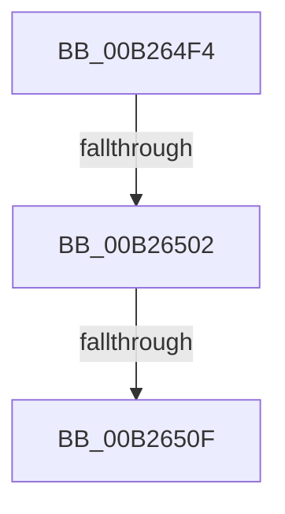

# sub_00B264F4

- RVA: `0x00B264F4`–`0x00B26560` (길이 `108` bytes)
- VA: `0x0000000140B264F4`
- 실행 섹션: `PAGE`
- PDB 이름 있음: `아니요`; PDB Function 태그: `아니요`
- unwind 정보 RVA: `0x000921F0`
- 디코드: `24`개 명령, `108/108` bytes 표시
- 미해석 바이트: `0` (있으면 어셈블리에 `.byte`로 보존)

> 이 문서는 커널 이미지의 기계어와 PDB 기호를 분석해 생성했습니다. 4번과 5번은 함수 원형과 자료형을 바이너리 사용 방식에서 추정한 C 해석이며 원본 소스 복구 결과는 아닙니다.

## 1. Dependencies

- 직접 호출 지점: **3**; 고유 호출 대상: **3**
- 직접 호출자로 확인된 함수: **0**
- RIP 상대 이미지 참조: **1**

### Outgoing calls
- `0x00B2653E` → [PnpNotifyTargetDeviceChangeNotifyEntry](../72/PnpNotifyTargetDeviceChangeNotifyEntry_function_00729D54.md) (function, `0x00729D54`)
- `0x00B26547` → [ObfDereferenceObject](../../text/2F/ObfDereferenceObject_function_002F9350.md) (function, `0x002F9350`)
- `0x00B26555` → [PnpDereferenceNotify](../95/PnpDereferenceNotify_function_00954A04.md) (function, `0x00954A04`)

### Direct callers
- 이 함수 시작 RVA로 연결되는 직접 call은 확인되지 않았습니다. 간접 호출은 완전히 역산할 수 없습니다.

### Static image references
- `0x00B2651F` → RVA `0x0001A220` (`.rdata`; read)

## 2. Other-region calls and transfers

- 다른 실행 섹션으로 향하는 call: **1**
  - `0x00B26547` → [ObfDereferenceObject](../../text/2F/ObfDereferenceObject_function_002F9350.md) (`PAGE` → `.text`)
- call이 아닌 외부 분기/꼬리 이동: **3**
  - `0x00B264FC` → [PnpProcessDeferredRegistrations + 0x13E](../95/PnpProcessDeferredRegistrations_function_009545BC.md) (`tail-transfer`)
  - `0x00B26509` → [PnpProcessDeferredRegistrations + 0x13E](../95/PnpProcessDeferredRegistrations_function_009545BC.md) (`tail-transfer`)
  - `0x00B2655B` → [PnpProcessDeferredRegistrations + 0x79](../95/PnpProcessDeferredRegistrations_function_009545BC.md) (`tail-transfer`)

## 3. Assembly (complete function range)

```asm
00B264F4  48 8D 45 C0                     lea rax, [rbp - 0x40]
00B264F8  48 39 43 08                     cmp qword ptr [rbx + 8], rax
00B264FC  0F 85 F8 E1 E2 FF               jne 0x1409546fa
00B26502  48 8B 03                        mov rax, qword ptr [rbx]
00B26505  48 39 58 08                     cmp qword ptr [rax + 8], rbx
00B26509  0F 85 EB E1 E2 FF               jne 0x1409546fa
00B2650F  48 8D 4D C0                     lea rcx, [rbp - 0x40]
00B26513  48 89 45 C0                     mov qword ptr [rbp - 0x40], rax
00B26517  48 89 48 08                     mov qword ptr [rax + 8], rcx
00B2651B  4C 8D 4D D4                     lea r9, [rbp - 0x2c]
00B2651F  0F 10 05 FA 3C 4F FF            movups xmm0, xmmword ptr [rip - 0xb0c306]
00B26526  4C 8D 45 D0                     lea r8, [rbp - 0x30]
00B2652A  C7 45 D8 01 00 20 00            mov dword ptr [rbp - 0x28], 0x200001
00B26531  48 8D 55 D8                     lea rdx, [rbp - 0x28]
00B26535  48 8D 4B A0                     lea rcx, [rbx - 0x60]
00B26539  F3 0F 7F 45 DC                  movdqu xmmword ptr [rbp - 0x24], xmm0
00B2653E  E8 11 38 C0 FF                  call 0x140729d54
00B26543  48 8B 4B F8                     mov rcx, qword ptr [rbx - 8]
00B26547  E8 04 2E 7D FF                  call 0x1402f9350
00B2654C  48 83 63 F8 00                  and qword ptr [rbx - 8], 0
00B26551  48 8D 4B A0                     lea rcx, [rbx - 0x60]
00B26555  E8 AA E4 E2 FF                  call 0x140954a04
00B2655A  90                              nop
00B2655B  E9 D5 E0 E2 FF                  jmp 0x140954635
```

## 4. C-style interpretation (structured pseudocode)

```c
__int64 __fastcall sub_00B264F4(void)
{
    __int64 result;

    *(unsigned __int64 *)(v_rbp - 64) = *(unsigned __int64 *)(v_rbx);
    *(unsigned __int64 *)(*(unsigned __int64 *)(v_rbx) + 8) = v_rbp - 64;
    *(unsigned int *)(v_rbp - 40) = 0x200001ULL;
    *(unsigned __int64 *)(v_rbp - 36) = v_xmm0;
    result = PnpNotifyTargetDeviceChangeNotifyEntry(v_rbx - 96, v_rbp - 40, v_rbp - 48, v_rbp - 44);
    result = ObfDereferenceObject(*(unsigned __int64 *)(v_rbx - 8), v_rbp - 40, v_rbp - 48, v_rbp - 44);
    result = PnpDereferenceNotify(v_rbx - 96, v_rbp - 40, v_rbp - 48, v_rbp - 44);
}
```

## 5. (Beta) C Style

```c
void sub_00B264F4(void)
{
    int64_t result;

    *(uint64_t *)(local_rbp - 0x40) = *(uint64_t *)(local_rbx);
    *(uint64_t *)(*(uint64_t *)(local_rbx) + 0x8) = local_rbp - 64;
    *(uint32_t *)(local_rbp - 0x28) = 0x200001ULL;
    *(uint64_t *)(local_rbp - 0x24) = v_xmm0;
    result = PnpNotifyTargetDeviceChangeNotifyEntry(local_rbx - 96, local_rbp - 40, local_rbp - 48, local_rbp - 44);
    result = ObfDereferenceObject(*(uint64_t *)(local_rbx - 0x8), local_rbp - 40, local_rbp - 48, local_rbp - 44);
    result = PnpDereferenceNotify(local_rbx - 96, local_rbp - 40, local_rbp - 48, local_rbp - 44);
}
```

## 6. Execution-region graph

[열기: 2D/3D 그래프와 함수 탐색 컨트롤 패널](../../../control-panel.html?section=page&rva=0x00B264F4&view=graph)

- 2D 그래프는 위에서 아래로 흐르고, 3D 그래프는 빈 공간을 드래그해 회전합니다. Shift+드래그는 이동, 휠은 확대·축소, 함수 노드 선택은 대상 보고서 이동입니다.

### Static fallback


