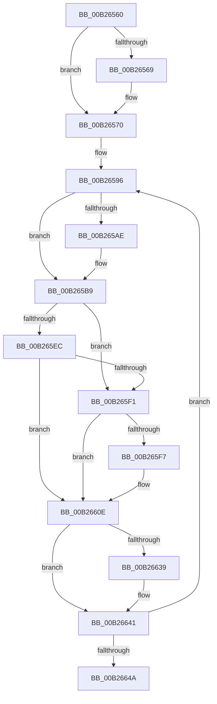

# sub_00B26560

- RVA: `0x00B26560`–`0x00B26652` (길이 `242` bytes)
- VA: `0x0000000140B26560`
- 실행 섹션: `PAGE`
- PDB 이름 있음: `아니요`; PDB Function 태그: `아니요`
- unwind 정보 RVA: `0x00092224`
- 디코드: `59`개 명령, `242/242` bytes 표시
- 미해석 바이트: `0` (있으면 어셈블리에 `.byte`로 보존)

> 이 문서는 커널 이미지의 기계어와 PDB 기호를 분석해 생성했습니다. 4번과 5번은 함수 원형과 자료형을 바이너리 사용 방식에서 추정한 C 해석이며 원본 소스 복구 결과는 아닙니다.

## 1. Dependencies

- 직접 호출 지점: **12**; 고유 호출 대상: **10**
- 직접 호출자로 확인된 함수: **0**
- RIP 상대 이미지 참조: **2**

### Outgoing calls
- `0x00B26586` → [ExAcquireFastMutex](../../text/20/ExAcquireFastMutex_function_0020E5A0.md) (function, `0x0020E5A0`)
- `0x00B2659C` → [PsGetCurrentServerSilo](../../text/22/PsGetCurrentServerSilo_function_00225710.md) (function, `0x00225710`)
- `0x00B265A4` → [PsGetServerSiloServiceSessionId](../../text/45/PsGetServerSiloServiceSessionId_function_0045ED00.md) (function, `0x0045ED00`)
- `0x00B265B2` → [IopGetSessionIdFromPDO](../8F/IopGetSessionIdFromPDO_function_008FFDD8.md) (function, `0x008FFDD8`)
- `0x00B265C5` → [ExReleaseFastMutex](../../text/25/ExReleaseFastMutex_function_002519C0.md) (function, `0x002519C0`)
- `0x00B265E2` → [ExAcquireResourceExclusiveLite](../../text/21/ExAcquireResourceExclusiveLite_function_00214E20.md) (function, `0x00214E20`)
- `0x00B26609` → [PnpNotifyDriverCallback](../95/PnpNotifyDriverCallback_function_00954AA0.md) (function, `0x00954AA0`)
- `0x00B26612` → [ExReleaseResourceLite](../../text/25/ExReleaseResourceLite_function_0025FA10.md) (function, `0x0025FA10`)
- `0x00B26617` → [KeLeaveCriticalRegion](../../text/25/KeLeaveCriticalRegion_function_0025D8B0.md) (function, `0x0025D8B0`)
- `0x00B26623` → [ExAcquireFastMutex](../../text/20/ExAcquireFastMutex_function_0020E5A0.md) (function, `0x0020E5A0`)
- `0x00B2662F` → [PnpDereferenceNotify](../95/PnpDereferenceNotify_function_00954A04.md) (function, `0x00954A04`)
- `0x00B2663C` → [PnpDereferenceNotify](../95/PnpDereferenceNotify_function_00954A04.md) (function, `0x00954A04`)

### Direct callers
- 이 함수 시작 RVA로 연결되는 직접 call은 확인되지 않았습니다. 간접 호출은 완전히 역산할 수 없습니다.

### Static image references
- `0x00B26570` → RVA `0x00012320` (`.rdata`; read)
- `0x00B26577` → RVA `0x00F8CDA0` (`.data`; read)

## 2. Other-region calls and transfers

- 다른 실행 섹션으로 향하는 call: **8**
  - `0x00B26586` → [ExAcquireFastMutex](../../text/20/ExAcquireFastMutex_function_0020E5A0.md) (`PAGE` → `.text`)
  - `0x00B2659C` → [PsGetCurrentServerSilo](../../text/22/PsGetCurrentServerSilo_function_00225710.md) (`PAGE` → `.text`)
  - `0x00B265A4` → [PsGetServerSiloServiceSessionId](../../text/45/PsGetServerSiloServiceSessionId_function_0045ED00.md) (`PAGE` → `.text`)
  - `0x00B265C5` → [ExReleaseFastMutex](../../text/25/ExReleaseFastMutex_function_002519C0.md) (`PAGE` → `.text`)
  - `0x00B265E2` → [ExAcquireResourceExclusiveLite](../../text/21/ExAcquireResourceExclusiveLite_function_00214E20.md) (`PAGE` → `.text`)
  - `0x00B26612` → [ExReleaseResourceLite](../../text/25/ExReleaseResourceLite_function_0025FA10.md) (`PAGE` → `.text`)
  - `0x00B26617` → [KeLeaveCriticalRegion](../../text/25/KeLeaveCriticalRegion_function_0025D8B0.md) (`PAGE` → `.text`)
  - `0x00B26623` → [ExAcquireFastMutex](../../text/20/ExAcquireFastMutex_function_0020E5A0.md) (`PAGE` → `.text`)
- call이 아닌 외부 분기/꼬리 이동: **1**
  - `0x00B2664D` → [PnpNotifyTargetDeviceChange + 0x194](../95/PnpNotifyTargetDeviceChange_function_00954790.md) (`tail-transfer`)

## 3. Assembly (complete function range)

```asm
00B26560  48 8B 4D D7                     mov rcx, qword ptr [rbp - 0x29]
00B26564  48 85 C9                        test rcx, rcx
00B26567  74 07                           je 0x140b26570
00B26569  48 8B 47 30                     mov rax, qword ptr [rdi + 0x30]
00B2656D  48 89 01                        mov qword ptr [rcx], rax
00B26570  0F 10 05 A9 BD 4E FF            movups xmm0, xmmword ptr [rip - 0xb14257]
00B26577  48 8D 0D 22 68 46 00            lea rcx, [rip + 0x466822]
00B2657E  4C 8B FF                        mov r15, rdi
00B26581  F3 0F 7F 45 EB                  movdqu xmmword ptr [rbp - 0x15], xmm0
00B26586  E8 15 80 6E FF                  call 0x14020e5a0
00B2658B  4C 8B 6D DF                     mov r13, qword ptr [rbp - 0x21]
00B2658F  49 81 C5 D8 01 00 00            add r13, 0x1d8
00B26596  83 CB FF                        or ebx, 0xffffffff
00B26599  4C 8B E7                        mov r12, rdi
00B2659C  E8 6F F1 6F FF                  call 0x140225710
00B265A1  48 8B C8                        mov rcx, rax
00B265A4  E8 57 87 93 FF                  call 0x14045ed00
00B265A9  39 47 14                        cmp dword ptr [rdi + 0x14], eax
00B265AC  74 0B                           je 0x140b265b9
00B265AE  48 8B 4D BF                     mov rcx, qword ptr [rbp - 0x41]
00B265B2  E8 21 98 DD FF                  call 0x1408ffdd8
00B265B7  8B D8                           mov ebx, eax
00B265B9  66 44 01 77 38                  add word ptr [rdi + 0x38], r14w
00B265BE  48 8D 0D DB 67 46 00            lea rcx, [rip + 0x4667db]
00B265C5  E8 F6 B3 72 FF                  call 0x1402519c0
00B265CA  65 48 8B 04 25 88 01 00 00      mov rax, qword ptr gs:[0x188]
00B265D3  41 8A D6                        mov dl, r14b
00B265D6  66 FF 88 E4 01 00 00            dec word ptr [rax + 0x1e4]
00B265DD  90                              nop
00B265DE  48 8B 4F 48                     mov rcx, qword ptr [rdi + 0x48]
00B265E2  E8 39 E8 6E FF                  call 0x140214e20
00B265E7  83 FB FF                        cmp ebx, -1
00B265EA  74 05                           je 0x140b265f1
00B265EC  39 5F 14                        cmp dword ptr [rdi + 0x14], ebx
00B265EF  75 1D                           jne 0x140b2660e
00B265F1  40 38 77 3A                     cmp byte ptr [rdi + 0x3a], sil
00B265F5  75 17                           jne 0x140b2660e
00B265F7  48 8B 47 50                     mov rax, qword ptr [rdi + 0x50]
00B265FB  48 8D 55 E7                     lea rdx, [rbp - 0x19]
00B265FF  45 33 C0                        xor r8d, r8d
00B26602  48 89 45 FF                     mov qword ptr [rbp - 1], rax
00B26606  48 8B CF                        mov rcx, rdi
00B26609  E8 92 E4 E2 FF                  call 0x140954aa0
00B2660E  48 8B 4F 48                     mov rcx, qword ptr [rdi + 0x48]
00B26612  E8 F9 93 73 FF                  call 0x14025fa10
00B26617  E8 94 72 73 FF                  call 0x14025d8b0
00B2661C  48 8D 0D 7D 67 46 00            lea rcx, [rip + 0x46677d]
00B26623  E8 78 7F 6E FF                  call 0x14020e5a0
00B26628  48 8B 7F 08                     mov rdi, qword ptr [rdi + 8]
00B2662C  49 8B CC                        mov rcx, r12
00B2662F  E8 D0 E3 E2 FF                  call 0x140954a04
00B26634  4D 3B E7                        cmp r12, r15
00B26637  75 08                           jne 0x140b26641
00B26639  49 8B CF                        mov rcx, r15
00B2663C  E8 C3 E3 E2 FF                  call 0x140954a04
00B26641  49 3B FD                        cmp rdi, r13
00B26644  0F 85 4C FF FF FF               jne 0x140b26596
00B2664A  8B 75 B7                        mov esi, dword ptr [rbp - 0x49]
00B2664D  E9 D2 E2 E2 FF                  jmp 0x140954924
```

## 4. C-style interpretation (structured pseudocode)

```c
__int64 __fastcall sub_00B26560(__int64 a1, __int64 a2, int a3)
{
    __int64 result;
    __int64 v_r13;
    __int64 v_rbx;

    if (*(unsigned __int64 *)(v_rbp - 41) != 0) {
        result = *(unsigned __int64 *)(v_rdi + 48);
        *(unsigned __int64 *)(*(unsigned __int64 *)(v_rbp - 41)) = result;
    }
    *(unsigned __int64 *)(v_rbp - 21) = v_xmm0;
    result = ExAcquireFastMutex(v_rip + 4614178, a2, a3, a4);
    v_r13 = (*(unsigned __int64 *)(v_rbp - 33)) + (472);
loc_00B26596:
    v_rbx = (unsigned int)((v_rbx) | (0xFFFFFFFFULL));
    result = PsGetCurrentServerSilo(v_rip + 4614178, a2, a3, a4);
    result = PsGetServerSiloServiceSessionId(result, a2, a3, a4);
    if ((*(unsigned int *)(v_rdi + 20)) != ((unsigned int)(result))) {
        a1 = *(unsigned __int64 *)(v_rbp - 65);
        result = IopGetSessionIdFromPDO(a1, a2, a3, a4);
        v_rbx = (unsigned int)(result);
    }
    result = ExReleaseFastMutex(v_rip + 4614107, a2, a3, a4);
    result = ExAcquireResourceExclusiveLite(*(unsigned __int64 *)(v_rdi + 72), (unsigned __int8)(v_r14), a3, a4);
    if (((unsigned int)(v_rbx)) == -1) goto loc_00B265F1;
    if ((*(unsigned int *)(v_rdi + 20)) != ((unsigned int)(v_rbx))) goto loc_00B2660E;
loc_00B265F1:
    if ((*(unsigned __int8 *)(v_rdi + 58)) == ((unsigned __int8)(v_rsi))) {
        result = *(unsigned __int64 *)(v_rdi + 80);
        a2 = v_rbp - 25;
        a3 = 0;
        *(unsigned __int64 *)(v_rbp - 1) = result;
        a1 = v_rdi;
        result = PnpNotifyDriverCallback(a1, a2, a3, a4);
    }
    result = ExReleaseResourceLite(*(unsigned __int64 *)(v_rdi + 72), a2, a3, a4);
    result = KeLeaveCriticalRegion(*(unsigned __int64 *)(v_rdi + 72), a2, a3, a4);
    result = ExAcquireFastMutex(v_rip + 4614013, a2, a3, a4);
    result = PnpDereferenceNotify(v_rdi, a2, a3, a4);
    if (v_rdi == v_rdi) {
        a1 = v_rdi;
        result = PnpDereferenceNotify(a1, a2, a3, a4);
    }
    if ((*(unsigned __int64 *)(v_rdi + 8)) != v_r13) goto loc_00B26596;
}
```

## 5. (Beta) C Style

```c
int64_t sub_00B26560(int64_t Arg1, int64_t Arg2, int32_t Arg3)
{
    int64_t result;
    int64_t local_r13;
    int64_t local_rbx;

    if (*(uint64_t *)(local_rbp - 0x29) != 0) {
        result = *(uint64_t *)(local_rdi + 0x30);
        *(uint64_t *)(*(uint64_t *)(local_rbp - 0x29)) = result;
    }
    *(uint64_t *)(local_rbp - 0x15) = v_xmm0;
    result = ExAcquireFastMutex(v_rip + 4614178, Arg2, Arg3, a4);
    local_r13 = (*(uint64_t *)(local_rbp - 0x21)) + (472);
loc_00B26596:
    local_rbx = (uint32_t)((local_rbx) | (0xFFFFFFFFULL));
    result = PsGetCurrentServerSilo(v_rip + 4614178, Arg2, Arg3, a4);
    result = PsGetServerSiloServiceSessionId(result, Arg2, Arg3, a4);
    if ((*(uint32_t *)(local_rdi + 0x14)) != ((uint32_t)(result))) {
        Arg1 = *(uint64_t *)(local_rbp - 0x41);
        result = IopGetSessionIdFromPDO(Arg1, Arg2, Arg3, a4);
        local_rbx = (uint32_t)(result);
    }
    result = ExReleaseFastMutex(v_rip + 4614107, Arg2, Arg3, a4);
    result = ExAcquireResourceExclusiveLite(*(uint64_t *)(local_rdi + 0x48), (uint8_t)(local_r14), Arg3, a4);
    if (((uint32_t)(local_rbx)) == -1) goto loc_00B265F1;
    if ((*(uint32_t *)(local_rdi + 0x14)) != ((uint32_t)(local_rbx))) goto loc_00B2660E;
loc_00B265F1:
    if ((*(uint8_t *)(local_rdi + 0x3A)) == ((uint8_t)(local_rsi))) {
        result = *(uint64_t *)(local_rdi + 0x50);
        Arg2 = local_rbp - 25;
        Arg3 = 0;
        *(uint64_t *)(local_rbp - 0x1) = result;
        Arg1 = local_rdi;
        result = PnpNotifyDriverCallback(Arg1, Arg2, Arg3, a4);
    }
    result = ExReleaseResourceLite(*(uint64_t *)(local_rdi + 0x48), Arg2, Arg3, a4);
    result = KeLeaveCriticalRegion(*(uint64_t *)(local_rdi + 0x48), Arg2, Arg3, a4);
    result = ExAcquireFastMutex(v_rip + 4614013, Arg2, Arg3, a4);
    result = PnpDereferenceNotify(local_rdi, Arg2, Arg3, a4);
    if (local_rdi == local_rdi) {
        Arg1 = local_rdi;
        result = PnpDereferenceNotify(Arg1, Arg2, Arg3, a4);
    }
    if ((*(uint64_t *)(local_rdi + 0x8)) != local_r13) goto loc_00B26596;
}
```

## 6. Execution-region graph

[열기: 2D/3D 그래프와 함수 탐색 컨트롤 패널](../../../control-panel.html?section=page&rva=0x00B26560&view=graph)

- 2D 그래프는 위에서 아래로 흐르고, 3D 그래프는 빈 공간을 드래그해 회전합니다. Shift+드래그는 이동, 휠은 확대·축소, 함수 노드 선택은 대상 보고서 이동입니다.

### Static fallback


