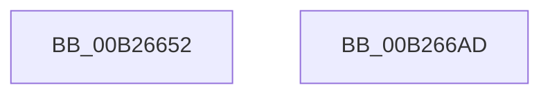

# sub_00B26652

- RVA: `0x00B26652`–`0x00B266CA` (길이 `120` bytes)
- VA: `0x0000000140B26652`
- 실행 섹션: `PAGE`
- PDB 이름 있음: `아니요`; PDB Function 태그: `아니요`
- unwind 정보 RVA: `0x0009225C`
- 디코드: `27`개 명령, `120/120` bytes 표시
- 미해석 바이트: `0` (있으면 어셈블리에 `.byte`로 보존)

> 이 문서는 커널 이미지의 기계어와 PDB 기호를 분석해 생성했습니다. 4번과 5번은 함수 원형과 자료형을 바이너리 사용 방식에서 추정한 C 해석이며 원본 소스 복구 결과는 아닙니다.

## 1. Dependencies

- 직접 호출 지점: **2**; 고유 호출 대상: **2**
- 직접 호출자로 확인된 함수: **0**
- RIP 상대 이미지 참조: **0**

### Outgoing calls
- `0x00B266A2` → [McTemplateK0qhzr1jxjhzr6_EtwWriteTransfer](../../text/5A/McTemplateK0qhzr1jxjhzr6_EtwWriteTransfer_function_005A58C0.md) (function, `0x005A58C0`)
- `0x00B266C4` → [KeBugCheckEx](../../text/4F/KeBugCheckEx_function_004FD660.md) (function, `0x004FD660`)

### Direct callers
- 이 함수 시작 RVA로 연결되는 직접 call은 확인되지 않았습니다. 간접 호출은 완전히 역산할 수 없습니다.

### Static image references
- 디코드된 RIP-relative 메모리 참조가 없습니다.

## 2. Other-region calls and transfers

- 다른 실행 섹션으로 향하는 call: **2**
  - `0x00B266A2` → [McTemplateK0qhzr1jxjhzr6_EtwWriteTransfer](../../text/5A/McTemplateK0qhzr1jxjhzr6_EtwWriteTransfer_function_005A58C0.md) (`PAGE` → `.text`)
  - `0x00B266C4` → [KeBugCheckEx](../../text/4F/KeBugCheckEx_function_004FD660.md) (`PAGE` → `.text`)
- call이 아닌 외부 분기/꼬리 이동: **1**
  - `0x00B266A8` → [PnpNotifyDriverCallback + 0xB3](../95/PnpNotifyDriverCallback_function_00954AA0.md) (`tail-transfer`)

## 3. Assembly (complete function range)

```asm
00B26652  0F B7 39                        movzx edi, word ptr [rcx]
00B26655  48 8B 41 08                     mov rax, qword ptr [rcx + 8]
00B26659  66 D1 EF                        shr di, 1
00B2665C  48 8B 4E 30                     mov rcx, qword ptr [rsi + 0x30]
00B26660  44 8B 4E 10                     mov r9d, dword ptr [rsi + 0x10]
00B26664  48 89 44 24 50                  mov qword ptr [rsp + 0x50], rax
00B26669  48 8B 84 24 C0 00 00 00         mov rax, qword ptr [rsp + 0xc0]
00B26671  0F B7 51 38                     movzx edx, word ptr [rcx + 0x38]
00B26675  66 89 7C 24 48                  mov word ptr [rsp + 0x48], di
00B2667A  48 89 44 24 40                  mov qword ptr [rsp + 0x40], rax
00B2667F  48 8B 84 24 C8 00 00 00         mov rax, qword ptr [rsp + 0xc8]
00B26687  4C 89 5C 24 38                  mov qword ptr [rsp + 0x38], r11
00B2668C  48 89 44 24 30                  mov qword ptr [rsp + 0x30], rax
00B26691  48 8B 41 40                     mov rax, qword ptr [rcx + 0x40]
00B26695  66 D1 EA                        shr dx, 1
00B26698  48 89 44 24 28                  mov qword ptr [rsp + 0x28], rax
00B2669D  66 89 54 24 20                  mov word ptr [rsp + 0x20], dx
00B266A2  E8 19 F2 A7 FF                  call 0x1405a58c0
00B266A7  90                              nop
00B266A8  E9 A6 E4 E2 FF                  jmp 0x140954b53
00B266AD  4C 8B 46 30                     mov r8, qword ptr [rsi + 0x30]
00B266B1  BA 0A 00 00 00                  mov edx, 0xa
00B266B6  45 0F B6 CE                     movzx r9d, r14b
00B266BA  B9 CA 00 00 00                  mov ecx, 0xca
00B266BF  48 89 6C 24 20                  mov qword ptr [rsp + 0x20], rbp
00B266C4  E8 97 6F 9D FF                  call 0x1404fd660
00B266C9  CC                              int3
```

## 4. C-style interpretation (structured pseudocode)

```c
__int64 __fastcall sub_00B26652(__int64 a1, __int64 a2, __int64 a3, __int64 a4, __int64 a5, __int64 a6, __int64 a7, __int64 a8, __int64 a9, __int64 a10, __int64 a11, __int64 a12, __int64 a13, __int64 a14, __int64 a15, __int64 a16, __int64 a17, __int64 a18, __int64 a19, __int64 a20, __int64 a21, __int64 a22, __int64 a23, __int64 a24, __int64 a25)
{
    __int64 result;
    __int64 v_rdi;
    unsigned __int16 v_stack_p20;
    unsigned __int64 v_stack_p28;
    unsigned __int64 v_stack_p30;
    unsigned __int64 v_stack_p38;
    unsigned __int64 v_stack_p40;
    unsigned __int16 v_stack_p48;
    unsigned __int64 v_stack_p50;

    v_rdi = (unsigned __int16)((*(unsigned __int16 *)(a1)) >> (1));
    v_stack_p50 = *(unsigned __int64 *)(a1 + 8);
    v_stack_p48 = (unsigned __int16)(v_rdi);
    v_stack_p40 = a24;
    v_stack_p38 = v_r11;
    v_stack_p30 = a25;
    a2 = (unsigned __int16)((*(unsigned __int16 *)(*(unsigned __int64 *)(v_rsi + 48) + 56)) >> (1));
    v_stack_p28 = *(unsigned __int64 *)(*(unsigned __int64 *)(v_rsi + 48) + 64);
    v_stack_p20 = (unsigned __int16)(a2);
    result = McTemplateK0qhzr1jxjhzr6_EtwWriteTransfer(*(unsigned __int64 *)(v_rsi + 48), a2, a3, (unsigned int)(*(unsigned int *)(v_rsi + 16)));
}
```

## 5. (Beta) C Style

```c
int64_t sub_00B26652(void *Arg1, int64_t Arg2, int64_t Arg3, int64_t Arg4, uint64_t Arg5, uint64_t Arg6, uint64_t Arg7, uint64_t Arg8, uint64_t Arg9, uint64_t Arg10, uint64_t Arg11, uint64_t Arg12, uint64_t Arg13, uint64_t Arg14, uint64_t Arg15, uint64_t Arg16, uint64_t Arg17, uint64_t Arg18, uint64_t Arg19, uint64_t Arg20, uint64_t Arg21, uint64_t Arg22, uint64_t Arg23, int64_t Arg24, int64_t Arg25)
{
    uint8_t *arg1 = (uint8_t *)Arg1;

    int64_t result;
    int64_t local_rdi;
    uint16_t v_stack_p20;
    uint64_t v_stack_p28;
    uint64_t v_stack_p30;
    uint64_t v_stack_p38;
    uint64_t v_stack_p40;
    uint16_t v_stack_p48;
    uint64_t v_stack_p50;

    local_rdi = (uint16_t)((*(uint16_t *)(arg1)) >> (1));
    v_stack_p50 = *(uint64_t *)(arg1 + 0x8);
    v_stack_p48 = (uint16_t)(local_rdi);
    v_stack_p40 = Arg24;
    v_stack_p38 = local_r11;
    v_stack_p30 = Arg25;
    Arg2 = (uint16_t)((*(uint16_t *)(*(uint64_t *)(local_rsi + 0x30) + 0x38)) >> (1));
    v_stack_p28 = *(uint64_t *)(*(uint64_t *)(local_rsi + 0x30) + 0x40);
    v_stack_p20 = (uint16_t)(Arg2);
    result = McTemplateK0qhzr1jxjhzr6_EtwWriteTransfer(*(uint64_t *)(local_rsi + 0x30), Arg2, Arg3, (uint32_t)(*(uint32_t *)(local_rsi + 0x10)));
}
```

### 관측된 메모리 오프셋

구조체 형식이 확인되지 않은 접근은 인자 기준의 오프셋으로만 기록했습니다.

| 기준 인자 | 오프셋 표현 | 폭 (bit) | 접근 |
|---|---:|---:|---|
| `Arg1` | `+ 0x0` | `16` | `R` |
| `Arg1` | `+ 0x8` | `64` | `R` |

## 6. Execution-region graph

[열기: 2D/3D 그래프와 함수 탐색 컨트롤 패널](../../../control-panel.html?section=page&rva=0x00B26652&view=graph)

- 2D 그래프는 위에서 아래로 흐르고, 3D 그래프는 빈 공간을 드래그해 회전합니다. Shift+드래그는 이동, 휠은 확대·축소, 함수 노드 선택은 대상 보고서 이동입니다.

### Static fallback


