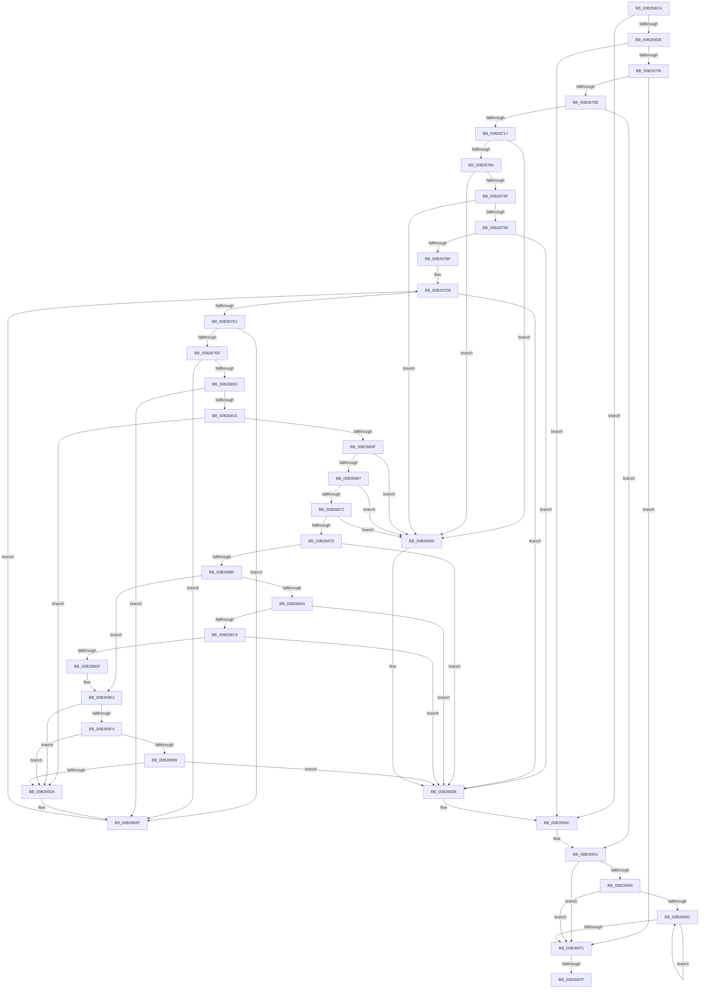

# sub_00B266CA

- RVA: `0x00B266CA`–`0x00B2698A` (길이 `704` bytes)
- VA: `0x0000000140B266CA`
- 실행 섹션: `PAGE`
- PDB 이름 있음: `아니요`; PDB Function 태그: `아니요`
- unwind 정보 RVA: `0x00092290`
- 디코드: `163`개 명령, `704/704` bytes 표시
- 미해석 바이트: `0` (있으면 어셈블리에 `.byte`로 보존)

> 이 문서는 커널 이미지의 기계어와 PDB 기호를 분석해 생성했습니다. 4번과 5번은 함수 원형과 자료형을 바이너리 사용 방식에서 추정한 C 해석이며 원본 소스 복구 결과는 아닙니다.

## 1. Dependencies

- 직접 호출 지점: **19**; 고유 호출 대상: **14**
- 직접 호출자로 확인된 함수: **0**
- RIP 상대 이미지 참조: **2**

### Outgoing calls
- `0x00B266CF` → [PiPnpRtlBeginOperation](../8E/PiPnpRtlBeginOperation_function_008E033C.md) (function, `0x008E033C`)
- `0x00B266F1` → [PnpQueryDeviceRelations](../8F/PnpQueryDeviceRelations_function_008F9FE0.md) (function, `0x008F9FE0`)
- `0x00B26731` → [ExAcquireResourceExclusiveLite](../../text/21/ExAcquireResourceExclusiveLite_function_00214E20.md) (function, `0x00214E20`)
- `0x00B26777` → [CmGetDeviceRegProp](../8E/CmGetDeviceRegProp_function_008ED870.md) (function, `0x008ED870`)
- `0x00B267B0` → [_CmGetDeviceContainerIdFromBase](../8F/_CmGetDeviceContainerIdFromBase_function_008FD2B4.md) (function, `0x008FD2B4`)
- `0x00B267C9` → [wcsicmp](../../text/50/wcsicmp_function_00500080.md) (function, `0x00500080`)
- `0x00B2684D` → [CmGetDeviceRegProp](../8E/CmGetDeviceRegProp_function_008ED870.md) (function, `0x008ED870`)
- `0x00B26890` → [_CmGetDeviceContainerIdFromBase](../8F/_CmGetDeviceContainerIdFromBase_function_008FD2B4.md) (function, `0x008FD2B4`)
- `0x00B268B1` → [CmMoveBaseContainer](../82/CmMoveBaseContainer_function_0082BE5C.md) (function, `0x0082BE5C`)
- `0x00B268BD` → [PiDcContainerRequiresConfiguration](../AB/PiDcContainerRequiresConfiguration_function_00AB6004.md) (function, `0x00AB6004`)
- `0x00B268D4` → [RtlStringCbCopyW](../../text/43/RtlStringCbCopyW_function_0043B910.md) (function, `0x0043B910`)
- `0x00B268EB` → [wcsicmp](../../text/50/wcsicmp_function_00500080.md) (function, `0x00500080`)
- `0x00B26900` → [CmIsLocalMachineContainer](../A8/CmIsLocalMachineContainer_function_00A8EA34.md) (function, `0x00A8EA34`)
- `0x00B26916` → [CmMoveBaseContainer](../82/CmMoveBaseContainer_function_0082BE5C.md) (function, `0x0082BE5C`)
- `0x00B26921` → [PiDcContainerRequiresConfiguration](../AB/PiDcContainerRequiresConfiguration_function_00AB6004.md) (function, `0x00AB6004`)
- `0x00B26942` → [ExReleaseResourceLite](../../text/25/ExReleaseResourceLite_function_0025FA10.md) (function, `0x0025FA10`)
- `0x00B26947` → [KeLeaveCriticalRegion](../../text/25/KeLeaveCriticalRegion_function_0025D8B0.md) (function, `0x0025D8B0`)
- `0x00B26961` → [ObfDereferenceObject](../../text/2F/ObfDereferenceObject_function_002F9350.md) (function, `0x002F9350`)
- `0x00B2697F` → [PiPnpRtlEndOperation](../8E/PiPnpRtlEndOperation_function_008E0518.md) (function, `0x008E0518`)

### Direct callers
- 이 함수 시작 RVA로 연결되는 직접 call은 확인되지 않았습니다. 간접 호출은 완전히 역산할 수 없습니다.

### Static image references
- `0x00B26720` → RVA `0x00F8C600` (`.data`; read)
- `0x00B26740` → RVA `0x00E66398` (`.data`; read)

## 2. Other-region calls and transfers

- 다른 실행 섹션으로 향하는 call: **7**
  - `0x00B26731` → [ExAcquireResourceExclusiveLite](../../text/21/ExAcquireResourceExclusiveLite_function_00214E20.md) (`PAGE` → `.text`)
  - `0x00B267C9` → [wcsicmp](../../text/50/wcsicmp_function_00500080.md) (`PAGE` → `.text`)
  - `0x00B268D4` → [RtlStringCbCopyW](../../text/43/RtlStringCbCopyW_function_0043B910.md) (`PAGE` → `.text`)
  - `0x00B268EB` → [wcsicmp](../../text/50/wcsicmp_function_00500080.md) (`PAGE` → `.text`)
  - `0x00B26942` → [ExReleaseResourceLite](../../text/25/ExReleaseResourceLite_function_0025FA10.md) (`PAGE` → `.text`)
  - `0x00B26947` → [KeLeaveCriticalRegion](../../text/25/KeLeaveCriticalRegion_function_0025D8B0.md) (`PAGE` → `.text`)
  - `0x00B26961` → [ObfDereferenceObject](../../text/2F/ObfDereferenceObject_function_002F9350.md) (`PAGE` → `.text`)
- call이 아닌 외부 분기/꼬리 이동: **2**
  - `0x00B26979` → [PiDcHandleCustomDeviceEvent + 0x6D](../95/PiDcHandleCustomDeviceEvent_function_00954C14.md) (`tail-transfer`)
  - `0x00B26985` → [PiDcHandleCustomDeviceEvent + 0x6D](../95/PiDcHandleCustomDeviceEvent_function_00954C14.md) (`tail-transfer`)

## 3. Assembly (complete function range)

```asm
00B266CA  48 8D 4C 24 50                  lea rcx, [rsp + 0x50]
00B266CF  E8 68 9C DB FF                  call 0x1408e033c
00B266D4  8B D8                           mov ebx, eax
00B266D6  85 C0                           test eax, eax
00B266D8  0F 88 6E 02 00 00               js 0x140b2694c
00B266DE  48 8B 8F A0 00 00 00            mov rcx, qword ptr [rdi + 0xa0]
00B266E5  4C 8D 4C 24 48                  lea r9, [rsp + 0x48]
00B266EA  45 33 C0                        xor r8d, r8d
00B266ED  41 8D 50 06                     lea edx, [r8 + 6]
00B266F1  E8 EA 38 DD FF                  call 0x1408f9fe0
00B266F6  8B D8                           mov ebx, eax
00B266F8  85 C0                           test eax, eax
00B266FA  0F 88 4C 02 00 00               js 0x140b2694c
00B26700  48 8B 44 24 48                  mov rax, qword ptr [rsp + 0x48]
00B26705  48 85 C0                        test rax, rax
00B26708  0F 84 63 02 00 00               je 0x140b26971
00B2670E  83 38 00                        cmp dword ptr [rax], 0
00B26711  0F 84 3A 02 00 00               je 0x140b26951
00B26717  65 48 8B 04 25 88 01 00 00      mov rax, qword ptr gs:[0x188]
00B26720  48 8D 0D D9 5E 46 00            lea rcx, [rip + 0x465ed9]
00B26727  B2 01                           mov dl, 1
00B26729  66 FF 88 E4 01 00 00            dec word ptr [rax + 0x1e4]
00B26730  90                              nop
00B26731  E8 EA E6 6E FF                  call 0x140214e20
00B26736  83 64 24 38 00                  and dword ptr [rsp + 0x38], 0
00B2673B  48 8D 44 24 40                  lea rax, [rsp + 0x40]
00B26740  48 8B 0D 51 FC 33 00            mov rcx, qword ptr [rip + 0x33fc51]
00B26747  48 8D 97 B0 00 00 00            lea rdx, [rdi + 0xb0]
00B2674E  48 89 44 24 30                  mov qword ptr [rsp + 0x30], rax
00B26753  41 B9 25 00 00 00               mov r9d, 0x25
00B26759  48 8D 45 00                     lea rax, [rbp]
00B2675D  C7 44 24 40 4E 00 00 00         mov dword ptr [rsp + 0x40], 0x4e
00B26765  48 89 44 24 28                  mov qword ptr [rsp + 0x28], rax
00B2676A  45 33 C0                        xor r8d, r8d
00B2676D  48 8D 44 24 44                  lea rax, [rsp + 0x44]
00B26772  48 89 44 24 20                  mov qword ptr [rsp + 0x20], rax
00B26777  E8 F4 70 DC FF                  call 0x1408ed870
00B2677C  85 C0                           test eax, eax
00B2677E  0F 88 B2 01 00 00               js 0x140b26936
00B26784  83 7C 24 44 01                  cmp dword ptr [rsp + 0x44], 1
00B26789  0F 85 A7 01 00 00               jne 0x140b26936
00B2678F  83 7C 24 40 4E                  cmp dword ptr [rsp + 0x40], 0x4e
00B26794  0F 85 9C 01 00 00               jne 0x140b26936
00B2679A  48 8B 0D F7 FB 33 00            mov rcx, qword ptr [rip + 0x33fbf7]
00B267A1  4C 8D 4D B0                     lea r9, [rbp - 0x50]
00B267A5  4C 8D 45 00                     lea r8, [rbp]
00B267A9  48 8D 97 B0 00 00 00            lea rdx, [rdi + 0xb0]
00B267B0  E8 FF 6A DD FF                  call 0x1408fd2b4
00B267B5  8B D8                           mov ebx, eax
00B267B7  85 C0                           test eax, eax
00B267B9  0F 88 7C 01 00 00               js 0x140b2693b
00B267BF  48 8D 55 B0                     lea rdx, [rbp - 0x50]
00B267C3  33 FF                           xor edi, edi
00B267C5  48 8D 4D 00                     lea rcx, [rbp]
00B267C9  E8 B2 98 9D FF                  call 0x140500080
00B267CE  48 8B 4C 24 48                  mov rcx, qword ptr [rsp + 0x48]
00B267D3  85 C0                           test eax, eax
00B267D5  41 0F 95 C6                     setne r14b
00B267D9  3B 39                           cmp edi, dword ptr [rcx]
00B267DB  0F 83 5A 01 00 00               jae 0x140b2693b
00B267E1  48 8B 44 F9 08                  mov rax, qword ptr [rcx + rdi*8 + 8]
00B267E6  48 85 C0                        test rax, rax
00B267E9  0F 84 40 01 00 00               je 0x140b2692f
00B267EF  48 8B 80 38 01 00 00            mov rax, qword ptr [rax + 0x138]
00B267F6  48 8B 70 28                     mov rsi, qword ptr [rax + 0x28]
00B267FA  48 85 F6                        test rsi, rsi
00B267FD  0F 84 2C 01 00 00               je 0x140b2692f
00B26803  48 8B 76 30                     mov rsi, qword ptr [rsi + 0x30]
00B26807  48 85 F6                        test rsi, rsi
00B2680A  0F 84 1F 01 00 00               je 0x140b2692f
00B26810  83 64 24 38 00                  and dword ptr [rsp + 0x38], 0
00B26815  48 8D 44 24 40                  lea rax, [rsp + 0x40]
00B2681A  48 8B 0D 77 FB 33 00            mov rcx, qword ptr [rip + 0x33fb77]
00B26821  41 B9 25 00 00 00               mov r9d, 0x25
00B26827  48 89 44 24 30                  mov qword ptr [rsp + 0x30], rax
00B2682C  45 33 C0                        xor r8d, r8d
00B2682F  48 8D 45 50                     lea rax, [rbp + 0x50]
00B26833  C7 44 24 40 4E 00 00 00         mov dword ptr [rsp + 0x40], 0x4e
00B2683B  48 89 44 24 28                  mov qword ptr [rsp + 0x28], rax
00B26840  48 8B D6                        mov rdx, rsi
00B26843  48 8D 44 24 44                  lea rax, [rsp + 0x44]
00B26848  48 89 44 24 20                  mov qword ptr [rsp + 0x20], rax
00B2684D  E8 1E 70 DC FF                  call 0x1408ed870
00B26852  8B D8                           mov ebx, eax
00B26854  3D 25 02 00 C0                  cmp eax, 0xc0000225
00B26859  0F 84 CB 00 00 00               je 0x140b2692a
00B2685F  85 C0                           test eax, eax
00B26861  0F 88 CF 00 00 00               js 0x140b26936
00B26867  83 7C 24 44 01                  cmp dword ptr [rsp + 0x44], 1
00B2686C  0F 85 C4 00 00 00               jne 0x140b26936
00B26872  83 7C 24 40 4E                  cmp dword ptr [rsp + 0x40], 0x4e
00B26877  0F 85 B9 00 00 00               jne 0x140b26936
00B2687D  48 8B 0D 14 FB 33 00            mov rcx, qword ptr [rip + 0x33fb14]
00B26884  4C 8D 4C 24 60                  lea r9, [rsp + 0x60]
00B26889  4C 8D 45 50                     lea r8, [rbp + 0x50]
00B2688D  48 8B D6                        mov rdx, rsi
00B26890  E8 1F 6A DD FF                  call 0x1408fd2b4
00B26895  8B D8                           mov ebx, eax
00B26897  85 C0                           test eax, eax
00B26899  0F 88 9C 00 00 00               js 0x140b2693b
00B2689F  45 84 F6                        test r14b, r14b
00B268A2  75 3E                           jne 0x140b268e2
00B268A4  4C 8D 4C 24 60                  lea r9, [rsp + 0x60]
00B268A9  4C 8D 45 B0                     lea r8, [rbp - 0x50]
00B268AD  48 8D 55 00                     lea rdx, [rbp]
00B268B1  E8 A6 55 D0 FF                  call 0x14082be5c
00B268B6  48 8D 4C 24 60                  lea rcx, [rsp + 0x60]
00B268BB  8B D8                           mov ebx, eax
00B268BD  E8 42 F7 F8 FF                  call 0x140ab6004
00B268C2  85 DB                           test ebx, ebx
00B268C4  78 75                           js 0x140b2693b
00B268C6  4C 8D 44 24 60                  lea r8, [rsp + 0x60]
00B268CB  BA 4E 00 00 00                  mov edx, 0x4e
00B268D0  48 8D 4D B0                     lea rcx, [rbp - 0x50]
00B268D4  E8 37 50 91 FF                  call 0x14043b910
00B268D9  8B D8                           mov ebx, eax
00B268DB  85 C0                           test eax, eax
00B268DD  78 5C                           js 0x140b2693b
00B268DF  41 B6 01                        mov r14b, 1
00B268E2  48 8D 55 B0                     lea rdx, [rbp - 0x50]
00B268E6  48 8D 4C 24 60                  lea rcx, [rsp + 0x60]
00B268EB  E8 90 97 9D FF                  call 0x140500080
00B268F0  85 C0                           test eax, eax
00B268F2  74 36                           je 0x140b2692a
00B268F4  48 8B 0D 9D FA 33 00            mov rcx, qword ptr [rip + 0x33fa9d]
00B268FB  48 8D 54 24 60                  lea rdx, [rsp + 0x60]
00B26900  E8 2F 81 F6 FF                  call 0x140a8ea34
00B26905  84 C0                           test al, al
00B26907  75 21                           jne 0x140b2692a
00B26909  4C 8D 4D B0                     lea r9, [rbp - 0x50]
00B2690D  4C 8D 44 24 60                  lea r8, [rsp + 0x60]
00B26912  48 8D 55 50                     lea rdx, [rbp + 0x50]
00B26916  E8 41 55 D0 FF                  call 0x14082be5c
00B2691B  48 8D 4D B0                     lea rcx, [rbp - 0x50]
00B2691F  8B D8                           mov ebx, eax
00B26921  E8 DE F6 F8 FF                  call 0x140ab6004
00B26926  85 DB                           test ebx, ebx
00B26928  78 11                           js 0x140b2693b
00B2692A  48 8B 4C 24 48                  mov rcx, qword ptr [rsp + 0x48]
00B2692F  FF C7                           inc edi
00B26931  E9 A3 FE FF FF                  jmp 0x140b267d9
00B26936  BB 0B 09 00 C0                  mov ebx, 0xc000090b
00B2693B  48 8D 0D BE 5C 46 00            lea rcx, [rip + 0x465cbe]
00B26942  E8 C9 90 73 FF                  call 0x14025fa10
00B26947  E8 64 6F 73 FF                  call 0x14025d8b0
00B2694C  48 8B 44 24 48                  mov rax, qword ptr [rsp + 0x48]
00B26951  48 85 C0                        test rax, rax
00B26954  74 1B                           je 0x140b26971
00B26956  33 FF                           xor edi, edi
00B26958  39 38                           cmp dword ptr [rax], edi
00B2695A  76 15                           jbe 0x140b26971
00B2695C  48 8B 4C F8 08                  mov rcx, qword ptr [rax + rdi*8 + 8]
00B26961  E8 EA 29 7D FF                  call 0x1402f9350
00B26966  48 8B 44 24 48                  mov rax, qword ptr [rsp + 0x48]
00B2696B  FF C7                           inc edi
00B2696D  3B 38                           cmp edi, dword ptr [rax]
00B2696F  72 EB                           jb 0x140b2695c
00B26971  48 8B 4C 24 50                  mov rcx, qword ptr [rsp + 0x50]
00B26976  48 85 C9                        test rcx, rcx
00B26979  0F 84 02 E3 E2 FF               je 0x140954c81
00B2697F  E8 94 9B DB FF                  call 0x1408e0518
00B26984  90                              nop
00B26985  E9 F7 E2 E2 FF                  jmp 0x140954c81
```

## 4. C-style interpretation (structured pseudocode)

```c
__int64 __fastcall sub_00B266CA(__int64 a1, __int64 a2, int a3, __int64 a4, __int64 a5, __int64 a6, unsigned int a7, unsigned int a8, __int64 a9, __int64 a10, __int64 a11, __int64 a12)
{
    __int64 result;
    __int64 v_r14;
    __int64 v_rdi;
    unsigned __int64 v_stack_p20;
    unsigned __int64 v_stack_p28;
    unsigned __int64 v_stack_p30;
    unsigned int v_stack_p40;
    unsigned __int64 v_stack_p44;

    result = PiPnpRtlBeginOperation(a10, a2, a3, a4);
    if (sign_flag) goto loc_00B2694C;
    a3 = 0;
    result = PnpQueryDeviceRelations(*(unsigned __int64 *)(v_rdi + 160), a3 + 6, a3, a9);
    if (sign_flag) goto loc_00B2694C;
    if (a9 == 0) goto loc_00B26971;
    if ((*(unsigned int *)(a9)) == 0) goto loc_00B26951;
    result = ExAcquireResourceExclusiveLite(v_rip + 4611801, 1, a3, a9);
    v_stack_p30 = a8;
    v_stack_p40 = 78;
    v_stack_p28 = v_rbp;
    a3 = 0;
    v_stack_p20 = v_stack_p44;
    result = CmGetDeviceRegProp(*(unsigned __int64 *)(v_rip + 3406929), v_rdi + 176, a3, 37);
    if (sign_flag) goto loc_00B26936;
    if (v_stack_p44 != 1) goto loc_00B26936;
    if (a8 != 78) goto loc_00B26936;
    result = _CmGetDeviceContainerIdFromBase(*(unsigned __int64 *)(v_rip + 3406839), v_rdi + 176, v_rbp, v_rbp - 80);
    if (sign_flag) goto loc_00B2693B;
    v_rdi = 0;
    result = wcsicmp(v_rbp, v_rbp - 80, v_rbp, v_rbp - 80);
    v_r14 = ((unsigned int)(result) != 0) ? 1 : 0;
loc_00B267D9:
    if (0 >= (*(unsigned int *)(a9))) goto loc_00B2693B;
    if (*(unsigned __int64 *)(a9 + v_rdi * 8 + 8) == 0) goto loc_00B2692F;
    if (*(unsigned __int64 *)(*(unsigned __int64 *)(*(unsigned __int64 *)(a9 + v_rdi * 8 + 8) + 312) + 40) == 0) goto loc_00B2692F;
    if (*(unsigned __int64 *)(*(unsigned __int64 *)(*(unsigned __int64 *)(*(unsigned __int64 *)(a9 + v_rdi * 8 + 8) + 312) + 40) + 48) == 0) goto loc_00B2692F;
    v_stack_p30 = a8;
    a3 = 0;
    v_stack_p40 = 78;
    v_stack_p28 = v_rbp + 80;
    v_stack_p20 = v_stack_p44;
    result = CmGetDeviceRegProp(*(unsigned __int64 *)(v_rip + 3406711), *(unsigned __int64 *)(*(unsigned __int64 *)(*(unsigned __int64 *)(*(unsigned __int64 *)(a9 + v_rdi * 8 + 8) + 312) + 40) + 48), a3, 37);
    if (((unsigned int)(result)) == 0xC0000225ULL) goto loc_00B2692A;
    if (sign_flag) goto loc_00B26936;
    if (v_stack_p44 != 1) goto loc_00B26936;
    if (a8 != 78) goto loc_00B26936;
    result = _CmGetDeviceContainerIdFromBase(*(unsigned __int64 *)(v_rip + 3406612), *(unsigned __int64 *)(*(unsigned __int64 *)(*(unsigned __int64 *)(*(unsigned __int64 *)(a9 + v_rdi * 8 + 8) + 312) + 40) + 48), v_rbp + 80, a12);
    if (sign_flag) goto loc_00B2693B;
    if ((unsigned __int8)(v_r14) != 0) goto loc_00B268E2;
    result = CmMoveBaseContainer(*(unsigned __int64 *)(v_rip + 3406612), v_rbp, v_rbp - 80, a12);
    result = PiDcContainerRequiresConfiguration(a12, v_rbp, v_rbp - 80, a12);
    if (sign_flag) goto loc_00B2693B;
    result = RtlStringCbCopyW(v_rbp - 80, 78, a12, a12);
    if (sign_flag) goto loc_00B2693B;
loc_00B268E2:
    result = wcsicmp(a12, v_rbp - 80, a12, a12);
    if ((unsigned int)(result) == 0) goto loc_00B2692A;
    result = CmIsLocalMachineContainer(*(unsigned __int64 *)(v_rip + 3406493), a12, a12, a12);
    if ((unsigned __int8)(result) != 0) goto loc_00B2692A;
    result = CmMoveBaseContainer(*(unsigned __int64 *)(v_rip + 3406493), v_rbp + 80, a12, v_rbp - 80);
    result = PiDcContainerRequiresConfiguration(v_rbp - 80, v_rbp + 80, a12, v_rbp - 80);
    if (sign_flag) goto loc_00B2693B;
loc_00B2692A:
loc_00B2692F:
    v_rdi = (unsigned int)((v_rdi) + 1);
    goto loc_00B267D9;
loc_00B26936:
loc_00B2693B:
    result = ExReleaseResourceLite(v_rip + 4611262, v_rbp + 80, a12, v_rbp - 80);
    result = KeLeaveCriticalRegion(v_rip + 4611262, v_rbp + 80, a12, v_rbp - 80);
loc_00B2694C:
loc_00B26951:
    if (a9 == 0) goto loc_00B26971;
    v_rdi = 0;
    if ((*(unsigned int *)(a9)) <= 0) goto loc_00B26971;
loc_00B2695C:
    result = ObfDereferenceObject(*(unsigned __int64 *)(a9 + v_rdi * 8 + 8), v_rbp + 80, a12, v_rbp - 80);
    v_rdi = (unsigned int)((v_rdi) + 1);
    if (((unsigned int)(v_rdi)) < (*(unsigned int *)(a9))) goto loc_00B2695C;
loc_00B26971:
    result = PiPnpRtlEndOperation(a10, v_rbp + 80, a12, v_rbp - 80);
}
```

## 5. (Beta) C Style

```c
int64_t sub_00B266CA(int64_t Arg1, int64_t Arg2, int32_t Arg3, int64_t Arg4, uint64_t Arg5, uint64_t Arg6, uint32_t Arg7, uint32_t Arg8, void *Arg9, int64_t Arg10, uint64_t Arg11, int64_t Arg12)
{
    uint8_t *arg9 = (uint8_t *)Arg9;

    int64_t result;
    int64_t local_r14;
    int64_t local_rdi;
    uint64_t v_stack_p20;
    uint64_t v_stack_p28;
    uint64_t v_stack_p30;
    uint32_t v_stack_p40;
    uint64_t v_stack_p44;

    result = PiPnpRtlBeginOperation(Arg10, Arg2, Arg3, Arg4);
    if (sign_flag) goto loc_00B2694C;
    Arg3 = 0;
    result = PnpQueryDeviceRelations(*(uint64_t *)(local_rdi + 0xA0), Arg3 + 6, Arg3, Arg9);
    if (sign_flag) goto loc_00B2694C;
    if (Arg9 == NULL) goto loc_00B26971;
    if ((*(uint32_t *)(arg9)) == 0) goto loc_00B26951;
    result = ExAcquireResourceExclusiveLite(v_rip + 4611801, 1, Arg3, Arg9);
    v_stack_p30 = Arg8;
    v_stack_p40 = 78;
    v_stack_p28 = local_rbp;
    Arg3 = 0;
    v_stack_p20 = v_stack_p44;
    result = CmGetDeviceRegProp(*(uint64_t *)(v_rip + 0x33FC51), local_rdi + 176, Arg3, 37);
    if (sign_flag) goto loc_00B26936;
    if (v_stack_p44 != 1) goto loc_00B26936;
    if (Arg8 != 78) goto loc_00B26936;
    result = _CmGetDeviceContainerIdFromBase(*(uint64_t *)(v_rip + 0x33FBF7), local_rdi + 176, local_rbp, local_rbp - 80);
    if (sign_flag) goto loc_00B2693B;
    local_rdi = 0;
    result = wcsicmp(local_rbp, local_rbp - 80, local_rbp, local_rbp - 80);
    local_r14 = ((uint32_t)(result) != 0) ? 1 : 0;
loc_00B267D9:
    if (0 >= (*(uint32_t *)(arg9))) goto loc_00B2693B;
    if (*(uint64_t *)(arg9 + local_rdi * 8 + 0x8) == 0) goto loc_00B2692F;
    if (*(uint64_t *)(*(uint64_t *)(*(uint64_t *)(arg9 + local_rdi * 8 + 0x8) + 0x138) + 0x28) == 0) goto loc_00B2692F;
    if (*(uint64_t *)(*(uint64_t *)(*(uint64_t *)(*(uint64_t *)(arg9 + local_rdi * 8 + 0x8) + 0x138) + 0x28) + 0x30) == 0) goto loc_00B2692F;
    v_stack_p30 = Arg8;
    Arg3 = 0;
    v_stack_p40 = 78;
    v_stack_p28 = local_rbp + 80;
    v_stack_p20 = v_stack_p44;
    result = CmGetDeviceRegProp(*(uint64_t *)(v_rip + 0x33FB77), *(uint64_t *)(*(uint64_t *)(*(uint64_t *)(*(uint64_t *)(arg9 + local_rdi * 8 + 0x8) + 0x138) + 0x28) + 0x30), Arg3, 37);
    if (((uint32_t)(result)) == 0xC0000225ULL) goto loc_00B2692A;
    if (sign_flag) goto loc_00B26936;
    if (v_stack_p44 != 1) goto loc_00B26936;
    if (Arg8 != 78) goto loc_00B26936;
    result = _CmGetDeviceContainerIdFromBase(*(uint64_t *)(v_rip + 0x33FB14), *(uint64_t *)(*(uint64_t *)(*(uint64_t *)(*(uint64_t *)(arg9 + local_rdi * 8 + 0x8) + 0x138) + 0x28) + 0x30), local_rbp + 80, Arg12);
    if (sign_flag) goto loc_00B2693B;
    if ((uint8_t)(local_r14) != 0) goto loc_00B268E2;
    result = CmMoveBaseContainer(*(uint64_t *)(v_rip + 0x33FB14), local_rbp, local_rbp - 80, Arg12);
    result = PiDcContainerRequiresConfiguration(Arg12, local_rbp, local_rbp - 80, Arg12);
    if (sign_flag) goto loc_00B2693B;
    result = RtlStringCbCopyW(local_rbp - 80, 78, Arg12, Arg12);
    if (sign_flag) goto loc_00B2693B;
loc_00B268E2:
    result = wcsicmp(Arg12, local_rbp - 80, Arg12, Arg12);
    if ((uint32_t)(result) == 0) goto loc_00B2692A;
    result = CmIsLocalMachineContainer(*(uint64_t *)(v_rip + 0x33FA9D), Arg12, Arg12, Arg12);
    if ((uint8_t)(result) != 0) goto loc_00B2692A;
    result = CmMoveBaseContainer(*(uint64_t *)(v_rip + 0x33FA9D), local_rbp + 80, Arg12, local_rbp - 80);
    result = PiDcContainerRequiresConfiguration(local_rbp - 80, local_rbp + 80, Arg12, local_rbp - 80);
    if (sign_flag) goto loc_00B2693B;
loc_00B2692A:
loc_00B2692F:
    local_rdi = (uint32_t)((local_rdi) + 1);
    goto loc_00B267D9;
loc_00B26936:
loc_00B2693B:
    result = ExReleaseResourceLite(v_rip + 4611262, local_rbp + 80, Arg12, local_rbp - 80);
    result = KeLeaveCriticalRegion(v_rip + 4611262, local_rbp + 80, Arg12, local_rbp - 80);
loc_00B2694C:
loc_00B26951:
    if (Arg9 == NULL) goto loc_00B26971;
    local_rdi = 0;
    if ((*(uint32_t *)(arg9)) <= 0) goto loc_00B26971;
loc_00B2695C:
    result = ObfDereferenceObject(*(uint64_t *)(arg9 + local_rdi * 8 + 0x8), local_rbp + 80, Arg12, local_rbp - 80);
    local_rdi = (uint32_t)((local_rdi) + 1);
    if (((uint32_t)(local_rdi)) < (*(uint32_t *)(arg9))) goto loc_00B2695C;
loc_00B26971:
    result = PiPnpRtlEndOperation(Arg10, local_rbp + 80, Arg12, local_rbp - 80);
}
```

### 관측된 메모리 오프셋

구조체 형식이 확인되지 않은 접근은 인자 기준의 오프셋으로만 기록했습니다.

| 기준 인자 | 오프셋 표현 | 폭 (bit) | 접근 |
|---|---:|---:|---|
| `Arg9` | `+ 0x0` | `32` | `R` |
| `Arg9` | `+ 0x8 + rdi*8` | `64` | `R` |

## 6. Execution-region graph

[열기: 2D/3D 그래프와 함수 탐색 컨트롤 패널](../../../control-panel.html?section=page&rva=0x00B266CA&view=graph)

- 2D 그래프는 위에서 아래로 흐르고, 3D 그래프는 빈 공간을 드래그해 회전합니다. Shift+드래그는 이동, 휠은 확대·축소, 함수 노드 선택은 대상 보고서 이동입니다.

### Static fallback


