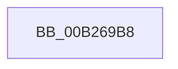

# sub_00B269B8

- RVA: `0x00B269B8`–`0x00B269CF` (길이 `23` bytes)
- VA: `0x0000000140B269B8`
- 실행 섹션: `PAGE`
- PDB 이름 있음: `아니요`; PDB Function 태그: `아니요`
- unwind 정보 RVA: `0x000922FC`
- 디코드: `6`개 명령, `23/23` bytes 표시
- 미해석 바이트: `0` (있으면 어셈블리에 `.byte`로 보존)

> 이 문서는 커널 이미지의 기계어와 PDB 기호를 분석해 생성했습니다. 4번과 5번은 함수 원형과 자료형을 바이너리 사용 방식에서 추정한 C 해석이며 원본 소스 복구 결과는 아닙니다.

## 1. Dependencies

- 직접 호출 지점: **1**; 고유 호출 대상: **1**
- 직접 호출자로 확인된 함수: **0**
- RIP 상대 이미지 참조: **0**

### Outgoing calls
- `0x00B269C1` → [KeDelayExecutionThread](../../text/20/KeDelayExecutionThread_function_00209550.md) (function, `0x00209550`)

### Direct callers
- 이 함수 시작 RVA로 연결되는 직접 call은 확인되지 않았습니다. 간접 호출은 완전히 역산할 수 없습니다.

### Static image references
- 디코드된 RIP-relative 메모리 참조가 없습니다.

## 2. Other-region calls and transfers

- 다른 실행 섹션으로 향하는 call: **1**
  - `0x00B269C1` → [KeDelayExecutionThread](../../text/20/KeDelayExecutionThread_function_00209550.md) (`PAGE` → `.text`)
- call이 아닌 외부 분기/꼬리 이동: **1**
  - `0x00B269CA` → [PnpCompleteDeviceEvent + 0x11E](../95/PnpCompleteDeviceEvent_function_00955548.md) (`tail-transfer`)

## 3. Assembly (complete function range)

```asm
00B269B8  4C 8D 44 24 30                  lea r8, [rsp + 0x30]
00B269BD  33 D2                           xor edx, edx
00B269BF  33 C9                           xor ecx, ecx
00B269C1  E8 8A 2B 6E FF                  call 0x140209550
00B269C6  48 8B 4B 50                     mov rcx, qword ptr [rbx + 0x50]
00B269CA  E9 97 EC E2 FF                  jmp 0x140955666
```

## 4. C-style interpretation (structured pseudocode)

```c
__int64 __fastcall sub_00B269B8(int a1, int a2, __int64 a3, __int64 a4, __int64 a5, __int64 a6)
{
    __int64 result;

    a2 = 0;
    a1 = 0;
    result = KeDelayExecutionThread(a1, a2, a6, a4);
}
```

## 5. (Beta) C Style

```c
int64_t sub_00B269B8(int32_t Arg1, int32_t Arg2, int64_t Arg3, int64_t Arg4, uint64_t Arg5, int64_t Arg6)
{
    int64_t result;

    Arg2 = 0;
    Arg1 = 0;
    result = KeDelayExecutionThread(Arg1, Arg2, Arg6, Arg4);
}
```

## 6. Execution-region graph

[열기: 2D/3D 그래프와 함수 탐색 컨트롤 패널](../../../control-panel.html?section=page&rva=0x00B269B8&view=graph)

- 2D 그래프는 위에서 아래로 흐르고, 3D 그래프는 빈 공간을 드래그해 회전합니다. Shift+드래그는 이동, 휠은 확대·축소, 함수 노드 선택은 대상 보고서 이동입니다.

### Static fallback


