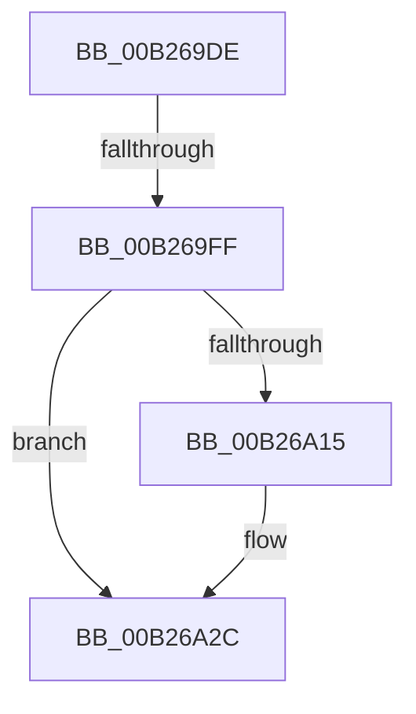

# sub_00B269DE

- RVA: `0x00B269DE`–`0x00B26A64` (길이 `134` bytes)
- VA: `0x0000000140B269DE`
- 실행 섹션: `PAGE`
- PDB 이름 있음: `아니요`; PDB Function 태그: `아니요`
- unwind 정보 RVA: `0x00092354`
- 디코드: `31`개 명령, `134/134` bytes 표시
- 미해석 바이트: `0` (있으면 어셈블리에 `.byte`로 보존)

> 이 문서는 커널 이미지의 기계어와 PDB 기호를 분석해 생성했습니다. 4번과 5번은 함수 원형과 자료형을 바이너리 사용 방식에서 추정한 C 해석이며 원본 소스 복구 결과는 아닙니다.

## 1. Dependencies

- 직접 호출 지점: **1**; 고유 호출 대상: **1**
- 직접 호출자로 확인된 함수: **0**
- RIP 상대 이미지 참조: **3**

### Outgoing calls
- `0x00B269EE` → [ExAllocatePool2](../../poolcode/B8/ExAllocatePool2_function_00B820F0.md) (function, `0x00B820F0`)

### Direct callers
- 이 함수 시작 RVA로 연결되는 직접 call은 확인되지 않았습니다. 간접 호출은 완전히 역산할 수 없습니다.

### Static image references
- `0x00B26A3E` → RVA `0x00E663B8` (`.data`; read)
- `0x00B26A49` → RVA `0x00E663B0` (`.data`; read)
- `0x00B26A54` → RVA `0x00F8CB20` (`.data`; read)

## 2. Other-region calls and transfers

- 다른 실행 섹션으로 향하는 call: **1**
  - `0x00B269EE` → [ExAllocatePool2](../../poolcode/B8/ExAllocatePool2_function_00B820F0.md) (`PAGE` → `POOLCODE`)
- call이 아닌 외부 분기/꼬리 이동: **2**
  - `0x00B269F9` → [PnpRecordBlackboxDeviceCompletionQueueInformation + 0x32](../95/PnpRecordBlackboxDeviceCompletionQueueInformation_function_00955A20.md) (`tail-transfer`)
  - `0x00B26A5F` → [PnpRecordBlackboxDeviceCompletionQueueInformation + 0x32](../95/PnpRecordBlackboxDeviceCompletionQueueInformation_function_00955A20.md) (`tail-transfer`)

## 3. Assembly (complete function range)

```asm
00B269DE  BF 48 00 00 00                  mov edi, 0x48
00B269E3  41 B8 50 6E 70 4B               mov r8d, 0x4b706e50
00B269E9  8B D7                           mov edx, edi
00B269EB  8D 4F F8                        lea ecx, [rdi - 8]
00B269EE  E8 FD B6 05 00                  call 0x140b820f0
00B269F3  48 8B D8                        mov rbx, rax
00B269F6  48 85 C0                        test rax, rax
00B269F9  0F 84 53 F0 E2 FF               je 0x140955a52
00B269FF  C7 00 01 00 00 00               mov dword ptr [rax], 1
00B26A05  89 78 04                        mov dword ptr [rax + 4], edi
00B26A08  C6 40 08 00                     mov byte ptr [rax + 8], 0
00B26A0C  48 8B 46 40                     mov rax, qword ptr [rsi + 0x40]
00B26A10  48 85 C0                        test rax, rax
00B26A13  74 17                           je 0x140b26a2c
00B26A15  48 2B 28                        sub rbp, qword ptr [rax]
00B26A18  48 B8 4B 59 86 38 D6 C5 6D 34   movabs rax, 0x346dc5d63886594b
00B26A22  48 F7 E5                        mul rbp
00B26A25  48 C1 EA 0B                     shr rdx, 0xb
00B26A29  89 53 0C                        mov dword ptr [rbx + 0xc], edx
00B26A2C  8B 46 20                        mov eax, dword ptr [rsi + 0x20]
00B26A2F  89 43 10                        mov dword ptr [rbx + 0x10], eax
00B26A32  48 8B 46 10                     mov rax, qword ptr [rsi + 0x10]
00B26A36  48 89 43 18                     mov qword ptr [rbx + 0x18], rax
00B26A3A  48 89 73 28                     mov qword ptr [rbx + 0x28], rsi
00B26A3E  48 8B 05 73 F9 33 00            mov rax, qword ptr [rip + 0x33f973]
00B26A45  48 89 43 30                     mov qword ptr [rbx + 0x30], rax
00B26A49  48 8B 05 60 F9 33 00            mov rax, qword ptr [rip + 0x33f960]
00B26A50  48 89 43 38                     mov qword ptr [rbx + 0x38], rax
00B26A54  48 8B 05 C5 60 46 00            mov rax, qword ptr [rip + 0x4660c5]
00B26A5B  48 89 43 40                     mov qword ptr [rbx + 0x40], rax
00B26A5F  E9 EE EF E2 FF                  jmp 0x140955a52
```

## 4. C-style interpretation (structured pseudocode)

```c
__int64 __fastcall sub_00B269DE(void)
{
    __int64 result;
    __int64 v_rbp;

    result = ExAllocatePool2(72 - 8, 72, (unsigned int)(0x4B706E50ULL), a4);
    *(unsigned int *)(result) = 1;
    *(unsigned int *)(result + 4) = 72;
    *(unsigned __int8 *)(result + 8) = 0;
    if (*(unsigned __int64 *)(v_rsi + 64) != 0) {
        v_rbp = (v_rbp) - (*(unsigned __int64 *)(*(unsigned __int64 *)(v_rsi + 64)));
        a2 = (72) >> (11);
        *(unsigned int *)(result + 12) = (unsigned int)(a2);
    }
    *(unsigned int *)(result + 16) = (unsigned int)((unsigned int)(*(unsigned int *)(v_rsi + 32)));
    *(unsigned __int64 *)(result + 24) = *(unsigned __int64 *)(v_rsi + 16);
    *(unsigned __int64 *)(result + 40) = v_rsi;
    *(unsigned __int64 *)(result + 48) = *(unsigned __int64 *)(v_rip + 3406195);
    *(unsigned __int64 *)(result + 56) = *(unsigned __int64 *)(v_rip + 3406176);
    *(unsigned __int64 *)(result + 64) = *(unsigned __int64 *)(v_rip + 4612293);
}
```

## 5. (Beta) C Style

```c
void sub_00B269DE(void)
{
    int64_t result;
    int64_t local_rbp;

    result = ExAllocatePool2(72 - 8, 72, (uint32_t)(0x4B706E50ULL), a4);
    *(uint32_t *)(result) = 1;
    *(uint32_t *)(result + 0x4) = 72;
    *(uint8_t *)(result + 0x8) = 0;
    if (*(uint64_t *)(local_rsi + 0x40) != 0) {
        local_rbp = (local_rbp) - (*(uint64_t *)(*(uint64_t *)(local_rsi + 0x40)));
        a2 = (72) >> (11);
        *(uint32_t *)(result + 0xC) = (uint32_t)(a2);
    }
    *(uint32_t *)(result + 0x10) = (uint32_t)((uint32_t)(*(uint32_t *)(local_rsi + 0x20)));
    *(uint64_t *)(result + 0x18) = *(uint64_t *)(local_rsi + 0x10);
    *(uint64_t *)(result + 0x28) = local_rsi;
    *(uint64_t *)(result + 0x30) = *(uint64_t *)(v_rip + 0x33F973);
    *(uint64_t *)(result + 0x38) = *(uint64_t *)(v_rip + 0x33F960);
    *(uint64_t *)(result + 0x40) = *(uint64_t *)(v_rip + 0x4660C5);
}
```

## 6. Execution-region graph

[열기: 2D/3D 그래프와 함수 탐색 컨트롤 패널](../../../control-panel.html?section=page&rva=0x00B269DE&view=graph)

- 2D 그래프는 위에서 아래로 흐르고, 3D 그래프는 빈 공간을 드래그해 회전합니다. Shift+드래그는 이동, 휠은 확대·축소, 함수 노드 선택은 대상 보고서 이동입니다.

### Static fallback


