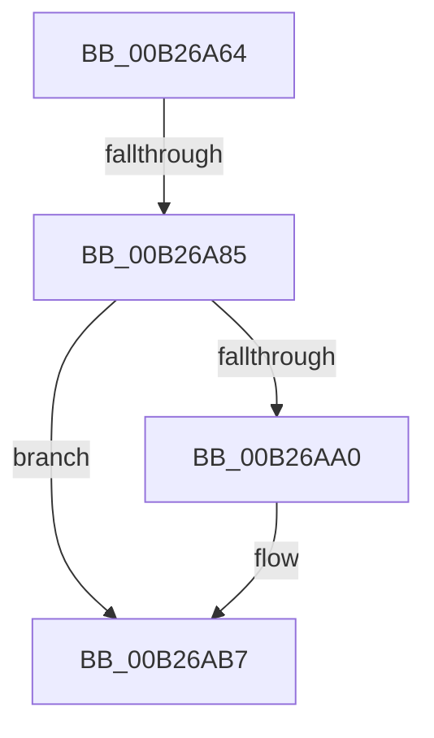

# sub_00B26A64

- RVA: `0x00B26A64`–`0x00B26AF0` (길이 `140` bytes)
- VA: `0x0000000140B26A64`
- 실행 섹션: `PAGE`
- PDB 이름 있음: `아니요`; PDB Function 태그: `아니요`
- unwind 정보 RVA: `0x0009237C`
- 디코드: `33`개 명령, `140/140` bytes 표시
- 미해석 바이트: `0` (있으면 어셈블리에 `.byte`로 보존)

> 이 문서는 커널 이미지의 기계어와 PDB 기호를 분석해 생성했습니다. 4번과 5번은 함수 원형과 자료형을 바이너리 사용 방식에서 추정한 C 해석이며 원본 소스 복구 결과는 아닙니다.

## 1. Dependencies

- 직접 호출 지점: **1**; 고유 호출 대상: **1**
- 직접 호출자로 확인된 함수: **0**
- RIP 상대 이미지 참조: **3**

### Outgoing calls
- `0x00B26A74` → [ExAllocatePool2](../../poolcode/B8/ExAllocatePool2_function_00B820F0.md) (function, `0x00B820F0`)

### Direct callers
- 이 함수 시작 RVA로 연결되는 직접 call은 확인되지 않았습니다. 간접 호출은 완전히 역산할 수 없습니다.

### Static image references
- `0x00B26ACA` → RVA `0x00E663B8` (`.data`; read)
- `0x00B26AD5` → RVA `0x00E663B0` (`.data`; read)
- `0x00B26AE0` → RVA `0x00F8CB20` (`.data`; read)

## 2. Other-region calls and transfers

- 다른 실행 섹션으로 향하는 call: **1**
  - `0x00B26A74` → [ExAllocatePool2](../../poolcode/B8/ExAllocatePool2_function_00B820F0.md) (`PAGE` → `POOLCODE`)
- call이 아닌 외부 분기/꼬리 이동: **2**
  - `0x00B26A7F` → [PnpRecordBlackboxPnpEventWorkerInformation + 0x32](../95/PnpRecordBlackboxPnpEventWorkerInformation_function_00955CD8.md) (`tail-transfer`)
  - `0x00B26AEB` → [PnpRecordBlackboxPnpEventWorkerInformation + 0x32](../95/PnpRecordBlackboxPnpEventWorkerInformation_function_00955CD8.md) (`tail-transfer`)

## 3. Assembly (complete function range)

```asm
00B26A64  BF 48 00 00 00                  mov edi, 0x48
00B26A69  41 B8 50 6E 70 4B               mov r8d, 0x4b706e50
00B26A6F  8B D7                           mov edx, edi
00B26A71  8D 4F F8                        lea ecx, [rdi - 8]
00B26A74  E8 77 B6 05 00                  call 0x140b820f0
00B26A79  48 8B D8                        mov rbx, rax
00B26A7C  48 85 C0                        test rax, rax
00B26A7F  0F 84 85 F2 E2 FF               je 0x140955d0a
00B26A85  C7 00 01 00 00 00               mov dword ptr [rax], 1
00B26A8B  89 78 04                        mov dword ptr [rax + 4], edi
00B26A8E  8B 4E 10                        mov ecx, dword ptr [rsi + 0x10]
00B26A91  89 48 10                        mov dword ptr [rax + 0x10], ecx
00B26A94  C6 40 08 00                     mov byte ptr [rax + 8], 0
00B26A98  48 8B 06                        mov rax, qword ptr [rsi]
00B26A9B  48 85 C0                        test rax, rax
00B26A9E  74 17                           je 0x140b26ab7
00B26AA0  48 2B 28                        sub rbp, qword ptr [rax]
00B26AA3  48 B8 4B 59 86 38 D6 C5 6D 34   movabs rax, 0x346dc5d63886594b
00B26AAD  48 F7 E5                        mul rbp
00B26AB0  48 C1 EA 0B                     shr rdx, 0xb
00B26AB4  89 53 0C                        mov dword ptr [rbx + 0xc], edx
00B26AB7  48 8B 46 08                     mov rax, qword ptr [rsi + 8]
00B26ABB  48 89 43 18                     mov qword ptr [rbx + 0x18], rax
00B26ABF  8B 46 14                        mov eax, dword ptr [rsi + 0x14]
00B26AC2  48 83 63 28 00                  and qword ptr [rbx + 0x28], 0
00B26AC7  89 43 20                        mov dword ptr [rbx + 0x20], eax
00B26ACA  48 8B 05 E7 F8 33 00            mov rax, qword ptr [rip + 0x33f8e7]
00B26AD1  48 89 43 30                     mov qword ptr [rbx + 0x30], rax
00B26AD5  48 8B 05 D4 F8 33 00            mov rax, qword ptr [rip + 0x33f8d4]
00B26ADC  48 89 43 38                     mov qword ptr [rbx + 0x38], rax
00B26AE0  48 8B 05 39 60 46 00            mov rax, qword ptr [rip + 0x466039]
00B26AE7  48 89 43 40                     mov qword ptr [rbx + 0x40], rax
00B26AEB  E9 1A F2 E2 FF                  jmp 0x140955d0a
```

## 4. C-style interpretation (structured pseudocode)

```c
__int64 __fastcall sub_00B26A64(void)
{
    __int64 result;
    __int64 v_rbp;

    result = ExAllocatePool2(72 - 8, 72, (unsigned int)(0x4B706E50ULL), a4);
    *(unsigned int *)(result) = 1;
    *(unsigned int *)(result + 4) = 72;
    *(unsigned int *)(result + 16) = (unsigned int)((unsigned int)(*(unsigned int *)(v_rsi + 16)));
    *(unsigned __int8 *)(result + 8) = 0;
    if (*(unsigned __int64 *)(v_rsi) != 0) {
        v_rbp = (v_rbp) - (*(unsigned __int64 *)(*(unsigned __int64 *)(v_rsi)));
        a2 = (72) >> (11);
        *(unsigned int *)(result + 12) = (unsigned int)(a2);
    }
    *(unsigned __int64 *)(result + 24) = *(unsigned __int64 *)(v_rsi + 8);
    *(unsigned int *)(result + 32) = (unsigned int)((unsigned int)(*(unsigned int *)(v_rsi + 20)));
    *(unsigned __int64 *)(result + 48) = *(unsigned __int64 *)(v_rip + 3406055);
    *(unsigned __int64 *)(result + 56) = *(unsigned __int64 *)(v_rip + 3406036);
    *(unsigned __int64 *)(result + 64) = *(unsigned __int64 *)(v_rip + 4612153);
}
```

## 5. (Beta) C Style

```c
void sub_00B26A64(void)
{
    int64_t result;
    int64_t local_rbp;

    result = ExAllocatePool2(72 - 8, 72, (uint32_t)(0x4B706E50ULL), a4);
    *(uint32_t *)(result) = 1;
    *(uint32_t *)(result + 0x4) = 72;
    *(uint32_t *)(result + 0x10) = (uint32_t)((uint32_t)(*(uint32_t *)(local_rsi + 0x10)));
    *(uint8_t *)(result + 0x8) = 0;
    if (*(uint64_t *)(local_rsi) != 0) {
        local_rbp = (local_rbp) - (*(uint64_t *)(*(uint64_t *)(local_rsi)));
        a2 = (72) >> (11);
        *(uint32_t *)(result + 0xC) = (uint32_t)(a2);
    }
    *(uint64_t *)(result + 0x18) = *(uint64_t *)(local_rsi + 0x8);
    *(uint32_t *)(result + 0x20) = (uint32_t)((uint32_t)(*(uint32_t *)(local_rsi + 0x14)));
    *(uint64_t *)(result + 0x30) = *(uint64_t *)(v_rip + 0x33F8E7);
    *(uint64_t *)(result + 0x38) = *(uint64_t *)(v_rip + 0x33F8D4);
    *(uint64_t *)(result + 0x40) = *(uint64_t *)(v_rip + 0x466039);
}
```

## 6. Execution-region graph

[열기: 2D/3D 그래프와 함수 탐색 컨트롤 패널](../../../control-panel.html?section=page&rva=0x00B26A64&view=graph)

- 2D 그래프는 위에서 아래로 흐르고, 3D 그래프는 빈 공간을 드래그해 회전합니다. Shift+드래그는 이동, 휠은 확대·축소, 함수 노드 선택은 대상 보고서 이동입니다.

### Static fallback


