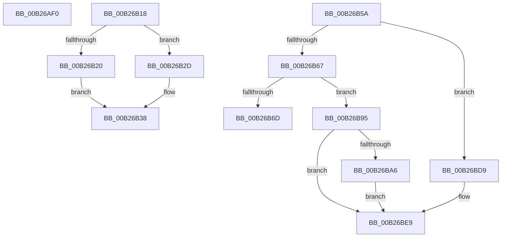

# sub_00B26AF0

- RVA: `0x00B26AF0`–`0x00B26BF5` (길이 `261` bytes)
- VA: `0x0000000140B26AF0`
- 실행 섹션: `PAGE`
- PDB 이름 있음: `아니요`; PDB Function 태그: `아니요`
- unwind 정보 RVA: `0x00092684`
- 디코드: `59`개 명령, `261/261` bytes 표시
- 미해석 바이트: `0` (있으면 어셈블리에 `.byte`로 보존)

> 이 문서는 커널 이미지의 기계어와 PDB 기호를 분석해 생성했습니다. 4번과 5번은 함수 원형과 자료형을 바이너리 사용 방식에서 추정한 C 해석이며 원본 소스 복구 결과는 아닙니다.

## 1. Dependencies

- 직접 호출 지점: **5**; 고유 호출 대상: **2**
- 직접 호출자로 확인된 함수: **0**
- RIP 상대 이미지 참조: **5**

### Outgoing calls
- `0x00B26B0D` → [AslLogCallPrintf](../95/AslLogCallPrintf_function_0095E4EC.md) (function, `0x0095E4EC`)
- `0x00B26B4F` → [AslLogCallPrintf](../95/AslLogCallPrintf_function_0095E4EC.md) (function, `0x0095E4EC`)
- `0x00B26B86` → [AslLogCallPrintf](../95/AslLogCallPrintf_function_0095E4EC.md) (function, `0x0095E4EC`)
- `0x00B26B9D` → [AslpFileMappingGetFileKind](../AF/AslpFileMappingGetFileKind_function_00AF950C.md) (function, `0x00AF950C`)
- `0x00B26BCB` → [AslLogCallPrintf](../95/AslLogCallPrintf_function_0095E4EC.md) (function, `0x0095E4EC`)

### Direct callers
- 이 함수 시작 RVA로 연결되는 직접 call은 확인되지 않았습니다. 간접 호출은 완전히 역산할 수 없습니다.

### Static image references
- `0x00B26AF0` → RVA `0x0003E930` (`.rdata`; read)
- `0x00B26AFD` → RVA `0x0003ED80` (`.rdata`; read)
- `0x00B26B43` → RVA `0x0003ED98` (`.rdata`; read)
- `0x00B26B6D` → RVA `0x0003EDC8` (`.rdata`; read)
- `0x00B26BAA` → RVA `0x0003EE00` (`.rdata`; read)

## 2. Other-region calls and transfers

- 다른 실행 섹션으로 향하는 call: **0**
- call이 아닌 외부 분기/꼬리 이동: **4**
  - `0x00B26B13` → [AslFileMappingCreate + 0xEA](../95/AslFileMappingCreate_function_00958448.md) (`tail-transfer`)
  - `0x00B26B55` → [AslFileMappingCreate + 0xEA](../95/AslFileMappingCreate_function_00958448.md) (`tail-transfer`)
  - `0x00B26B90` → [AslFileMappingCreate + 0xEA](../95/AslFileMappingCreate_function_00958448.md) (`tail-transfer`)
  - `0x00B26BF0` → [AslFileMappingCreate + 0xF2](../95/AslFileMappingCreate_function_00958448.md) (`tail-transfer`)

## 3. Assembly (complete function range)

```asm
00B26AF0  4C 8D 0D 39 7E 51 FF            lea r9, [rip - 0xae81c7]
00B26AF7  41 B8 BA 00 00 00               mov r8d, 0xba
00B26AFD  48 8D 15 7C 82 51 FF            lea rdx, [rip - 0xae7d84]
00B26B04  89 44 24 20                     mov dword ptr [rsp + 0x20], eax
00B26B08  B9 01 00 00 00                  mov ecx, 1
00B26B0D  E8 DA 79 E3 FF                  call 0x14095e4ec
00B26B12  90                              nop
00B26B13  E9 1A 1A E3 FF                  jmp 0x140958532
00B26B18  81 FB BA 00 00 C0               cmp ebx, 0xc00000ba
00B26B1E  74 0D                           je 0x140b26b2d
00B26B20  41 B8 A4 00 00 00               mov r8d, 0xa4
00B26B26  B9 01 00 00 00                  mov ecx, 1
00B26B2B  EB 0B                           jmp 0x140b26b38
00B26B2D  41 B8 A6 00 00 00               mov r8d, 0xa6
00B26B33  B9 03 00 00 00                  mov ecx, 3
00B26B38  89 5C 24 28                     mov dword ptr [rsp + 0x28], ebx
00B26B3C  48 8D 15 3D 82 51 FF            lea rdx, [rip - 0xae7dc3]
00B26B43  4C 8D 0D 4E 82 51 FF            lea r9, [rip - 0xae7db2]
00B26B4A  4C 89 74 24 20                  mov qword ptr [rsp + 0x20], r14
00B26B4F  E8 98 79 E3 FF                  call 0x14095e4ec
00B26B54  90                              nop
00B26B55  E9 D8 19 E3 FF                  jmp 0x140958532
00B26B5A  48 8B 45 E8                     mov rax, qword ptr [rbp - 0x18]
00B26B5E  48 89 47 18                     mov qword ptr [rdi + 0x18], rax
00B26B62  4D 85 FF                        test r15, r15
00B26B65  74 72                           je 0x140b26bd9
00B26B67  4C 39 6D E8                     cmp qword ptr [rbp - 0x18], r13
00B26B6B  75 28                           jne 0x140b26b95
00B26B6D  4C 8D 0D 54 82 51 FF            lea r9, [rip - 0xae7dac]
00B26B74  41 B8 D3 00 00 00               mov r8d, 0xd3
00B26B7A  48 8D 15 FF 81 51 FF            lea rdx, [rip - 0xae7e01]
00B26B81  B9 01 00 00 00                  mov ecx, 1
00B26B86  E8 61 79 E3 FF                  call 0x14095e4ec
00B26B8B  BB 0D 00 00 C0                  mov ebx, 0xc000000d
00B26B90  E9 9D 19 E3 FF                  jmp 0x140958532
00B26B95  48 8D 4F 08                     lea rcx, [rdi + 8]
00B26B99  48 8D 57 40                     lea rdx, [rdi + 0x40]
00B26B9D  E8 6A 29 FD FF                  call 0x140af950c
00B26BA2  85 C0                           test eax, eax
00B26BA4  79 43                           jns 0x140b26be9
00B26BA6  89 44 24 28                     mov dword ptr [rsp + 0x28], eax
00B26BAA  4C 8D 0D 4F 82 51 FF            lea r9, [rip - 0xae7db1]
00B26BB1  48 8B 07                        mov rax, qword ptr [rdi]
00B26BB4  48 8D 15 C5 81 51 FF            lea rdx, [rip - 0xae7e3b]
00B26BBB  41 B8 DA 00 00 00               mov r8d, 0xda
00B26BC1  48 89 44 24 20                  mov qword ptr [rsp + 0x20], rax
00B26BC6  B9 01 00 00 00                  mov ecx, 1
00B26BCB  E8 1C 79 E3 FF                  call 0x14095e4ec
00B26BD0  C7 47 40 03 00 00 00            mov dword ptr [rdi + 0x40], 3
00B26BD7  EB 10                           jmp 0x140b26be9
00B26BD9  48 8B 45 E8                     mov rax, qword ptr [rbp - 0x18]
00B26BDD  48 F7 D8                        neg rax
00B26BE0  1B C9                           sbb ecx, ecx
00B26BE2  F7 D9                           neg ecx
00B26BE4  FF C1                           inc ecx
00B26BE6  89 4F 40                        mov dword ptr [rdi + 0x40], ecx
00B26BE9  49 89 3C 24                     mov qword ptr [r12], rdi
00B26BED  41 8B DD                        mov ebx, r13d
00B26BF0  E9 45 19 E3 FF                  jmp 0x14095853a
```

## 4. C-style interpretation (structured pseudocode)

```c
__int64 __fastcall sub_00B26AF0(void)
{
    __int64 result;
    unsigned int v_stack_p20;
    unsigned int v_stack_p28;

    v_stack_p20 = (unsigned int)(result);
    result = AslLogCallPrintf(1, v_rip - 11435396, 186, v_rip - 11436487);
}
```

## 5. (Beta) C Style

```c
void sub_00B26AF0(void)
{
    int64_t result;
    uint32_t v_stack_p20;
    uint32_t v_stack_p28;

    v_stack_p20 = (uint32_t)(result);
    result = AslLogCallPrintf(1, v_rip - 11435396, 186, v_rip - 11436487);
}
```

## 6. Execution-region graph

[열기: 2D/3D 그래프와 함수 탐색 컨트롤 패널](../../../control-panel.html?section=page&rva=0x00B26AF0&view=graph)

- 2D 그래프는 위에서 아래로 흐르고, 3D 그래프는 빈 공간을 드래그해 회전합니다. Shift+드래그는 이동, 휠은 확대·축소, 함수 노드 선택은 대상 보고서 이동입니다.

### Static fallback


