# sub_00B26BF6

- RVA: `0x00B26BF6`–`0x00B26E86` (길이 `656` bytes)
- VA: `0x0000000140B26BF6`
- 실행 섹션: `PAGE`
- PDB 이름 있음: `아니요`; PDB Function 태그: `아니요`
- unwind 정보 RVA: `0x000926E0`
- 디코드: `159`개 명령, `656/656` bytes 표시
- 미해석 바이트: `0` (있으면 어셈블리에 `.byte`로 보존)

> 이 문서는 커널 이미지의 기계어와 PDB 기호를 분석해 생성했습니다. 4번과 5번은 함수 원형과 자료형을 바이너리 사용 방식에서 추정한 C 해석이며 원본 소스 복구 결과는 아닙니다.

## 1. Dependencies

- 직접 호출 지점: **13**; 고유 호출 대상: **10**
- 직접 호출자로 확인된 함수: **0**
- RIP 상대 이미지 참조: **9**

### Outgoing calls
- `0x00B26C39` → [guard_dispatch_icall](../../text/6B/guard_dispatch_icall_function_006BAAD0.md) (function, `0x006BAAD0`)
- `0x00B26CC2` → [RtlAssert](../../text/5E/RtlAssert_function_005E75E0.md) (function, `0x005E75E0`)
- `0x00B26D54` → [ExfTryToWakePushLock](../../text/26/ExfTryToWakePushLock_function_00265DD0.md) (function, `0x00265DD0`)
- `0x00B26D5C` → [KeAbPostRelease](../../text/2E/KeAbPostRelease_function_002E1600.md) (function, `0x002E1600`)
- `0x00B26D61` → [KeLeaveCriticalRegion](../../text/25/KeLeaveCriticalRegion_function_0025D8B0.md) (function, `0x0025D8B0`)
- `0x00B26D9B` → [ObfDereferenceObject](../../text/2F/ObfDereferenceObject_function_002F9350.md) (function, `0x002F9350`)
- `0x00B26DB0` → [KsepPoolFreePaged](../../text/4B/KsepPoolFreePaged_function_004B0E10.md) (function, `0x004B0E10`)
- `0x00B26DF2` → [KsepDebugPrint](../../text/4D/KsepDebugPrint_function_004DCFF0.md) (function, `0x004DCFF0`)
- `0x00B26E03` → [KsepLogInfo](../../text/49/KsepLogInfo_function_00499A68.md) (function, `0x00499A68`)
- `0x00B26E1F` → [KsepDbFreeDriverShims](../95/KsepDbFreeDriverShims_function_00958754.md) (function, `0x00958754`)
- `0x00B26E27` → [KsepPoolFreePaged](../../text/4B/KsepPoolFreePaged_function_004B0E10.md) (function, `0x004B0E10`)
- `0x00B26E66` → [KsepDebugPrint](../../text/4D/KsepDebugPrint_function_004DCFF0.md) (function, `0x004DCFF0`)
- `0x00B26E74` → [KsepLogInfo](../../text/49/KsepLogInfo_function_00499A68.md) (function, `0x00499A68`)

### Direct callers
- 이 함수 시작 RVA로 연결되는 직접 call은 확인되지 않았습니다. 간접 호출은 완전히 역산할 수 없습니다.

### Static image references
- `0x00B26C4A` → RVA `0x00000000` (`image boundary/outside`; read)
- `0x00B26C83` → RVA `0x00F101C0` (`.data`; read/write)
- `0x00B26CA7` → RVA `0x00E66CE8` (`.data`; read)
- `0x00B26CB4` → RVA `0x00B00C70` (` ?? ::NNGAKEGL::`string'`; read)
- `0x00B26CBB` → RVA `0x00B00DC0` (` ?? ::NNGAKEGL::`string'`; read)
- `0x00B26D40` → RVA `0x00E66CB0` (`.data`; read/write)
- `0x00B26DB8` → RVA `0x00F105E0` (`.data`; read/write)
- `0x00B26DE9` → RVA `0x00B00D30` (` ?? ::NNGAKEGL::`string'`; read)
- `0x00B26E5D` → RVA `0x00B00D80` (` ?? ::NNGAKEGL::`string'`; read)

## 2. Other-region calls and transfers

- 다른 실행 섹션으로 향하는 call: **12**
  - `0x00B26C39` → [guard_dispatch_icall](../../text/6B/guard_dispatch_icall_function_006BAAD0.md) (`PAGE` → `.text`)
  - `0x00B26CC2` → [RtlAssert](../../text/5E/RtlAssert_function_005E75E0.md) (`PAGE` → `.text`)
  - `0x00B26D54` → [ExfTryToWakePushLock](../../text/26/ExfTryToWakePushLock_function_00265DD0.md) (`PAGE` → `.text`)
  - `0x00B26D5C` → [KeAbPostRelease](../../text/2E/KeAbPostRelease_function_002E1600.md) (`PAGE` → `.text`)
  - `0x00B26D61` → [KeLeaveCriticalRegion](../../text/25/KeLeaveCriticalRegion_function_0025D8B0.md) (`PAGE` → `.text`)
  - `0x00B26D9B` → [ObfDereferenceObject](../../text/2F/ObfDereferenceObject_function_002F9350.md) (`PAGE` → `.text`)
  - `0x00B26DB0` → [KsepPoolFreePaged](../../text/4B/KsepPoolFreePaged_function_004B0E10.md) (`PAGE` → `.text`)
  - `0x00B26DF2` → [KsepDebugPrint](../../text/4D/KsepDebugPrint_function_004DCFF0.md) (`PAGE` → `.text`)
  - `0x00B26E03` → [KsepLogInfo](../../text/49/KsepLogInfo_function_00499A68.md) (`PAGE` → `.text`)
  - `0x00B26E27` → [KsepPoolFreePaged](../../text/4B/KsepPoolFreePaged_function_004B0E10.md) (`PAGE` → `.text`)
  - `0x00B26E66` → [KsepDebugPrint](../../text/4D/KsepDebugPrint_function_004DCFF0.md) (`PAGE` → `.text`)
  - `0x00B26E74` → [KsepLogInfo](../../text/49/KsepLogInfo_function_00499A68.md) (`PAGE` → `.text`)
- call이 아닌 외부 분기/꼬리 이동: **1**
  - `0x00B26E7A` → [KseDriverUnloadImage + 0x6C](../95/KseDriverUnloadImage_function_009587E0.md) (`tail-transfer`)

## 3. Assembly (complete function range)

```asm
00B26BF6  48 85 FF                        test rdi, rdi
00B26BF9  74 04                           je 0x140b26bff
00B26BFB  44 88 67 0A                     mov byte ptr [rdi + 0xa], r12b
00B26BFF  48 8B 7C 24 50                  mov rdi, qword ptr [rsp + 0x50]
00B26C04  33 F6                           xor esi, esi
00B26C06  4C 8D 77 18                     lea r14, [rdi + 0x18]
00B26C0A  41 8B 06                        mov eax, dword ptr [r14]
00B26C0D  85 C0                           test eax, eax
00B26C0F  74 37                           je 0x140b26c48
00B26C11  48 8B 47 20                     mov rax, qword ptr [rdi + 0x20]
00B26C15  48 8D 0C B6                     lea rcx, [rsi + rsi*4]
00B26C19  48 03 C9                        add rcx, rcx
00B26C1C  48 8B 54 C8 48                  mov rdx, qword ptr [rax + rcx*8 + 0x48]
00B26C21  8B 42 1C                        mov eax, dword ptr [rdx + 0x1c]
00B26C24  A8 04                           test al, 4
00B26C26  75 16                           jne 0x140b26c3e
00B26C28  48 8B 42 10                     mov rax, qword ptr [rdx + 0x10]
00B26C2C  48 8B 40 20                     mov rax, qword ptr [rax + 0x20]
00B26C30  48 85 C0                        test rax, rax
00B26C33  74 09                           je 0x140b26c3e
00B26C35  48 8B 4D 30                     mov rcx, qword ptr [rbp + 0x30]
00B26C39  E8 92 3E B9 FF                  call 0x1406baad0
00B26C3E  41 8B 06                        mov eax, dword ptr [r14]
00B26C41  41 03 F4                        add esi, r12d
00B26C44  3B F0                           cmp esi, eax
00B26C46  72 C9                           jb 0x140b26c11
00B26C48  33 ED                           xor ebp, ebp
00B26C4A  48 8D 15 AF 93 4D FF            lea rdx, [rip - 0xb26c51]
00B26C51  44 8D 4D 07                     lea r9d, [rbp + 7]
00B26C55  85 C0                           test eax, eax
00B26C57  0F 84 C2 00 00 00               je 0x140b26d1f
00B26C5D  41 B8 8B 05 00 00               mov r8d, 0x58b
00B26C63  48 8B 47 20                     mov rax, qword ptr [rdi + 0x20]
00B26C67  48 8D 0C AD 00 00 00 00         lea rcx, [rbp*4]
00B26C6F  48 03 CD                        add rcx, rbp
00B26C72  48 03 C9                        add rcx, rcx
00B26C75  48 8B 74 C8 48                  mov rsi, qword ptr [rax + rcx*8 + 0x48]
00B26C7A  83 7E 18 00                     cmp dword ptr [rsi + 0x18], 0
00B26C7E  77 5A                           ja 0x140b26cda
00B26C80  41 8B C4                        mov eax, r12d
00B26C83  F0 0F C1 05 35 95 3E 00         lock xadd dword ptr [rip + 0x3e9535], eax
00B26C8B  41 03 C4                        add eax, r12d
00B26C8E  83 E0 3F                        and eax, 0x3f
00B26C91  C7 84 C2 E4 01 F1 00 20 04 00 C0  mov dword ptr [rdx + rax*8 + 0xf101e4], 0xc0000420
00B26C9C  C7 84 C2 E0 01 F1 00 8B 05 07 00  mov dword ptr [rdx + rax*8 + 0xf101e0], 0x7058b
00B26CA7  8B 05 3B 00 34 00               mov eax, dword ptr [rip + 0x34003b]
00B26CAD  A8 04                           test al, 4
00B26CAF  74 29                           je 0x140b26cda
00B26CB1  45 33 C9                        xor r9d, r9d
00B26CB4  48 8D 15 B5 9F FD FF            lea rdx, [rip - 0x2604b]
00B26CBB  48 8D 0D FE A0 FD FF            lea rcx, [rip - 0x25f02]
00B26CC2  E8 19 09 AC FF                  call 0x1405e75e0
00B26CC7  48 8D 15 32 93 4D FF            lea rdx, [rip - 0xb26cce]
00B26CCE  41 B8 8B 05 00 00               mov r8d, 0x58b
00B26CD4  41 B9 07 00 00 00               mov r9d, 7
00B26CDA  8B 4E 18                        mov ecx, dword ptr [rsi + 0x18]
00B26CDD  8B 46 1C                        mov eax, dword ptr [rsi + 0x1c]
00B26CE0  FF C9                           dec ecx
00B26CE2  89 4E 18                        mov dword ptr [rsi + 0x18], ecx
00B26CE5  A8 04                           test al, 4
00B26CE7  74 25                           je 0x140b26d0e
00B26CE9  85 C9                           test ecx, ecx
00B26CEB  75 21                           jne 0x140b26d0e
00B26CED  48 8B 0E                        mov rcx, qword ptr [rsi]
00B26CF0  48 39 71 08                     cmp qword ptr [rcx + 8], rsi
00B26CF4  0F 85 85 01 00 00               jne 0x140b26e7f
00B26CFA  48 8B 46 08                     mov rax, qword ptr [rsi + 8]
00B26CFE  48 39 30                        cmp qword ptr [rax], rsi
00B26D01  0F 85 78 01 00 00               jne 0x140b26e7f
00B26D07  48 89 08                        mov qword ptr [rax], rcx
00B26D0A  48 89 41 08                     mov qword ptr [rcx + 8], rax
00B26D0E  41 03 EC                        add ebp, r12d
00B26D11  41 3B 2E                        cmp ebp, dword ptr [r14]
00B26D14  0F 82 49 FF FF FF               jb 0x140b26c63
00B26D1A  48 8B 7C 24 50                  mov rdi, qword ptr [rsp + 0x50]
00B26D1F  48 8B 17                        mov rdx, qword ptr [rdi]
00B26D22  48 39 7A 08                     cmp qword ptr [rdx + 8], rdi
00B26D26  0F 85 53 01 00 00               jne 0x140b26e7f
00B26D2C  48 8B 47 08                     mov rax, qword ptr [rdi + 8]
00B26D30  48 39 38                        cmp qword ptr [rax], rdi
00B26D33  0F 85 46 01 00 00               jne 0x140b26e7f
00B26D39  48 89 10                        mov qword ptr [rax], rdx
00B26D3C  48 89 42 08                     mov qword ptr [rdx + 8], rax
00B26D40  F0 48 0F C1 1D 67 FF 33 00      lock xadd qword ptr [rip + 0x33ff67], rbx
00B26D49  80 E3 06                        and bl, 6
00B26D4C  80 FB 02                        cmp bl, 2
00B26D4F  75 08                           jne 0x140b26d59
00B26D51  49 8B CD                        mov rcx, r13
00B26D54  E8 77 F0 73 FF                  call 0x140265dd0
00B26D59  49 8B CD                        mov rcx, r13
00B26D5C  E8 9F A8 7B FF                  call 0x1402e1600
00B26D61  E8 4A 6B 73 FF                  call 0x14025d8b0
00B26D66  41 8B 16                        mov edx, dword ptr [r14]
00B26D69  4C 8D 2D 90 92 4D FF            lea r13, [rip - 0xb26d70]
00B26D70  33 FF                           xor edi, edi
00B26D72  8D 6F 05                        lea ebp, [rdi + 5]
00B26D75  85 D2                           test edx, edx
00B26D77  0F 84 99 00 00 00               je 0x140b26e16
00B26D7D  48 8B 74 24 50                  mov rsi, qword ptr [rsp + 0x50]
00B26D82  48 8B 46 20                     mov rax, qword ptr [rsi + 0x20]
00B26D86  48 8D 0C BF                     lea rcx, [rdi + rdi*4]
00B26D8A  48 03 C9                        add rcx, rcx
00B26D8D  48 8B 5C C8 48                  mov rbx, qword ptr [rax + rcx*8 + 0x48]
00B26D92  48 8B 4B 20                     mov rcx, qword ptr [rbx + 0x20]
00B26D96  48 85 C9                        test rcx, rcx
00B26D99  74 05                           je 0x140b26da0
00B26D9B  E8 B0 25 7D FF                  call 0x1402f9350
00B26DA0  8B 43 1C                        mov eax, dword ptr [rbx + 0x1c]
00B26DA3  A8 04                           test al, 4
00B26DA5  74 61                           je 0x140b26e08
00B26DA7  83 7B 18 00                     cmp dword ptr [rbx + 0x18], 0
00B26DAB  75 5B                           jne 0x140b26e08
00B26DAD  48 8B CB                        mov rcx, rbx
00B26DB0  E8 5B A0 98 FF                  call 0x1404b0e10
00B26DB5  41 8B C4                        mov eax, r12d
00B26DB8  F0 0F C1 05 20 98 3E 00         lock xadd dword ptr [rip + 0x3e9820], eax
00B26DC0  41 03 C4                        add eax, r12d
00B26DC3  83 E0 3F                        and eax, 0x3f
00B26DC6  41 83 A4 C5 E4 03 F1 00 00      and dword ptr [r13 + rax*8 + 0xf103e4], 0
00B26DCF  41 C7 84 C5 E0 03 F1 00 C4 05 07 00  mov dword ptr [r13 + rax*8 + 0xf103e0], 0x705c4
00B26DDB  8B 05 07 FF 33 00               mov eax, dword ptr [rip + 0x33ff07]
00B26DE1  41 84 C4                        test r12b, al
00B26DE4  74 11                           je 0x140b26df7
00B26DE6  4C 8B C3                        mov r8, rbx
00B26DE9  48 8D 15 40 9F FD FF            lea rdx, [rip - 0x260c0]
00B26DF0  8B CD                           mov ecx, ebp
00B26DF2  E8 F9 61 9B FF                  call 0x1404dcff0
00B26DF7  4C 8B C3                        mov r8, rbx
00B26DFA  48 8D 15 2F 9F FD FF            lea rdx, [rip - 0x260d1]
00B26E01  8B CD                           mov ecx, ebp
00B26E03  E8 60 2C 97 FF                  call 0x140499a68
00B26E08  41 8B 16                        mov edx, dword ptr [r14]
00B26E0B  41 03 FC                        add edi, r12d
00B26E0E  3B FA                           cmp edi, edx
00B26E10  0F 82 6C FF FF FF               jb 0x140b26d82
00B26E16  48 8B 5C 24 50                  mov rbx, qword ptr [rsp + 0x50]
00B26E1B  48 8B 4B 20                     mov rcx, qword ptr [rbx + 0x20]
00B26E1F  E8 30 19 E3 FF                  call 0x140958754
00B26E24  48 8B CB                        mov rcx, rbx
00B26E27  E8 E4 9F 98 FF                  call 0x1404b0e10
00B26E2C  41 8B C4                        mov eax, r12d
00B26E2F  F0 0F C1 05 A9 97 3E 00         lock xadd dword ptr [rip + 0x3e97a9], eax
00B26E37  41 03 C4                        add eax, r12d
00B26E3A  83 E0 3F                        and eax, 0x3f
00B26E3D  41 83 A4 C5 E4 03 F1 00 00      and dword ptr [r13 + rax*8 + 0xf103e4], 0
00B26E46  41 C7 84 C5 E0 03 F1 00 CC 05 07 00  mov dword ptr [r13 + rax*8 + 0xf103e0], 0x705cc
00B26E52  8B 05 90 FE 33 00               mov eax, dword ptr [rip + 0x33fe90]
00B26E58  41 84 C4                        test r12b, al
00B26E5B  74 0E                           je 0x140b26e6b
00B26E5D  48 8D 15 1C 9F FD FF            lea rdx, [rip - 0x260e4]
00B26E64  8B CD                           mov ecx, ebp
00B26E66  E8 85 61 9B FF                  call 0x1404dcff0
00B26E6B  48 8D 15 0E 9F FD FF            lea rdx, [rip - 0x260f2]
00B26E72  8B CD                           mov ecx, ebp
00B26E74  E8 EF 2B 97 FF                  call 0x140499a68
00B26E79  90                              nop
00B26E7A  E9 CD 19 E3 FF                  jmp 0x14095884c
00B26E7F  B9 03 00 00 00                  mov ecx, 3
00B26E84  CD 29                           int 0x29
```

## 4. C-style interpretation (structured pseudocode)

```c
__int64 __fastcall sub_00B26BF6(__int64 a1, __int64 a2, __int64 a3, __int64 a4, __int64 a5, __int64 a6, __int64 a7, __int64 a8, __int64 a9, __int64 a10)
{
    __int64 result;
    __int64 v_rbp;
    __int64 v_rbx;
    __int64 v_rdi;
    __int64 v_rsi;

    if (v_rdi != 0) {
        *(unsigned __int8 *)(v_rdi + 10) = (unsigned __int8)(v_r12);
    }
    v_rsi = 0;
    if ((unsigned int)((unsigned int)(*(unsigned int *)(a10 + 24))) == 0) goto loc_00B26C48;
loc_00B26C11:
    a1 = (v_rsi + v_rsi * 4) + (v_rsi + v_rsi * 4);
    if ((((unsigned __int8)((unsigned int)(*(unsigned int *)(*(unsigned __int64 *)(*(unsigned __int64 *)(a10 + 32) + a1 * 8 + 72) + 28)))) & (4)) != 0) goto loc_00B26C3E;
    result = *(unsigned __int64 *)(*(unsigned __int64 *)(*(unsigned __int64 *)(*(unsigned __int64 *)(a10 + 32) + a1 * 8 + 72) + 16) + 32);
    if (*(unsigned __int64 *)(*(unsigned __int64 *)(*(unsigned __int64 *)(*(unsigned __int64 *)(a10 + 32) + a1 * 8 + 72) + 16) + 32) != 0) {
        a1 = *(unsigned __int64 *)(v_rbp + 48);
        result = guard_dispatch_icall(a1, *(unsigned __int64 *)(*(unsigned __int64 *)(a10 + 32) + a1 * 8 + 72), a3, a4);
    }
    v_rsi = (unsigned int)((v_rsi) + ((unsigned int)(v_r12)));
    if (((unsigned int)(v_rsi)) < ((unsigned int)((unsigned int)(*(unsigned int *)(a10 + 24))))) goto loc_00B26C11;
loc_00B26C48:
    v_rbp = 0;
    if ((unsigned int)((unsigned int)(*(unsigned int *)(a10 + 24))) == 0) goto loc_00B26D1F;
loc_00B26C63:
    a1 = (v_rbp * 4) + (0);
    a1 = (a1) + (a1);
    if ((*(unsigned int *)(*(unsigned __int64 *)(*(unsigned __int64 *)(a10 + 32) + a1 * 8 + 72) + 24)) > 0) goto loc_00B26CDA;
    result = (unsigned int)(((unsigned int)((unsigned int)(v_r12))) + ((unsigned int)(v_r12)));
    result = (unsigned int)((result) & (63));
    *(unsigned int *)(v_rip - 11693137 + result * 8 + 15794660) = 0xC0000420ULL;
    *(unsigned int *)(v_rip - 11693137 + result * 8 + 15794656) = 0x7058BULL;
    result = (unsigned int)(*(unsigned int *)(v_rip + 3407931));
    if ((((unsigned __int8)((unsigned int)(*(unsigned int *)(v_rip + 3407931)))) & (4)) != 0) {
        a4 = 0;
        a2 = v_rip - 155723;
        a1 = v_rip - 155394;
        result = RtlAssert(a1, a2, (unsigned int)(0x58BULL), a4);
        a2 = v_rip - 11693262;
        a3 = 0x58BULL;
        a4 = 7;
    }
    a1 = (unsigned int)(((unsigned int)(*(unsigned int *)(*(unsigned __int64 *)(*(unsigned __int64 *)(a10 + 32) + a1 * 8 + 72) + 24))) - 1);
    *(unsigned int *)(*(unsigned __int64 *)(*(unsigned __int64 *)(a10 + 32) + a1 * 8 + 72) + 24) = (unsigned int)(a1);
    if ((((unsigned __int8)((unsigned int)(*(unsigned int *)(*(unsigned __int64 *)(*(unsigned __int64 *)(a10 + 32) + a1 * 8 + 72) + 28)))) & (4)) == 0) goto loc_00B26D0E;
    if ((unsigned int)(a1) != 0) goto loc_00B26D0E;
    if ((*(unsigned __int64 *)(*(unsigned __int64 *)(*(unsigned __int64 *)(*(unsigned __int64 *)(a10 + 32) + a1 * 8 + 72)) + 8)) != (*(unsigned __int64 *)(*(unsigned __int64 *)(a10 + 32) + a1 * 8 + 72))) goto loc_00B26E7F;
    if ((*(unsigned __int64 *)(*(unsigned __int64 *)(*(unsigned __int64 *)(*(unsigned __int64 *)(a10 + 32) + a1 * 8 + 72) + 8))) != (*(unsigned __int64 *)(*(unsigned __int64 *)(a10 + 32) + a1 * 8 + 72))) goto loc_00B26E7F;
    *(unsigned __int64 *)(*(unsigned __int64 *)(*(unsigned __int64 *)(*(unsigned __int64 *)(a10 + 32) + a1 * 8 + 72) + 8)) = *(unsigned __int64 *)(*(unsigned __int64 *)(*(unsigned __int64 *)(a10 + 32) + a1 * 8 + 72));
    *(unsigned __int64 *)(*(unsigned __int64 *)(*(unsigned __int64 *)(*(unsigned __int64 *)(a10 + 32) + a1 * 8 + 72)) + 8) = *(unsigned __int64 *)(*(unsigned __int64 *)(*(unsigned __int64 *)(a10 + 32) + a1 * 8 + 72) + 8);
loc_00B26D0E:
    v_rbp = (unsigned int)((v_rbp) + ((unsigned int)(v_r12)));
    if (((unsigned int)(v_rbp)) < (*(unsigned int *)(a10 + 24))) goto loc_00B26C63;
loc_00B26D1F:
    if ((*(unsigned __int64 *)(*(unsigned __int64 *)(a10) + 8)) != a10) goto loc_00B26E7F;
    if ((*(unsigned __int64 *)(*(unsigned __int64 *)(a10 + 8))) != a10) goto loc_00B26E7F;
    *(unsigned __int64 *)(*(unsigned __int64 *)(a10 + 8)) = *(unsigned __int64 *)(a10);
    *(unsigned __int64 *)(*(unsigned __int64 *)(a10) + 8) = *(unsigned __int64 *)(a10 + 8);
    v_rbx = (unsigned __int8)((v_rbx) & (6));
    result = *(unsigned __int64 *)(a10 + 8);
    if (((unsigned __int8)(v_rbx)) == 2) {
        a1 = v_r13;
        result = ExfTryToWakePushLock(a1, *(unsigned __int64 *)(a10), a3, a4);
    }
    result = KeAbPostRelease(v_r13, *(unsigned __int64 *)(a10), a3, a4);
    result = KeLeaveCriticalRegion(v_r13, *(unsigned __int64 *)(a10), a3, a4);
    v_rdi = 0;
    if ((unsigned int)((unsigned int)(*(unsigned int *)(a10 + 24))) == 0) goto loc_00B26E16;
loc_00B26D82:
    a1 = (v_rdi + v_rdi * 4) + (v_rdi + v_rdi * 4);
    result = *(unsigned __int64 *)(a10 + 32);
    if (*(unsigned __int64 *)(*(unsigned __int64 *)(*(unsigned __int64 *)(a10 + 32) + a1 * 8 + 72) + 32) != 0) {
        result = ObfDereferenceObject(*(unsigned __int64 *)(*(unsigned __int64 *)(*(unsigned __int64 *)(a10 + 32) + a1 * 8 + 72) + 32), (unsigned int)(*(unsigned int *)(a10 + 24)), a3, a4);
    }
    if ((((unsigned __int8)((unsigned int)(*(unsigned int *)(*(unsigned __int64 *)(*(unsigned __int64 *)(a10 + 32) + a1 * 8 + 72) + 28)))) & (4)) == 0) goto loc_00B26E08;
    if ((*(unsigned int *)(*(unsigned __int64 *)(*(unsigned __int64 *)(a10 + 32) + a1 * 8 + 72) + 24)) != 0) goto loc_00B26E08;
    result = KsepPoolFreePaged(*(unsigned __int64 *)(*(unsigned __int64 *)(a10 + 32) + a1 * 8 + 72), (unsigned int)(*(unsigned int *)(a10 + 24)), a3, a4);
    result = (unsigned int)(((unsigned int)((unsigned int)(v_r12))) + ((unsigned int)(v_r12)));
    result = (unsigned int)((result) & (63));
    *(unsigned int *)(v_rip - 11693424 + result * 8 + 15795168) = 0x705C4ULL;
    result = (unsigned int)(*(unsigned int *)(v_rip + 3407623));
    if ((((unsigned __int8)(v_r12)) & ((unsigned __int8)((unsigned int)(*(unsigned int *)(v_rip + 3407623))))) != 0) {
        a3 = *(unsigned __int64 *)(*(unsigned __int64 *)(a10 + 32) + a1 * 8 + 72);
        a2 = v_rip - 155840;
        a1 = (unsigned int)(v_rdi + 5);
        result = KsepDebugPrint(a1, a2, a3, a4);
    }
    result = KsepLogInfo((unsigned int)((unsigned int)(v_rdi + 5)), v_rip - 155857, *(unsigned __int64 *)(*(unsigned __int64 *)(a10 + 32) + a1 * 8 + 72), a4);
loc_00B26E08:
    v_rdi = (unsigned int)((v_rdi) + ((unsigned int)(v_r12)));
    if (((unsigned int)(v_rdi)) < ((unsigned int)((unsigned int)(*(unsigned int *)(a10 + 24))))) goto loc_00B26D82;
loc_00B26E16:
    result = KsepDbFreeDriverShims(*(unsigned __int64 *)(a10 + 32), (unsigned int)(*(unsigned int *)(a10 + 24)), *(unsigned __int64 *)(*(unsigned __int64 *)(a10 + 32) + a1 * 8 + 72), a4);
    result = KsepPoolFreePaged(a10, (unsigned int)(*(unsigned int *)(a10 + 24)), *(unsigned __int64 *)(*(unsigned __int64 *)(a10 + 32) + a1 * 8 + 72), a4);
    result = (unsigned int)(((unsigned int)((unsigned int)(v_r12))) + ((unsigned int)(v_r12)));
    result = (unsigned int)((result) & (63));
    *(unsigned int *)(v_rip - 11693424 + result * 8 + 15795168) = 0x705CCULL;
    result = (unsigned int)(*(unsigned int *)(v_rip + 3407504));
    if ((((unsigned __int8)(v_r12)) & ((unsigned __int8)((unsigned int)(*(unsigned int *)(v_rip + 3407504))))) != 0) {
        a2 = v_rip - 155876;
        a1 = (unsigned int)(v_rdi + 5);
        result = KsepDebugPrint(a1, a2, *(unsigned __int64 *)(*(unsigned __int64 *)(a10 + 32) + a1 * 8 + 72), a4);
    }
    result = KsepLogInfo((unsigned int)((unsigned int)(v_rdi + 5)), v_rip - 155890, *(unsigned __int64 *)(*(unsigned __int64 *)(a10 + 32) + a1 * 8 + 72), a4);
loc_00B26E7F:
    return result;
}
```

## 5. (Beta) C Style

```c
int64_t sub_00B26BF6(int64_t Arg1, int64_t Arg2, int64_t Arg3, int64_t Arg4, uint64_t Arg5, uint64_t Arg6, uint64_t Arg7, uint64_t Arg8, uint64_t Arg9, void *Arg10)
{
    uint8_t *arg10 = (uint8_t *)Arg10;

    int64_t result;
    int64_t local_rbp;
    int64_t local_rbx;
    int64_t local_rdi;
    int64_t local_rsi;

    if (local_rdi != 0) {
        *(uint8_t *)(local_rdi + 0xA) = (uint8_t)(local_r12);
    }
    local_rsi = 0;
    if ((uint32_t)((uint32_t)(*(uint32_t *)(arg10 + 0x18))) == 0) goto loc_00B26C48;
loc_00B26C11:
    Arg1 = (local_rsi + local_rsi * 4) + (local_rsi + local_rsi * 4);
    if ((((uint8_t)((uint32_t)(*(uint32_t *)(*(uint64_t *)(*(uint64_t *)(arg10 + 0x20) + Arg1 * 8 + 0x48) + 0x1C)))) & (4)) != 0) goto loc_00B26C3E;
    result = *(uint64_t *)(*(uint64_t *)(*(uint64_t *)(*(uint64_t *)(arg10 + 0x20) + Arg1 * 8 + 0x48) + 0x10) + 0x20);
    if (*(uint64_t *)(*(uint64_t *)(*(uint64_t *)(*(uint64_t *)(arg10 + 0x20) + Arg1 * 8 + 0x48) + 0x10) + 0x20) != 0) {
        Arg1 = *(uint64_t *)(local_rbp + 0x30);
        result = guard_dispatch_icall(Arg1, *(uint64_t *)(*(uint64_t *)(arg10 + 0x20) + Arg1 * 8 + 0x48), Arg3, Arg4);
    }
    local_rsi = (uint32_t)((local_rsi) + ((uint32_t)(local_r12)));
    if (((uint32_t)(local_rsi)) < ((uint32_t)((uint32_t)(*(uint32_t *)(arg10 + 0x18))))) goto loc_00B26C11;
loc_00B26C48:
    local_rbp = 0;
    if ((uint32_t)((uint32_t)(*(uint32_t *)(arg10 + 0x18))) == 0) goto loc_00B26D1F;
loc_00B26C63:
    Arg1 = (local_rbp * 4) + (0);
    Arg1 = (Arg1) + (Arg1);
    if ((*(uint32_t *)(*(uint64_t *)(*(uint64_t *)(arg10 + 0x20) + Arg1 * 8 + 0x48) + 0x18)) > 0) goto loc_00B26CDA;
    result = (uint32_t)(((uint32_t)((uint32_t)(local_r12))) + ((uint32_t)(local_r12)));
    result = (uint32_t)((result) & (63));
    *(uint32_t *)(v_rip - 0xB26C51 + result * 8 + 0xF101E4) = 0xC0000420ULL;
    *(uint32_t *)(v_rip - 0xB26C51 + result * 8 + 0xF101E0) = 0x7058BULL;
    result = (uint32_t)(*(uint32_t *)(v_rip + 0x34003B));
    if ((((uint8_t)((uint32_t)(*(uint32_t *)(v_rip + 0x34003B)))) & (4)) != 0) {
        Arg4 = 0;
        Arg2 = v_rip - 155723;
        Arg1 = v_rip - 155394;
        result = RtlAssert(Arg1, Arg2, (uint32_t)(0x58BULL), Arg4);
        Arg2 = v_rip - 11693262;
        Arg3 = 0x58BULL;
        Arg4 = 7;
    }
    Arg1 = (uint32_t)(((uint32_t)(*(uint32_t *)(*(uint64_t *)(*(uint64_t *)(arg10 + 0x20) + Arg1 * 8 + 0x48) + 0x18))) - 1);
    *(uint32_t *)(*(uint64_t *)(*(uint64_t *)(arg10 + 0x20) + Arg1 * 8 + 0x48) + 0x18) = (uint32_t)(Arg1);
    if ((((uint8_t)((uint32_t)(*(uint32_t *)(*(uint64_t *)(*(uint64_t *)(arg10 + 0x20) + Arg1 * 8 + 0x48) + 0x1C)))) & (4)) == 0) goto loc_00B26D0E;
    if ((uint32_t)(Arg1) != 0) goto loc_00B26D0E;
    if ((*(uint64_t *)(*(uint64_t *)(*(uint64_t *)(*(uint64_t *)(arg10 + 0x20) + Arg1 * 8 + 0x48)) + 0x8)) != (*(uint64_t *)(*(uint64_t *)(arg10 + 0x20) + Arg1 * 8 + 0x48))) goto loc_00B26E7F;
    if ((*(uint64_t *)(*(uint64_t *)(*(uint64_t *)(*(uint64_t *)(arg10 + 0x20) + Arg1 * 8 + 0x48) + 0x8))) != (*(uint64_t *)(*(uint64_t *)(arg10 + 0x20) + Arg1 * 8 + 0x48))) goto loc_00B26E7F;
    *(uint64_t *)(*(uint64_t *)(*(uint64_t *)(*(uint64_t *)(arg10 + 0x20) + Arg1 * 8 + 0x48) + 0x8)) = *(uint64_t *)(*(uint64_t *)(*(uint64_t *)(arg10 + 0x20) + Arg1 * 8 + 0x48));
    *(uint64_t *)(*(uint64_t *)(*(uint64_t *)(*(uint64_t *)(arg10 + 0x20) + Arg1 * 8 + 0x48)) + 0x8) = *(uint64_t *)(*(uint64_t *)(*(uint64_t *)(arg10 + 0x20) + Arg1 * 8 + 0x48) + 0x8);
loc_00B26D0E:
    local_rbp = (uint32_t)((local_rbp) + ((uint32_t)(local_r12)));
    if (((uint32_t)(local_rbp)) < (*(uint32_t *)(arg10 + 0x18))) goto loc_00B26C63;
loc_00B26D1F:
    if ((*(uint64_t *)(*(uint64_t *)(arg10) + 0x8)) != Arg10) goto loc_00B26E7F;
    if ((*(uint64_t *)(*(uint64_t *)(arg10 + 0x8))) != Arg10) goto loc_00B26E7F;
    *(uint64_t *)(*(uint64_t *)(arg10 + 0x8)) = *(uint64_t *)(arg10);
    *(uint64_t *)(*(uint64_t *)(arg10) + 0x8) = *(uint64_t *)(arg10 + 0x8);
    local_rbx = (uint8_t)((local_rbx) & (6));
    result = *(uint64_t *)(arg10 + 0x8);
    if (((uint8_t)(local_rbx)) == 2) {
        Arg1 = local_r13;
        result = ExfTryToWakePushLock(Arg1, *(uint64_t *)(arg10), Arg3, Arg4);
    }
    result = KeAbPostRelease(local_r13, *(uint64_t *)(arg10), Arg3, Arg4);
    result = KeLeaveCriticalRegion(local_r13, *(uint64_t *)(arg10), Arg3, Arg4);
    local_rdi = 0;
    if ((uint32_t)((uint32_t)(*(uint32_t *)(arg10 + 0x18))) == 0) goto loc_00B26E16;
loc_00B26D82:
    Arg1 = (local_rdi + local_rdi * 4) + (local_rdi + local_rdi * 4);
    result = *(uint64_t *)(arg10 + 0x20);
    if (*(uint64_t *)(*(uint64_t *)(*(uint64_t *)(arg10 + 0x20) + Arg1 * 8 + 0x48) + 0x20) != 0) {
        result = ObfDereferenceObject(*(uint64_t *)(*(uint64_t *)(*(uint64_t *)(arg10 + 0x20) + Arg1 * 8 + 0x48) + 0x20), (uint32_t)(*(uint32_t *)(arg10 + 0x18)), Arg3, Arg4);
    }
    if ((((uint8_t)((uint32_t)(*(uint32_t *)(*(uint64_t *)(*(uint64_t *)(arg10 + 0x20) + Arg1 * 8 + 0x48) + 0x1C)))) & (4)) == 0) goto loc_00B26E08;
    if ((*(uint32_t *)(*(uint64_t *)(*(uint64_t *)(arg10 + 0x20) + Arg1 * 8 + 0x48) + 0x18)) != 0) goto loc_00B26E08;
    result = KsepPoolFreePaged(*(uint64_t *)(*(uint64_t *)(arg10 + 0x20) + Arg1 * 8 + 0x48), (uint32_t)(*(uint32_t *)(arg10 + 0x18)), Arg3, Arg4);
    result = (uint32_t)(((uint32_t)((uint32_t)(local_r12))) + ((uint32_t)(local_r12)));
    result = (uint32_t)((result) & (63));
    *(uint32_t *)(v_rip - 0xB26D70 + result * 8 + 0xF103E0) = 0x705C4ULL;
    result = (uint32_t)(*(uint32_t *)(v_rip + 0x33FF07));
    if ((((uint8_t)(local_r12)) & ((uint8_t)((uint32_t)(*(uint32_t *)(v_rip + 0x33FF07))))) != 0) {
        Arg3 = *(uint64_t *)(*(uint64_t *)(arg10 + 0x20) + Arg1 * 8 + 0x48);
        Arg2 = v_rip - 155840;
        Arg1 = (uint32_t)(local_rdi + 5);
        result = KsepDebugPrint(Arg1, Arg2, Arg3, Arg4);
    }
    result = KsepLogInfo((uint32_t)((uint32_t)(local_rdi + 5)), v_rip - 155857, *(uint64_t *)(*(uint64_t *)(arg10 + 0x20) + Arg1 * 8 + 0x48), Arg4);
loc_00B26E08:
    local_rdi = (uint32_t)((local_rdi) + ((uint32_t)(local_r12)));
    if (((uint32_t)(local_rdi)) < ((uint32_t)((uint32_t)(*(uint32_t *)(arg10 + 0x18))))) goto loc_00B26D82;
loc_00B26E16:
    result = KsepDbFreeDriverShims(*(uint64_t *)(arg10 + 0x20), (uint32_t)(*(uint32_t *)(arg10 + 0x18)), *(uint64_t *)(*(uint64_t *)(arg10 + 0x20) + Arg1 * 8 + 0x48), Arg4);
    result = KsepPoolFreePaged(Arg10, (uint32_t)(*(uint32_t *)(arg10 + 0x18)), *(uint64_t *)(*(uint64_t *)(arg10 + 0x20) + Arg1 * 8 + 0x48), Arg4);
    result = (uint32_t)(((uint32_t)((uint32_t)(local_r12))) + ((uint32_t)(local_r12)));
    result = (uint32_t)((result) & (63));
    *(uint32_t *)(v_rip - 0xB26D70 + result * 8 + 0xF103E0) = 0x705CCULL;
    result = (uint32_t)(*(uint32_t *)(v_rip + 0x33FE90));
    if ((((uint8_t)(local_r12)) & ((uint8_t)((uint32_t)(*(uint32_t *)(v_rip + 0x33FE90))))) != 0) {
        Arg2 = v_rip - 155876;
        Arg1 = (uint32_t)(local_rdi + 5);
        result = KsepDebugPrint(Arg1, Arg2, *(uint64_t *)(*(uint64_t *)(arg10 + 0x20) + Arg1 * 8 + 0x48), Arg4);
    }
    result = KsepLogInfo((uint32_t)((uint32_t)(local_rdi + 5)), v_rip - 155890, *(uint64_t *)(*(uint64_t *)(arg10 + 0x20) + Arg1 * 8 + 0x48), Arg4);
loc_00B26E7F:
    return result;
}
```

### 관측된 메모리 오프셋

구조체 형식이 확인되지 않은 접근은 인자 기준의 오프셋으로만 기록했습니다.

| 기준 인자 | 오프셋 표현 | 폭 (bit) | 접근 |
|---|---:|---:|---|
| `Arg10` | `+ 0x0` | `32` | `R` |
| `Arg10` | `+ 0x0` | `64` | `R` |
| `Arg10` | `+ 0x8` | `64` | `R` |
| `Arg10` | `+ 0x18` | `64` | `R` |
| `Arg10` | `+ 0x20` | `64` | `R` |

## 6. Execution-region graph

[열기: 2D/3D 그래프와 함수 탐색 컨트롤 패널](../../../control-panel.html?section=page&rva=0x00B26BF6&view=graph)

- 2D 그래프는 위에서 아래로 흐르고, 3D 그래프는 빈 공간을 드래그해 회전합니다. Shift+드래그는 이동, 휠은 확대·축소, 함수 노드 선택은 대상 보고서 이동입니다.

### Static fallback

```mermaid
flowchart TD
  bb_00B26BF6[BB_00B26BF6]
  bb_00B26BFB[BB_00B26BFB]
  bb_00B26BFF[BB_00B26BFF]
  bb_00B26C11[BB_00B26C11]
  bb_00B26C28[BB_00B26C28]
  bb_00B26C35[BB_00B26C35]
  bb_00B26C3E[BB_00B26C3E]
  bb_00B26C48[BB_00B26C48]
  bb_00B26C5D[BB_00B26C5D]
  bb_00B26C63[BB_00B26C63]
  bb_00B26C80[BB_00B26C80]
  bb_00B26CB1[BB_00B26CB1]
  bb_00B26CDA[BB_00B26CDA]
  bb_00B26CE9[BB_00B26CE9]
  bb_00B26CED[BB_00B26CED]
  bb_00B26CFA[BB_00B26CFA]
  bb_00B26D07[BB_00B26D07]
  bb_00B26D0E[BB_00B26D0E]
  bb_00B26D1A[BB_00B26D1A]
  bb_00B26D1F[BB_00B26D1F]
  bb_00B26D2C[BB_00B26D2C]
  bb_00B26D39[BB_00B26D39]
  bb_00B26D51[BB_00B26D51]
  bb_00B26D59[BB_00B26D59]
  bb_00B26D7D[BB_00B26D7D]
  bb_00B26D82[BB_00B26D82]
  bb_00B26D9B[BB_00B26D9B]
  bb_00B26DA0[BB_00B26DA0]
  bb_00B26DA7[BB_00B26DA7]
  bb_00B26DAD[BB_00B26DAD]
  bb_00B26DE6[BB_00B26DE6]
  bb_00B26DF7[BB_00B26DF7]
  bb_00B26E08[BB_00B26E08]
  bb_00B26E16[BB_00B26E16]
  bb_00B26E5D[BB_00B26E5D]
  bb_00B26E6B[BB_00B26E6B]
  bb_00B26E7F[BB_00B26E7F]
  bb_00B26BF6 -->|branch| bb_00B26BFF
  bb_00B26BF6 -->|fallthrough| bb_00B26BFB
  bb_00B26BFB -->|flow| bb_00B26BFF
  bb_00B26BFF -->|branch| bb_00B26C48
  bb_00B26BFF -->|fallthrough| bb_00B26C11
  bb_00B26C11 -->|branch| bb_00B26C3E
  bb_00B26C11 -->|fallthrough| bb_00B26C28
  bb_00B26C28 -->|branch| bb_00B26C3E
  bb_00B26C28 -->|fallthrough| bb_00B26C35
  bb_00B26C35 -->|flow| bb_00B26C3E
  bb_00B26C3E -->|branch| bb_00B26C11
  bb_00B26C3E -->|fallthrough| bb_00B26C48
  bb_00B26C48 -->|branch| bb_00B26D1F
  bb_00B26C48 -->|fallthrough| bb_00B26C5D
  bb_00B26C5D -->|flow| bb_00B26C63
  bb_00B26C63 -->|branch| bb_00B26CDA
  bb_00B26C63 -->|fallthrough| bb_00B26C80
  bb_00B26C80 -->|branch| bb_00B26CDA
  bb_00B26C80 -->|fallthrough| bb_00B26CB1
  bb_00B26CB1 -->|flow| bb_00B26CDA
  bb_00B26CDA -->|branch| bb_00B26D0E
  bb_00B26CDA -->|fallthrough| bb_00B26CE9
  bb_00B26CE9 -->|branch| bb_00B26D0E
  bb_00B26CE9 -->|fallthrough| bb_00B26CED
  bb_00B26CED -->|branch| bb_00B26E7F
  bb_00B26CED -->|fallthrough| bb_00B26CFA
  bb_00B26CFA -->|branch| bb_00B26E7F
  bb_00B26CFA -->|fallthrough| bb_00B26D07
  bb_00B26D07 -->|flow| bb_00B26D0E
  bb_00B26D0E -->|branch| bb_00B26C63
  bb_00B26D0E -->|fallthrough| bb_00B26D1A
  bb_00B26D1A -->|flow| bb_00B26D1F
  bb_00B26D1F -->|branch| bb_00B26E7F
  bb_00B26D1F -->|fallthrough| bb_00B26D2C
  bb_00B26D2C -->|branch| bb_00B26E7F
  bb_00B26D2C -->|fallthrough| bb_00B26D39
  bb_00B26D39 -->|branch| bb_00B26D59
  bb_00B26D39 -->|fallthrough| bb_00B26D51
  bb_00B26D51 -->|flow| bb_00B26D59
  bb_00B26D59 -->|branch| bb_00B26E16
  bb_00B26D59 -->|fallthrough| bb_00B26D7D
  bb_00B26D7D -->|flow| bb_00B26D82
  bb_00B26D82 -->|branch| bb_00B26DA0
  bb_00B26D82 -->|fallthrough| bb_00B26D9B
  bb_00B26D9B -->|flow| bb_00B26DA0
  bb_00B26DA0 -->|branch| bb_00B26E08
  bb_00B26DA0 -->|fallthrough| bb_00B26DA7
  bb_00B26DA7 -->|branch| bb_00B26E08
  bb_00B26DA7 -->|fallthrough| bb_00B26DAD
  bb_00B26DAD -->|branch| bb_00B26DF7
  bb_00B26DAD -->|fallthrough| bb_00B26DE6
  bb_00B26DE6 -->|flow| bb_00B26DF7
  bb_00B26DF7 -->|flow| bb_00B26E08
  bb_00B26E08 -->|branch| bb_00B26D82
  bb_00B26E08 -->|fallthrough| bb_00B26E16
  bb_00B26E16 -->|branch| bb_00B26E6B
  bb_00B26E16 -->|fallthrough| bb_00B26E5D
  bb_00B26E5D -->|flow| bb_00B26E6B
```


