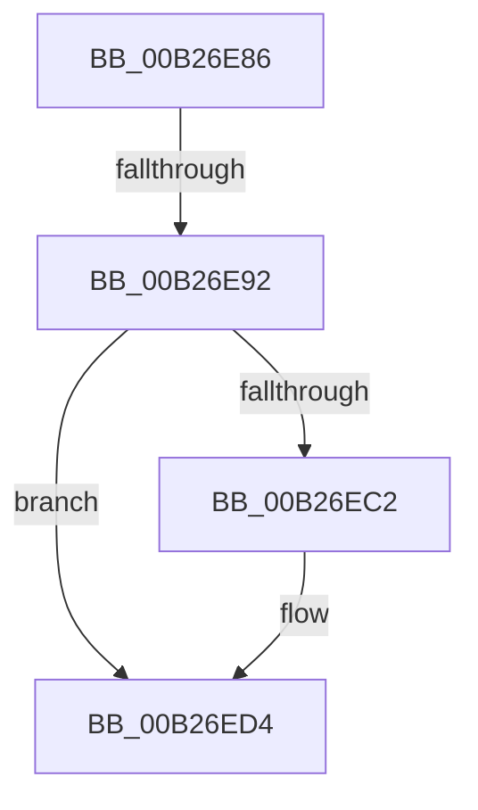

# sub_00B26E86

- RVA: `0x00B26E86`–`0x00B26EEC` (길이 `102` bytes)
- VA: `0x0000000140B26E86`
- 실행 섹션: `PAGE`
- PDB 이름 있음: `아니요`; PDB Function 태그: `아니요`
- unwind 정보 RVA: `0x00092708`
- 디코드: `22`개 명령, `102/102` bytes 표시
- 미해석 바이트: `0` (있으면 어셈블리에 `.byte`로 보존)

> 이 문서는 커널 이미지의 기계어와 PDB 기호를 분석해 생성했습니다. 4번과 5번은 함수 원형과 자료형을 바이너리 사용 방식에서 추정한 C 해석이며 원본 소스 복구 결과는 아닙니다.

## 1. Dependencies

- 직접 호출 지점: **2**; 고유 호출 대상: **2**
- 직접 호출자로 확인된 함수: **0**
- RIP 상대 이미지 참조: **4**

### Outgoing calls
- `0x00B26ECF` → [KsepDebugPrint](../../text/4D/KsepDebugPrint_function_004DCFF0.md) (function, `0x004DCFF0`)
- `0x00B26EE1` → [KsepLogInfo](../../text/49/KsepLogInfo_function_00499A68.md) (function, `0x00499A68`)

### Direct callers
- 이 함수 시작 RVA로 연결되는 직접 call은 확인되지 않았습니다. 간접 호출은 완전히 역산할 수 없습니다.

### Static image references
- `0x00B26E97` → RVA `0x00F105E0` (`.data`; read/write)
- `0x00B26EA1` → RVA `0x00F103E0` (`.data`; read)
- `0x00B26EB8` → RVA `0x00E66CE8` (`.data`; read)
- `0x00B26EC6` → RVA `0x00B009E0` (` ?? ::NNGAKEGL::`string'`; read)

## 2. Other-region calls and transfers

- 다른 실행 섹션으로 향하는 call: **2**
  - `0x00B26ECF` → [KsepDebugPrint](../../text/4D/KsepDebugPrint_function_004DCFF0.md) (`PAGE` → `.text`)
  - `0x00B26EE1` → [KsepLogInfo](../../text/49/KsepLogInfo_function_00499A68.md) (`PAGE` → `.text`)
- call이 아닌 외부 분기/꼬리 이동: **2**
  - `0x00B26E8C` → [KseDriverLoadImage + 0x49](../95/KseDriverLoadImage_function_009588C0.md) (`tail-transfer`)
  - `0x00B26EE7` → [KseDriverLoadImage + 0x10A](../95/KseDriverLoadImage_function_009588C0.md) (`tail-transfer`)

## 3. Assembly (complete function range)

```asm
00B26E86  81 FB 6C 03 00 C0               cmp ebx, 0xc000036c
00B26E8C  0F 85 77 1A E3 FF               jne 0x140958909
00B26E92  B8 01 00 00 00                  mov eax, 1
00B26E97  F0 0F C1 05 41 97 3E 00         lock xadd dword ptr [rip + 0x3e9741], eax
00B26E9F  FF C0                           inc eax
00B26EA1  48 8D 0D 38 95 3E 00            lea rcx, [rip + 0x3e9538]
00B26EA8  83 E0 3F                        and eax, 0x3f
00B26EAB  BF 04 00 00 00                  mov edi, 4
00B26EB0  48 C7 04 C1 BB 00 07 00         mov qword ptr [rcx + rax*8], 0x700bb
00B26EB8  8B 05 2A FE 33 00               mov eax, dword ptr [rip + 0x33fe2a]
00B26EBE  A8 01                           test al, 1
00B26EC0  74 12                           je 0x140b26ed4
00B26EC2  4C 8B 45 E8                     mov r8, qword ptr [rbp - 0x18]
00B26EC6  48 8D 15 13 9B FD FF            lea rdx, [rip - 0x264ed]
00B26ECD  8B CF                           mov ecx, edi
00B26ECF  E8 1C 61 9B FF                  call 0x1404dcff0
00B26ED4  4C 8B 45 E8                     mov r8, qword ptr [rbp - 0x18]
00B26ED8  48 8D 15 01 9B FD FF            lea rdx, [rip - 0x264ff]
00B26EDF  8B CF                           mov ecx, edi
00B26EE1  E8 82 2B 97 FF                  call 0x140499a68
00B26EE6  90                              nop
00B26EE7  E9 DE 1A E3 FF                  jmp 0x1409589ca
```

## 4. C-style interpretation (structured pseudocode)

```c
__int64 __fastcall sub_00B26E86(void)
{
    __int64 result;

    result = (unsigned int)((1) + 1);
    result = (unsigned int)((result) & (63));
    *(unsigned __int64 *)(v_rip + 4101432 + result * 8) = 0x700BBULL;
    result = (unsigned int)(*(unsigned int *)(v_rip + 3407402));
    if ((((unsigned __int8)((unsigned int)(*(unsigned int *)(v_rip + 3407402)))) & (1)) != 0) {
        a3 = *(unsigned __int64 *)(v_rbp - 24);
        a2 = v_rip - 156909;
        a1 = 4;
        result = KsepDebugPrint(a1, a2, a3, a4);
    }
    result = KsepLogInfo(4, v_rip - 156927, *(unsigned __int64 *)(v_rbp - 24), a4);
}
```

## 5. (Beta) C Style

```c
void sub_00B26E86(void)
{
    int64_t result;

    result = (uint32_t)((1) + 1);
    result = (uint32_t)((result) & (63));
    *(uint64_t *)(v_rip + 0x3E9538 + result * 8) = 0x700BBULL;
    result = (uint32_t)(*(uint32_t *)(v_rip + 0x33FE2A));
    if ((((uint8_t)((uint32_t)(*(uint32_t *)(v_rip + 0x33FE2A)))) & (1)) != 0) {
        a3 = *(uint64_t *)(local_rbp - 0x18);
        a2 = v_rip - 156909;
        a1 = 4;
        result = KsepDebugPrint(a1, a2, a3, a4);
    }
    result = KsepLogInfo(4, v_rip - 156927, *(uint64_t *)(local_rbp - 0x18), a4);
}
```

## 6. Execution-region graph

[열기: 2D/3D 그래프와 함수 탐색 컨트롤 패널](../../../control-panel.html?section=page&rva=0x00B26E86&view=graph)

- 2D 그래프는 위에서 아래로 흐르고, 3D 그래프는 빈 공간을 드래그해 회전합니다. Shift+드래그는 이동, 휠은 확대·축소, 함수 노드 선택은 대상 보고서 이동입니다.

### Static fallback


