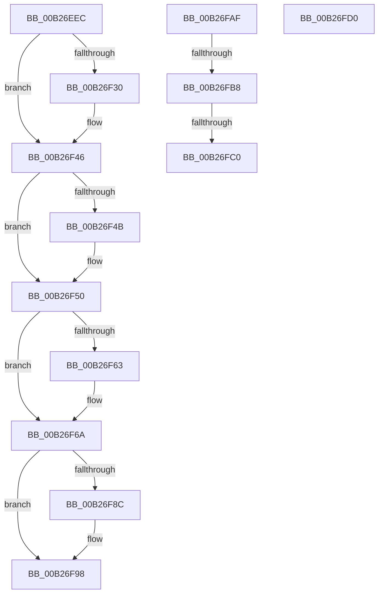

# sub_00B26EEC

- RVA: `0x00B26EEC`–`0x00B26FE8` (길이 `252` bytes)
- VA: `0x0000000140B26EEC`
- 실행 섹션: `PAGE`
- PDB 이름 있음: `아니요`; PDB Function 태그: `아니요`
- unwind 정보 RVA: `0x00092738`
- 디코드: `58`개 명령, `252/252` bytes 표시
- 미해석 바이트: `0` (있으면 어셈블리에 `.byte`로 보존)

> 이 문서는 커널 이미지의 기계어와 PDB 기호를 분석해 생성했습니다. 4번과 5번은 함수 원형과 자료형을 바이너리 사용 방식에서 추정한 C 해석이며 원본 소스 복구 결과는 아닙니다.

## 1. Dependencies

- 직접 호출 지점: **7**; 고유 호출 대상: **7**
- 직접 호출자로 확인된 함수: **0**
- RIP 상대 이미지 참조: **6**

### Outgoing calls
- `0x00B26F1C` → [KeAbPreAcquire](../../text/21/KeAbPreAcquire_function_00210230.md) (function, `0x00210230`)
- `0x00B26F41` → [ExfAcquirePushLockExclusiveEx](../../text/20/ExfAcquirePushLockExclusiveEx_function_0020FC90.md) (function, `0x0020FC90`)
- `0x00B26F93` → [ExfTryToWakePushLock](../../text/26/ExfTryToWakePushLock_function_00265DD0.md) (function, `0x00265DD0`)
- `0x00B26F9F` → [KeAbPostRelease](../../text/2E/KeAbPostRelease_function_002E1600.md) (function, `0x002E1600`)
- `0x00B26FA4` → [KeLeaveCriticalRegion](../../text/25/KeLeaveCriticalRegion_function_0025D8B0.md) (function, `0x0025D8B0`)
- `0x00B26FC5` → [KsepDbFreeDriverShims](../95/KsepDbFreeDriverShims_function_00958754.md) (function, `0x00958754`)
- `0x00B26FDD` → [KsepLogInfo](../../text/49/KsepLogInfo_function_00499A68.md) (function, `0x00499A68`)

### Direct callers
- 이 함수 시작 RVA로 연결되는 직접 call은 확인되지 않았습니다. 간접 호출은 완전히 역산할 수 없습니다.

### Static image references
- `0x00B26EF0` → RVA `0x00E66CB0` (`.data`; read)
- `0x00B26F21` → RVA `0x00E66CB0` (`.data`; read/write)
- `0x00B26F50` → RVA `0x00E66CA8` (`.data`; read)
- `0x00B26F57` → RVA `0x00E66CA0` (`.data`; read)
- `0x00B26F74` → RVA `0x00E66CA8` (`.data`; write)
- `0x00B26FD4` → RVA `0x00B00B90` (` ?? ::NNGAKEGL::`string'`; read)

## 2. Other-region calls and transfers

- 다른 실행 섹션으로 향하는 call: **6**
  - `0x00B26F1C` → [KeAbPreAcquire](../../text/21/KeAbPreAcquire_function_00210230.md) (`PAGE` → `.text`)
  - `0x00B26F41` → [ExfAcquirePushLockExclusiveEx](../../text/20/ExfAcquirePushLockExclusiveEx_function_0020FC90.md) (`PAGE` → `.text`)
  - `0x00B26F93` → [ExfTryToWakePushLock](../../text/26/ExfTryToWakePushLock_function_00265DD0.md) (`PAGE` → `.text`)
  - `0x00B26F9F` → [KeAbPostRelease](../../text/2E/KeAbPostRelease_function_002E1600.md) (`PAGE` → `.text`)
  - `0x00B26FA4` → [KeLeaveCriticalRegion](../../text/25/KeLeaveCriticalRegion_function_0025D8B0.md) (`PAGE` → `.text`)
  - `0x00B26FDD` → [KsepLogInfo](../../text/49/KsepLogInfo_function_00499A68.md) (`PAGE` → `.text`)
- call이 아닌 외부 분기/꼬리 이동: **5**
  - `0x00B26FAA` → [KsepGetShimsForDriver + 0x86](../95/KsepGetShimsForDriver_function_00958A78.md) (`tail-transfer`)
  - `0x00B26FB2` → [KsepGetShimsForDriver + 0x9C](../95/KsepGetShimsForDriver_function_00958A78.md) (`tail-transfer`)
  - `0x00B26FBA` → [KsepGetShimsForDriver + 0x94](../95/KsepGetShimsForDriver_function_00958A78.md) (`tail-transfer`)
  - `0x00B26FCB` → [KsepGetShimsForDriver + 0x94](../95/KsepGetShimsForDriver_function_00958A78.md) (`tail-transfer`)
  - `0x00B26FE3` → [KsepGetShimsForDriver + 0x9C](../95/KsepGetShimsForDriver_function_00958A78.md) (`tail-transfer`)

## 3. Assembly (complete function range)

```asm
00B26EEC  4C 89 70 20                     mov qword ptr [rax + 0x20], r14
00B26EF0  48 8D 0D B9 FD 33 00            lea rcx, [rip + 0x33fdb9]
00B26EF7  48 8B 45 40                     mov rax, qword ptr [rbp + 0x40]
00B26EFB  45 33 C0                        xor r8d, r8d
00B26EFE  89 5E 18                        mov dword ptr [rsi + 0x18], ebx
00B26F01  33 D2                           xor edx, edx
00B26F03  48 89 46 10                     mov qword ptr [rsi + 0x10], rax
00B26F07  48 83 CB FF                     or rbx, 0xffffffffffffffff
00B26F0B  65 48 8B 04 25 88 01 00 00      mov rax, qword ptr gs:[0x188]
00B26F14  66 01 98 E4 01 00 00            add word ptr [rax + 0x1e4], bx
00B26F1B  90                              nop
00B26F1C  E8 0F 93 6E FF                  call 0x140210230
00B26F21  F0 48 0F BA 2D 85 FD 33 00 00   lock bts qword ptr [rip + 0x33fd85], 0
00B26F2B  4C 8B F0                        mov r14, rax
00B26F2E  73 16                           jae 0x140b26f46
00B26F30  4C 8D 05 79 FD 33 00            lea r8, [rip + 0x33fd79]
00B26F37  48 8B D0                        mov rdx, rax
00B26F3A  48 8D 0D 6F FD 33 00            lea rcx, [rip + 0x33fd6f]
00B26F41  E8 4A 8D 6E FF                  call 0x14020fc90
00B26F46  4D 85 F6                        test r14, r14
00B26F49  74 05                           je 0x140b26f50
00B26F4B  41 C6 46 0A 01                  mov byte ptr [r14 + 0xa], 1
00B26F50  48 8B 05 51 FD 33 00            mov rax, qword ptr [rip + 0x33fd51]
00B26F57  48 8D 0D 42 FD 33 00            lea rcx, [rip + 0x33fd42]
00B26F5E  48 39 08                        cmp qword ptr [rax], rcx
00B26F61  74 07                           je 0x140b26f6a
00B26F63  B9 03 00 00 00                  mov ecx, 3
00B26F68  CD 29                           int 0x29
00B26F6A  48 89 0E                        mov qword ptr [rsi], rcx
00B26F6D  48 89 46 08                     mov qword ptr [rsi + 8], rax
00B26F71  48 89 30                        mov qword ptr [rax], rsi
00B26F74  48 89 35 2D FD 33 00            mov qword ptr [rip + 0x33fd2d], rsi
00B26F7B  F0 48 0F C1 1D 2C FD 33 00      lock xadd qword ptr [rip + 0x33fd2c], rbx
00B26F84  80 E3 06                        and bl, 6
00B26F87  80 FB 02                        cmp bl, 2
00B26F8A  75 0C                           jne 0x140b26f98
00B26F8C  48 8D 0D 1D FD 33 00            lea rcx, [rip + 0x33fd1d]
00B26F93  E8 38 EE 73 FF                  call 0x140265dd0
00B26F98  48 8D 0D 11 FD 33 00            lea rcx, [rip + 0x33fd11]
00B26F9F  E8 5C A6 7B FF                  call 0x1402e1600
00B26FA4  E8 07 69 73 FF                  call 0x14025d8b0
00B26FA9  90                              nop
00B26FAA  E9 4F 1B E3 FF                  jmp 0x140958afe
00B26FAF  4D 85 F6                        test r14, r14
00B26FB2  0F 84 5C 1B E3 FF               je 0x140958b14
00B26FB8  85 DB                           test ebx, ebx
00B26FBA  0F 84 4C 1B E3 FF               je 0x140958b0c
00B26FC0  8B D3                           mov edx, ebx
00B26FC2  49 8B CE                        mov rcx, r14
00B26FC5  E8 8A 17 E3 FF                  call 0x140958754
00B26FCA  90                              nop
00B26FCB  E9 3C 1B E3 FF                  jmp 0x140958b0c
00B26FD0  4D 8B 45 08                     mov r8, qword ptr [r13 + 8]
00B26FD4  48 8D 15 B5 9B FD FF            lea rdx, [rip - 0x2644b]
00B26FDB  8B CB                           mov ecx, ebx
00B26FDD  E8 86 2A 97 FF                  call 0x140499a68
00B26FE2  90                              nop
00B26FE3  E9 2C 1B E3 FF                  jmp 0x140958b14
```

## 4. C-style interpretation (structured pseudocode)

```c
__int64 __fastcall sub_00B26EEC(__int64 a1, int a2, int a3)
{
    __int64 result;
    __int64 v_rbx;

    *(unsigned __int64 *)(result + 32) = v_r14;
    a3 = 0;
    *(unsigned int *)(v_rsi + 24) = (unsigned int)(v_rbx);
    a2 = 0;
    *(unsigned __int64 *)(v_rsi + 16) = *(unsigned __int64 *)(v_rbp + 64);
    v_rbx = (v_rbx) | (-1);
    result = KeAbPreAcquire(v_rip + 3407289, a2, a3, a4);
    if (!(condition_is_above_or_equal)) {
        a3 = v_rip + 3407225;
        a2 = result;
        a1 = v_rip + 3407215;
        result = ExfAcquirePushLockExclusiveEx(a1, a2, a3, a4);
    }
    if (result != 0) {
        *(unsigned __int8 *)(result + 10) = 1;
    }
    if ((*(unsigned __int64 *)(*(unsigned __int64 *)(v_rip + 3407185))) != (v_rip + 3407170)) {
        a1 = 3;
    }
    *(unsigned __int64 *)(v_rsi) = a1;
    *(unsigned __int64 *)(v_rsi + 8) = *(unsigned __int64 *)(v_rip + 3407185);
    *(unsigned __int64 *)(*(unsigned __int64 *)(v_rip + 3407185)) = v_rsi;
    *(unsigned __int64 *)(v_rip + 3407149) = v_rsi;
    v_rbx = (unsigned __int8)((v_rbx) & (6));
    result = *(unsigned __int64 *)(v_rip + 3407185);
    if (((unsigned __int8)(v_rbx)) == 2) {
        a1 = v_rip + 3407133;
        result = ExfTryToWakePushLock(a1, a2, a3, a4);
    }
    result = KeAbPostRelease(v_rip + 3407121, a2, a3, a4);
    result = KeLeaveCriticalRegion(v_rip + 3407121, a2, a3, a4);
}
```

## 5. (Beta) C Style

```c
int64_t sub_00B26EEC(int64_t Arg1, int32_t Arg2, int32_t Arg3)
{
    int64_t result;
    int64_t local_rbx;

    *(uint64_t *)(result + 0x20) = local_r14;
    Arg3 = 0;
    *(uint32_t *)(local_rsi + 0x18) = (uint32_t)(local_rbx);
    Arg2 = 0;
    *(uint64_t *)(local_rsi + 0x10) = *(uint64_t *)(local_rbp + 0x40);
    local_rbx = (local_rbx) | (-1);
    result = KeAbPreAcquire(v_rip + 3407289, Arg2, Arg3, a4);
    if (!(condition_is_above_or_equal)) {
        Arg3 = v_rip + 3407225;
        Arg2 = result;
        Arg1 = v_rip + 3407215;
        result = ExfAcquirePushLockExclusiveEx(Arg1, Arg2, Arg3, a4);
    }
    if (result != 0) {
        *(uint8_t *)(result + 0xA) = 1;
    }
    if ((*(uint64_t *)(*(uint64_t *)(v_rip + 0x33FD51))) != (v_rip + 3407170)) {
        Arg1 = 3;
    }
    *(uint64_t *)(local_rsi) = Arg1;
    *(uint64_t *)(local_rsi + 0x8) = *(uint64_t *)(v_rip + 0x33FD51);
    *(uint64_t *)(*(uint64_t *)(v_rip + 0x33FD51)) = local_rsi;
    *(uint64_t *)(v_rip + 0x33FD2D) = local_rsi;
    local_rbx = (uint8_t)((local_rbx) & (6));
    result = *(uint64_t *)(v_rip + 0x33FD51);
    if (((uint8_t)(local_rbx)) == 2) {
        Arg1 = v_rip + 3407133;
        result = ExfTryToWakePushLock(Arg1, Arg2, Arg3, a4);
    }
    result = KeAbPostRelease(v_rip + 3407121, Arg2, Arg3, a4);
    result = KeLeaveCriticalRegion(v_rip + 3407121, Arg2, Arg3, a4);
}
```

## 6. Execution-region graph

[열기: 2D/3D 그래프와 함수 탐색 컨트롤 패널](../../../control-panel.html?section=page&rva=0x00B26EEC&view=graph)

- 2D 그래프는 위에서 아래로 흐르고, 3D 그래프는 빈 공간을 드래그해 회전합니다. Shift+드래그는 이동, 휠은 확대·축소, 함수 노드 선택은 대상 보고서 이동입니다.

### Static fallback


